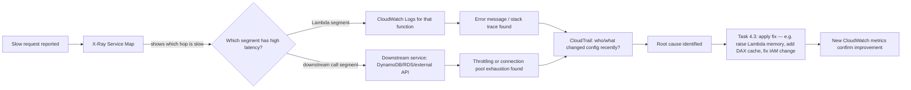
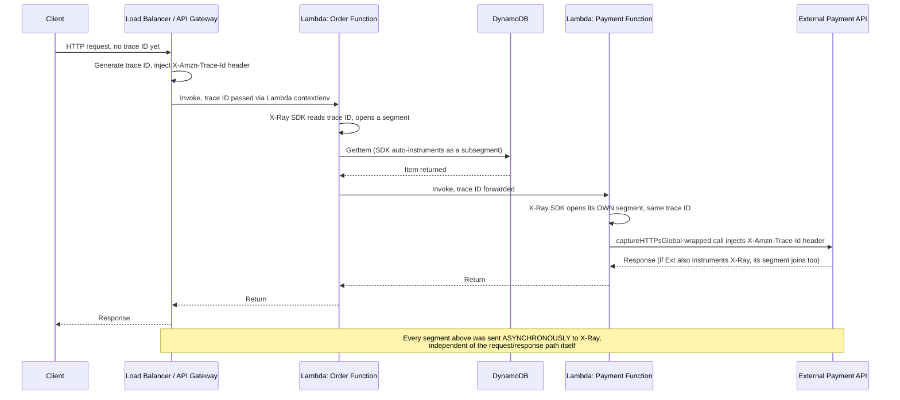
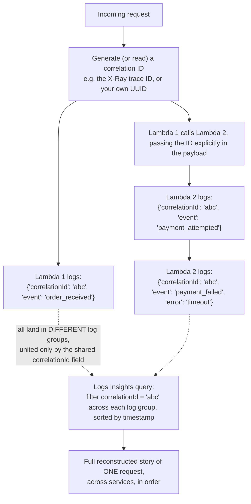
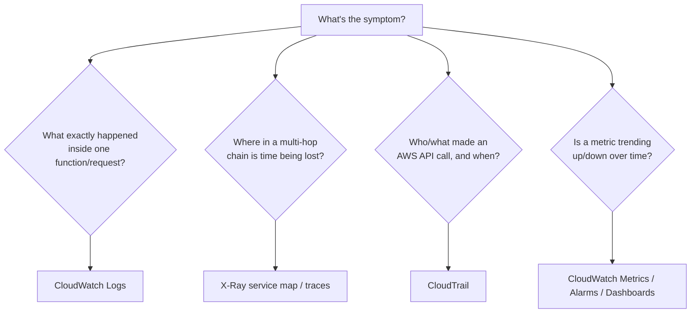
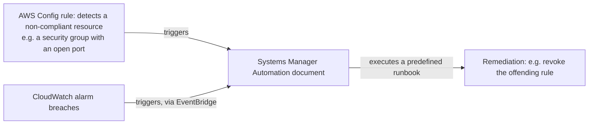
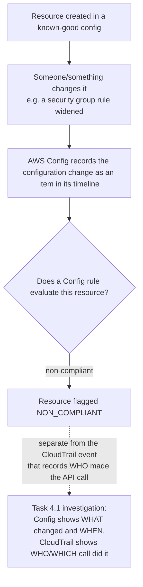

# Domain 4: Troubleshooting and Optimization (22%)


*Source: [AWS Documentation — Visualize Lambda function invocations using AWS X-Ray](https://docs.aws.amazon.com/lambda/latest/dg/services-xray.html). Even the simplest possible trace — one function, no downstream calls — produces two nodes: this is the minimum unit Task 4.1's "use X-Ray tracing" bullet is testing you on.*

Everything shipped in Domains 1-3 eventually breaks, runs slow, or costs too much. Domain 4 is the
"it's live and something's wrong" layer: finding out what happened, making sure you can find out
*next* time without digging, and tuning what you built so it doesn't need rescuing as often. If
Domains 1-3 are about building and shipping correctly, Domain 4 assumes you didn't catch
everything — because nobody does — and tests whether you know how to find out what you missed
quickly, and cheaply enough to do it routinely rather than only during a crisis.

## The domain in one analogy

Think of your application as a car and yourself as the mechanic who didn't build it. **CloudWatch**
is the dashboard — the gauges and warning lights telling you *something* is wrong right now (a
spiking metric, an alarm). **X-Ray** is popping the hood and following one specific fuel line
from tank to engine to see exactly where a leak is, hop by hop. **CloudTrail** is the service
log book — a timestamped record of every mechanic (human or automated) who's touched this car and
what they did, so you can check "did someone change something before this started." **CloudWatch
Logs Insights** is reading the engine's own diagnostic codes directly instead of guessing from the
dashboard alone. **AWS Config** is comparing the car's current state against its factory spec
sheet to see what's drifted. **Trusted Advisor** and the **Well-Architected Tool** are two
different kinds of inspection — one is a quick automated checklist a mechanic runs in five
minutes, the other is a thorough, structured annual inspection where you answer detailed questions
about how the car's actually been driven and maintained. Keep this mapping in your head: almost
every Domain 4 question is really asking "which gauge/tool would a mechanic reach for first,
given this specific symptom," and that's exactly the skill this entire domain tests.

## Task statements (verbatim from the exam guide)

**Task 4.1 — Assist in root cause analysis**
- Use CloudWatch Logs and Metrics to find what happened
- Use X-Ray tracing to find *where* in a distributed call chain it happened
- Use CloudTrail to find *who/what* made an API call that caused it
- AI-assisted error analysis (summarizing logs/traces into a likely cause)

**Task 4.2 — Instrument code for observability**
- Emit structured logs, custom metrics, and trace segments/subsegments from application code
- Ensure the right signals exist *before* an incident, not scrambled together during one

**Task 4.3 — Optimize applications on AWS**
- Lambda performance tuning (memory/CPU tradeoff, cold starts, concurrency)
- Cost/performance tradeoffs across compute and data store choices
- AI-assisted optimization recommendations

## Every task, mapped to a doc

| Task | What to read | Where |
|---|---|---|
| 4.1 — Logs and metrics | [`services/management-governance/cloudwatch.md`](../../../services/management-governance/cloudwatch.md) |
| 4.1 — Reading Logs Insights queries specifically, for debugging | Full topic page: query syntax, debugging a query that returns nothing, a complete "app is slow" worked investigation | [`cloudwatch-logs-insights-debugging.md`](cloudwatch-logs-insights-debugging.md) |
| 4.1 — X-Ray tracing to find *where* in a distributed call chain something broke | Full X-Ray service deep dive: segments/subsegments, service maps, sampling rules, annotations vs. metadata | [`services/developer-tools/x-ray.md`](../../../services/developer-tools/x-ray.md) |
| 4.1 — Who/what made an API call | [`services/management-governance/cloudtrail.md`](../../../services/management-governance/cloudtrail.md) |
| 4.1 — AI-assisted error analysis | Cross-link — see below |
| 4.2 — Instrumenting code (custom metrics, structured logs, trace segments) | [`services/management-governance/cloudwatch.md`](../../../services/management-governance/cloudwatch.md) (metrics/logs side); [`services/developer-tools/x-ray.md`](../../../services/developer-tools/x-ray.md) (the X-Ray SDK/daemon mechanics of emitting segments/subsegments/annotations from your own code) — see also the [`observability-instrumentation.md`](observability-instrumentation.md) topic page in this folder, which ties both together specifically for Task 4.2 |
| 4.2 — Automating remediation/runbooks once an issue is found | [`services/management-governance/systems-manager.md`](../../../services/management-governance/systems-manager.md) |
| 4.2 — Auditing config drift as a troubleshooting input | [`services/management-governance/aws-config.md`](../../../services/management-governance/aws-config.md) |
| 4.3 — Lambda performance tuning | [`services/compute/lambda.md`](../../../services/compute/lambda.md), and specifically cold-start diagnosis: [`lambda-cold-start-diagnosis.md`](lambda-cold-start-diagnosis.md) |
| 4.3 — Cost visibility to inform tradeoffs | [`services/management-governance/cost-management-tools.md`](../../../services/management-governance/cost-management-tools.md), and specifically the full anomaly-to-root-cause workflow: [`cost-anomaly-detection-workflow.md`](cost-anomaly-detection-workflow.md) |
| 4.3 — Architecture-level cost/performance guidance | [`services/management-governance/well-architected-tool.md`](../../../services/management-governance/well-architected-tool.md), [`services/management-governance/trusted-advisor.md`](../../../services/management-governance/trusted-advisor.md) |
| 4.3 — Data store choice tradeoffs feeding optimization | [`services/database/database-selection-guide.md`](../../../services/database/database-selection-guide.md) |
| 4.3 — Caching as a performance/cost lever | [`services/database/elasticache.md`](../../../services/database/elasticache.md) |
| 4.3 — AI-assisted optimization recommendations | Cross-link — see below |
| Supporting — the data store whose consistency choices show up again here as a performance lever | [`services/database/dynamodb.md`](../../../services/database/dynamodb.md) |
| Supporting — API Gateway as the typical first hop whose throttling/timeout often shows up as a troubleshooting symptom | [`services/networking-content-delivery/api-gateway.md`](../../../services/networking-content-delivery/api-gateway.md) |
| Supporting — the identity every CloudTrail event is ultimately attributing an action to | [`services/security-identity-compliance/iam.md`](../../../services/security-identity-compliance/iam.md) |

### AI-assisted development cross-link

Task 4.1's error analysis and Task 4.3's optimization recommendations are the third and fourth
places the AI-assisted development pattern shows up on this exam (after Domain 1's generation and
Domain 3's test-gen/approvals). Read the canonical explanation once:

➡️ **[`../domain-1-development/ai-assisted-development.md`](../domain-1-development/ai-assisted-development.md#how-it-works--the-pattern-across-the-sdlc)**
— see the "Domain 4" section of that doc's diagram for how an assistant reads CloudWatch/X-Ray
data and proposes a root cause or a tuning change, while a human still verifies before acting.

### Topic pages in this folder

This folder now has five topic pages beyond this README and `labs.md`, each going deeper into a
specific thin slice of Domain 4 than the service docs alone cover:

➡️ **[`observability-instrumentation.md`](observability-instrumentation.md)** — X-Ray tracing
concepts (segments, subsegments, service maps) plus how to instrument code for Task 4.2.

➡️ **[`cloudwatch-logs-insights-debugging.md`](cloudwatch-logs-insights-debugging.md)** — reading
and writing Logs Insights queries specifically as a debugging tool, including the single most
useful and least-documented skill: diagnosing *why a query returns nothing*.

➡️ **[`lambda-cold-start-diagnosis.md`](lambda-cold-start-diagnosis.md)** — proving a slow
invocation is actually a cold start (not a downstream dependency), and matching the mitigation
(SnapStart, package trimming, provisioned concurrency) to the actual cause.

➡️ **[`cost-anomaly-detection-workflow.md`](cost-anomaly-detection-workflow.md)** — the complete
loop from an anomaly alert to a quantified, attributed root cause, and why the "what" tool and the
"who" tool are always paired.

Read each service doc first for the underlying concepts, then the relevant topic page for how the
specific Domain 4 task statement applies those concepts in practice.

## How it fits together: tracing a slow request to its root cause



Step by step:
1. **A slow request gets reported** (a user complaint, an alarm, a dashboard spike) — this is the
   trigger for root cause analysis (Task 4.1).
2. **X-Ray's service map shows the full call chain** — client → API Gateway → Lambda → DynamoDB/RDS
   → any external call — with latency annotated per hop. This answers *where* the time is going,
   which raw logs alone can't show you across a distributed system.
3. **You drill into the specific segment with high latency.** If it's the Lambda segment itself,
   go to CloudWatch Logs for that function to find an error or slow code path. If it's a downstream
   segment, the problem is in the dependency, not your function's code.
4. **CloudWatch Logs surfaces the specific error** — a stack trace, a timeout message, a thrown
   exception — assuming Task 4.2 was done right and the function logs meaningfully (structured,
   with enough context) instead of nothing.
5. **If the downstream call is slow/throttled** (DynamoDB `ProvisionedThroughputExceededException`,
   an RDS connection pool maxed out), that's the real bottleneck — fixing the Lambda code wouldn't
   have helped.
6. **CloudTrail answers "did something change recently?"** — a permissions change, a capacity
   setting change, a deployment — correlating the incident's start time against the API call
   history to catch a human- or pipeline-caused regression.
7. **Once the root cause is identified, Task 4.3's optimization step applies the actual fix** —
   increase Lambda memory (which also increases CPU proportionally), add a DAX cache in front of
   DynamoDB, revert the bad IAM/config change, or re-architect the slow call out of the critical
   path.
8. **New CloudWatch metrics after the fix confirm the improvement** — closing the loop back to
   Task 4.2's "instrument so you can tell."

## Distributed tracing, explained in full: how one trace ID survives five service boundaries

The diagram above shows *where* X-Ray fits into an investigation; this section explains the
underlying mechanism in more depth, because "how does a single trace stay coherent across five
independently-scaling services" is the part of Task 4.1 that's easy to use without actually
understanding — and understanding it is what lets you debug a *broken* trace, not just read a
working one.



Three facts make this work, and each is a specific, separately testable idea:

1. **The trace ID is generated once, at the first hop, and carried as an HTTP header
   (`X-Amzn-Trace-Id`) from then on.** Nothing downstream generates a *new* ID for the same
   logical request — every participating service reads and re-forwards the same one.
2. **AWS-to-AWS propagation (load balancer → Lambda → DynamoDB) is automatic** once active
   tracing is enabled on each hop — you don't manually thread the header through. **Crossing to a
   non-AWS HTTP call** requires the X-Ray SDK's HTTP instrumentation (`captureHTTPsGlobal` in
   Node.js, `patch_all()` in Python) to inject the header — if that instrumentation isn't wired up,
   the trace simply stops at that hop, which is the single most common cause of "my trace has a
   gap."
3. **Segments are sent asynchronously, decoupled from the actual request/response flow.** The
   client gets its response at normal speed; X-Ray assembles the full trace from independently
   arriving segment reports afterward, which is why a trace sometimes takes a few seconds to
   fully populate in the console even after the request itself has already completed.

A trace with a visible gap between two services that *should* be connected is diagnosable from
this exact mechanism: either the downstream service never runs the X-Ray SDK at all, or it runs
it but the specific outbound call wasn't wrapped by the SDK's auto-instrumentation (a raw socket
call instead of the SDK-wrapped HTTP client, for example) — in either case, X-Ray can't
retroactively trace a hop that never reported data, no matter how the calling side is configured.

## Log correlation across a distributed system, explained with a diagram

Distributed tracing (X-Ray) answers "where did the time go." **Log correlation** is the sibling
skill — answering "show me everything every service said about this one request" — and it depends
on a completely different mechanism: a correlation ID deliberately propagated through every log
line, not an AWS-managed header.



Walking through why this is a genuinely separate mechanism from X-Ray's trace ID propagation,
even though the two are often (and ideally) the *same* ID:

1. **X-Ray's trace ID propagates automatically for AWS-to-AWS calls** — but it propagates as an
   HTTP/invocation header, not as a field inside your own structured log lines. Nothing writes it
   into your `logger.info(...)` call for you.
2. **You must deliberately include that same ID (or your own correlation ID) in every structured
   log line yourself** — this is Task 4.2's instrumentation discipline, not something AWS does on
   your behalf. A function that logs `{"message": "processed order"}` with no ID attached cannot
   be correlated with anything else later, no matter how good your tracing setup is.
3. **The payoff is a single Logs Insights query reconstructing one request's full story across
   every log group it touched** — see
   [`cloudwatch-logs-insights-debugging.md`](cloudwatch-logs-insights-debugging.md) for the exact
   query shape. This is only possible because every hop wrote the same ID into its own logs; it
   is not something CloudWatch infers for you after the fact.
4. **Using the X-Ray trace ID itself as your correlation ID (rather than inventing a separate
   one) is the recommended practice**, since it means a single ID lets you pivot between "the
   trace timeline" and "every structured log line for this request" without maintaining two
   separate identifiers — this is exactly what ServiceLens/the CloudWatch Trace Map does for you
   automatically, described further in the X-Ray service doc.

## The symptom-to-tool lookup, as one diagram

The single most repeated Domain 4 exam pattern is "given this symptom, which tool answers it":



Memorize this mapping cold — a large fraction of Domain 4 questions are solvable by correctly
routing the symptom to one of these four boxes, even before you reason about the AWS-specific
details of the scenario.

## Task 4.2 in one picture: instrumenting BEFORE the incident

```mermaid
flowchart LR
    CODE[Application code] --> LOG[Structured JSON logs\nwith request/correlation ID]
    CODE --> METRIC[Custom CloudWatch metrics\ne.g. OrdersProcessed, PaymentFailures]
    CODE --> TRACE[X-Ray SDK: wraps outbound\nSDK/HTTP calls as subsegments]
    LOG --> READY[All three exist BEFORE\nanything goes wrong]
    METRIC --> READY
    TRACE --> READY
    READY -.only now can Task 4.1's tools\nactually answer a real incident.-> INCIDENT[Incident happens]
```

This is why Task 4.2 is its own task statement, separate from 4.1: root cause analysis tools are
useless against a function that logs nothing structured, emits no custom metrics, and never
enabled X-Ray. A scenario where "the team couldn't figure out what happened" is almost always
really testing whether you'd have instrumented *before* that incident, not just which tool to
reach for after one.

## Full worked case study: diagnosing and fixing a slow checkout endpoint

**Symptom.** A checkout API's p99 latency jumped from 200ms to 4 seconds after a routine deploy
two days ago, and a subset of requests now return 500 errors. The team doesn't know if it's the
Lambda function, DynamoDB, or something else, and cost has also crept up without anyone changing
traffic volume.

**Investigation, following the Task 4.1 toolchain in order.**

```mermaid
sequenceDiagram
    participant Eng as Engineer
    participant XRay as X-Ray Service Map
    participant CW as CloudWatch Logs/Metrics
    participant CT as CloudTrail

    Eng->>XRay: Open the service map for the last 2 days
    XRay-->>Eng: The DynamoDB subsegment, not the Lambda segment, shows the latency spike
    Eng->>CW: Check DynamoDB-related CloudWatch metrics for the table
    CW-->>Eng: ConsumedReadCapacityUnits is pegged at the provisioned limit; ThrottledRequests > 0
    Eng->>CT: Check CloudTrail for changes around the deploy time
    CT-->>Eng: A CloudFormation stack update 2 days ago changed the table from on-demand to\nprovisioned capacity with a LOW read capacity setting, as an unintended side effect of an\nunrelated template edit
    Eng->>Eng: Root cause confirmed: under-provisioned read capacity introduced by an unreviewed IaC change
```

**Fix and why (Task 4.3):**
- **Immediate fix**: switch the table back to on-demand capacity mode, removing the need to
  predict capacity at all for this bursty checkout workload — directly addressing the throttling.
- **Why not "just raise the Lambda's memory" first**: the trace already showed the bottleneck was
  the *downstream DynamoDB call*, not the Lambda function's own compute — raising Lambda memory
  would have cost more without fixing anything, a classic trap of optimizing the wrong layer
  because it's the easiest knob to reach for.
- **Secondary fix — add a cache**: since checkout reads the same product-catalog items repeatedly
  within a short window, adding a DAX cache in front of the DynamoDB table further reduces read
  load and latency for the hottest keys, independent of the capacity-mode fix.
- **Process fix (closing the loop into Domain 3)**: the capacity-mode change rode into production
  as an unreviewed side effect of an unrelated IaC change — add a `cdk diff`/`cfn-lint` check that
  specifically flags capacity-mode changes on production tables, so the *next* unintended change
  like this is caught in Task 3.2's validation step rather than discovered via a live incident.
- **Instrumentation fix (closing the loop into Task 4.2)**: add a CloudWatch alarm on
  `ThrottledRequests` for this table going forward, so this exact failure mode pages someone within
  minutes instead of being diagnosed after two days of degraded customer experience.

This case study's shape — "trace first to find *where*, metrics to find *what*, CloudTrail to find
*why it changed*, then fix the right layer, then close the loop so it can't silently recur" — is
the master pattern for nearly every Domain 4 scenario question, regardless of which specific
services the question names.

## Second worked case study: "the app is slow" with full CloudWatch/X-Ray evidence, diagnosed step by step

A second, independent worked scenario — deliberately a different failure shape from the one above
— because recognizing the *pattern* of investigation matters more than memorizing one specific
answer.

**Symptom as reported to you.** "Our recommendation API is slow. Customers are seeing spinners for
3-5 seconds instead of the usual instant response. It started sometime this morning. Nobody
changed any code yesterday."

**Evidence you're given (exactly as it would appear on the exam):**
- A CloudWatch dashboard shows the Lambda function's `Duration` metric p50 steady at 45ms, but p99
  spiking to 4,800ms starting at roughly 08:00 this morning.
- The function's `REPORT` log lines for the slow invocations show `Init Duration: 3,912 ms`
  present on nearly every one of the slow requests.
- An X-Ray trace for one of the fast (p50) requests shows a single Lambda segment with no
  meaningful subsegment breakdown — this function makes no downstream calls at all.
- CloudTrail shows no configuration changes to this function or any related resource in the last
  7 days.

**Diagnosis, step by step:**

1. **Rule out a downstream dependency immediately.** The X-Ray trace for a typical request shows
   this function has no downstream calls to trace in the first place — there is no DynamoDB
   table, no external API, nothing for a trace to implicate. This immediately rules out "a slow
   downstream call" as the cause, which narrows the investigation to the function's own execution.
2. **Read the `REPORT` log line's `Init Duration` field — this is the decisive piece of
   evidence.** Its presence, and its size (3,912ms, nearly the entire 4,800ms Duration), is the
   definitive fingerprint of a cold start, not a code-performance regression. See
   [`lambda-cold-start-diagnosis.md`](lambda-cold-start-diagnosis.md) for exactly how this field
   is read and why it's conclusive.
3. **Rule out "nobody changed any code" as contradicting the cold-start theory — it doesn't.**
   Cold starts are not caused by a code change; they're caused by the *invocation pattern*
   changing (a traffic lull, then a burst, forcing new environments to spin up) or a redeploy
   that happened for an unrelated reason (even a configuration-only change triggers a new version,
   and therefore a cold fleet). CloudTrail showing "no configuration changes" to *this specific
   resource* doesn't rule out an upstream trigger — check whether a *different*, related resource
   (a Lambda layer version, an environment variable change, a concurrency setting) changed instead.
4. **Confirm the frequency and timing with a Logs Insights query** (see
   [`cloudwatch-logs-insights-debugging.md`](cloudwatch-logs-insights-debugging.md)) counting
   invocations with a present `Init Duration` per hour — this confirms whether cold starts have
   become a *large, sustained* fraction of traffic (a real, ongoing problem) starting at 08:00, or
   whether the dashboard's p99 spike is being driven by just a handful of outliers around a
   specific, narrow trigger event (e.g., exactly one scale-up burst).
5. **Identify the actual trigger.** Suppose the query confirms a sustained, elevated cold-start
   rate beginning exactly at 08:00 and continuing since. Checking the account's overall traffic
   pattern shows a marketing campaign started at 08:00, driving sustained higher concurrency than
   this function has seen before — meaning a larger number of brand-new execution environments
   are being provisioned continuously to keep up, each one paying the cold-start cost once.
6. **Fix, matched to the actual cause.** Since this is a *sustained* traffic-shape change (not a
   one-off burst), provisioned concurrency sized to the new baseline concurrency level is the
   correct, durable fix — scheduled ahead of the next campaign if it's a recurring event, or set
   as a standing baseline if the new, higher traffic level is now simply normal. Reaching for
   "increase memory" here would be the wrong fix: the evidence already shows the bottleneck is
   `Init Duration` (the cold path), not handler execution time, so more memory would speed up an
   already-small fraction of the total latency rather than address the actual cause.

**Why this scenario's shape matters.** Notice that *none* of the fixes considered here involved
guessing — every step either confirmed or ruled out a specific hypothesis using a specific,
named piece of evidence (an X-Ray trace, a `REPORT` log field, a Logs Insights count, a traffic
correlation). This evidence-driven elimination process, not a memorized answer, is exactly what
Domain 4 scenario questions are built to test, and it's the same shape as the checkout case study
above even though the specific symptom, tools emphasized, and fix are completely different.

## Third worked case study: API Gateway throttling masquerading as "the Lambda is broken"

A shorter third scenario, specifically because API Gateway sits in front of so many of this
domain's services and its own failure modes are easy to misattribute to the backend behind it.

**Symptom.** A partner integration reports intermittent `429` errors calling your public API,
but your own Lambda function's CloudWatch metrics show no errors, no throttling, and completely
normal `Duration` — the function appears to be running fine every time it's actually invoked.

**Diagnosis.** A `429` with a *healthy-looking backend* is the signature of a rejection that never
reached the Lambda function at all — API Gateway itself rejected the request before invoking
anything downstream. Checking API Gateway's own throttling layers (account-level, per-method, and
usage-plan — see [`services/networking-content-delivery/api-gateway.md`](../../../services/networking-content-delivery/api-gateway.md#throttling--layered-limits-most-restrictive-wins))
shows this specific partner's API key is on a usage plan with a tighter-than-expected rate limit,
and their traffic pattern is bursty enough to occasionally exceed it — while *other* partners on a
more generous plan never see this. **The fix** is adjusting that specific usage plan's burst/rate
limit (or moving the partner to a different plan), not touching the Lambda function at all, which
was never the bottleneck.

**The transferable lesson:** when a client-visible error doesn't correlate with any backend
metric showing distress, the rejection is happening *in front of* the backend — API Gateway
throttling, a WAF rule, or an authorizer denial are all candidates worth checking before assuming
the compute layer is lying about its own health.

## Use Cases — Real Scenarios

Concrete developer/SRE situations where Task 4.1/4.2/4.3 decisions actually get made, with app
type / requirement / implementation decision spelled out:

1. **App type:** Multi-hop order-fulfillment API (API Gateway → Lambda → DynamoDB → external
   shipping-rate API). **Requirement:** a customer reports slow checkout, and the team needs to
   know which of the four hops is actually responsible before touching any code.
   **Decision:** open the X-Ray service map first — it shows per-hop latency across the whole
   chain, which raw CloudWatch Logs from a single function can't show without manual timestamp
   correlation across four separate log groups.
2. **App type:** Internal analytics dashboard Lambda function. **Requirement:** a security
   reviewer needs to know exactly which IAM principal deleted a specific DynamoDB table at 2am,
   three weeks after the fact. **Decision:** CloudTrail event history lookup, not CloudWatch
   Logs — CloudTrail is the durable record of *which API call* happened and *who* made it;
   CloudWatch Logs only shows what the *application* printed, not AWS management-plane actions.
3. **App type:** Payment-processing Lambda function reported as "slow" under load.
   **Requirement:** confirm whether the function is CPU-bound or I/O-bound before deciding whether
   to raise memory or investigate a downstream dependency. **Decision:** check CloudWatch's `Max
   Memory Used` and Duration together — high memory utilization plus high duration points at
   CPU/memory constraint (raise memory); low memory utilization with high duration points at an
   external wait (trace it with X-Ray instead of touching memory).
4. **App type:** B2B API platform with a composite service made of six Lambda functions.
   **Requirement:** give an on-call engineer one chart showing overall error rate and latency
   trend across the whole service, not six separate default dashboards.
   **Decision:** a single CloudWatch dashboard built from a custom metric math expression
   aggregating all six functions' metrics, rather than asking the on-call engineer to mentally
   combine six separate views during an incident.
5. **App type:** Read-heavy product catalog API. **Requirement:** reduce DynamoDB read-capacity
   cost from repeated reads of the same few hundred hot items, without changing the application's
   query logic. **Decision:** add a DAX caching layer in front of DynamoDB — a drop-in client swap
   rather than an application-logic rewrite, specifically because the access pattern is repeated
   reads of the same known keys.
6. **App type:** Checkout service that just had a routine infrastructure deploy (see the full case
   study above). **Requirement:** figure out why latency spiked right after a deploy where nobody
   touched the application code. **Decision:** check CloudTrail for infrastructure-level changes
   (capacity mode, IAM, config) that rode along with the deployment as an unreviewed side effect —
   the regression isn't always in the code diff itself.
7. **App type:** Early-stage startup's first production incident. **Requirement:** an AI tool
   summarizes CloudWatch Logs into a plausible root cause during an outage, and the team must
   decide how much to trust it before applying a fix. **Decision:** treat the summary as a fast
   hypothesis to verify against the raw X-Ray trace/metrics, not as a confirmed diagnosis — ship
   the fix only after confirming the actual data supports it.
8. **App type:** Cost review ahead of a board meeting. **Requirement:** figure out whether a
   Lambda function is paying for memory it doesn't actually use, without guessing from the
   configured memory value alone. **Decision:** right-size memory down based on the function's
   actual reported `Max Memory Used`, then re-verify Duration doesn't regress badly enough to
   offset the savings — compute cost as memory × duration, not from the memory number alone.
9. **App type:** Compliance-driven infrastructure team. **Requirement:** determine whether a
   security group was ever in a compliant state and exactly when it drifted, separate from which
   specific API call caused the drift. **Decision:** use AWS Config's configuration timeline to
   answer "when did this resource's state change," paired with CloudTrail to answer "which API
   call did it" — using both tools together rather than expecting either alone to answer both
   questions.
10. **App type:** Platform team doing a pre-launch architecture review for a new payments system.
    **Requirement:** a holistic check of whether the whole system's design follows AWS best
    practices, not just whether any one resource is individually misconfigured.
    **Decision:** run a structured AWS Well-Architected Tool review across the relevant pillars,
    rather than relying only on Trusted Advisor's automated per-resource checks, which answer a
    narrower question.
11. **App type:** Shared, multi-team AWS account running dozens of services. **Requirement:** a
    weekend cost spike needs attribution to a specific team before Monday's finance review.
    **Decision:** follow the Cost Anomaly Detection → Cost Explorer → CloudTrail → cost allocation
    tag workflow in order — the anomaly alert alone never names a responsible team, and skipping
    straight to "ask every team if they launched something" wastes the time the automated tooling
    is specifically built to save.
12. **App type:** Public-facing partner API with per-partner usage plans. **Requirement:** one
    partner reports intermittent failures while every backend metric looks completely healthy.
    **Decision:** check API Gateway's own throttling layers before touching the Lambda function —
    a healthy backend with client-visible errors points at a rejection happening in front of the
    backend, not inside it.

## Common exam scenarios

- *"A Lambda function's errors aren't showing enough context to debug"* → the function isn't
  logging with structured, sufficiently detailed output — this is an instrumentation gap (Task
  4.2), fix before the next incident, not during it.
- *"Need to see which specific microservice in a chain of 5 calls is adding latency"* → X-Ray
  service map / trace segments, not just CloudWatch Logs (logs alone don't show cross-service
  timing without manual correlation).
- *"Some requests don't show up in X-Ray even though tracing is enabled and nothing looks broken"*
  → expected sampling behavior (X-Ray's default rule traces the first request each second plus 5%
  of the rest, per service), not a misconfiguration — see
  [`services/developer-tools/x-ray.md`](../../../services/developer-tools/x-ray.md#sampling--why-x-ray-doesnt-trace-every-single-request)
  unless a custom sampling rule was clearly set up wrong.
- *"Need to filter/search traces by a customer ID or feature-flag value, versus just viewing extra
  debug context on a trace you've already found"* → the former is an X-Ray annotation (indexed,
  searchable); the latter is metadata (not indexed, view-only) — a frequently tested distinction in
  the X-Ray service doc's own exam tips.
- *"Need to know exactly which IAM principal deleted a resource at 2am"* → CloudTrail event
  history, not CloudWatch Logs (CloudTrail is the audit trail of *API calls*, CloudWatch is
  *application/runtime* telemetry).
- *"A Lambda function times out intermittently under load, and profiling shows it's CPU-bound, not
  idle-waiting"* → increase memory (which scales CPU proportionally in Lambda), not just the
  timeout value.
- *"A slow invocation shows a large `Init Duration` field in its REPORT log line"* → this is the
  definitive fingerprint of a cold start, not a code-performance regression — see
  [`lambda-cold-start-diagnosis.md`](lambda-cold-start-diagnosis.md) for the full diagnosis-to-fix
  flow and why "add more memory" is usually the wrong first move here.
- *"Need a single chart to understand overall error rate and latency trend over the last 24 hours
  for a service made of 6 different Lambda functions"* → a CloudWatch dashboard with a custom
  metric math expression, not six separate default dashboards.
- *"Cost grew significantly after a traffic increase and the team needs to know if a cheaper
  architecture meets the same requirements"* → the cost/performance tradeoff is Task 4.3 — check
  Trusted Advisor/Cost Explorer and the Well-Architected Tool's cost pillar review, don't guess.
- *"Cost grew steadily over several weeks but never crossed any single day's Budget threshold"* →
  Cost Anomaly Detection's learned-baseline model, not a static Budget — see
  [`cost-anomaly-detection-workflow.md`](cost-anomaly-detection-workflow.md) for why a fixed
  threshold structurally can't catch a gradual, sustained deviation.
- *"An AI tool suggests a specific root cause for a production incident from the logs it was given"*
  → treat it as a hypothesis to verify against the actual CloudWatch/X-Ray data, not a confirmed
  diagnosis — see [`../domain-1-development/ai-assisted-development.md`](../domain-1-development/ai-assisted-development.md#when-not-to-use-it--limits).
- *"DynamoDB reads are being throttled under load"* → check if it's a hot partition key (access
  pattern issue, fix the key design) vs. simply under-provisioned capacity (fix: on-demand mode or
  raise provisioned capacity) — these have different fixes despite the same symptom.
- *"Latency spiked right after a deployment and nobody changed the application code"* → check
  CloudTrail for infrastructure-level changes (capacity mode, IAM, config) that rode along with
  the deployment, per the case study above — the regression isn't always in the code diff.
- *"A function shows high Duration in CloudWatch but low actual CPU/memory utilization"* → the
  function is likely I/O-bound, waiting on a slow downstream call — trace it with X-Ray to find
  which downstream hop is actually slow, rather than tuning the function's own memory.
- *"Client-visible 429/403 errors with a completely healthy-looking backend"* → the rejection is
  happening in front of the backend — check API Gateway throttling layers, a WAF rule, or an
  authorizer denial before assuming the compute layer is broken.
- *"Alarms exist but nobody noticed the incident for two days"* → the alarm wasn't wired to a
  notification action (SNS topic → on-call), or the alarm didn't exist for the specific failure
  mode at all — distinguishing "we had no visibility" from "we had visibility but no alerting."
- *"A cost review shows a Lambda function paying for far more memory than it uses"* → right-size
  memory down using CloudWatch's reported `Max Memory Used` per invocation, but re-verify Duration
  doesn't regress — memory also drives CPU, so going too low can increase Duration enough to raise
  total cost despite the lower per-GB-second rate.
- *"A read-heavy DynamoDB table serving the same few hot items repeatedly shows high read-capacity
  cost"* → DAX caching layer, reducing repeated reads of the same keys without changing application
  logic beyond swapping the client.
- *"Config drift is suspected as a contributing factor in an incident, separate from a deployment
  event"* → AWS Config shows configuration history/compliance drift over time, distinct from both
  CloudTrail (discrete API call events) and CloudWatch (application telemetry).
- *"The team wants an architecture-level, not just a resource-level, review of cost and performance
  tradeoffs before scaling up"* → the Well-Architected Tool's cost optimization and performance
  efficiency pillar reviews, not just reading individual CloudWatch metrics.

## Domain 4 study checklist

- [ ] Given a symptom description, route it to the correct tool (CloudWatch Logs, X-Ray,
      CloudTrail, or CloudWatch Metrics) without hesitation.
- [ ] Explain why instrumentation (Task 4.2) has to happen before an incident, not during one.
- [ ] Explain the Lambda memory/CPU/cost tradeoff and compute total cost as memory × duration,
      not just eyeball the memory number.
- [ ] Diagnose a DynamoDB throttling symptom as either a hot-key problem or a capacity problem, and
      know the different fix for each.
- [ ] Prove a slow Lambda invocation is actually a cold start using the `Init Duration` field,
      rather than assuming it — and match the mitigation (SnapStart, package trimming, provisioned
      concurrency) to the actual cause.
- [ ] Read a Logs Insights query pipeline stage by stage, and diagnose why one returns zero rows.
- [ ] Walk through the full cost-anomaly workflow from alert to attributed root cause, and explain
      why the detection tool alone never answers "who."
- [ ] Describe where AI-assisted error analysis and optimization recommendations fit, and what a
      human still verifies before acting on either.
- [ ] Walk through the case study's investigation order (trace → metrics → CloudTrail → fix →
      re-instrument) from memory.

## Lambda cost/performance math, concretely

Task 4.3's most commonly mis-answered question type is "should we raise or lower memory" — because
it's not a monotonic relationship with cost, even though compute capability (CPU, network
bandwidth) scales linearly with memory up to the maximum.

```
Cost per invocation ≈ (Memory in GB) × (Billed Duration in seconds) × (price per GB-second)
```

| Memory | Duration (CPU-bound workload) | Cost basis (relative) | Total relative cost |
|---|---|---|---|
| 128 MB | 4.0s (CPU-starved) | 0.125 GB × 4.0s | 0.50 |
| 512 MB | 1.1s | 0.5 GB × 1.1s | 0.55 |
| 1024 MB | 0.55s | 1.0 GB × 0.55s | 0.55 |
| 1769 MB (1 full vCPU) | 0.32s | 1.73 GB × 0.32s | 0.55 |
| 3008 MB | 0.30s (diminishing returns — already not CPU-bound) | 2.94 GB × 0.30s | 0.88 |

The exam-relevant lesson: for a genuinely CPU-bound function, raising memory from a low starting
point often **reduces** total cost because duration drops faster than the per-GB-second rate rises
— but only up to the point where the workload stops being CPU-bound (one full vCPU around
~1,769 MB in this illustrative table), after which more memory just adds cost without a
corresponding duration improvement. Never answer a "should we raise memory" question from the
memory number alone — always reason through (or ask for) the Duration change it would cause.

```bash
# The concrete CloudWatch metric that tells you whether raising memory would even help:
# "Max Memory Used" close to the configured memory limit → raising memory may reduce GC/throttling-driven delay
# "Max Memory Used" far below the limit → the function is NOT memory-constrained; look elsewhere (I/O wait, cold starts)
```

This same math is the reason "is this actually a cold start or a memory constraint" has to be
answered *before* reaching for a memory change — see
[`lambda-cold-start-diagnosis.md`](lambda-cold-start-diagnosis.md)'s diagnosis flow for how the
`Init Duration` field separates the two.

## CloudWatch Logs Insights, as a root-cause tool

Task 4.1 expects you to recognize what a Logs Insights query is *for*, not to write one from
scratch under exam pressure. This is covered here at a summary level; the full topic page —
[`cloudwatch-logs-insights-debugging.md`](cloudwatch-logs-insights-debugging.md) — walks through
the query pipeline stage by stage, a complete "app is slow" worked investigation using real query
output, and (the part most references skip) how to diagnose a query that mysteriously returns
zero rows.

```sql
-- "How often is this function actually failing, and what are the top error messages?"
fields @timestamp, @message
| filter @message like /ERROR/
| stats count() as errorCount by bin(5m)
```

```sql
-- "Correlate every log line for ONE specific failing request across its full execution"
fields @timestamp, @message
| filter @requestId = "abc-123-def-456"
| sort @timestamp asc
```

The second query pattern — filtering by a correlation/request ID across potentially many log
groups — only works if Task 4.2's instrumentation discipline (propagate a correlation ID through
every log line) was actually followed. This is the concrete, queryable payoff of "instrument before
the incident," not an abstract principle — see the log-correlation diagram above for exactly why
this mechanism is separate from X-Ray's own trace ID propagation.

## Automated remediation: Systems Manager Automation and Config rules

Task 4.2's "automating remediation/runbooks" bullet is about *not* manually SSHing in or
clicking through the console once an issue is diagnosed repeatedly:



A scenario describing "whenever this specific condition recurs, apply the same fix automatically,
without a human running a script by hand" is pointing at an SSM Automation runbook triggered either
by an AWS Config rule (configuration-compliance-driven) or a CloudWatch alarm via EventBridge
(metric-threshold-driven) — the trigger differs by scenario, the remediation mechanism is the same.

## Cost/performance tooling, compared

Task 4.3 names several AWS tools that overlap in purpose but differ in scope — the exam tests
picking the right one for a given question's framing:

| Tool | Scope | Best for |
|---|---|---|
| **CloudWatch Metrics/Dashboards** | Real-time, resource-level telemetry | "Is this specific metric trending badly right now" |
| **Cost Explorer** | Historical billing data, filterable/groupable | "Where did the money actually go last month, broken down by service/tag" |
| **Cost Anomaly Detection** | ML-learned spend-pattern deviation, not a fixed threshold | "Did something change that doesn't look like us, even within budget" — full workflow: [`cost-anomaly-detection-workflow.md`](cost-anomaly-detection-workflow.md) |
| **Trusted Advisor** | Automated checks against AWS best practices (cost, performance, security, fault tolerance, service limits) | "Flag idle/underutilized resources and common misconfigurations automatically" |
| **AWS Well-Architected Tool** | Structured, pillar-based architecture review (you answer questions, it surfaces risks) | "A holistic review of whether this workload's *architecture*, not just one resource, follows best practices" |

A scenario describing "want an automated, ongoing check for idle EC2 instances and
over-provisioned EBS volumes" is Trusted Advisor. A scenario describing "want a structured review
of whether our whole payments system's architecture follows AWS best practices before a big
launch" is the Well-Architected Tool — a qualitatively different, broader exercise than checking
individual resource-level recommendations. A scenario describing "spend grew in a way that
doesn't match our usual pattern, but never crossed our monthly cap" is Cost Anomaly Detection,
distinct from both.

## Reading a real Cost Explorer screen, discussed


*Source: [AWS Documentation — Amazon CloudWatch User Guide (Cost Explorer integration)](https://docs.aws.amazon.com/AmazonCloudWatch/latest/monitoring/images/ce.png). This is the exact view you land in during Step 2 of the cost-anomaly workflow above: having been told "EC2 spend was anomalous this weekend," this is where you confirm precisely which usage type drove it and quantify the dollar impact — the difference between a vague alert and an attributable, defensible number for a post-mortem.*

Notice what this view *can't* tell you on its own: a usage-type breakdown by dollar amount says
nothing about *who* launched the resource responsible. That's the exact gap CloudTrail closes in
the next step of the same workflow — a repeating structural pattern across this entire domain
(a detection/quantification tool paired with CloudTrail for attribution), not a coincidence
specific to cost.

## AWS Config: drift as a Task 4.1 investigative input



Config and CloudTrail answer related but distinct questions, and exam questions sometimes test the
pairing directly: **CloudTrail** is the log of discrete API calls (an event-level record — "at
14:02:03, user X called `AuthorizeSecurityGroupIngress`"). **AWS Config** is a timeline of a
*resource's configuration state* over time plus ongoing compliance evaluation against rules you
define ("this security group's current state doesn't comply with the 'no open SSH to 0.0.0.0/0'
rule"). A question asking "how do we know this security group was ever compliant and when it
stopped being" wants Config's configuration timeline; a question asking "which specific API call
changed it" wants CloudTrail — often you use both together during one investigation, as the
diagram shows.

## Labs

See [`labs.md`](labs.md) for hands-on Floci exercises covering this domain.
