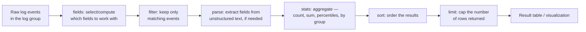
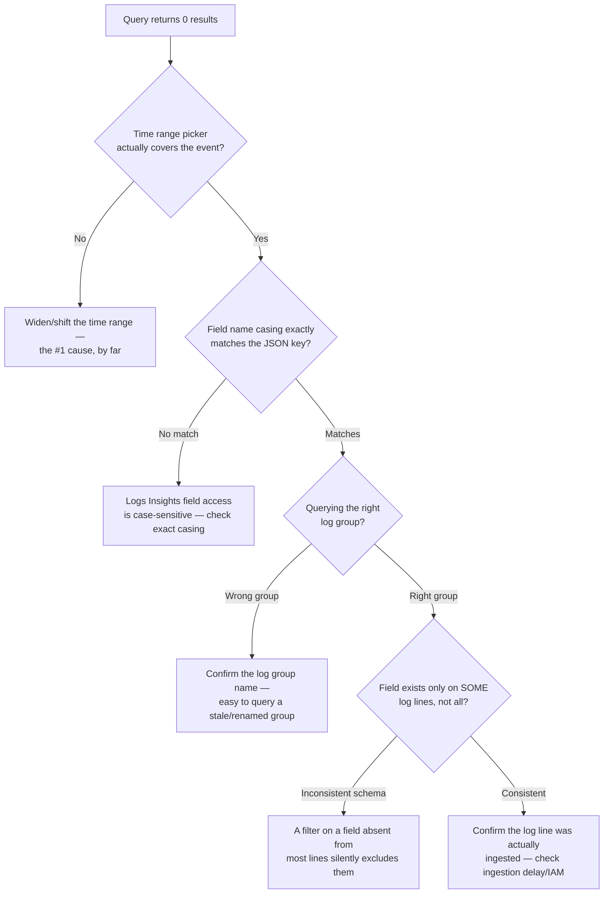
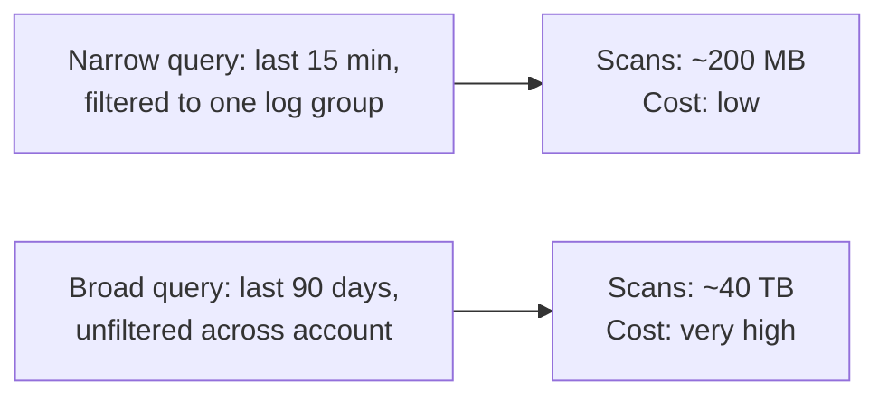

# Reading CloudWatch Logs Insights Queries for Debugging (Task 4.1)


*Source: [AWS Documentation — Amazon CloudWatch User Guide](https://docs.aws.amazon.com/AmazonCloudWatch/latest/monitoring/). This is the dashboard you land on before you ever open Logs Insights — it tells you *something* is wrong (an alarm is red), but not *why*. Logs Insights is the tool you reach for next, to turn that "something's wrong" into "here's the specific request/error responsible."*

## Analogy

Think of CloudWatch Metrics as your car's dashboard warning light — "check engine" tells you
*something* is off, with no detail. CloudWatch Logs Insights is popping the hood and reading the
diagnostic codes directly: it doesn't predict a problem, it lets you ask the engine (your
application's own log output) a specific question and get a specific, evidence-backed answer.
The warning light (an alarm) tells you to look; Logs Insights is how you actually look.

## Why This Topic Exists As Its Own Doc

The domain README covers Logs Insights in a few paragraphs as one stop on the symptom-to-tool
map. That's enough to know *when* to reach for it. It is not enough to actually read, write, and
— critically — debug a real query under exam or incident pressure, which is what Task 4.1 ("assist
in root cause analysis") is actually testing. This doc is the deep dive: query syntax piece by
piece, the specific query shapes that solve specific debugging problems, and — because this is
the single most common real gap — how to read a query that *returns nothing* and figure out why.

## Purpose

CloudWatch Metrics answer "is a number trending badly." CloudWatch Logs Insights answers "what,
specifically, happened" — by letting you run a purpose-built query language directly against raw
log data, on demand, without pre-defining anything in advance. The core idea that makes this
different from grep: Logs Insights is schema-flexible (it reads structured JSON fields
automatically by name, and can parse unstructured text on demand) and runs server-side across
potentially many log groups and terabytes of data in seconds, instead of you downloading log
files and `grep`-ing them locally.

## When to Use It

- You have a *specific* question about what happened ("how many times did this error occur in
  the last hour," "what were the slowest 20 requests yesterday," "show me every log line for this
  one failing request") and need the answer from real log data, not a guess.
- The question is retrospective/ad hoc — you don't know in advance that you'll need this exact
  query, so pre-building a metric filter for it would be premature.
- You need to correlate a specific identifier (request ID, customer ID, order ID) across
  potentially many log streams or even multiple log groups.
- You're doing root cause analysis during or after an incident and need to go from "errors
  spiked" to "here is the exact failure mode and how often it's occurring."

## When NOT to Use It

- **You need proactive, real-time alerting** — Logs Insights is query-on-demand; it does not
  watch logs continuously and notify you. For "alert me the moment this error pattern appears
  more than N times," you need a **metric filter + alarm** (see the main
  [`observability-instrumentation.md`](observability-instrumentation.md) and
  [`services/management-governance/cloudwatch.md`](../../../services/management-governance/cloudwatch.md)
  docs) — a metric filter turns the log pattern into a first-class metric an alarm can watch
  continuously; Logs Insights only answers the question the moment you ask it.
- **You need to visualize a value over time on a persistent dashboard** — a metric (custom or via
  a metric filter) belongs on a CloudWatch dashboard; re-running an Insights query manually every
  time you want to glance at a trend is the wrong tool for that job, even though Insights *can*
  produce time-bucketed results (`stats ... by bin(5m)`) for a one-off investigation.
- **The data isn't in CloudWatch Logs at all** — X-Ray trace data, CloudTrail API-call history,
  and Config compliance state are different data sources entirely; Logs Insights only queries log
  groups.
- **You're querying the same broad time range across a huge log group over and over** — Logs
  Insights bills per GB *scanned*, not per result; a repeated, unscoped query against a massive
  log group is an expensive way to answer a question you could cache the answer to once.

## Use Cases

1. **Quantifying an error before chasing its cause.** An on-call engineer is paged for "elevated
   errors" with no further detail. Before touching any code, they run a query counting error
   occurrences by message over the last hour — turning a vague page into "47 occurrences of
   `payment timeout`, 3 occurrences of `invalid card`, nothing else" in seconds.
2. **Reconstructing one failing request's full story.** A customer reports order `o-4471` failed.
   Filtering by that specific order/request ID across every log line (sorted by timestamp)
   reconstructs exactly what the application did, in order, for that one request — only possible
   if a correlation ID was propagated through every log line in the first place (Task 4.2's
   payoff).
3. **Finding a latency regression's shape, not just its existence.** A p99 latency metric alarm
   fired. A Logs Insights query computing `pct(latencyMs, 50)`, `pct(latencyMs, 90)`, and
   `pct(latencyMs, 99)` in 5-minute buckets shows *when* the regression started and whether it's
   a sustained shift or a few extreme outliers — a materially different root cause in each case.
4. **Parsing an unstructured legacy log format for a field that was never JSON.** An older service
   logs Apache-style access lines, not structured JSON. The `parse` command extracts fields
   (status code, path, method) from the raw text pattern, making it queryable exactly like a
   structured log, without changing the application.
5. **Cross-referencing a Trusted Advisor "idle" finding against real usage before deleting
   anything.** Before terminating an EC2 instance flagged as low-utilization, querying its logs
   for invocation frequency over a longer window can reveal a legitimate once-a-month batch job
   that would otherwise look idle on any given day.
6. **Auditing risky commands run during a Session Manager session.** If Systems Manager session
   logging streams to CloudWatch Logs, a query filtering for `sudo` or destructive command
   patterns in a specific instance's session log gives a concrete post-incident audit trail.

## Why It's Important

Task 4.1 explicitly tests whether you recognize *what a Logs Insights query is for*, and real
incident response constantly rewards (or punishes) how fast someone can go from "something is
wrong" to "here is the specific, quantified evidence of what and how often." A team that can only
grep raw files loses minutes-to-hours per incident that a team fluent in Logs Insights spends in
seconds. It is also one of the most reliably tested symptom-to-tool mappings on DVA-C03 Domain 4.

## How It Works: The Query Pipeline, Explained Piece by Piece

A Logs Insights query is a **pipeline** — each stage (separated by `|`) receives the output of the
stage before it, exactly like a Unix shell pipeline. Understanding this mental model is what lets
you read (and write) an unfamiliar query without memorizing every command's syntax up front.



Walking through each stage:
1. **`fields`** — picks which fields appear in the output (or computes a new one), e.g.
   `fields @timestamp, @message`. For JSON-structured logs, any top-level JSON key is
   automatically available by name (`fields orderId, latencyMs`) with no `parse` step needed.
2. **`filter`** — keeps only log events matching a condition, e.g. `filter level = "ERROR"` or
   `filter @message like /timeout/`. This is the single most important stage for controlling cost
   (how much data gets scanned) *and* for scoping the question correctly.
3. **`parse`** — extracts fields from unstructured text using a pattern with `*` wildcards, e.g.
   `parse @message '* * * [*] "* * *" * *' as host, ident, user, ts, method, path, protocol,
   status, bytes` for an Apache-style access log line. Only needed when the log isn't already
   JSON with the fields you want.
4. **`stats`** — aggregates: `count()`, `sum()`, `avg()`, `min()`, `max()`, and percentiles via
   `pct(field, N)`, optionally grouped `by` a field or a time bucket (`bin(5m)`).
5. **`sort`** — orders the result set, e.g. `sort @timestamp desc` or `sort errorCount desc`.
6. **`limit`** — caps how many rows come back, e.g. `limit 20`.

The exam-relevant mental model: this is a **pipeline of successive transformations**, not a
single monolithic query — you read it top to bottom exactly like a shell pipe, and each stage can
only see what the previous stage passed through.

## Worked Debugging Scenario: "The App Is Slow — Diagnose It With the Evidence"

This is the canonical Domain 4 exam pattern — a symptom is described, evidence from CloudWatch is
given, and you're expected to diagnose the actual root cause step by step rather than guessing.

**Symptom as reported:** "Customers are complaining the checkout API is slow, starting about 40
minutes ago. The team doesn't yet know if it's one specific endpoint, one specific customer, or
broad."

**Step 1 — quantify it, don't trust the anecdote.**

```
fields @timestamp, latencyMs, path
| stats pct(latencyMs, 50) as p50, pct(latencyMs, 90) as p90, pct(latencyMs, 99) as p99 by bin(5m)
| sort @timestamp desc
```

*Evidence returned:* p50 is flat at 80ms for the whole window, but p99 jumped from 300ms to
4,200ms starting exactly 40 minutes ago and has stayed there. **Diagnosis so far:** this is not a
broad slowdown (the median is fine) — it's a tail-latency regression affecting a *subset* of
requests. Don't conclude "everything is slow" from a customer complaint; the data says otherwise.

**Step 2 — narrow by endpoint to find which requests are actually slow.**

```
fields @timestamp, latencyMs, path
| filter latencyMs > 2000
| stats count() as slowCount by path
| sort slowCount desc
```

*Evidence returned:* `/checkout/apply-discount` accounts for 94% of the slow requests; every
other path is negligible. **Diagnosis so far:** the regression is isolated to one specific
endpoint, not the checkout flow broadly — ruling out a generic infrastructure problem (which
would hit every endpoint roughly equally) and pointing at something specific to discount-code
processing.

**Step 3 — find out what's actually happening inside that one endpoint's slow requests.**

```
fields @timestamp, @message, requestId, latencyMs
| filter path = "/checkout/apply-discount" and latencyMs > 2000
| sort @timestamp desc
| limit 20
```

*Evidence returned:* every slow request's log line includes
`"externalCallMs": 3900, "ownCodeMs": 45` — the function's own code is fast; almost all the time
is an outbound call. **Diagnosis so far:** this is I/O-bound, not CPU-bound — raising the
function's memory (a common but wrong first instinct for "slow") would do nothing, because the
bottleneck isn't compute.

**Step 4 — confirm with X-Ray which specific downstream call it is (crossing tools, as a real
investigation does).** Opening the X-Ray trace for one of the slow `requestId` values from Step 3
shows the time concentrated in a subsegment calling a third-party discount-validation API, not in
a DynamoDB call — see
[`services/developer-tools/x-ray.md`](../../../services/developer-tools/x-ray.md) for how that
subsegment timeline is read.

**Step 5 — correlate the start time against CloudTrail/Config for a config change (closing the
loop per the main README's case study pattern).** A check against CloudTrail around the 40-minute
mark shows no AWS-side config change — ruling out "we deployed something" and pointing instead at
the third-party API itself degrading, which is outside this team's direct control. The actual fix
becomes adding a tighter timeout plus a circuit breaker around that specific external call, not
touching the Lambda's memory or the discount-code logic itself.

**The shape of this investigation** — quantify, narrow by dimension, read the actual log content
of the narrowed set, cross-reference with a second tool, check for a correlated config change — is
the general Task 4.1 pattern, and Logs Insights is the tool doing the first three of those five
steps.

## More Worked Query Patterns, By Debugging Goal

**Goal: "How often is X actually happening, trending over time?"**

```
filter @message like /ThrottlingException/
| stats count() as throttleCount by bin(10m)
| sort @timestamp desc
```

**Goal: "Which specific values of a field are responsible for most of the errors?"**

```
fields @timestamp, errorCode, customerId
| filter level = "ERROR"
| stats count() as errorCount by errorCode
| sort errorCount desc
| limit 10
```

**Goal: "Reconstruct one request's full story across possibly many log streams."**

```
fields @timestamp, @logStream, @message
| filter requestId = "req-8842-aa21"
| sort @timestamp asc
```

Note `@logStream` here — including it is what lets you confirm whether this request's logs are
scattered across multiple instances/containers (common for a retried or load-balanced request)
rather than assuming they all live in one place.

**Goal: "Is a specific customer disproportionately affected?"**

```
fields customerId
| filter level = "ERROR"
| stats count() as errors by customerId
| sort errors desc
| limit 15
```

**Goal: "Parse an unstructured field out of free text, because the log was never JSON."**

```
fields @timestamp, @message
| parse @message "user=* action=* duration=*ms" as user, action, durationMs
| filter action = "checkout"
| stats avg(durationMs) as avgDuration by user
```

## Debugging the Query Itself: "Why Does This Return Nothing?"

This is the single most useful skill this doc can teach, and it's the part a quick glance at
syntax reference never covers: a query that returns **zero rows** when you expected results is
usually not a bug in Logs Insights — it's one of a handful of specific, diagnosable causes.



Walking through each branch, because recognizing *which one* applies is the actual debugging
skill:

1. **Time range is wrong — by far the most common cause.** The console's time range picker
   defaults to a window that may not cover when the event you're hunting actually happened,
   especially after switching from investigating a different, earlier incident. Always
   deliberately re-confirm the time range before concluding a query is broken.
2. **Case sensitivity on field names.** `filter Level = "ERROR"` will not match a JSON key named
   `level` (lowercase) — Logs Insights field access is case-sensitive, and this is an extremely
   easy typo to make when switching between services with slightly different logging
   conventions.
3. **Wrong log group.** Especially after a Lambda function is renamed or redeployed under a new
   name, or when investigating across multiple similarly-named services, confirm you're pointed
   at the log group that's actually receiving the traffic in question.
4. **Inconsistent log schema.** If only some log lines include a given field (e.g., only error
   lines have an `errorCode` key, but you're filtering on it against *all* lines including
   successful ones), a filter referencing that field implicitly excludes every line where it's
   absent — this can silently produce a much smaller result set than expected, not zero, which is
   an even sneakier version of the same problem.
5. **The data genuinely isn't there yet, or never arrived.** Confirm the application is actually
   writing the log line you expect (a recent deploy might have changed logging), and that nothing
   is blocking ingestion (an IAM permission gap on a custom logging pipeline, for instance).

## Cost Discipline: Scanned, Not Returned

Logs Insights bills per **gigabyte scanned**, not per row returned — a query that returns 3 rows
from a 50 GB scan costs the same as one that returns 3 million rows from that same scan. This has
two direct, practical consequences worth internalizing:



- **Narrow the time range and add a `filter` as early in the pipeline as possible.** A `filter`
  placed early reduces how much data later pipeline stages have to process, and reduces the
  billed scan volume directly — this is the single biggest lever on cost.
- **Don't re-run the same broad, unscoped query repeatedly out of habit** during an investigation
  — narrow it once you have a working hypothesis, rather than re-scanning the same wide window
  for every follow-up question.

## Exam Scenario Walkthrough

**Scenario.** A production Lambda function's error rate spiked according to a CloudWatch Metric
alarm. The on-call engineer needs to know, within the next five minutes, exactly which error
messages are occurring and how often each one is happening, without downloading any log files.
What's the fastest correct approach, and what specific query stage does the real work?

> **Answer:** A CloudWatch Logs Insights query using `stats count() as errorCount by message`
> (or the equivalent grouping on whatever field holds the error text), scoped to the alarm's time
> window, sorted descending by count. The `stats ... by` stage is what turns "a pile of raw log
> lines" into "a ranked list of distinct error messages with counts," which is exactly the
> five-minute, no-file-download answer the scenario demands. A metric filter would be the wrong
> answer here — it's for *future* proactive alerting on a pattern you already know about, not for
> an ad hoc investigation into errors that already happened.

## Exam Tips

- **Logs Insights is query-on-demand, not pre-aggregated or alerting** — if a scenario needs
  *proactive* notification on a log pattern, that's a metric filter + alarm, not Logs Insights.
- **`fields`/`filter` work on structured (JSON) fields automatically by key name; `parse` is for
  unstructured text** — recognizing which one a scenario calls for is a frequently tested
  distinction.
- **Billed per GB scanned, not per result returned** — an unexpectedly expensive query is almost
  always an unnecessarily broad time range or a missing early filter, not a bug.
- **A query returning zero results is usually a time-range or field-casing mistake**, not
  evidence that "nothing happened" — always re-check both before concluding the investigation
  came up empty.
- **Correlating one request across log lines requires a propagated correlation/request ID** —
  this only works if Task 4.2's instrumentation discipline was followed in the first place.

## Related Terms

- [`observability-instrumentation.md`](observability-instrumentation.md) — why a correlation ID
  must exist *before* you can write the cross-log query shown above.
- [`services/management-governance/cloudwatch.md`](../../../services/management-governance/cloudwatch.md)
  — the full CloudWatch service doc, including metric filters and the CloudWatch side of this
  pairing.
- [`services/developer-tools/x-ray.md`](../../../services/developer-tools/x-ray.md) — the
  complementary tool for "where in a multi-hop chain is the time going," used in Step 4 above.
- [`README.md`](README.md) — the domain-wide symptom-to-tool lookup this doc fits into.
