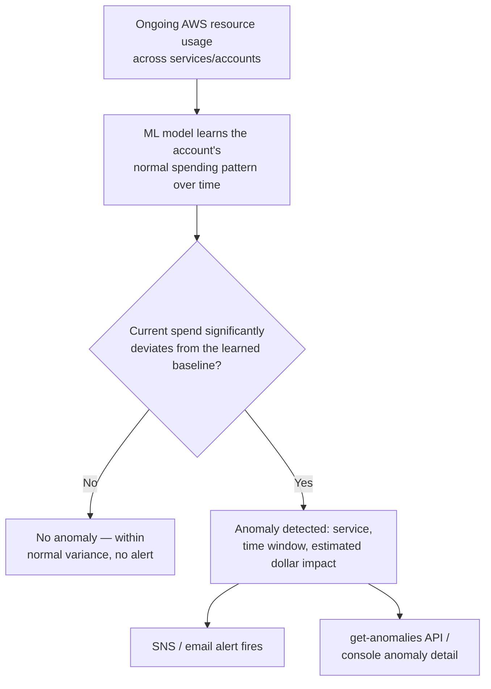
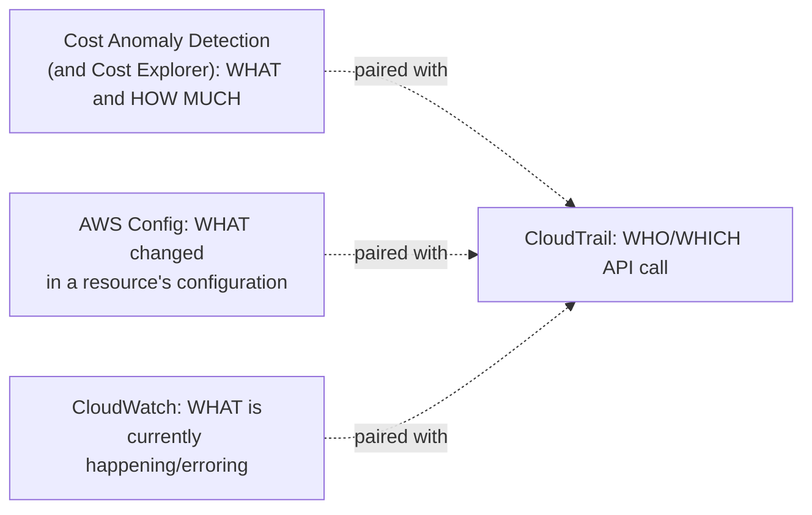
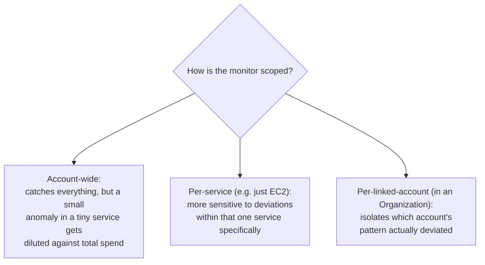

# Cost Anomaly Detection Workflow (Task 4.3)


*Source: [AWS Documentation — Amazon CloudWatch User Guide (Cost Explorer integration)](https://docs.aws.amazon.com/AmazonCloudWatch/latest/monitoring/images/ce.png), docs.aws.amazon.com. This is the drill-down view you land in *after* an anomaly alert tells you something unusual happened — Cost Anomaly Detection finds the "something changed," Cost Explorer (shown here) is where you confirm exactly what and quantify it in dollars.*

## Analogy

A fixed-threshold Budget alert is a burglar alarm wired to one door — it only fires if someone
opens *that specific* door past a set point. Cost Anomaly Detection is a security guard who has
walked the building every night for months and has learned what "normal" looks like — they don't
need a rule written in advance for every possible door; they notice when *anything* deviates
meaningfully from the pattern they already know, even through a window nobody thought to wire an
alarm to. The guard doesn't replace the burglar alarm (a Budget is still useful for a hard, known
ceiling); they catch the specific class of problem a fixed threshold structurally can't: an
unexpected deviation with no pre-defined rule.

## Definition

**AWS Cost Anomaly Detection** is a free, machine-learning-based service that continuously learns
an AWS account's (or cost-allocation-tag-scoped group's) normal spending pattern and automatically
flags a statistically significant deviation from that learned pattern — without requiring anyone
to configure a static dollar threshold in advance. The **workflow** this doc covers is the full
loop: detection, alerting, investigating *what* drove the anomaly, finding *who/what* caused it,
and closing the loop so the same failure mode doesn't silently recur.

## Purpose

A fixed-threshold Budget answers "did we cross $10,000 this month" — a useful, necessary check,
but structurally blind to a sudden *spike within* an otherwise-normal budget (spending $3,000
instead of a typical $1,000 for three days, then returning to normal, might never cross a
monthly cap at all) or to a spend pattern that's unusual *for this account specifically* even
though it's a small absolute dollar amount. Cost Anomaly Detection exists to catch exactly that
class of problem: not "did we exceed a number," but "did something change that doesn't look like
us," learned from the account's own history rather than a guess at a reasonable ceiling.

## When to Use It

- You want automated detection of unusual spend *patterns*, not just a static ceiling — a sudden
  spike, a new and unexpected service/usage-type appearing, or a gradual deviation from the
  account's established baseline.
- You have an established spending history for the account/service being monitored (anomaly
  detection needs a real baseline to compare against).
- You want zero-cost, zero-maintenance anomaly alerting layered on top of (not instead of) your
  existing Budgets.
- You're investigating an already-flagged anomaly and need the standard workflow for turning
  "something unusual happened" into "here is exactly what, how much, and who caused it."

## When NOT to Use It

- **As a substitute for a hard spending ceiling.** Anomaly Detection flags deviation from a
  *pattern*; it does not enforce a cap or trigger automated remediation the way a **Budget
  Action** can. If the requirement is "never let spend exceed $X, period," that's a Budgets
  question, not an Anomaly Detection one.
- **On a brand-new account or workload with no spending history yet.** The model needs time to
  learn what "normal" looks like; a newly created account or an entirely new service just turned
  on has no established baseline, so anomaly detection won't meaningfully flag anything useful
  for it yet, and may produce noisy false positives until enough history accumulates.
- **For identifying who caused the anomaly.** Cost Anomaly Detection answers *what* and *how
  much*; it does **not** identify the specific IAM principal or API call responsible — that's
  CloudTrail's job, and the two tools are used together, never as substitutes for each other (see
  the workflow below).
- **For granular, resource-level best-practice checks** (an idle load balancer, an unattached EBS
  volume) — that's Trusted Advisor's Cost Optimization category, a different kind of check
  (static best-practice rule vs. learned pattern deviation).

## Use Cases

1. **A forgotten large training instance left running over a weekend.** An ML engineer launches
   an `m5.4xlarge` for a training job Friday evening and leaves for the weekend with no
   auto-shutdown configured. Saturday morning, the anomaly monitor — having learned this
   account's typically near-zero weekend EC2 spend — flags the sustained, unusual usage roughly a
   day after it starts.
2. **A misconfigured Auto Scaling policy that never scales back in.** Over several weeks, an ASG
   quietly runs more instances than needed, with no single day crossing any static Budget
   threshold, but the *gradual, sustained* deviation from the account's prior baseline is exactly
   the pattern anomaly detection is built to catch where a fixed threshold wouldn't.
3. **A new, unexpectedly expensive usage type appearing after a deploy.** A routine
   infrastructure change (e.g., a CloudFormation template edit) has an unintended side effect that
   enables a new, costly feature (cross-region data transfer, a new data-event logging
   configuration) — the anomaly shows up as a new cost line that didn't exist in the account's
   prior pattern, even if the absolute dollar amount is modest.
4. **Attributing an anomaly to a specific team in a shared, multi-team account.** Once Cost
   Anomaly Detection flags *what* service/time window is anomalous, cross-referencing against
   Cost Explorer grouped by cost allocation tag attributes the anomaly to the responsible team,
   closing the loop from "something unusual happened" to "Team=ML's forgotten instance."
5. **Validating that a cost optimization actually worked, by watching for the absence of a
   recurring anomaly.** A team that previously saw recurring weekend-spend anomalies from
   forgotten training instances adds an auto-shutdown policy; the subsequent absence of the
   previously recurring anomaly pattern is itself confirmatory evidence the fix worked.
6. **Scoping anomaly monitors to a specific linked account or service in a large AWS
   Organization.** Rather than one account-wide monitor diluting signal across dozens of
   unrelated services, scoping separate monitors per linked account or per major service gives a
   platform team more specific, actionable alerts instead of one noisy, undifferentiated feed.

## Why It's Important

Cost overruns are one of the most common operational surprises for teams on AWS, and the gap
between "a resource was left running" and "someone notices" is exactly what determines whether a
mistake costs tens of dollars or thousands. Cost Anomaly Detection is specifically the layer that
catches what a static Budget threshold structurally cannot — and because it's free with no
configuration burden beyond defining monitors, there's rarely a good reason not to have it
running alongside Budgets rather than instead of them. Task 4.3 ("optimize applications on AWS,"
cost/performance tradeoffs) explicitly expects you to be able to trace a cost anomaly to its root
cause using the right sequence of tools, not just know the tool's name.

## How It Works: The Detection and Alerting Pipeline



Walking through it: (1) the anomaly monitor continuously observes actual spend, scoped to
whatever dimension you configured it against (the whole account, a specific linked account, or a
specific service); (2) the ML model maintains a learned expectation of what "normal" spend looks
like for that scope, built from historical pattern, including things like weekday/weekend
variation; (3) when current spend deviates significantly from that learned expectation, an
anomaly is generated with an estimated dollar impact and the affected service/time window; (4) an
alert (SNS, email) can notify a human proactively, and the anomaly's detail is also queryable via
`get-anomalies` for programmatic/scripted investigation.

## The Full Investigation Workflow, Step by Step

This is the complete loop Task 4.3 expects you to be able to walk through — detection alone is
only the first quarter of it.

```mermaid
sequenceDiagram
    participant Anomaly as Cost Anomaly Detection
    participant Eng as Engineer
    participant CE as Cost Explorer
    participant CT as CloudTrail
    participant Fix as Remediation

    Anomaly->>Eng: Alert — anomaly detected, estimated $X, Service=EC2, window=Sat 06:00-Mon 09:00
    Eng->>CE: get-cost-and-usage, filtered to EC2, grouped by USAGE_TYPE, same window
    CE-->>Eng: BoxUsage:m5.4xlarge is the driver — confirms WHAT, quantifies HOW MUCH
    Eng->>CT: lookup-events, EventName=RunInstances, same time window
    CT-->>Eng: Specific principal + instance parameters — confirms WHO/WHAT launched it
    Eng->>Fix: Terminate the instance; already-incurred cost remains on the bill
    Eng->>Eng: Add a preventive guardrail (auto-shutdown policy, SCP, or alarm)\nso the same failure mode doesn't silently recur
```

**Step 1 — the alert arrives.** Cost Anomaly Detection's alert tells you *what* service and *when*,
with an estimated dollar impact — but critically, it does **not** tell you *who* caused it. This
is the single most important limitation to internalize: treating the anomaly alert as a complete
answer, rather than the first step of an investigation, is the most common mistake.

**Step 2 — quantify and narrow with Cost Explorer.** Using the anomaly's service and time window
as filters, a `get-cost-and-usage` call grouped by `USAGE_TYPE` identifies exactly which specific
usage type (not just "EC2" broadly) is driving the anomaly — turning a vague service-level flag
into a specific, billable line item.

```bash
aws ce get-cost-and-usage \
  --time-period Start=2026-11-15,End=2026-11-17 \
  --granularity DAILY \
  --filter '{"Dimensions":{"Key":"SERVICE","Values":["Amazon Elastic Compute Cloud - Compute"]}}' \
  --group-by Type=DIMENSION,Key=USAGE_TYPE \
  --metrics "UnblendedCost"
```

**Step 3 — find who/what caused it with CloudTrail.** Using the same narrowed time window and the
specific action implied by the usage type (e.g., `RunInstances` for a new EC2 usage-type spike),
CloudTrail surfaces the exact principal and call parameters responsible.

```bash
aws cloudtrail lookup-events \
  --lookup-attributes AttributeKey=EventName,AttributeValue=RunInstances \
  --start-time "2026-11-15T00:00:00Z" \
  --end-time "2026-11-16T00:00:00Z"
```

**Step 4 — attribute to a team via cost allocation tags, if the account is shared.** A further
`get-cost-and-usage` call grouped by `Type=TAG,Key=Team` (scoped to the already-narrowed
service/usage-type) turns "someone in the account" into "Team=ML specifically," closing the
attribution loop in a shared multi-team account.

**Step 5 — remediate, then close the loop with a preventive guardrail.** Terminating the
resource stops *future* cost from accruing — the already-incurred charges remain on the bill
regardless (there's no retroactive credit for "I didn't mean to leave this running"). The
step that actually prevents recurrence is adding something that didn't exist before the incident:
a CloudWatch alarm on instance age/idle time, an SCP restricting large instance types outside
approved hours, or an auto-shutdown Lambda triggered by a schedule — Cost Anomaly Detection itself
has no remediation action of its own, only detection.

## Why the "What" Tool and the "Who" Tool Are Always Paired

This is a recurring structural pattern across Domain 4's cost and governance content — worth
calling out explicitly here because cost anomalies are one of the clearest illustrations of it:



Cost Anomaly Detection, AWS Config, and CloudWatch all answer some flavor of "what is happening or
changed" — none of them is an audit log, and none of them independently tells you which IAM
principal or API call was responsible. CloudTrail is the one tool in this domain that answers
"who/what made the call," and it recurs as the second half of nearly every "detect an anomaly,
then find its cause" investigation regardless of which detection tool found the anomaly in the
first place. Recognizing this pairing as a pattern — rather than memorizing it once per tool — is
the transferable skill.

## Worked Scenario: A Gradual Anomaly With No Single Crossing Point

Not every cost anomaly looks like a sudden spike. A slower, more insidious pattern is worth
walking through separately because it's a common exam trap: a question describing "cost grew
steadily but never crossed any single day's budget threshold" is specifically testing whether you
reach for Anomaly Detection (which catches *sustained deviation from a learned pattern*) instead
of a static Budget (which only fires on crossing an absolute number).

**Symptom.** Over six weeks, an Auto Scaling group's instance count crept from an average of 4 to
an average of 11, because a scale-in policy's cooldown was misconfigured and never actually
triggered. No single day's spend crossed the account's $5,000/day Budget threshold — the growth
was too gradual.

**Diagnosis path.** Cost Anomaly Detection's model, having learned the account's prior ~4-instance
baseline, flags the *sustained* deviation once it's statistically significant relative to that
learned baseline — even though no static threshold was ever crossed. A Cost Explorer breakdown by
`INSTANCE_TYPE`/`USAGE_TYPE` over the six-week window shows the steady climb visually, and a
CloudTrail search for `UpdateAutoScalingGroup`/scaling-policy-related calls around when the
cooldown misconfiguration was introduced (likely weeks earlier, at the root, not at the moment of
detection) completes the "who/what changed it" half.

**The lesson.** A Budget alone would never have caught this pattern, because it never crossed the
threshold on any single day — this is precisely the gap Cost Anomaly Detection's learned-baseline
approach exists to close, and it's the scenario shape the exam most often uses to test whether you
understand *why* both tools are needed together, not just that both exist.

## Exam Scenario Walkthrough

**Scenario.** An account's EC2 spend over a specific weekend was unusually high, flagged by Cost
Anomaly Detection with an estimated $340 impact. The alert names the service and time window but
not a specific resource or person. What should the engineer do next, in order, and why can't the
anomaly alert alone answer the question "who did this"?

> **Answer:** First, run a Cost Explorer query scoped to the anomaly's service and time window,
> grouped by `USAGE_TYPE`, to identify the specific instance type/usage line driving the cost —
> this quantifies and narrows *what*. Then, using that narrowed window, search CloudTrail for the
> relevant launch event (`RunInstances`) to find the specific principal and parameters — this
> answers *who*. Cost Anomaly Detection's own alert can never answer "who," by design: it's a
> billing-pattern detector, not an audit log; CloudTrail is the only tool in this domain that
> records API-call-level identity, and the two are always used together for this exact reason.

## Exam Tips

- **Cost Anomaly Detection is free** — there's no cost-benefit tradeoff in turning it on broadly;
  a question implying it's too expensive to use widely is wrong.
- **It detects pattern deviation, not threshold crossing** — a gradual, sustained increase that
  never crosses any single day's Budget is the textbook scenario pointing specifically at Anomaly
  Detection over Budgets.
- **It never identifies WHO caused the anomaly** — that's always CloudTrail, paired afterward; an
  answer choice suggesting the anomaly alert itself reveals the responsible principal is wrong.
- **It needs an established baseline** — a brand-new account/workload won't get a meaningful
  anomaly signal yet; don't expect it to flag anything useful in the first days of a new service.
- **It has no remediation action of its own** — unlike AWS Config's optional auto-remediation,
  Cost Anomaly Detection only detects and alerts; fixing the issue (terminating a resource, adding
  a guardrail) is always a separate, human (or separately automated) step.
- **The standard investigation order is: Anomaly Detection → Cost Explorer (quantify/narrow) →
  CloudTrail (attribute to a principal) → cost allocation tags (attribute to a team, if shared)**
  — memorize this sequence; it's the same shape tested repeatedly across cost-related Domain 4
  scenarios.

## Scoping Anomaly Monitors: Account-Wide vs. Per-Service vs. Per-Linked-Account

A monitor's **scope** determines how specific its alerts are, and picking the wrong scope is a
real, common configuration mistake worth understanding before setting one up:



A single account-wide monitor in a large, multi-service account can genuinely miss a meaningful
anomaly in a smaller service, because that service's spend is a small enough fraction of total
account spend that its deviation doesn't register as statistically significant against the whole.
Scoping separate monitors per major service (or per linked account, in an Organization with many
member accounts) gives each one a cleaner, more specific baseline to compare against — the same
principle as not wiring one smoke detector to cover an entire office building when each floor
should have its own.

## Exam Scenario Walkthrough, Second Pass: The Scope Mistake

**Scenario.** A platform team runs one account-wide Cost Anomaly Detection monitor across an
account that spends $200,000/month, dominated by a large Redshift cluster. A small, newly
launched DynamoDB table's cost triples from $40/month to $120/month — a real, meaningful
three-fold increase for that specific resource — but no anomaly alert ever fires. Why not, and
what's the fix?

> **Answer:** An $80 increase is statistically invisible against a $200,000/month account-wide
> baseline — the account-wide monitor's model simply doesn't register it as a significant
> deviation from the whole. The fix is a **more narrowly scoped monitor** (per-service, or scoped
> to the specific linked account/cost-allocation-tag group if the DynamoDB table belongs to one
> team specifically) so the comparison baseline is the service's own historical pattern, not the
> entire account's. This is a genuinely common real-world monitoring mistake, not just an exam
> trick question — the same principle (scope your alerting baseline to the thing that actually
> matters, not the broadest possible aggregate) recurs across CloudWatch alarms and Trusted
> Advisor findings too.

## Related Terms

- [`services/management-governance/cost-management-tools.md`](../../../services/management-governance/cost-management-tools.md)
  — the full Cost Management service doc, including Budgets, Cost Explorer, and the CUR.
- [`services/management-governance/cloudtrail.md`](../../../services/management-governance/cloudtrail.md)
  — the "who/what made the call" half of every cost investigation in this doc.
- [`services/management-governance/trusted-advisor.md`](../../../services/management-governance/trusted-advisor.md)
  — the complementary, resource-level best-practice check (idle resources) rather than a learned
  spending-pattern deviation.
- [`README.md`](README.md) — the domain's general cost/performance tooling comparison table and
  Task 4.3 framing.
