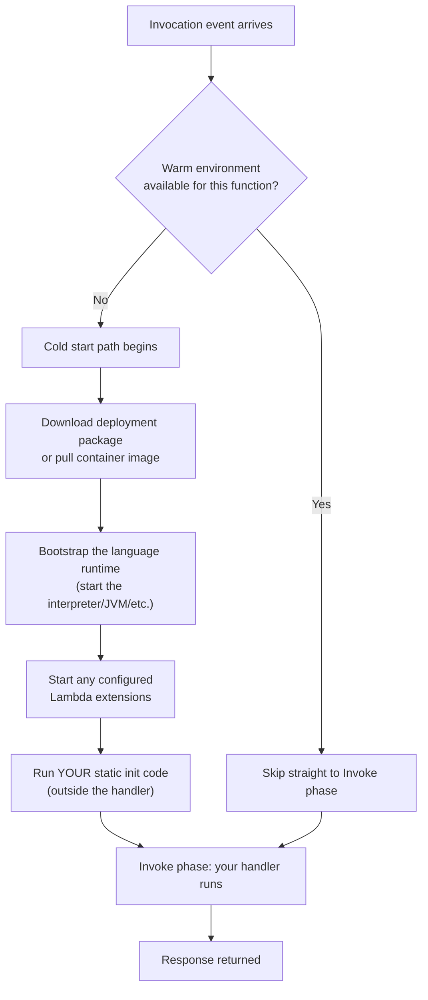
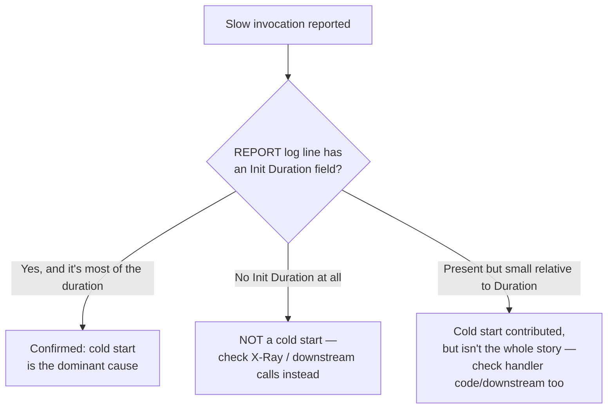

# Lambda Cold Start Diagnosis and Mitigation (Task 4.1 / 4.3)


*Source: [AWS Documentation — Understanding the Lambda execution environment lifecycle](https://docs.aws.amazon.com/lambda/latest/dg/lambda-runtime-environment.html), AWS Lambda Developer Guide. Every cold start pays for code/image download, runtime bootstrap, and your own static init code, in that order, before your handler ever runs — this diagram is the map for exactly where a cold-start mitigation technique targets.*

## Analogy

A warm Lambda invocation is like walking into a restaurant kitchen where the stove is already
lit, the prep station is already stocked, and the chef is standing there waiting. A cold start is
walking into a kitchen that doesn't exist yet: you have to build the kitchen (download the code),
turn on the utilities (bootstrap the runtime), and have the chef do their mise en place (run your
static initialization code) — all *before* a single order can be cooked. Provisioned concurrency
is paying a chef to stand in a pre-built kitchen 24/7 even when no orders are coming in, so the
first order of the day is exactly as fast as the hundredth. SnapStart is closer to photographing
the fully-prepped kitchen once and instantly materializing a copy of that photo for every new
order, instead of re-doing the prep work from scratch every time.

## Definition

A **cold start** is the latency penalty Lambda pays the first time (or after enough idle time, or
during a scale-up) it must provision a brand-new execution environment for a function, as opposed
to reusing an already-initialized one (a **warm start**). The cold path adds: downloading the
deployment package or pulling the container image, bootstrapping the chosen language runtime, and
running the function's own static initialization code — all before the handler itself ever runs.

## Purpose

Lambda's entire value proposition is "don't provision anything, don't pay while idle" — but that
exact design choice is *why* a brand-new execution environment sometimes has to be built on the
spot, instead of a server simply sitting there warm and waiting. Cold starts are not a bug; they
are the direct, structural consequence of serverless's defining tradeoff. This topic exists
because Task 4.3 ("Lambda performance tuning — cold starts, concurrency") expects you to diagnose
*whether* a given latency problem is actually a cold start (not just assume it is), and to pick
the *right* mitigation for the specific cause, rather than reaching for "add more memory" as a
reflexive first answer.

## When to Use (i.e., When to Actively Mitigate Cold Starts)

- A latency-sensitive, user-facing synchronous API (checkout, login, a mobile app's first screen)
  where even an occasional multi-second delay is unacceptable.
- A function using a runtime with historically slow bootstrap (Java, to a lesser extent .NET),
  especially if VPC-attached or bundling a large dependency tree/ML model.
- A function that scales from zero or near-zero frequently (bursty, spiky, or very low-traffic
  workloads), where a large fraction of real invocations land on a cold environment.
- A function behind a strict latency SLA where the p99 (not the average) is the metric that
  matters, since cold starts show up specifically in the tail, not the median.

## When NOT to Use (i.e., When Mitigation Isn't Worth It)

- **An internal, asynchronous, or batch-processing function with no human waiting on the
  response** — a cold start adding a second to a nightly report job that already takes two
  minutes is immaterial; spending engineering effort or ongoing cost to eliminate it has no real
  payoff.
- **A function that's already warm nearly all the time due to high, steady traffic** — at high
  enough sustained invocation rate, the fraction of requests hitting a cold environment is already
  small; provisioned concurrency's continuous cost may not be justified for a marginal
  improvement.
- **Before confirming the delay is actually a cold start at all** — see the diagnosis section
  below; spending effort "fixing cold starts" that turn out to be an unrelated downstream
  dependency wastes time and, if provisioned concurrency is added speculatively, money.
- **A function where the fix budget is better spent on reducing deployment package size or
  dependency count first** — provisioned concurrency and SnapStart treat the symptom; a smaller
  package/image and fewer cold-path dependencies reduce the actual cold-start duration itself,
  often for free.

## Use Cases

1. **Checkout API behind API Gateway, Java runtime.** A payments team's Java-based checkout
   Lambda shows occasional 2-3 second latency spikes that correlate exactly with low-traffic
   overnight hours. Diagnosis points at cold starts on a historically slow-to-bootstrap runtime;
   SnapStart is evaluated first (no ongoing cost) before provisioned concurrency.
2. **Mobile app's first-screen data fetch, spiky traffic tied to push notifications.** A burst of
   app opens right after a push notification causes Lambda to scale from near-zero rapidly,
   meaning a large fraction of that burst's invocations are cold. Provisioned concurrency,
   pre-scaled ahead of a known notification send time, directly targets this.
3. **An ML inference Lambda loading a multi-hundred-MB model file in static init.** The model load
   happens once per cold environment (correctly placed outside the handler), but the cold-start
   cost of that load is itself large; reducing the loaded model's size or switching to a smaller
   deployment package (or Lambda SnapStart, where supported) is evaluated before simply adding
   provisioned concurrency to paper over it.
4. **A VPC-attached function reaching a private RDS instance, showing worse cold starts than an
   equivalent non-VPC function.** Confirming via the `Init Duration` field whether VPC ENI
   attachment overhead (reduced significantly by Hyperplane ENIs, but not zero) is contributing,
   versus the runtime bootstrap itself being the dominant cost.
5. **A low-traffic internal admin tool invoked a few times a day.** Cold starts are frequent here
   (the function is almost never warm) but completely tolerable, since no external user is
   waiting on it synchronously under a tight SLA — correctly identified as a case to *not* spend
   effort mitigating.
6. **A canary/new-version deployment immediately after a release.** A fresh deployment always
   starts fully cold (no warm environments exist yet for the new version), producing a temporary
   spike in cold starts right after every deploy — distinguishing this expected, transient
   pattern from a persistent cold-start problem is itself a diagnostic skill.

## Why This Is Important

Cold starts are one of the most commonly tested and most commonly misdiagnosed Lambda
performance topics on DVA-C03. The exam (and real production incidents) reward correctly
distinguishing a cold start from an unrelated downstream slowness, and correctly matching the
mitigation to the actual cause (runtime choice, package size, invocation pattern) rather than
defaulting to "just add provisioned concurrency," which has a real, continuous dollar cost that
isn't always justified.

## How It Works: The Full Cold-Start Timeline



Walking through each stage and where mitigation actually targets it:
1. **Download/pull** — a smaller deployment package (zip) or container image downloads faster.
   This is the first lever to pull, and it's free: trimming unused dependencies, using Lambda
   Layers for shared code instead of bundling it per-function, and avoiding an unnecessarily
   large base container image all reduce this stage's duration directly.
2. **Runtime bootstrap** — the interpreter/JVM/CLR starting up. This is almost entirely
   determined by language choice: interpreted languages with small runtimes (Python, Node.js, Go)
   bootstrap fastest; JVM-based languages (Java) have historically been the slowest here due to
   class loading and JIT warm-up — the specific problem **SnapStart** targets.
3. **Extensions** — any configured Lambda extensions (observability agents, custom runtime
   extensions) start here, adding their own overhead; an unnecessary extension is a cold-start
   cost with no corresponding benefit if it's not actually being used.
4. **Your static init code** — anything declared outside the handler function (a database
   connection setup, loading a config file, loading an ML model into memory) runs exactly once
   per cold environment, here. This is the stage application code has the most direct control
   over: moving genuinely one-time setup *out* of the handler (so it only pays this cost once per
   environment, not once per invocation) is the single most impactful code-level change available.
5. **Invoke phase** — your handler runs. Both cold and warm paths converge here; this stage's
   duration is unrelated to cold-start mitigation (it's ordinary code performance).

## Step-by-Step: Diagnosing Whether a Slow Invocation Is Actually a Cold Start

This is the exam-relevant "app is slow, diagnose it" sequence, specific to Lambda latency.

1. **Pull the `REPORT` line for the slow invocation from CloudWatch Logs.** Every Lambda
   invocation emits a `REPORT` log line automatically. On a cold start, and *only* on a cold
   start, it includes an extra field: `Init Duration`. Its presence is the definitive signal —
   a warm invocation's `REPORT` line has no `Init Duration` field at all.
   ```
   REPORT RequestId: abc-123  Duration: 842.11 ms  Billed Duration: 843 ms
   Memory Size: 512 MB  Max Memory Used: 210 MB  Init Duration: 611.47 ms
   ```
2. **Compare `Init Duration` to total `Duration`.** If `Init Duration` (611ms here) accounts for
   most of the elapsed time relative to a typical warm `Duration` for this function (say, 230ms),
   the slowness is overwhelmingly a cold start, not a code-performance regression.
3. **Query for the pattern's frequency, don't trust one data point.** Using
   [`cloudwatch-logs-insights-debugging.md`](cloudwatch-logs-insights-debugging.md)'s techniques:
   ```
   fields @timestamp, @initDuration, @duration
   | filter ispresent(@initDuration)
   | stats count() as coldStarts, avg(@initDuration) as avgInit by bin(1h)
   ```
   This shows whether cold starts are rare-but-occasional (likely tolerable) or a large,
   persistent fraction of total traffic (a real problem worth mitigating).
4. **If `Init Duration` is absent but the invocation is still slow, it is NOT a cold start.** Pull
   up the function's X-Ray trace instead (see
   [`services/developer-tools/x-ray.md`](../../../services/developer-tools/x-ray.md)) — a high
   `Duration` with no `Init Duration` points at the handler's own code or, far more often, a slow
   downstream dependency it's waiting on, which no cold-start mitigation will ever fix.
5. **Check whether the slow invocations correlate with a traffic pattern.** A burst of cold starts
   immediately after a quiet period, or right after a deployment (every environment for the new
   version starts cold), is expected and often self-resolving as the fleet of warm environments
   rebuilds — distinct from a sustained, ongoing high cold-start rate that indicates a genuine
   capacity/traffic-shape mismatch.



## Mitigation Decision Tree: Picking the Right Fix for the Actual Cause

```mermaid
flowchart TD
    CONFIRMED[Cold start confirmed as\nthe dominant cause] --> Q1{Is the runtime Java\n(or similarly slow-bootstrapping)?}
    Q1 -->|Yes| SNAPSTART["Try SnapStart first —\nno ongoing cost, often 90%+ reduction"]
    Q1 -->|No| Q2{Is the deployment package/image\nunusually large?}
    Q2 -->|Yes| TRIM["Trim dependencies, use Layers,\nsmaller container base image"]
    Q2 -->|No, already lean| Q3{Is traffic bursty/spiky with\na known or predictable pattern?}
    Q3 -->|Predictable pattern, e.g. daily peak| SCHEDULED["Provisioned concurrency,\nscheduled to scale ahead of the peak"]
    Q3 -->|Genuinely unpredictable, 24/7 latency-critical| ALWAYS["Provisioned concurrency,\nheld continuously — real ongoing cost"]
    Q3 -->|Rare/tolerable, not user-facing| ACCEPT["Accept the cold start —\nmitigation isn't worth the cost/effort"]
```

- **SnapStart** (currently Java, with growing runtime support) snapshots a fully initialized
  execution environment once, after Init completes, and restores new environments from that
  snapshot instead of re-running Init from scratch — commonly cutting cold starts by 90%+, with
  **no continuous cost**, unlike provisioned concurrency. This should be the first thing evaluated
  for a Java function before reaching for anything that costs money continuously.
- **Trimming the deployment package/image** reduces the download stage's duration directly, at
  zero ongoing cost — moving shared dependencies into a Lambda Layer, removing unused libraries,
  and choosing a minimal container base image are all free wins worth doing regardless of whether
  provisioned concurrency is also used.
- **Provisioned concurrency** pre-warms a specified number of execution environments so they're
  always ready, eliminating the cold path entirely for traffic within that provisioned amount —
  at a real, continuous, separate cost (see the worked cost example below). Traffic *above* the
  provisioned amount still falls back to on-demand (cold-start-prone) scaling for the overflow —
  this is expected behavior, not a bug, and a common source of "provisioned concurrency isn't
  working" confusion.
- **Application Auto Scaling for provisioned concurrency** lets you scale the provisioned amount
  up ahead of a known traffic pattern (a scheduled scaling action before a predictable daily peak)
  rather than paying for peak-level provisioned concurrency 24/7 when only a few hours a day
  actually need it.
- **Graviton/Arm** doesn't directly target cold-start duration the way the above do, but is worth
  mentioning in the same breath: switching architecture is a near-free-lunch cost optimization
  for warm-path compute cost (see
  [`services/compute/lambda.md`](../../../services/compute/lambda.md)'s worked example), distinct
  from — and complementary to — cold-start mitigation specifically.

## Worked Cost Tradeoff: Provisioned Concurrency Is Not Free Insurance

Reusing the shape of the worked example in [`services/compute/lambda.md`](../../../services/compute/lambda.md):
a function handling 10 million requests/month at 1,024 MB costs roughly **$52/month** in ordinary
on-demand compute + request charges. Adding 5 provisioned concurrency environments, held
continuously 24/7 for a 30-day month, costs roughly an *additional* **$54/month** — nearly
**doubling** the function's total monthly cost. The exam- and real-world-relevant lesson: this is
a deliberate, real tradeoff (predictable low latency, bought with a continuous dollar cost), not
a default setting to apply broadly "just in case." Scope provisioned concurrency to the specific
functions on the specific latency-critical path that actually need it, and prefer SnapStart or
package trimming wherever either one alone is sufficient, since both are free.

## Common Mistakes (and the Right Diagnosis Instead)

- **Assuming every slow invocation is a cold start.** Always check for the `Init Duration` field
  first — if it's absent, the slowness is in the handler's own code or a downstream call, and no
  amount of cold-start mitigation will fix it.
- **Reaching for "add more memory" to fix a cold start.** More memory speeds up CPU-bound *handler
  code* (since CPU scales with memory); it does little for the download/bootstrap stages of a
  cold start, which are dominated by package size and runtime choice, not CPU allocation during
  Init specifically (though a larger memory allocation does modestly speed up the Init phase's own
  CPU-bound work, like decompressing a large package).
- **Adding provisioned concurrency as a first reflex without confirming traffic actually benefits
  from it.** If traffic regularly exceeds the provisioned amount, the overflow still cold-starts —
  check actual concurrency patterns via CloudWatch's `ConcurrentExecutions` metric before sizing
  provisioned concurrency, rather than guessing.
- **Forgetting that a fresh deployment always starts fully cold.** A spike in cold starts
  immediately after every release is expected (no warm environments exist yet for the new
  version) and typically self-resolves within minutes as traffic rebuilds the warm fleet —
  distinguishing this from a persistent problem avoids chasing a non-issue.

## Exam Scenario Walkthrough

**Scenario.** A latency-sensitive checkout Lambda function (Java runtime) shows a p99 latency of
3.8 seconds, while its p50 is a steady 180ms. The team wants the fastest, cheapest fix.

> **Answer:** First confirm via the `REPORT` log line's `Init Duration` field that the p99 outlier
> invocations are cold starts (a flat p50 with a high p99 is itself a strong signal pointing at an
> occasional cold path, not a uniform slowdown). Given the Java runtime specifically, **try
> SnapStart first** — it directly targets Java's historically slow bootstrap/JIT-warmup cost, with
> no ongoing cost, before reaching for provisioned concurrency (which would also work, but costs
> money continuously for a problem SnapStart may solve for free).

## Exam Tips

- **The `Init Duration` field in the `REPORT` log line is the definitive cold-start signal** — its
  presence (and size relative to total `Duration`) is how you *prove* a slow invocation was a
  cold start, rather than assuming it.
- **Reserved concurrency and provisioned concurrency are not the same thing** — reserved
  concurrency *caps and guarantees* a slice of account concurrency for a function (protects
  against being starved, or protects a downstream dependency from being overwhelmed); provisioned
  concurrency *pre-warms* environments specifically to eliminate cold starts. A question about
  "stop one function from starving others" is reserved concurrency; "eliminate first-invocation
  latency" is provisioned concurrency (or SnapStart for Java).
- **SnapStart has no ongoing cost; provisioned concurrency does** — a cost-conscious answer
  evaluates SnapStart first whenever the runtime supports it, before reaching for a solution with
  a continuous dollar cost.
- **VPC attachment adds some cold-start overhead but far less than in Lambda's early years**
  (Hyperplane ENIs removed most of the old per-invoke ENI creation penalty) — don't over-attribute
  a cold start to "it's VPC-attached" without checking the actual `Init Duration` breakdown.
- **Traffic above the provisioned concurrency amount still cold-starts for the overflow** — this
  is expected, not a misconfiguration; a question describing "provisioned concurrency isn't
  eliminating all cold starts" under a traffic spike is testing recognition of this exact
  behavior.
- **A fresh deployment always starts fully cold** — a cold-start spike immediately following a
  release is expected and typically transient, not a new ongoing problem.

## Cold Starts Across Runtimes: What the Evidence Actually Looks Like

The diagnosis steps above apply to every runtime, but the *shape* of the evidence differs enough
across languages that it's worth seeing side by side — this is a frequently tested distinction
because the exam sometimes names a specific runtime deliberately, expecting you to connect it to
the right mitigation:

| Runtime | Typical cold-start `Init Duration` | Dominant cause | Best first mitigation |
|---|---|---|---|
| Python / Node.js | Tens to a few hundred ms | Small interpreter startup; usually dominated by package size/dependencies if large | Trim package size, move shared code to Layers |
| Go | Very low, often under 100ms | Compiled binary, minimal runtime overhead | Rarely needs mitigation at all |
| Java (JVM) | Several hundred ms to multiple seconds | JVM startup, class loading, JIT warm-up | **SnapStart** first — directly targets this exact cost |
| .NET | Moderate, better than Java historically, worse than Python/Node/Go | CLR startup, assembly loading | Package trimming; ahead-of-time compilation where supported |
| Container image-based functions (any runtime) | Added download/unpack time on top of the runtime's own number | Image size and layer count | Minimize base image size, reduce layer count, avoid unnecessary build tools in the final image |

The practical lesson: a scenario naming "Java" and describing a strict latency SLA is pointing you
at SnapStart specifically, not a generic "add provisioned concurrency" answer — SnapStart exists
*because* Java's cold-start profile is structurally different (and historically worse) than the
interpreted-language runtimes, and it's free where provisioned concurrency is not.

## Related Terms

- [`services/compute/lambda.md`](../../../services/compute/lambda.md) — the full Lambda service
  deep dive, including the memory/CPU/cost worked examples referenced above.
- [`cloudwatch-logs-insights-debugging.md`](cloudwatch-logs-insights-debugging.md) — how to query
  for `Init Duration` patterns across many invocations.
- [`services/developer-tools/x-ray.md`](../../../services/developer-tools/x-ray.md) — how to tell
  a cold start apart from downstream-dependency slowness using the Lambda service segment vs. the
  function's own segment.
- [`README.md`](README.md) — the domain's Lambda cost/performance math section and the general
  Task 4.3 framing this topic fits into.
