# DVA-C03 Study-Mode Exam Bank — Bank 1 (65 Questions)

Domain-weighted practice exam (interleaved, not grouped by domain) for **drilling**: each question
is immediately followed by the correct answer and a full explanation of every option, right and
wrong. This is not a timed simulation — see [`../practice-questions/full-exams/`](../practice-questions/full-exams/)
for that. See [`README.md`](README.md) in this folder for how to use the three banks together.

Domain mix in this bank: **20 Domain 1** (Development, 30.8%), **17 Domain 2** (Security, 26.2%),
**14 Domain 3** (Testing & Deployment, 21.5%), **14 Domain 4** (Troubleshooting & Optimization,
21.5%) — matching the real exam's 30/26/22/22 weighting. Each question header tags its domain.

---

## Q1 — Domain 1: Development with AWS Services

A developer calls a downstream internal HTTP API from inside a Lambda function using the AWS SDK's
underlying HTTP client (not an AWS service call). The API occasionally returns `503` under load.
The developer wants retries with exponential backoff **and** jitter so that many concurrent Lambda
invocations don't all retry at the exact same intervals and create a synchronized retry storm. Which
approach correctly implements this?

A. Retry immediately in a tight loop up to 3 times with no delay between attempts.

B. Sleep for a fixed 2-second delay before every retry, identical for every invocation.

C. Compute each retry delay as `min(maxDelay, baseDelay * 2^attempt)` and then multiply by a random factor (e.g. `random.uniform(0, 1)`) before sleeping, capping total attempts.

D. Disable retries entirely and let API Gateway's integration timeout handle the failure.

**Correct Answer: C**

**Explanation:** This is "full jitter" exponential backoff: the delay grows exponentially with the
attempt number (bounded by a cap) and is then randomized, so that thousands of Lambda invocations
that all failed at roughly the same moment don't all retry at exactly the same future instant —
which would just recreate the load spike that caused the `503`s. This is the standard resilience
pattern the AWS SDKs themselves use for throttled service calls (Task 1.1's "retry logic/exponential
backoff"), and you must hand-implement it for calls to *your own* non-AWS APIs since the SDK's
built-in retry handler doesn't apply there. See [`services/compute/lambda.md`](../../../services/compute/lambda.md).

**Why the others are wrong:**
- A: A tight loop with no delay multiplies load on an already-struggling API almost instantly — the opposite of what backoff is for, and it can exhaust the Lambda invocation's timeout budget in milliseconds.
- B: A fixed, identical delay for every caller causes every concurrent invocation to retry at the same synchronized moment, reproducing the exact thundering-herd problem jitter exists to prevent.
- D: Giving up without retrying at all turns a transient, recoverable `503` into a guaranteed permanent failure for the caller, and API Gateway's integration timeout is unrelated to how a Lambda function should handle a downstream dependency failure.

---

## Q2 — Domain 2: Security

A developer's Lambda execution role policy currently allows `iam:PassRole` on `Resource: "*"` so
the function can pass an execution role to a Step Functions state machine it starts. A security
review flags this as overly broad. Which replacement most correctly follows least privilege?

A. Remove `iam:PassRole` entirely; the state machine will use the caller's own credentials instead.

B. Scope the `Resource` to the exact ARN of the one role the function is expected to pass, and add a `Condition` requiring `iam:PassedToService` equals `states.amazonaws.com`.

C. Keep `Resource: "*"` but change the `Effect` to `Deny` for every role ARN except the one needed.

D. Replace `iam:PassRole` with `sts:AssumeRole` on the same resource, since they grant equivalent access.

**Correct Answer: B**

**Explanation:** `iam:PassRole` is checked whenever a principal hands a role to an AWS service so
that service can act as that role; scoping `Resource` to the specific role ARN and adding
`iam:PassedToService` ensures the caller can only pass that one role, and only to the Step Functions
service — not to, say, EC2 or Lambda, which would let a compromised caller escalate privileges by
passing a sensitive role to an unrelated service. See [`services/security-identity-compliance/iam.md`](../../../services/security-identity-compliance/iam.md).

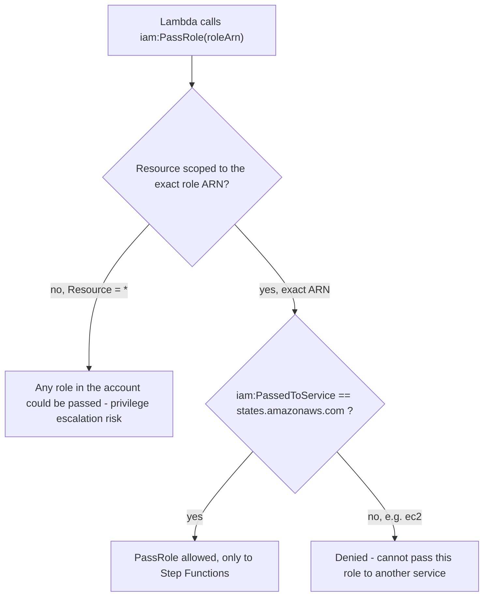

Step by step: (1) the function attempts to pass a role to a service; (2) IAM first checks whether the
resource is scoped to the one intended role ARN rather than a wildcard; (3) the `iam:PassedToService`
condition further restricts *which* service the role may be handed to; (4) only a call matching both
the exact role and the exact target service is allowed — closing off the escalation path where a
compromised caller could otherwise pass a sensitive role to an unrelated, more dangerous service.

**Why the others are wrong:**
- A: Step Functions requires an explicit execution role passed at state-machine-creation/start time; there's no mechanism for it to inherit the caller's own credentials, so removing `PassRole` breaks the function entirely.
- C: Enumerating every role ARN to deny is unmaintainable (new roles created later are implicitly allowed) and inverts the least-privilege model — allow-list the one needed resource instead of deny-listing everything else.
- D: `sts:AssumeRole` lets the caller itself temporarily become the role; `iam:PassRole` lets the caller hand the role to an AWS *service*. They are distinct permissions checked in different scenarios and are not interchangeable here.

---

## Q3 — Domain 3: Testing and Deployment

A team wants to run their Lambda function's handler locally against a sample API Gateway proxy
event before ever deploying, including stepping through with a debugger, without deploying any AWS
resources. Which AWS SAM CLI command is designed for exactly this?

A. `sam deploy --no-execute-changeset`

B. `sam validate`

C. `sam local invoke -e event.json`

D. `sam package --output-template-file packaged.yaml`

**Correct Answer: C**

**Explanation:** `sam local invoke` runs a Lambda function handler inside a local Docker container
that emulates the Lambda execution environment, accepting a sample event JSON file (`-e event.json`)
as the trigger payload — ideal for Task 3.1's "test functions locally" without touching a real AWS
account, and it supports attaching a remote debugger via `-d <port>` for step-through debugging.
See [`services/developer-tools/sam.md`](../../../services/developer-tools/sam.md) and
[`../domain-3-testing-deployment/README.md`](../domain-3-testing-deployment/README.md).

**Why the others are wrong:**
- A: `sam deploy --no-execute-changeset` still creates a real CloudFormation change set against a real AWS account; it stops short of executing it but doesn't run anything locally.
- B: `sam validate` only lints the template's YAML/JSON syntax and schema — it never invokes any function code at all.
- D: `sam package` zips/uploads build artifacts and rewrites the template with S3 URIs as a deploy *preparation* step; it doesn't execute or test function code.

---

## Q4 — Domain 4: Troubleshooting and Optimization

An X-Ray trace segment for a Lambda function includes both `annotations` and `metadata` fields
populated by the function's code. A developer later tries to filter traces in the X-Ray console
using a filter expression like `annotation.customerTier = "gold"`, but an equivalent filter on a
field stored under `metadata` returns nothing. Why?

A. `metadata` fields are stripped by X-Ray before traces are stored, so they never persist.

B. Only `annotations` are indexed for filtering/search; `metadata` is stored with the trace for display and programmatic retrieval but is not searchable via filter expressions.

C. Filter expressions only work on segments, never on subsegments, regardless of annotations vs metadata.

D. X-Ray filter expressions require the field name to be lowercase; `customerTier` must be renamed to `customertier`.

**Correct Answer: B**

**Explanation:** X-Ray explicitly distinguishes the two: `annotations` are indexed key-value pairs
(simple types only, limited count) meant for searching/filtering traces, while `metadata` can hold
arbitrary nested objects for richer debugging context but is never indexed — you can only view it
after you've already found the trace some other way (e.g., by trace ID). The fix is to promote any
field you need to filter on from `metadata` to `annotations`. Relevant to Task 4.1's "use
instrumentation... to troubleshoot." See [`services/management-governance/cloudwatch.md`](../../../services/management-governance/cloudwatch.md)
for X-Ray/CloudWatch integration.

**Why the others are wrong:**
- A: Metadata is fully stored with the trace (visible in the console's "Metadata" tab for a trace); it is not stripped, just not searchable.
- C: Filter expressions can match against annotations on segments or subsegments; the annotation-vs-metadata distinction is unrelated to segment vs subsegment.
- D: X-Ray filter expressions are case-sensitive to whatever key name you actually used when calling `put_annotation`; there's no forced-lowercase requirement, and this wasn't the actual cause here.

---

## Q5 — Domain 1: Development with AWS Services

An order-processing Lambda function writes a new order item to DynamoDB. Due to client-side retry
logic in the caller, the exact same `PutItem` request (identical `orderId`) can occasionally be sent
twice. The team needs the second identical request to be a safe no-op rather than overwriting fields
like `createdAt` with a new timestamp. Which DynamoDB write pattern correctly makes this operation
idempotent?

A. Call `PutItem` normally every time; DynamoDB automatically deduplicates identical items.

B. Use `PutItem` with a `ConditionExpression` of `attribute_not_exists(orderId)` so the write only succeeds the first time; treat the resulting `ConditionalCheckFailedException` on retry as success.

C. Use `Scan` before every write to check if the item already exists, then conditionally call `PutItem`.

D. Set the table's billing mode to on-demand, which makes all writes idempotent by default.

**Correct Answer: B**

**Explanation:** A conditional write with `attribute_not_exists(partitionKey)` guarantees the item
is created only once; a duplicate request fails with `ConditionalCheckFailedException`, which the
application should catch and treat as "already applied" rather than an error — this is the standard
idempotency pattern for Task 1.3's data-store interactions and avoids the race condition a
read-then-write (`Scan`-then-`PutItem`) pattern has. See [`services/database/dynamodb.md`](../../../services/database/dynamodb.md).

**Why the others are wrong:**
- A: DynamoDB has no built-in request deduplication for `PutItem`; a duplicate call simply overwrites the existing item with whatever attributes the second call provides, including a fresh timestamp.
- C: A separate `Scan`-then-write is both inefficient (full table scan) and still has a race condition — two concurrent duplicate requests can both pass the existence check before either writes.
- D: Billing mode (provisioned vs. on-demand) only affects capacity management and cost; it has no effect on write semantics or idempotency.

---

## Q6 — Domain 2: Security

A company sets a permissions boundary on all developer IAM roles that allows only `s3:*`,
`dynamodb:*`, and `lambda:*` actions. One developer's role also has an identity-based policy
attached that grants `iam:CreateUser`. When that developer's role tries to call `CreateUser`, what
happens?

A. The call succeeds, because identity-based policies always take precedence over permissions boundaries.

B. The call is denied, because the permissions boundary caps the maximum permissions to the intersection of the boundary and the identity-based policy, and `iam:CreateUser` isn't in the boundary.

C. The call succeeds only if MFA is present on the session.

D. The call is denied only if an SCP also explicitly denies it; the boundary alone has no effect.

**Correct Answer: B**

**Explanation:** A permissions boundary sets the *maximum* permissions an identity can have —
actual effective permissions are the intersection of the identity-based policy and the boundary.
Even though the identity-based policy grants `iam:CreateUser`, that action isn't included in the
boundary's allowed set (`s3:*`, `dynamodb:*`, `lambda:*`), so it's outside the intersection and the
call is denied. This is exactly Task 2.1's distinction between permissions boundaries, SCPs, and
identity-based policies. See [`services/security-identity-compliance/iam.md`](../../../services/security-identity-compliance/iam.md).

**Why the others are wrong:**
- A: Permissions boundaries are evaluated alongside identity-based policies, not subordinate to them; the boundary can only shrink, never be overridden by, the identity-based policy's grants.
- C: MFA presence is a condition key that can appear inside a policy statement, but it has no bearing on whether an action is within a permissions boundary's allowed set.
- D: SCPs are a separate, additional layer (relevant only inside AWS Organizations) — a permissions boundary alone, with no SCP involved at all, is sufficient by itself to deny this action.

---

## Q7 — Domain 3: Testing and Deployment

A team writes unit tests for a Lambda handler that calls `dynamodb.put_item()` via `boto3`. They
want the tests to run in CI without any network calls or real AWS credentials, and to assert that
`put_item` was called with specific arguments. Which approach is most appropriate?

A. Give the CI runner a real IAM user's access keys scoped to a dedicated test DynamoDB table.

B. Use a mocking library (e.g. `moto` or `unittest.mock.patch`) to intercept the boto3 client call, run the test fully offline, and assert on the call arguments.

C. Deploy the function to a `test` Lambda alias and invoke it for real before every CI run.

D. Wrap the handler in a `try/except` that swallows any `ClientError` so tests never see network failures.

**Correct Answer: B**

**Explanation:** Mocking the boto3 call (via `moto`, which simulates AWS service responses in-process,
or `unittest.mock.patch` on the client method directly) lets unit tests run fully offline, fast, and
deterministically, while still letting the test assert exactly what arguments the code attempted to
send — this is Task 3.1's "mock external services/dependencies for unit testing." See
[`../domain-3-testing-deployment/README.md`](../domain-3-testing-deployment/README.md).

**Why the others are wrong:**
- A: Using real credentials and a real table turns a unit test into an integration test, introduces network flakiness and cost, and is a credential-management risk inside shared CI infrastructure.
- C: Invoking a deployed alias is an integration/end-to-end test of the deployed artifact, not a fast, isolated unit test of the handler's logic, and it requires a deployment step before tests can even run.
- D: Swallowing exceptions hides real bugs from the test suite instead of verifying correct behavior — this makes tests pass regardless of whether the code is actually correct, which is the opposite of useful testing.

---

## Q8 — Domain 4: Troubleshooting and Optimization

An X-Ray trace for a specific API Gateway stage shows most requests as green (success) but a
cluster of nodes shown as solid purple. According to X-Ray's service map coloring convention, what
does solid purple specifically indicate, and what should the developer check first?

A. Purple means the node has no traffic at all; check whether the integration is even wired up.

B. Purple indicates throttling errors (HTTP 429); check the caller's request rate against the downstream service's throttle/concurrency limits.

C. Purple always means a Lambda cold start; check the function's provisioned concurrency setting.

D. Purple means the trace sampling rate is too low to draw conclusions; increase the X-Ray sampling rate.

**Correct Answer: B**

**Explanation:** X-Ray's service map color convention is: green for successful calls, red for
server faults (5xx), yellow for client errors (4xx other than throttling), and purple specifically
for throttling errors (429 Too Many Requests). A purple cluster means requests are being throttled —
the first things to check are the downstream service's rate limits/concurrency (e.g. a Lambda
function's reserved concurrency, or a downstream API's throttle setting) against the actual request
rate reaching it. See [`services/management-governance/cloudwatch.md`](../../../services/management-governance/cloudwatch.md).

**Why the others are wrong:**
- A: A node with zero traffic simply wouldn't appear with meaningful color-coded request data at all; purple specifically reflects observed 429 responses, not absence of traffic.
- C: Cold starts show up as elevated latency/duration on a node, not as a distinct color; the service map's color is driven by response status codes, not by internal timing causes.
- D: Sampling rate affects how many requests are traced (statistical completeness), not the color applied to traces that *were* captured; a low sampling rate wouldn't turn successful nodes purple.

---

## Q9 — Domain 1: Development with AWS Services

A chat application needs the server to push messages to connected clients in real time, and
clients may stay connected for long periods without making new requests. The team wants to use
API Gateway for this without managing their own WebSocket server infrastructure. Which API Gateway
feature, and which routing concept, correctly supports this?

A. A REST API with long-polling clients hitting a GET endpoint every 500ms.

B. A WebSocket API, which maintains a persistent connection per client and routes inbound messages to backend integrations (e.g. Lambda) based on a route key extracted from the message body, while the server can push to any open connection via the Management API's `PostToConnection`.

C. An HTTP API with Server-Sent Events enabled as a built-in integration type.

D. A REST API with a `GatewayResponse` configured for status code 101 Switching Protocols.

**Correct Answer: B**

**Explanation:** API Gateway WebSocket APIs maintain persistent, full-duplex connections; each
inbound message is routed to a backend integration (commonly Lambda) based on a *route key* (by
default, a `$default` or custom key parsed from the message JSON), and the backend can push data to
any specific open connection asynchronously using `apigatewaymanagementapi:PostToConnection` against
that connection's ID — this is Task 1.1's "work with APIs... WebSocket" content.

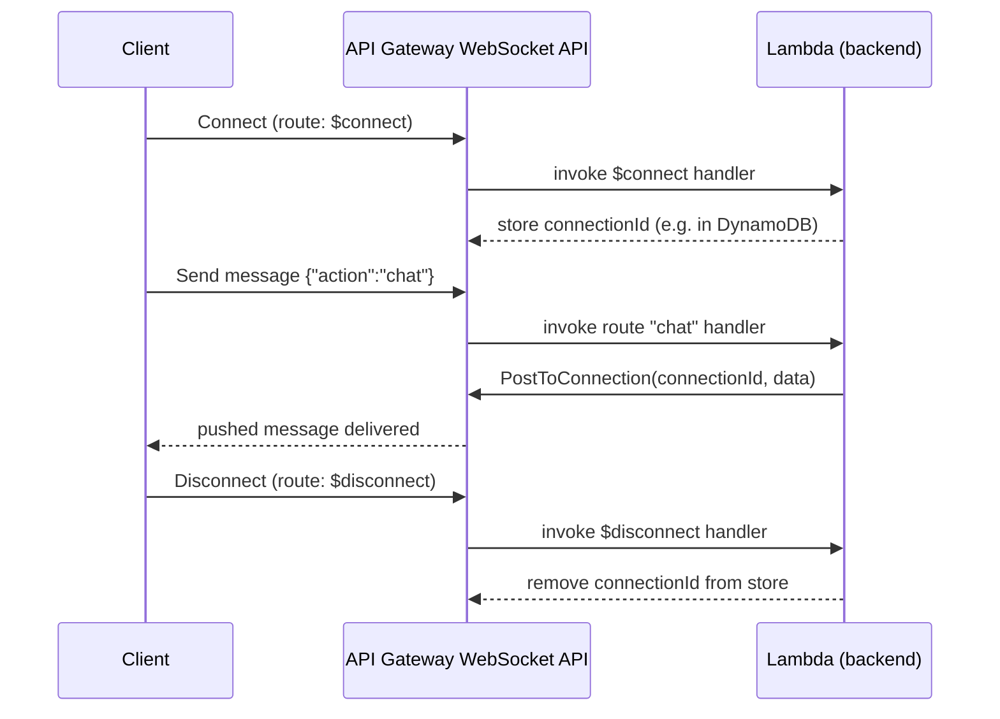

Step by step: (1) a client opens a connection, triggering the reserved `$connect` route; (2) the
backend typically persists the new `connectionId` (e.g. in DynamoDB) so it can be targeted later;
(3) when the client sends a message, API Gateway inspects it and routes to the matching custom
route; (4) the Lambda handling that route can call `PostToConnection` on *any* stored connection ID
to push data without waiting for that client to ask; (5) `$disconnect` fires on close so the backend
can clean up state. See [`services/networking-content-delivery/api-gateway.md`](../../../services/networking-content-delivery/api-gateway.md).

**Why the others are wrong:**
- A: Long-polling a REST endpoint repeatedly is inefficient, adds latency between pushes, and is exactly the pattern WebSocket APIs exist to replace.
- C: API Gateway HTTP APIs do not have a built-in Server-Sent-Events integration type; SSE would have to be hand-built over a regular HTTP response stream, which isn't a native API Gateway feature.
- D: There's no such `GatewayResponse` mechanism for protocol switching in API Gateway; WebSocket support is a distinct API type (`protocolType: WEBSOCKET`), not a REST API response customization.

---

## Q10 — Domain 2: Security

A developer is confused about how AWS decides whether a request from an IAM role to an S3 bucket
*in the same account* is allowed when both an identity-based policy (attached to the role) and a
resource-based bucket policy exist, with no explicit deny in either. Which statement correctly
describes the evaluation outcome?

A. Only the identity-based policy matters within the same account; bucket policies are ignored unless the request is cross-account.

B. The resulting permissions are the *union* of what the identity-based policy and the resource-based policy each allow — if either one allows the action, and neither contains an explicit deny, the request is allowed.

C. Both policies must independently allow the action, or the request is denied (an intersection, not a union).

D. The more recently modified policy always wins and the other is ignored.

**Correct Answer: B**

**Explanation:** Per AWS's official policy evaluation logic, within a single account, identity-based
and resource-based policies are combined as a union of allowed permissions: if *either* policy
allows the action and there's no explicit deny anywhere in the evaluation, AWS allows the request.
This differs from the cross-account case, where *both* the trusted account's identity policy and
the trusting account's resource policy must independently allow it.

*Source: AWS Documentation — [IAM policy evaluation logic, "Policy evaluation for requests within a single account"](https://docs.aws.amazon.com/IAM/latest/UserGuide/reference_policies_evaluation-logic_policy-eval-basics.html) (curl-verified 200 OK, `image/png`).*

Step by step, per the diagram: AWS first checks for any explicit `Deny` across all applicable
policies (identity-based, resource-based, SCPs, permissions boundaries) — if found, deny
immediately, full stop. If none is found, AWS checks whether *any* applicable policy contains an
`Allow` for the requested action/resource; if so, the request is allowed. If no policy allows it,
the request is denied by default (implicit deny). See [`services/security-identity-compliance/iam.md`](../../../services/security-identity-compliance/iam.md).

**Why the others are wrong:**
- A: Bucket policies are fully evaluated for same-account access too, not ignored — they're a core mechanism for scenarios like granting access to roles the bucket owner doesn't directly manage.
- C: An intersection would mean both must allow — that's actually the rule for cross-account requests (each account's policies must independently allow), not same-account requests, which use a union.
- D: Policy evaluation has no concept of "most recently modified wins"; every attached and applicable policy is evaluated together for every request.

---

## Q11 — Domain 1: Development with AWS Services

A REST API built on API Gateway integrates with a legacy backend that expects XML, while all
clients send and expect JSON. The team wants API Gateway itself to transform the request body from
JSON to XML before forwarding to the backend, and transform the XML response back to JSON, without
writing a Lambda function to do the conversion. Which API Gateway feature accomplishes this?

A. A Lambda proxy integration with `isBase64Encoded: true`.

B. Request and response mapping templates written in Velocity Template Language (VTL), configured on the method's integration request/response.

C. A usage plan with a transformation rule attached.

D. CORS configuration on the resource, which includes a body-transformation option.

**Correct Answer: B**

**Explanation:** API Gateway's non-proxy ("custom") integrations support **mapping templates**
written in VTL, configured separately for the integration *request* (transforming the incoming
client payload before it reaches the backend) and integration *response* (transforming the
backend's raw response before it reaches the client) — exactly the JSON↔XML translation layer
described here, with zero custom compute. This is core Task 1.1 API Gateway content.

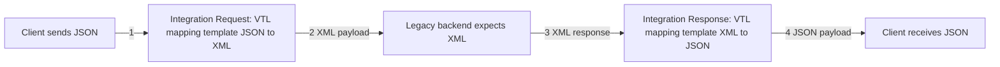

Step by step: (1) the client's JSON body arrives at the method; (2) the configured request mapping
template (selected by the `Content-Type` header) rewrites it into the XML shape the backend expects
before API Gateway forwards it; (3) the backend processes it and returns XML; (4) the response
mapping template rewrites that XML back into the JSON shape the client expects. See
[`services/networking-content-delivery/api-gateway.md`](../../../services/networking-content-delivery/api-gateway.md).

**Why the others are wrong:**
- A: `isBase64Encoded` only controls whether a *proxy* integration's body is treated as base64 binary data; proxy integrations pass the payload through unmodified otherwise and have no mapping-template transformation step at all.
- C: Usage plans control throttling and API key quotas; they have no body-transformation capability.
- D: CORS configuration only controls cross-origin headers (`Access-Control-Allow-*`); it has nothing to do with payload format conversion.

---

## Q12 — Domain 2: Security

A company's SCP attached at the AWS Organizations root explicitly denies `ec2:RunInstances` for
every account. A developer in one account has an identity-based policy that explicitly `Allow`s
`ec2:RunInstances` on `Resource: "*"`. What happens when that developer tries to launch an EC2
instance?

A. The request is allowed, because an explicit `Allow` in an identity-based policy always overrides an SCP.

B. The request is denied, because an SCP sets the maximum permissions available account-wide, and no identity-based or resource-based policy can grant an action an SCP explicitly denies.

C. The request is allowed only if the developer is in the AWS Organizations management account.

D. The outcome depends on whichever policy was attached most recently to the account.

**Correct Answer: B**

**Explanation:** SCPs don't grant permissions themselves — they define the *ceiling* of what's
possible for any principal in affected accounts. An explicit `Deny` in an SCP can never be overridden
by any identity-based or resource-based policy; the effective permission is the intersection of
"what the SCP allows" and "what the identity-based/resource-based policy allows," and an SCP-level
deny removes the action from that ceiling entirely. This is Task 2.1's SCP-vs-IAM-policy distinction.
See [`services/security-identity-compliance/organizations-and-scps.md`](../../../services/security-identity-compliance/organizations-and-scps.md).

**Why the others are wrong:**
- A: SCPs sit above identity-based policies in the evaluation hierarchy for member accounts; no identity-based `Allow` can punch through an SCP-level `Deny`.
- C: SCPs do not apply to the Organizations management account itself by default, but the question is about "a developer in one account" being restricted by an org-wide SCP applied to member accounts — being in the management account isn't implied here, and even if it were, that's a different mechanism (management account exemption), not a workaround for a member account being denied.
- D: There's no "most recently attached wins" concept; SCPs and identity-based policies are evaluated together using fixed logic (SCP ceiling intersected with granted permissions), not by recency.

---

## Q13 — Domain 1: Development with AWS Services

A Lambda function written in Java has historically suffered multi-second cold starts because the
JVM has to initialize the full class hierarchy and run static initializers on every cold invocation.
The team wants to reduce this without rewriting the function in another language or paying for
provisioned concurrency continuously. Which feature is purpose-built for this?

A. Lambda SnapStart, which takes a cached, pre-initialized snapshot of the execution environment (post-initialization-code) and resumes new execution environments from that snapshot instead of running `init` from scratch.

B. Increasing the function's memory to the maximum 10,240 MB, which proportionally eliminates JVM startup time.

C. Switching the function's architecture from x86_64 to arm64, which bypasses JVM class loading entirely.

D. Setting the function's timeout to 1 second so cold starts are forced to fail fast and retry on a warm environment.

**Correct Answer: A**

**Explanation:** SnapStart (available for Java, and now other supported runtimes) runs the
function's initialization code once, then persists an encrypted snapshot of the fully-initialized
execution environment's memory and disk state; new invocations resume from that snapshot rather than
re-running class loading and static initializers, cutting cold-start latency dramatically for
JVM-heavy functions — without needing provisioned concurrency billed continuously. This is Task
1.2's cold-start-mitigation content. See [`services/compute/lambda.md`](../../../services/compute/lambda.md).

**Why the others are wrong:**
- B: More memory proportionally increases CPU allocation, which can shrink cold-start duration somewhat, but it does not eliminate the fundamental JVM class-loading/static-initializer cost that dominates Java cold starts — it's a blunt, costly workaround, not a targeted fix.
- C: Switching CPU architecture changes instruction set and can offer a modest price/performance benefit, but it does not bypass JVM startup work, which is a software-level cost independent of the underlying silicon.
- D: A 1-second timeout would simply make most cold-starting invocations fail outright (timeout errors), rather than improving cold-start latency — it actively makes the user-facing symptom worse.

---

## Q14 — Domain 4: Troubleshooting and Optimization

A dashboard needs a single CloudWatch alarm that fires only when **both** (a) a Lambda function's
error rate exceeds 5% **and** (b) its invocation count is above 100 in the same 5-minute period —
to avoid false alarms from a tiny number of invocations where one error looks like 100% error rate.
Which CloudWatch feature is designed for combining multiple conditions like this into one alarm?

A. A single metric alarm on the `Errors` metric with a static threshold of 5.

B. Metric math: define an expression like `(errorRate = errors/invocations*100)` combined with a second expression gating on `invocations > 100`, then alarm on a boolean combination of both expressions.

C. Two separate alarms with no way to combine their states; CloudWatch alarms can never reference each other.

D. A CloudWatch Logs Insights saved query, since alarms can only be based on log queries, not metrics.

**Correct Answer: B**

**Explanation:** CloudWatch **metric math** lets you define multiple metrics/expressions (e.g. a
computed error-rate expression and a volume-gating expression) and build an alarm on a math
expression that combines them (e.g. using `IF()` to zero out the error rate when volume is too low
to be meaningful) — this is exactly the mechanism for "alarm on a derived, multi-condition metric"
under Task 4.1/4.3. See [`services/management-governance/cloudwatch.md`](../../../services/management-governance/cloudwatch.md).

**Why the others are wrong:**
- A: A raw `Errors` count alarm with a static threshold doesn't account for invocation volume at all — 5 errors out of 6 invocations (an alarming 83% rate) and 5 errors out of 10,000 (a negligible 0.05% rate) would trigger the same alarm.
- C: CloudWatch **composite alarms** can combine the states (`ALARM`/`OK`) of multiple existing alarms with `AND`/`OR` logic — this capability does exist, making the claim "can never reference each other" false (this is also a viable alternative to metric math for this exact scenario, but it's not listed as the answer choice's actual description, which denies the capability exists at all).
- D: CloudWatch alarms are built on metrics (including metrics derived from Logs Insights via metric filters), but an alarm doesn't directly evaluate a Logs Insights query in real time — and metric math is the specific, simpler, purpose-built tool for this numeric combination.

---

## Q15 — Domain 1: Development with AWS Services

A public API built on API Gateway serves a product catalog that changes infrequently (a few times
per day) but receives very high read traffic. The backend Lambda function's invocation cost and
latency are both a concern. Which API Gateway feature reduces both backend invocations and response
latency for repeated identical requests, without any application code changes?

A. API Gateway response caching, configured per-stage with a TTL, caching responses keyed by the configured cache key parameters (e.g. path and query string).

B. Lambda reserved concurrency set to a high number so more requests can run the function in parallel.

C. A WAF rate-based rule that blocks requests exceeding a threshold.

D. Enabling X-Ray tracing on the stage, which caches trace data and serves it for identical requests.

**Correct Answer: A**

**Explanation:** API Gateway's built-in **stage-level caching** stores responses for a configurable
TTL (up to 1 hour), keyed by whichever request parameters you designate as cache keys; a cache hit
is served directly from the API Gateway cache cluster without invoking the backend Lambda function
at all, cutting both cost and latency for repeat requests to the same cache key. This is Task 1.1's
API Gateway content on stages/caching. See [`services/networking-content-delivery/api-gateway.md`](../../../services/networking-content-delivery/api-gateway.md).

**Why the others are wrong:**
- B: Reserved concurrency controls how many concurrent executions a function can have, not whether requests are deduplicated or cached — it doesn't reduce invocation count for repeated identical requests at all.
- C: A WAF rate-based rule blocks or counts requests exceeding a rate threshold per source; it protects against abuse, but it doesn't cache responses or reduce legitimate traffic's backend load.
- D: X-Ray tracing records request/response metadata for observability; it is not a caching layer and does not serve cached responses to clients.

---

## Q16 — Domain 3: Testing and Deployment

A team's CI/CD pipeline must deploy the same CloudFormation stack into three separate AWS accounts
(dev, staging, prod) that are all part of the same AWS Organization, triggered from a single
CodePipeline running in a central "tooling" account. Which combination of features is the standard
way to let a central pipeline deploy into other accounts' resources?

A. Hardcode the target accounts' root user credentials as CodePipeline pipeline variables.

B. Configure cross-account CodePipeline actions that assume an IAM role in each target account (via `RoleArn` on the action, trusting the tooling account), with a KMS key policy that also grants the target accounts' roles decrypt access to the pipeline's artifact bucket/key.

C. Copy the entire CodePipeline definition into each of the three accounts and trigger them all manually at the same time.

D. Use AWS Organizations' `CreateAccount` API from within the pipeline to recreate the target accounts on every deployment.

**Correct Answer: B**

**Explanation:** Cross-account CodePipeline deployment actions specify a `RoleArn` for a role that
exists in the target account and trusts the pipeline's (tooling) account; CodePipeline assumes that
role to perform the deployment action there. Because the pipeline's artifacts are encrypted with a
KMS key in the tooling account, that key's policy must also grant the target accounts' roles
`kms:Decrypt` so they can read the artifacts they need to deploy — a commonly missed step that
causes "Access Denied" cross-account deployment failures. This is Task 3.2 content. See
[`services/developer-tools/codepipeline.md`](../../../services/developer-tools/codepipeline.md).

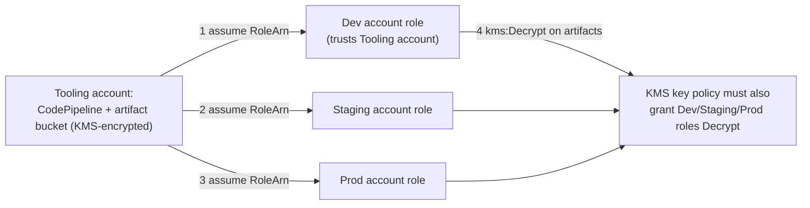

Step by step: (1)-(3) CodePipeline's deploy action in each stage assumes a role that already exists
in that target account and trusts the tooling account; (4) because the deployment artifacts are
encrypted under a KMS key owned by the tooling account, each target account's assumed role also
needs `kms:Decrypt` granted in that key's policy — missing this step is the most common cause of a
cross-account deploy failing with Access Denied even though the IAM role trust itself is correct.

**Why the others are wrong:**
- A: Hardcoding root credentials anywhere, let alone in a pipeline configuration, is a severe and explicitly discouraged security practice, and root credentials should never be used for day-to-day automation at all.
- C: Duplicating the pipeline definition across accounts defeats the purpose of centralized CI/CD (single source of truth, consistent promotion gates) and reintroduces manual, error-prone coordination.
- D: `CreateAccount` provisions brand-new AWS accounts; it has nothing to do with deploying a CloudFormation stack into already-existing target accounts, and calling it repeatedly would be both wrong and destructive.

---

## Q17 — Domain 4: Troubleshooting and Optimization

Choose **TWO** correct, cost-effective actions for a Lambda-based application's over-provisioned
DynamoDB table. The table uses provisioned (not on-demand) capacity, and CloudWatch shows it rarely
uses more than 20% of its provisioned read capacity and almost never throttles, with a steady,
predictable traffic pattern.

A. Enable DynamoDB **auto scaling** on the table with a sensible target utilization (e.g. 70%), letting provisioned RCU/WCU track actual demand automatically instead of sitting fixed at a level sized for a worst case that rarely occurs.

B. Manually reduce the table's provisioned RCU/WCU to align with observed utilization (with reasonable headroom for normal variability), since right-sizing a steady, predictable, over-provisioned workload directly cuts billed capacity without changing on-demand's per-request premium.

C. Switch the table to on-demand billing mode, which always costs less than any provisioned configuration regardless of traffic predictability or steadiness.

D. Add a Global Secondary Index to spread read load across more partitions, which reduces the base table's total billed capacity.

E. Enable DynamoDB Accelerator (DAX) in front of the table, which eliminates all read-capacity billing on the base table entirely.

**Correct Answer: A, B**

**Explanation:** For workloads with steady, predictable, well-understood traffic that's already
over-provisioned (20% utilization, no throttling), the cost-effective fix is **right-sizing**
provisioned capacity — either by enabling **auto scaling** (so RCU/WCU tracks real demand within a
target utilization band automatically) or by **manually reducing** RCU/WCU to match the observed
pattern with headroom. Both directly cut billed capacity for a workload that's genuinely steady and
predictable; provisioned capacity (right-sized) is typically cheaper than on-demand for exactly this
profile. This is Task 4.3's core DynamoDB cost-optimization pattern. See [`services/database/dynamodb.md`](../../../services/database/dynamodb.md).

**Why the others are wrong:**
- C: On-demand mode charges a higher effective per-request rate in exchange for zero capacity planning; for steady, predictable, efficiently-provisioned workloads like this one, on-demand is usually *more* expensive, not universally cheaper regardless of pattern.
- D: Adding a GSI adds its own separate provisioned/billed capacity and additional storage cost; it does not reduce the base table's billed capacity and is unrelated to right-sizing an over-provisioned table.
- E: DAX caches reads but doesn't change how the base table itself is billed — the base table's provisioned RCU/WCU still exists and is still billed regardless of cache hit rate, and DAX itself adds its own separate node-hour cost on top.

---

## Q18 — Domain 2: Security

A Lambda function needs to call Amazon Cognito after a user signs up, to customize the ID token
claims issued to that user (e.g. injecting a `tenantId` custom attribute derived from business logic
that can't live purely in Cognito's built-in attribute schema). Which Cognito feature is designed for
exactly this kind of custom, code-driven claim injection?

A. A Cognito Identity Pool role mapping rule.

B. A Cognito User Pool **Pre Token Generation** Lambda trigger, which Cognito invokes just before issuing tokens, allowing the function to add/override claims in the ID and access tokens.

C. An App Client's `ExplicitAuthFlows` setting.

D. A Cognito User Pool domain's custom branding configuration.

**Correct Answer: B**

**Explanation:** The **Pre Token Generation** trigger fires right before Cognito issues tokens
(during sign-in or token refresh), receiving the user's existing attributes/groups and letting the
Lambda function return a response that adds, overrides, or suppresses specific claims in the
resulting ID/access token — this is the standard mechanism for injecting business-logic-derived
claims like a computed `tenantId`, well beyond the user pool's static attribute schema. This is
Task 2.1 federation/authZ content. See [`services/security-identity-compliance/cognito.md`](../../../services/security-identity-compliance/cognito.md).

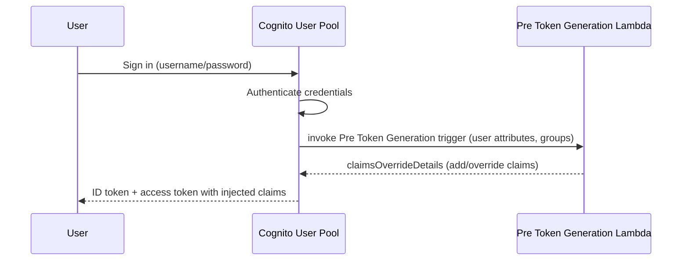

Step by step: (1) the user authenticates normally; (2) before issuing tokens, Cognito pauses and
invokes the Lambda trigger, passing the user's current attributes and group memberships; (3) the
function returns a `claimsOverrideDetails` object specifying claims to add, suppress, or override;
(4) Cognito merges that into the final token it issues — the application never needs a second
round-trip to fetch this derived data.

**Why the others are wrong:**
- A: Identity Pool role mapping rules determine which IAM role a federated/authenticated identity assumes for AWS credential vending; they don't modify the contents of User Pool-issued ID/access tokens.
- C: `ExplicitAuthFlows` configures which authentication flows (e.g. `ADMIN_USER_PASSWORD_AUTH`, `USER_SRP_AUTH`) an app client is permitted to use; it has no role in customizing token claims.
- D: A user pool domain's branding/hosted-UI configuration affects the visual sign-in page, not the programmatic contents of issued tokens.

---

## Q19 — Domain 1: Development with AWS Services

A team needs a Lambda function to be invoked via a simple HTTPS URL for webhook callbacks from a
third-party service, without provisioning an API Gateway API at all, since they only need one
function reachable at one URL with minimal configuration. Which feature fits, and what is an
important limitation to know?

A. Lambda function URLs — a dedicated HTTPS endpoint tied to a specific function/alias, configurable with `AWS_IAM` or `NONE` auth; unlike API Gateway, they don't support custom domain mapping, request throttling plans, or usage plans out of the box.

B. API Gateway HTTP API with a `$default` route — this is the only AWS-native way to expose a single Lambda function over HTTPS.

C. An S3 static website redirect rule pointing at the Lambda function's ARN.

D. A CloudFront distribution with the Lambda function set directly as the origin's DNS name.

**Correct Answer: A**

**Explanation:** **Lambda function URLs** are a dedicated, built-in HTTPS endpoint per function (or
alias), requiring no separate API Gateway resource — ideal for simple single-function webhook/HTTP
use cases. They support two auth types (`AWS_IAM` for SigV4-signed requests, or `NONE` for fully
public access) but lack API Gateway's richer feature set like usage plans, request validation,
custom authorizers, or native custom domain mapping without extra services like CloudFront in front.
This is Task 1.2 Lambda content. See [`services/compute/lambda.md`](../../../services/compute/lambda.md).

**Why the others are wrong:**
- B: API Gateway HTTP APIs are a perfectly valid way to expose a Lambda function, but they are not the *only* AWS-native option — function URLs exist precisely to avoid needing API Gateway for simple cases.
- C: S3 static website redirect rules can only issue HTTP redirects to other URLs/buckets; they have no mechanism to invoke a Lambda function or any ARN-based resource.
- D: CloudFront origins must be an HTTP(S) endpoint (e.g. S3, ALB, or a function URL/API Gateway domain) — a Lambda function's ARN is not a valid origin "DNS name" and cannot be set directly as one.

---

## Q20 — Domain 4: Troubleshooting and Optimization

A team wants to detect subtle but real degradation in a Lambda function's duration metric — not a
spike above a fixed threshold, but a pattern that deviates from its own normal historical range for
that time of day/week (e.g. slightly slower every Monday morning that a static threshold wouldn't
catch without being either too sensitive or too loose). Which CloudWatch alarm type is designed for
this?

A. A standard static-threshold metric alarm set conservatively low.

B. A CloudWatch **anomaly detection** alarm, which models the metric's expected range using machine learning on historical data (capturing seasonal/daily/weekly patterns) and alarms when the metric falls outside its dynamically computed band.

C. A composite alarm combining two static alarms with `AND` logic.

D. A billing alarm configured on the Lambda service's estimated charges.

**Correct Answer: B**

**Explanation:** CloudWatch **anomaly detection** applies a statistical/ML model to a metric's
history, producing a continuously-updated expected range (a band) that accounts for trends and
recurring patterns (like "usually a bit slower on Monday mornings"); an anomaly alarm fires when the
actual value falls outside that band by a configurable number of standard deviations — exactly
suited for catching deviations a fixed threshold would either miss or over-trigger on. This is Task
4.1/4.3 observability content. See [`services/management-governance/cloudwatch.md`](../../../services/management-governance/cloudwatch.md).

**Why the others are wrong:**
- A: A static threshold has no concept of "normal for this time of day/week" — setting it low enough to catch subtle Monday-morning slowdowns would also false-alarm constantly during legitimately busier periods.
- C: A composite alarm only combines the `ALARM`/`OK` states of other alarms with boolean logic; it doesn't add any pattern-awareness of its own — the underlying alarms would still need to be anomaly-based to get this behavior.
- D: Billing alarms track AWS estimated charges, not application performance metrics like Lambda duration; they're unrelated to this scenario entirely.

---

## Q21 — Domain 3: Testing and Deployment

A CodeDeploy deployment group for an ECS service is configured with `CodeDeployDefault.ECSLinear10PercentEvery1Minutes`.
During a deployment, what does this configuration actually do, and how does it differ from an
`AllAtOnce` deployment config?

A. It deploys the new task set to 10% of running tasks, waits one minute total, then cuts over the rest — identical in effect to `AllAtOnce` but with an extra minute of delay.

B. It shifts production traffic to the new (green) task set in fixed 10% increments every minute via the configured load balancer listener, continuing until 100% of traffic has shifted, giving CloudWatch alarms repeated windows to detect problems and trigger an automatic rollback before full cutover.

C. It runs 10% of the test suite before promoting, repeating until all tests pass or one minute elapses.

D. It permanently splits traffic 90/10 between old and new versions indefinitely, never reaching 100%.

**Correct Answer: B**

**Explanation:** Linear deployment configs shift a fixed percentage of traffic from the old to the
new task set at a fixed time interval (here, 10% every minute, reaching 100% in 10 minutes),
continuously giving any configured CloudWatch alarms a chance to trigger an automatic rollback if
error rates spike at any increment — versus `AllAtOnce`, which cuts 100% of traffic over immediately
with no gradual exposure window. This is Task 3.3's deployment-strategy content. See
[`services/developer-tools/codedeploy.md`](../../../services/developer-tools/codedeploy.md).

**Why the others are wrong:**
- A: `AllAtOnce` shifts 100% immediately with no incremental steps at all; a linear 10%-per-minute rollout is fundamentally different (gradual, alarm-gated) rather than "the same but delayed."
- C: CodeDeploy's deployment configs govern traffic/task shifting percentages and timing, not test execution; test suites run in earlier pipeline stages (e.g. CodeBuild), not as part of the deployment config's percentage semantics.
- D: Linear configs always progress toward 100% at the configured pace unless a rollback is triggered; they don't settle into a permanent partial split.

---

## Q22 — Domain 2: Security

A Cognito User Pool is configured with two groups, `admins` and `standard-users`, each mapped to a
different IAM role via group precedence. A user signs in and is confirmed as a member of both
groups. Which statement correctly describes which IAM role that user's temporary credentials will
use when exchanging their ID token via an Identity Pool?

A. The user gets a merged role combining the permissions of both groups' roles.

B. The group with the numerically lower `Precedence` value wins, and the role mapped to that group is the one used — Cognito uses precedence specifically to resolve exactly this kind of multi-group ambiguity.

C. The identity pool randomly selects one of the two roles on each credential request.

D. Membership in multiple groups is not permitted by Cognito, so this configuration would have failed at user creation.

**Correct Answer: B**

**Explanation:** When a user belongs to multiple Cognito User Pool groups that each map to different
IAM roles, the group's `Precedence` attribute (lower number = higher priority) determines which
single role's credentials the user receives through an Identity Pool — this is precisely the
documented purpose of precedence, to deterministically resolve multi-group role conflicts. This is
Task 2.1 Cognito authZ content. See [`services/security-identity-compliance/cognito.md`](../../../services/security-identity-compliance/cognito.md).

**Why the others are wrong:**
- A: IAM credential vending through an Identity Pool returns a single assumed role's credentials per request; there's no mechanism to merge two separate roles' policies into one combined session.
- C: Role selection is deterministic (precedence-based), not random — the same user with the same group memberships will consistently get the same resolved role.
- D: Cognito fully supports users belonging to multiple groups simultaneously; precedence exists specifically because this is a common and supported configuration.

---

## Q23 — Domain 1: Development with AWS Services

A Lambda function processes incoming orders. On success, the team wants a message automatically
sent to an SQS queue consumed by an analytics service — without the function's own code needing to
publish that message. On failure (after all retries are exhausted), they want the failed event sent
to a separate SQS dead-letter queue for manual inspection. Which Lambda feature(s) correctly achieve
both requirements with the least custom code?

A. Configure a single on-failure Destination pointing at the DLQ; there is no equivalent "on success" mechanism, so success notifications must be coded manually.

B. Configure Lambda **Destinations**: an on-success destination (the analytics SQS queue) and a separate on-failure destination (the DLQ) — both delivered automatically by the Lambda service itself after an asynchronous invocation completes, with no handler code required for either.

C. Attach a single DLQ to the function; Lambda automatically also forwards every successful invocation's result to the same DLQ for auditing.

D. Use an SQS event source mapping's `redrivePolicy` to define both the success and failure targets.

**Correct Answer: B**

**Explanation:** Lambda **Destinations** (for asynchronous invocations) let you configure separate
targets for success and failure outcomes — each can be an SQS queue, SNS topic, another Lambda
function, or EventBridge — fully handled by the Lambda service after invocation completes, with the
invocation record (including payload and response) delivered automatically. This supersedes the
older DLQ-only mechanism (which only covers failures) by also covering the success path. See
[`services/compute/lambda.md`](../../../services/compute/lambda.md).

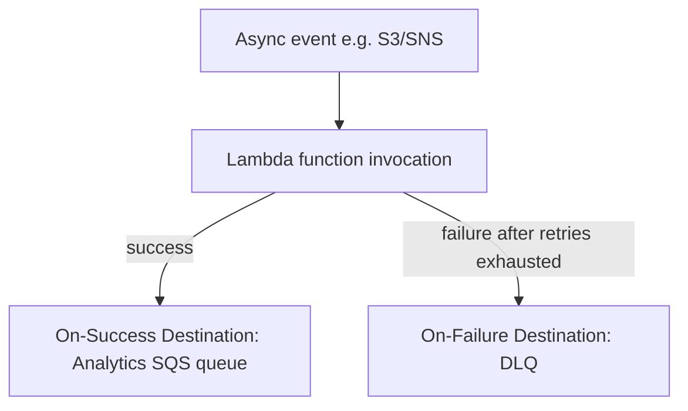

Step by step: (1) an asynchronous event invokes the function; (2a) if the invocation succeeds, the
Lambda service automatically delivers the invocation record to the on-success destination (the
analytics queue) with zero application code; (2b) if it fails and retries are exhausted, the service
automatically delivers the failed event to the on-failure destination (the DLQ) instead.

**Why the others are wrong:**
- A: This undersells Destinations' actual capability — on-success destinations are a first-class, fully supported feature, not something requiring manual coding.
- C: A legacy DLQ configuration only ever receives failed-after-retries events; it has no "also forward successes" behavior, and mixing success/failure records into one queue would defeat the purpose of separating them anyway.
- D: SQS event source mapping redrive policies configure what happens when a *queue consumer* (the Lambda function) repeatedly fails to process messages pulled *from* SQS (a different direction entirely) — they are unrelated to Lambda's own asynchronous-invocation Destinations feature.

---

## Q24 — Domain 3: Testing and Deployment

A team is deploying a Lambda function whose runtime dependencies include a large native binary
library (needed for video transcoding) that exceeds the 250 MB unzipped deployment package limit
even after using layers. What is the correct way to package and deploy this function?

A. Split the function into two separate Lambda functions so each stays under the size limit.

B. Package the function as a **container image** (up to 10 GB) pushed to Amazon ECR, and configure the Lambda function with `PackageType: Image` referencing that image.

C. Store the binary library in S3 and have the function download it on every cold start before processing.

D. Request an AWS support limit increase for the deployment package size.

**Correct Answer: B**

**Explanation:** Lambda supports **container image packaging** (as an alternative to the traditional
zip-based deployment), supporting images up to 10 GB — far beyond the 250 MB unzipped limit for
zip/layers — which is the standard solution for functions with large dependencies like native
transcoding libraries, ML models, or large language runtimes. This is Task 1.2's packaging content.
See [`services/compute/lambda.md`](../../../services/compute/lambda.md).

**Why the others are wrong:**
- A: Splitting the function doesn't reduce the size of the dependency itself — whichever function actually needs the transcoding library still needs to include it, hitting the same limit.
- C: Downloading a large binary from S3 on every cold start adds significant latency and repeated data-transfer cost, and still requires enough `/tmp` or memory-backed storage to hold it — it's a workaround, not the purpose-built solution, and container images solve this cleanly.
- D: The 250 MB unzipped package limit for zip-based functions is a hard platform limit, not something resolved via an AWS Support case; the documented solution for exceeding it is to use container image packaging instead.

---

## Q25 — Domain 2: Security

A Cognito User Pool group `premium-users` is mapped to an IAM role that grants write access to a
specific S3 prefix. The security team wants to confirm this is enforced correctly: a `standard-user`
(not in that group) should never be able to write to that prefix even if they somehow obtain
temporary credentials. Where is this ultimately enforced?

A. Entirely client-side, by hiding the "upload" UI button for non-premium users.

B. By the IAM policy attached to the role that the Identity Pool actually vends for that user's resolved group — a `standard-user` who isn't in `premium-users` is never issued that role's credentials in the first place, and even if they were, the role's policy itself (evaluated by IAM/S3 on every request) would be the final authority.

C. By an API Gateway resource policy that checks the user's Cognito group membership on every request.

D. By Cognito itself intercepting and blocking the S3 API call before credentials are even issued.

**Correct Answer: B**

**Explanation:** Security enforcement for AWS API calls is never a client-side or UI concern — it's
enforced by IAM at the moment each AWS API call is made, using the actual IAM policy attached to
whatever role the caller's credentials represent. A `standard-user` is simply never handed the
`premium-users` role's credentials by the Identity Pool's role-mapping logic, and even in a
hypothetical credential-leak scenario, the receiving party would still be bound by that role's
policy document, which IAM/S3 evaluate on every single API request regardless of how the caller
obtained the credentials. See [`services/security-identity-compliance/cognito.md`](../../../services/security-identity-compliance/cognito.md).

**Why the others are wrong:**
- A: Hiding a UI button is purely cosmetic and provides zero actual security — a user could still call the S3 API directly with any credentials they hold, bypassing the UI entirely.
- C: This scenario describes direct AWS SDK calls to S3 using vended temporary credentials, not calls routed through an API Gateway API; adding an API Gateway layer isn't how this particular architecture (Identity Pool → direct AWS SDK calls) is secured.
- D: Cognito issues credentials via STS but does not sit in the data path of subsequent AWS API calls made with those credentials — it has no mechanism to "intercept" an S3 `PutObject` call made directly to S3's endpoint afterward.

---

## Q26 — Domain 4: Troubleshooting and Optimization

A team wants to reduce their monthly S3 bill for a bucket holding years of log files, most of which
are never accessed after 30 days but must be retained for 7 years for compliance. They're currently
paying S3 Standard rates for the entire 7 years of data. Which combination of AWS tools should they
use to both diagnose the actual access pattern and implement the fix?

A. Enable **S3 Storage Class Analysis** to observe real access patterns over time, then configure an **S3 Lifecycle policy** transitioning objects older than 30 days to Glacier Deep Archive (or an intermediate tier first), based on the observed pattern.

B. Manually review S3 server access logs line by line to estimate access frequency, then delete objects older than 30 days to save money.

C. Enable S3 Intelligent-Tiering monitoring only, since it requires no lifecycle configuration and automatically deletes cold objects.

D. Switch the entire bucket to S3 One Zone-IA immediately without further analysis, since any IA tier is always cheaper than Standard regardless of access pattern.

**Correct Answer: A**

**Explanation:** **Storage Class Analysis** observes actual access patterns (how often objects of
different ages are retrieved) and recommends an appropriate point at which to transition data to
infrequent-access or archive tiers; a **Lifecycle policy** then automates the transition at the
confirmed age threshold — for logs needed only for rare compliance audits after 30 days, Glacier
Deep Archive offers the lowest storage cost for the remaining ~7-year retention. This is Task 4.3
cost-optimization content. See [`services/storage/s3-storage-classes.md`](../../../services/storage/s3-storage-classes.md).

**Why the others are wrong:**
- B: Manually reviewing access logs doesn't scale and is error-prone, and deleting data that must be retained for 7 years for compliance would violate the stated retention requirement entirely — this is actively the wrong action, not just an inefficient one.
- C: Intelligent-Tiering automatically moves objects between access tiers based on observed access patterns, but it does **not** delete objects — that claim describes lifecycle expiration, a different feature, and conflates two unrelated mechanisms.
- D: Not every workload benefits from IA tiers — One Zone-IA has a retrieval fee and only a single Availability Zone's durability; blindly moving everything without regard to actual access pattern or durability requirements is not a sound cost/risk decision, and skips the diagnostic step the question explicitly asks for.

---

## Q27 — Domain 3: Testing and Deployment

A CloudFormation template defines an RDS instance resource. After the stack was deployed, someone
manually changed the instance's `BackupRetentionPeriod` directly in the RDS console, bypassing
CloudFormation entirely. The team wants a way to detect that the live resource configuration no
longer matches what the template declares, without re-deploying anything. Which CloudFormation
feature does this?

A. `aws cloudformation validate-template`, which checks template syntax against the live resource state.

B. **Drift detection** (`aws cloudformation detect-stack-drift`), which compares each resource's actual, live configuration against the template's expected configuration and reports any discrepancies per-resource and per-property.

C. A stack update with `--no-execute-changeset`, which reports differences without applying them.

D. CloudTrail's `LookupEvents` API, filtered to `ModifyDBInstance` calls.

**Correct Answer: B**

**Explanation:** **Drift detection** is purpose-built for exactly this: it queries the actual,
current configuration of each resource CloudFormation manages and compares it against what the
template/stack believes should be true, flagging resources as `MODIFIED`, `DELETED`, or `IN_SYNC`,
down to the specific property level (e.g. `BackupRetentionPeriod` changed from 7 to 1). This is Task
3.2 IaC-governance content. See [`services/management-governance/cloudformation.md`](../../../services/management-governance/cloudformation.md).

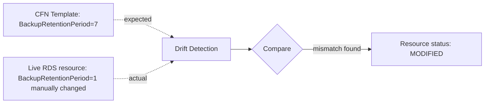

Step by step: (1) the template still declares `BackupRetentionPeriod: 7`; (2) the live resource was
manually changed to `1` outside CloudFormation; (3) running drift detection queries the real RDS
instance's current configuration and compares it property-by-property against the template's
expectations; (4) the specific property mismatch is reported, flagging the resource `MODIFIED`.

**Why the others are wrong:**
- A: `validate-template` only checks that the template's JSON/YAML is syntactically well-formed and references valid resource types/properties — it never inspects live resource state at all.
- C: A change set with `--no-execute-changeset` shows what *would* change if you applied the template *again*, computed from the template's own declared values — not a comparison against manual out-of-band changes unless you happen to re-run an update, and it doesn't flag drift that hasn't yet been acted on.
- D: CloudTrail can show *who* made the `ModifyDBInstance` call and *when*, which is useful forensic context, but it doesn't tell CloudFormation (or the team) that the live state now diverges from the template's expectations — that correlation is drift detection's specific job.

---

## Q28 — Domain 1: Development with AWS Services

A Lambda function needs to invoke the AWS Encryption SDK pattern (envelope encryption) to encrypt a
large payload client-side before storing it in S3, using a KMS customer master key, without sending
the full plaintext payload to KMS itself (which has request size limits and would be slow/costly for
large data). Which call sequence correctly implements envelope encryption?

A. Call `kms:Encrypt` directly on the full payload, since KMS natively supports encrypting objects of any size.

B. Call `kms:GenerateDataKey` to get a plaintext data key and its KMS-encrypted counterpart; use the plaintext data key with a local symmetric cipher (e.g. AES-GCM) to encrypt the actual payload; store the ciphertext payload alongside the encrypted data key; discard the plaintext data key from memory.

C. Call `kms:Sign` on the payload to produce a signature, then store the signature in place of the payload.

D. Store the payload directly in a Secrets Manager secret, which transparently performs envelope encryption with no additional API calls required.

**Correct Answer: B**

**Explanation:** `kms:GenerateDataKey` returns both a plaintext data key (for immediate local use)
and that same key encrypted under your KMS CMK; your application uses the plaintext key to encrypt
the actual large payload locally with a fast symmetric cipher, then stores only the ciphertext
payload plus the encrypted data key (never the plaintext key) — this is **envelope encryption**,
and it's how the AWS Encryption SDK itself works under the hood. Decryption reverses this: call
`kms:Decrypt` on the small encrypted data key to get the plaintext key back, then use it locally to
decrypt the payload. This is Task 1.1/2.2 content. See [`services/security-identity-compliance/kms.md`](../../../services/security-identity-compliance/kms.md).

**Why the others are wrong:**
- A: `kms:Encrypt` has a strict request size limit (4 KB for symmetric CMKs) — it is explicitly not designed for encrypting large payloads directly, which is exactly why envelope encryption with a data key exists.
- C: `kms:Sign` produces a cryptographic signature for integrity/authenticity verification, not ciphertext — it doesn't encrypt the payload at all and serves an entirely different purpose (signing vs. encrypting).
- D: Secrets Manager secrets have their own size limit (64 KB) and are designed for small, structured secrets like credentials, not arbitrary large payloads — and even where it does apply encryption, that's not "no additional API calls," it's Secrets Manager's own internal KMS integration for its own data model.

---

## Q29 — Domain 3: Testing and Deployment

A CloudFormation template is becoming unwieldy as one 2,000-line file defining a VPC, an RDS
instance, and an ECS cluster together. The team wants to split it into logically separate, reusable
pieces (network, database, compute) that can still be deployed together as one coordinated stack,
with outputs from the network stack feeding into the database and compute stacks. Which
CloudFormation feature fits this?

A. CloudFormation **StackSets**, which deploy the same template to many accounts/regions.

B. **Nested stacks**, where a parent template's resources include `AWS::CloudFormation::Stack` resources pointing at child templates (network, database, compute), with the parent passing parameters down and reading `!GetAtt` outputs back up between them.

C. Splitting into three entirely separate, independently-deployed top-level stacks with no formal reference mechanism between them, relying on hardcoded ARNs.

D. CloudFormation `Transform: AWS::Include` to literally paste every child template's text into one combined file before deployment.

**Correct Answer: B**

**Explanation:** **Nested stacks** let a parent template declare child stacks as resources
(`AWS::CloudFormation::Stack`, each pointing at its own template, often in S3), passing `Parameters`
down into each child and reading the child's declared `Outputs` back via `!GetAtt ChildStack.Outputs.SomeOutput`
— this is the standard pattern for decomposing a large template into logical, reusable units that
still deploy and update together as one coordinated unit. This is Task 3.2 IaC content. See
[`services/management-governance/cloudformation.md`](../../../services/management-governance/cloudformation.md).

**Why the others are wrong:**
- A: StackSets solve a different problem — deploying the *same* template consistently across many accounts/regions, not decomposing one large template's resources into logically separate, interdependent pieces within a single deployment.
- C: Fully independent stacks with no formal cross-stack reference mechanism (hardcoded ARNs) are brittle — any change to a hardcoded value requires manually updating every dependent stack, and CloudFormation has no way to track or validate the relationship.
- D: `AWS::Include` is a macro transform for inlining reusable template *snippets* (not full independent stacks with their own lifecycle) at deploy time; it doesn't provide the separate-stack-with-outputs coordination nested stacks offer.

---

## Q30 — Domain 1: Development with AWS Services

A video-processing Lambda function needs up to 6 GB of local scratch space to assemble temporary
video segments before uploading the final file to S3, far more than the Lambda default `/tmp` size.
Which Lambda configuration setting should the developer adjust?

A. `MemorySize`, since `/tmp` storage is automatically sized as a fixed percentage of configured memory.

B. `EphemeralStorage.Size`, a dedicated setting independent of memory, configurable from 512 MB up to 10,240 MB, which directly controls the `/tmp` directory's capacity.

C. The function's `Timeout`, which also controls how much `/tmp` space is reserved.

D. Attach an EFS file system — Lambda has no way to configure `/tmp` size beyond the fixed 512 MB default.

**Correct Answer: B**

**Explanation:** Lambda's `/tmp` ephemeral storage size is configured **independently** of memory via
the `EphemeralStorage.Size` property (CLI: `--ephemeral-storage Size=6144`), adjustable from the 512
MB default up to 10,240 MB — exactly suited to a scratch-space-heavy workload like temporary video
assembly, without needing EFS at all for this use case. This is Task 1.2 Lambda configuration
content. See [`services/compute/lambda.md`](../../../services/compute/lambda.md).

**Why the others are wrong:**
- A: Memory and ephemeral storage are separate, independently billed and configured settings in modern Lambda — increasing `MemorySize` does not automatically grow `/tmp` capacity.
- C: `Timeout` controls how long an invocation is allowed to run before being terminated; it has no relationship to `/tmp` storage capacity.
- D: Lambda does support configuring `/tmp` beyond 512 MB natively (up to 10 GB) without needing EFS; EFS is a separate option useful for sharing large, persistent state *across* invocations/functions, not a requirement for larger scratch space within one invocation.

---

## Q31 — Domain 2: Security

A Lambda function's execution role needs to use a KMS customer-managed key to decrypt environment
variables and a separate S3 object. The KMS key's key policy currently only grants administrative
actions to the account root and a specific IAM group of security engineers — the Lambda execution
role is not mentioned anywhere in the key policy, nor does the execution role's own IAM policy
mention the key. What happens when the function tries to decrypt?

A. The call succeeds anyway, because any principal in the same account can use any KMS key in that account by default.

B. The call is denied — KMS keys, as resource-based-policy-governed resources, require the key policy itself (or a grant) to authorize the caller, in addition to (not instead of) the caller's own identity-based IAM permissions; missing from the key policy means access is denied regardless of what the execution role's own policy says.

C. The call succeeds because Lambda execution roles are implicitly trusted by all KMS keys in the account.

D. The call is denied only if the key is a customer-managed key; AWS-managed keys would work automatically for any principal.

**Correct Answer: B**

**Explanation:** Unlike most AWS resources, **KMS key policies are mandatory** — even a principal
with full IAM-level `kms:Decrypt` permission in their identity-based policy cannot use a key unless
the key's own resource policy (or a grant derived from it) also authorizes them. This dual-gate
design means a key with no mention of the execution role (and no grant) will deny access, no matter
what the role's own IAM policy says. The fix is to add a statement to the key policy allowing the
execution role's ARN to call `kms:Decrypt` (and related actions). See [`services/security-identity-compliance/kms.md`](../../../services/security-identity-compliance/kms.md).

**Why the others are wrong:**
- A: KMS explicitly does **not** grant account-wide implicit access to customer-managed keys by default — this is precisely why the key policy's default statement granting the root user full access is often the *only* reason some keys appear permissive, and it does not extend to all principals in the account automatically for other actions.
- C: There is no blanket trust relationship between Lambda execution roles and KMS keys; each key's policy must explicitly authorize whichever specific principals need to use it.
- D: AWS-managed keys (like `aws/lambda`) still enforce resource-level authorization via their policy, which AWS controls and typically scopes to the relevant service's usage pattern — they are not universally usable by any principal either, though their default policies are often broader for the service they're tied to.

---

## Q32 — Domain 4: Troubleshooting and Optimization

A team profiles their Lambda function using the open-source AWS Lambda Power Tuning tool (a Step
Functions state machine that invokes the function repeatedly at different memory settings and
measures cost/duration). The results show that cost and duration *both* decrease when memory is
raised from 128 MB to 512 MB, then duration keeps dropping only slightly while cost starts rising
past 1024 MB. What does this pattern indicate, and what should the team do?

A. The function is I/O-bound, not CPU-bound, so memory has no effect on duration at any setting — the data must be wrong.

B. Below ~1024 MB the function was CPU-starved (Lambda allocates CPU proportionally to memory), so adding memory sped it up enough to lower total cost even at a higher per-ms rate; past that point extra memory stops helping speed much while its cost keeps climbing — the team should set memory near the elbow (~512–1024 MB) where the cost curve bottoms out.

C. The tool's results are only valid for choosing memory for cold starts, not for steady-state invocations, so they should be ignored for this decision.

D. Cost and duration are billed completely independently in Lambda, so a change in duration can never affect cost.

**Correct Answer: B**

**Explanation:** Lambda allocates CPU power proportional to configured memory; for CPU-bound
functions, under-provisioned memory starves the CPU, making the function run disproportionately
long and thus cost more despite the lower per-millisecond rate. Raising memory up to the point where
CPU is no longer the bottleneck reduces duration enough to *lower* total cost (duration × rate) even
though the rate itself rose — past that "elbow" point, more memory barely helps speed, so cost just
climbs with the higher rate. The right-sizing goal is the memory setting at the bottom of that
cost curve. This is Task 4.3's Lambda-optimization content. See [`services/compute/lambda.md`](../../../services/compute/lambda.md).

**Why the others are wrong:**
- A: The described pattern (duration dropping as memory rises) is a classic signature of a CPU-bound function benefiting from more allocated CPU, not evidence of a measurement error — I/O-bound functions typically show duration staying roughly flat across memory settings instead.
- C: AWS Lambda Power Tuning measures steady-state invocation cost/duration across memory settings generally; it's commonly used for exactly this kind of right-sizing decision, not narrowly scoped to cold-start analysis only.
- D: Lambda cost is billed as a function of both duration *and* configured memory (GB-seconds), so a change in duration directly changes the billed amount — the premise that they're billed independently is false.

---

## Q33 — Domain 3: Testing and Deployment

A team deploys infrastructure via CloudFormation and wants an `AWS::CloudFormation::CustomResource`
backed by a Lambda function to perform an action CloudFormation has no native resource for (e.g.
looking up and storing a third-party SaaS API key into Parameter Store during stack creation). What
is a critical requirement the custom resource's Lambda function must fulfill for the stack operation
to complete successfully?

A. It must always return `PhysicalResourceId` as a randomly generated UUID on every invocation, including updates, to force replacement.

B. It must send a response (success or failure) back to the pre-signed S3 response URL provided in the event, within the configured timeout, or the stack operation will hang (and eventually time out/roll back) waiting for a response that never arrives.

C. It must be written in the same CloudFormation template's `Transform` section rather than as a separate Lambda resource.

D. It must have `cloudformation:*` permissions on `Resource: "*"` to be allowed to respond to the custom resource event.

**Correct Answer: B**

**Explanation:** Custom resources work by CloudFormation invoking the specified Lambda function with
an event containing a pre-signed S3 URL; the function **must** PUT a response document (indicating
`SUCCESS` or `FAILED`, plus any `Data` outputs) to that URL before the custom resource's configured
timeout — if it doesn't, CloudFormation has no way to know the operation finished, and the stack
operation stalls until it eventually times out and rolls back. This is a very common source of stuck
CloudFormation deployments. See [`services/management-governance/cloudformation.md`](../../../services/management-governance/cloudformation.md).

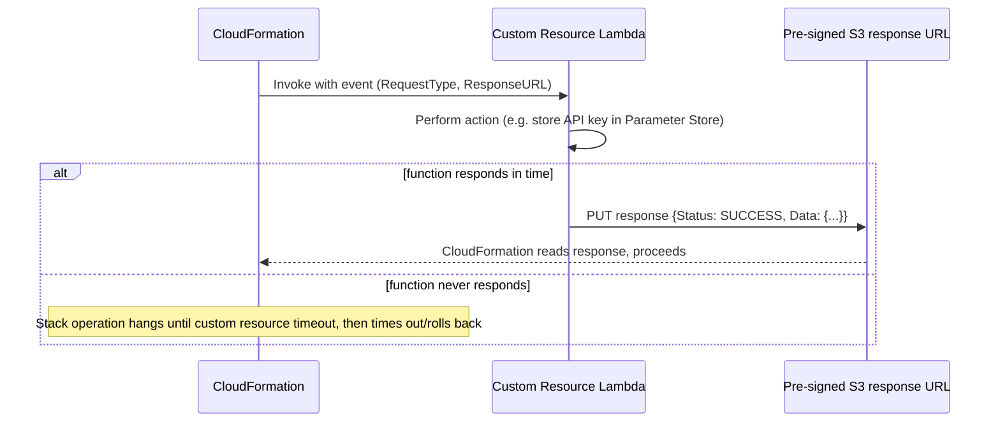

Step by step: (1) CloudFormation invokes the Lambda function and includes a pre-signed S3 URL in the
event; (2) the function performs whatever external action it owns; (3) it must PUT a JSON response
document to that exact URL indicating success or failure; (4) only once CloudFormation reads that
response does it consider the custom resource's lifecycle step complete — silence is never
interpreted as success.

**Why the others are wrong:**
- A: `PhysicalResourceId` should generally stay *stable* across updates unless you specifically intend to force replacement of the underlying resource; randomizing it every time causes unnecessary replace-on-every-update behavior, not a requirement for successful completion.
- C: Custom resources are regular resources (`AWS::CloudFormation::CustomResource` or `Custom::TypeName`) referencing a Lambda function's ARN via `ServiceToken`; they have nothing to do with the template's `Transform` section, which is for macros like SAM or `AWS::Include`.
- D: The Lambda function's *execution role* needs permissions for whatever AWS actions its own logic performs (e.g. `ssm:PutParameter`), but responding to the custom resource event is just an HTTPS PUT to a pre-signed URL — it requires no CloudFormation IAM permissions at all.

---

## Q34 — Domain 1: Development with AWS Services

A team has five Lambda functions, each independently assuming its own execution role, that all need
reserved concurrency carved out so that a sudden burst against one function can never starve the
others of the account's shared unreserved concurrency pool. The account's total regional concurrency
limit is 1,000. The team sets `ReservedConcurrentExecutions` to 150 on each of the five functions
(750 total reserved). What is the effect on the remaining, unreserved pool shared by every other
function in the account (including any not in this group)?

A. Nothing changes; reserved concurrency is purely informational and doesn't actually subtract from the shared pool.

B. The shared, unreserved pool available to all other functions in the account shrinks to 250 (1,000 − 750), and each of the five functions is capped at exactly 150 concurrent executions regardless of how much the shared pool has available.

C. Reserved concurrency only applies during cold starts; once functions are warm, they draw from the full 1,000 regardless of reservations.

D. Setting reserved concurrency on five functions automatically increases the account's total regional limit to accommodate them.

**Correct Answer: B**

**Explanation:** `ReservedConcurrentExecutions` both guarantees *and caps* concurrency for a specific
function: it's subtracted from the account-wide pool (reducing what's left for every other,
unreserved function) while simultaneously being the hard ceiling that one function itself can never
exceed, even if the rest of the account's pool is sitting idle. Over-reserving across many functions
can starve the shared pool for everything else, which is exactly the trade-off teams must plan for.
This is Task 1.2 concurrency content. See [`services/compute/lambda.md`](../../../services/compute/lambda.md).

**Why the others are wrong:**
- A: Reserved concurrency is a hard, enforced allocation, not informational — AWS actively tracks and enforces both the reservation and the resulting reduction of the shared pool.
- C: Concurrency limits (reserved or unreserved) apply to concurrent *executions* regardless of cold or warm state; "only during cold starts" isn't how the mechanism works at all.
- D: Reserved concurrency is carved out of the account's *existing* regional limit; it never increases that limit — raising the account-wide limit requires a separate AWS Support service-quota increase request.

---

## Q35 — Domain 2: Security

A company requires that any S3 bucket holding customer PII be encrypted with a customer-managed KMS
key (not SSE-S3), and that this be *enforced* — not just configured as a default — so that even a
client explicitly requesting SSE-S3 or no encryption header is rejected at upload time. Which bucket
policy statement enforces this correctly?

A. Set the bucket's default encryption to SSE-KMS with the customer-managed key; this alone guarantees every object is encrypted with that key, with no additional policy needed.

B. Add a bucket policy statement that denies `s3:PutObject` unless the request's `s3:x-amz-server-side-encryption` equals `aws:kms` AND `s3:x-amz-server-side-encryption-aws-kms-key-id` equals the specific key's ARN — rejecting any upload that doesn't explicitly request that exact key.

C. Attach an SCP at the organization root denying `s3:PutObject` account-wide unless MFA is present.

D. Enable S3 Object Lock in compliance mode, which implicitly forces all uploads to use the bucket's default KMS key.

**Correct Answer: B**

**Explanation:** Bucket default encryption applies automatically only when the *request itself*
doesn't specify an encryption header — a client that explicitly requests SSE-S3 or a different key
will have that request honored unless a bucket policy actively denies it. The robust enforcement
pattern is a `Deny` statement conditioned on the encryption headers, rejecting any `PutObject` that
doesn't match the required KMS key exactly — this is the standard Task 2.2 "enforce encryption in
transit/at rest" pattern. See [`services/storage/s3.md`](../../../services/storage/s3.md) and
[`services/security-identity-compliance/kms.md`](../../../services/security-identity-compliance/kms.md).

**Why the others are wrong:**
- A: Default encryption is a *fallback* applied only when the uploader's request omits encryption settings — it does not override or reject a request that explicitly asks for a different encryption method, which is exactly the gap the scenario describes needing closed.
- C: An SCP can restrict IAM principals' ability to call `PutObject` account-wide, but SCPs don't evaluate S3-specific request headers like encryption settings, and they don't apply to anonymous/cross-account callers the way a bucket policy does — it's the wrong enforcement layer for this specific requirement.
- D: Object Lock (WORM) governs retention and deletion prevention for compliance holds; it has no relationship to which encryption key is used for new uploads.

---

## Q36 — Domain 1: Development with AWS Services

A workflow needs to process a variable-length list of items (sometimes 3, sometimes 3,000) from an
input array, running the same processing logic on each item, with up to 40 items processed
concurrently at a time, and the overall workflow should fail only if more than 5% of items fail.
Which Step Functions state type is purpose-built for this?

A. A `Parallel` state with a fixed number of hardcoded branches, one per possible item.

B. A `Map` state with `MaxConcurrency` set to 40 and a `ToleratedFailurePercentage` of 5, iterating over the input array and applying the same inner workflow to each item.

C. A `Choice` state with one branch per possible array length.

D. A `Wait` state configured with a dynamic `SecondsPath` equal to the array length.

**Correct Answer: B**

**Explanation:** The **Map** state is designed exactly for "run this same sub-workflow over every
item in a dynamically-sized array," with `MaxConcurrency` controlling how many iterations run at
once (here capped at 40) and, in Distributed Map / newer Map configurations, a tolerated-failure
percentage that lets the overall state succeed even if a bounded fraction of iterations fail — ideal
for large, variable-size batch item processing. This is Task 1.1 Step Functions content.

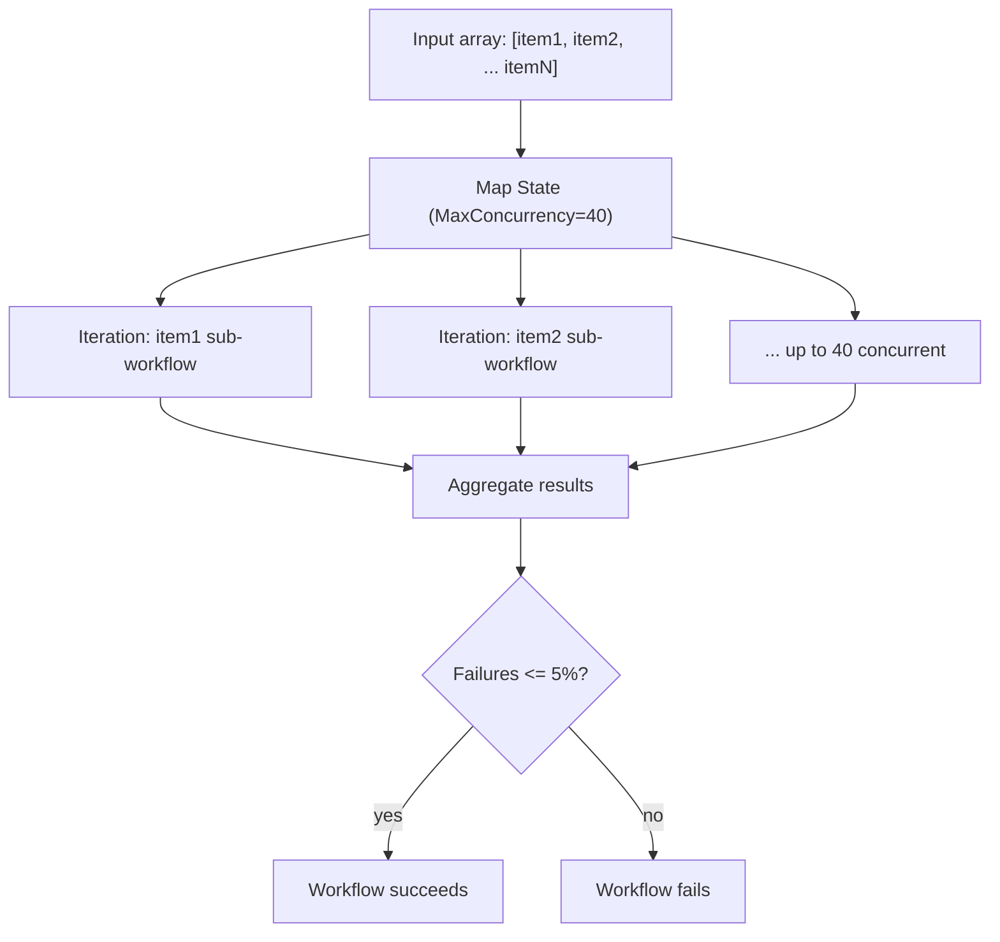

Step by step: (1) the Map state receives the full input array; (2) it launches iterations of the
inner sub-workflow for each item, never exceeding 40 concurrently; (3) each iteration independently
succeeds or fails; (4) once all iterations finish, the tolerated-failure-percentage setting
determines whether enough succeeded for the overall Map state (and workflow) to be considered
successful. See [`services/application-integration/step-functions.md`](../../../services/application-integration/step-functions.md).

**Why the others are wrong:**
- A: `Parallel` states define a *fixed* number of statically-defined branches at design time; they cannot dynamically scale to a variable-length input array like "3 or 3,000 items" without hardcoding every possible branch, which is infeasible.
- C: `Choice` states route execution down one of several branches based on conditions; they have no looping/iteration capability over an array at all.
- D: `Wait` states only pause execution for a duration or until a timestamp; they have no concept of iterating over array items or concurrency control.

---

## Q37 — Domain 2: Security

A security team creates a KMS key intended to be used by application teams across three different
AWS accounts in the same organization, each needing `kms:Decrypt` permission, but the security team
wants to avoid directly modifying the key policy every time a new team or role needs access, instead
delegating that day-to-day grant management to each account's own platform team. Which KMS mechanism
supports this kind of delegated, fine-grained access provisioning without repeatedly editing the key
policy itself?

A. KMS **grants**, created via `kms:CreateGrant` by a principal the key policy has already authorized to create grants, allowing that principal to delegate specific, scoped permissions (like `Decrypt`) on the key to other principals without touching the key policy document.

B. IAM permissions boundaries attached to each application team's roles.

C. A separate KMS key per team, replicated automatically by KMS whenever a new account joins the organization.

D. S3 bucket policies referencing the KMS key ARN, which propagate decrypt permissions automatically to any role in the organization.

**Correct Answer: A**

**Explanation:** **Grants** are KMS's mechanism for temporary, delegated, fine-grained permissions on
a key: a principal who is themselves authorized (via the key policy) to call `kms:CreateGrant` can
grant specific operations (like `Decrypt`) to other principals programmatically, without editing the
key policy JSON document itself each time — ideal for platform teams who need to self-service grant
new application roles access on an ongoing basis. See [`services/security-identity-compliance/kms.md`](../../../services/security-identity-compliance/kms.md).

**Why the others are wrong:**
- B: Permissions boundaries cap what an identity-based policy can grant that specific role; they say nothing about whether the KMS key's own resource policy/grants authorize that role to use the key — both IAM authorization and KMS resource-level authorization are still required.
- C: KMS keys are not automatically replicated per team or account by any built-in "join the org" trigger; multi-region keys exist for geographic replication of a single logical key, not an automatic per-team key factory.
- D: Bucket policies control access to the S3 bucket/objects, not to the KMS key used to encrypt them; a caller still separately needs KMS-level authorization (via key policy or grant) to decrypt, regardless of what the bucket policy allows.

---

## Q38 — Domain 1: Development with AWS Services

A workflow needs to coordinate three steps — reserve inventory, charge payment, ship order — where
each step can take anywhere from milliseconds to several hours (e.g. waiting on a manual fraud
review), the workflow must survive for up to a year, and the team wants built-in visual execution
history for debugging, prioritizing cost-per-execution-step over raw per-step latency. Which Step
Functions workflow type should they choose, and why?

A. **Standard** workflows — they support long-running executions (up to one year), provide exactly-once execution semantics with full execution history retained for debugging, and are billed per state transition rather than per duration, fitting a long-lived, debugging-friendly, infrequent-step workflow.

B. **Express** workflows — they're billed by duration and number of requests, optimized for high-volume, short-duration (under 5 minutes) workloads, and don't retain full execution history in the console by default.

C. Either type is functionally identical; the choice is purely cosmetic console styling.

D. Neither type supports executions longer than 5 minutes; this workflow would need to be built from separate Lambda functions chained by EventBridge instead.

**Correct Answer: A**

**Explanation:** **Standard** Step Functions workflows are built for exactly this profile: long
potential durations (up to one year per execution), durable state across steps that might wait hours
for a human/external process, at-least-once (effectively exactly-once for most purposes) execution
semantics, and a full, retained visual execution history in the console for every run — ideal for
infrequent, long-lived, debugging-critical workflows like this order pipeline, at the cost of being
priced per state transition rather than per short-duration request. This is Task 1.1 content. See
[`services/application-integration/step-functions.md`](../../../services/application-integration/step-functions.md).

**Why the others are wrong:**
- B: Express workflows are optimized for the opposite profile — high-volume, short-duration (≤5 minutes), ephemeral executions where you don't need a long-retained, per-execution visual history by default; a multi-hour fraud-review wait would simply exceed Express's execution duration ceiling.
- C: The two types differ substantially in billing model, maximum duration, execution semantics, and history retention — the choice has real functional and cost consequences, not just a styling difference.
- D: Standard workflows explicitly support durations up to one year; the claim that neither type can exceed 5 minutes is incorrect for Standard, and chaining raw Lambda+EventBridge manually would just be reinventing Step Functions' own state-tracking capability.

---

## Q39 — Domain 3: Testing and Deployment

A team uses AWS CDK (TypeScript) and wants to enforce, at `cdk synth` time (before any deployment),
that no construct in the entire app ever creates an S3 bucket without versioning enabled — failing
the synth step with a clear error if one is found, across every stack in the app automatically,
without manually reviewing every construct's code. Which CDK feature is designed for this kind of
automated, app-wide policy check?

A. A CDK **Aspect**, implemented as a class with a `visit(node)` method applied via `Aspects.of(app).add(...)`, which CDK invokes on every construct in the tree during synthesis, allowing it to inspect each node (e.g. check if it's a `CfnBucket` lacking versioning) and call `Annotations.of(node).addError(...)` to fail synthesis.

B. A `cdk diff` command run manually by a developer before every deployment.

C. A unit test using `cdk assert` that only checks a single, manually-selected stack's template, run optionally at the developer's discretion.

D. CloudFormation StackSets with a `PreventDriftOverride` parameter.

**Correct Answer: A**

**Explanation:** **Aspects** are CDK's mechanism for cross-cutting, tree-wide inspection/mutation of
every construct during synthesis — exactly suited for "scan everything, everywhere, automatically"
governance rules like enforcing bucket versioning, tagging standards, or encryption requirements.
Calling `Annotations.of(node).addError(...)` inside the aspect's `visit` method causes `cdk synth`
(and therefore any deploy depending on it) to fail with that error if the condition is met, which is
exactly the automated, synth-time enforcement the scenario calls for. This is Task 3.2 IaC content.
See [`services/management-governance/cdk.md`](../../../services/management-governance/cdk.md).

**Why the others are wrong:**
- B: `cdk diff` only shows what would change relative to the currently deployed stack; it has no concept of scanning for a specific architectural policy violation and doesn't fail the build on its own.
- C: A unit test scoped to one manually-selected stack, run only "at the developer's discretion," is neither automatic nor app-wide — the scenario specifically requires enforcement across every stack without relying on someone remembering to run a check.
- D: There is no CloudFormation StackSets parameter called `PreventDriftOverride`, and StackSets governs multi-account/region deployment of a template, not construct-level code policy enforcement at synth time.

---

## Q40 — Domain 4: Troubleshooting and Optimization

A DynamoDB table uses a partition key that is a user's `customerId`. One enterprise customer
generates 100x more read/write traffic than any other customer, and that single partition is
throttled even though the table overall has plenty of unused provisioned capacity across other
partitions. What DynamoDB mechanism is specifically meant to help absorb this kind of skewed,
single-partition "hot key" traffic, and what is its practical limit?

A. Global Secondary Indexes automatically redistribute a hot partition's traffic across all index partitions transparently.

B. DynamoDB **adaptive capacity** automatically and continuously shifts throughput capacity toward frequently-accessed partitions to help absorb uneven access patterns, without manual intervention — but it has physical limits (a single partition's throughput ceiling), so a sufficiently extreme, sustained hot key still requires an application-level fix like key-splitting (e.g. adding a random/calculated suffix to spread one logical key across multiple physical partitions).

C. Enabling DynamoDB Streams automatically load-balances read traffic across partitions.

D. Switching to strongly consistent reads eliminates partition-level throttling entirely.

**Correct Answer: B**

**Explanation:** **Adaptive capacity** (effectively always-on in current DynamoDB) continuously
monitors partition-level traffic and shifts capacity toward "hot" partitions to help absorb uneven
access patterns, isolating this from needing to massively over-provision the whole table. However,
it has a ceiling — a single partition still has a maximum throughput it can physically sustain — so
truly extreme hot-key scenarios (like one customer generating 100x normal traffic) may still need an
application-level fix such as sharding the hot key (e.g. appending a random 0–9 suffix and querying
all 10 shards in parallel, then merging results) to spread load across multiple physical partitions.
This is Task 4.2/4.3 content. See [`services/database/dynamodb.md`](../../../services/database/dynamodb.md).

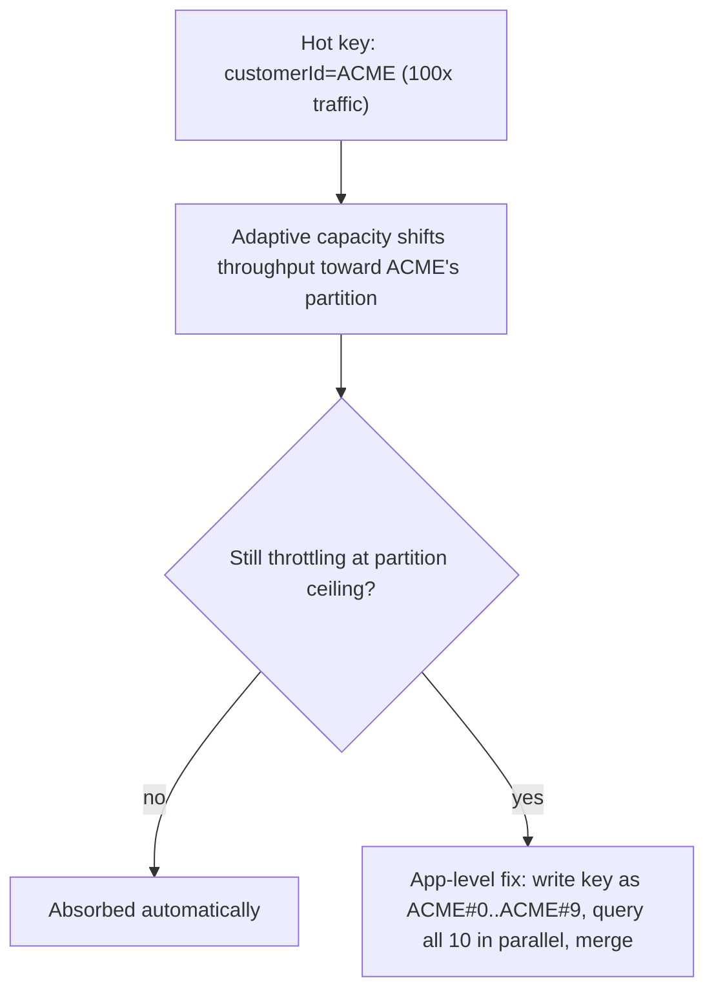

**Why the others are wrong:**
- A: GSIs are separate index structures with their own partition key design and their own separate throttling behavior — they don't automatically redistribute the base table's hot-partition traffic, and a poorly chosen GSI key can develop the exact same hot-key problem independently.
- C: DynamoDB Streams captures a change log of item-level modifications for downstream processing (e.g. triggering Lambda); it has no load-balancing function over read/write traffic distribution across partitions.
- D: Consistency model (eventual vs. strong) affects whether a read reflects the latest write; it has no bearing on how throughput capacity is distributed across partitions and cannot eliminate partition-level throttling.

---

## Q41 — Domain 2: Security

An S3 bucket has: (1) Block Public Access fully enabled at the bucket level, (2) a bucket policy
granting `s3:GetObject` to `Principal: "*"`, and (3) an object-level ACL granting `READ` to the
`AllUsers` predefined group on one specific object. What is the actual effective access for an
anonymous, unauthenticated internet request to that object?

A. The object is publicly readable, because the object ACL's grant to `AllUsers` always takes precedence over bucket-level Block Public Access.

B. The request is denied — Block Public Access, when enabled at the bucket level, overrides and blocks public access granted through *either* bucket policies or ACLs, regardless of what those policies/ACLs themselves say.

C. The request succeeds only through the bucket policy's wildcard principal, but is denied through the ACL, resulting in a race condition with unpredictable outcomes.

D. Block Public Access only restricts *new* public grants going forward; grants that existed before it was enabled remain active and public.

**Correct Answer: B**

**Explanation:** S3 **Block Public Access** settings, when enabled, are enforced *above* and
independently of whatever a bucket policy or ACL actually grants — specifically, the
`BlockPublicPolicy`/`IgnorePublicAcls`/`RestrictPublicBuckets` settings (bundled together when fully
enabled) cause S3 to ignore public grants in policies and ACLs for evaluation purposes, denying
anonymous public access regardless of what those underlying documents say. This is a deliberate,
blunt safety mechanism specifically designed to prevent exactly this kind of "wildcard principal +
public ACL" misconfiguration from being externally exploitable. See [`services/storage/s3.md`](../../../services/storage/s3.md).

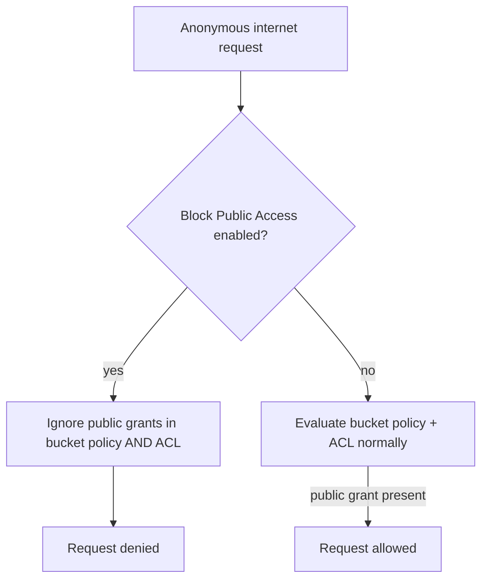

**Why the others are wrong:**
- A: There's no precedence rule where ACL grants beat Block Public Access — Block Public Access is specifically designed to override *both* bucket policies and ACLs when it comes to public grants, not be subordinate to either.
- C: There's no "race condition" concept in S3 access evaluation; the outcome is deterministic — Block Public Access being enabled deterministically blocks the public grant from either mechanism.
- D: Block Public Access settings apply to the current, live evaluation of every request against the bucket's current policy/ACL state — it's not a one-time, point-in-time filter that only affects grants created after it was turned on; it actively suppresses existing public grants too.

---

## Q42 — Domain 1: Development with AWS Services

A team needs a serverless job scheduled to run at a fixed wall-clock time (e.g. "the 1st of every
month at 09:00 America/New_York," correctly handling daylight saving time transitions) to trigger a
Lambda function, and separately wants the ability to create one-time, ad hoc future-dated triggers
(e.g. "run this exact function once, 45 minutes from now") without writing a custom delay mechanism.
Which AWS feature(s) fit both requirements, and how do they differ from basic EventBridge rules?

A. EventBridge rules with `cron()` expressions handle both cases identically; there's no dedicated feature for one-time future-dated triggers.

B. **EventBridge Scheduler**, which supports both recurring `cron`/`rate` schedules with native timezone-aware DST handling, and genuinely one-time `at()` schedules for ad hoc future triggers — a distinct, more flexible capability set than classic EventBridge rule-based scheduling (which lacks built-in timezone handling and one-time scheduling as a first-class concept).

C. AWS Batch scheduled jobs, which are the only AWS-native way to run code at a specific future wall-clock time.

D. A Step Functions `Wait` state with `Timestamp` set from a Lambda function invoked immediately, polling in a loop until the target time arrives.

**Correct Answer: B**

**Explanation:** **EventBridge Scheduler** is a distinct, newer capability from classic EventBridge
rules: it natively supports specifying an IANA timezone for recurring `cron`/`rate` schedules
(correctly handling DST shifts) and also supports genuinely one-time `at()` schedules for ad hoc
future triggers — both scheduling primitives classic rule-based `ScheduleExpression` historically
lacked as clean, dedicated features. This is Task 1.1 event-driven-architecture content. See
[`services/application-integration/eventbridge.md`](../../../services/application-integration/eventbridge.md).

**Why the others are wrong:**
- A: Classic EventBridge rules support `cron()`/`rate()` recurring expressions but have no dedicated concept of a genuinely one-time future schedule as a first-class primitive the way EventBridge Scheduler's `at()` expressions provide, and historically lacked native per-schedule timezone handling.
- C: AWS Batch scheduling is tied to its own job-queue/compute-environment model for batch compute workloads; it is not "the only" way to trigger code at a specific time, and it's a heavier-weight mechanism than needed for simply invoking a Lambda function on a schedule.
- D: Polling in a loop via a `Wait` state wastes execution time/cost and reinvents what EventBridge Scheduler already provides natively and more cheaply as a managed, event-driven trigger rather than an active polling workflow.

---

## Q43 — Domain 3: Testing and Deployment

A CloudFormation template update is about to modify a production RDS instance's `DBInstanceClass`
and also, unintentionally due to a template authoring mistake, would cause an unrelated DynamoDB
table's `BillingMode` property to trigger a resource **replacement** (full delete-and-recreate)
rather than an in-place update — which would mean permanent data loss for that table. What is the
single best practice that would have surfaced this *before* the update was applied?

A. Run `aws cloudformation update-stack` directly; CloudFormation always pauses automatically before any resource replacement, regardless of tooling used.

B. Create and review a **change set** first (`aws cloudformation create-change-set`), inspecting the `Replacement: True` flag CloudFormation reports per-resource in the change set output, before ever executing it.

C. Enable termination protection on the stack, which blocks any update that would replace a resource.

D. Add a `DeletionPolicy: Retain` to every resource in the template; this prevents replacement from ever occurring.

**Correct Answer: B**

**Explanation:** A **change set** computes and displays exactly what CloudFormation *would* do for
every resource in an update — including a `Replacement` field (`True`/`False`/`Conditional`) per
resource — without actually applying anything, letting a human reviewer catch an unintended
destructive replacement (like the DynamoDB table here) before executing it. This is the standard
Task 3.2 pre-deployment safety practice for exactly this class of risk. See [`services/management-governance/cloudformation.md`](../../../services/management-governance/cloudformation.md).

**Why the others are wrong:**
- A: `update-stack` applies changes directly and immediately (after whatever rollback configuration is set); it does not pause for manual review before replacing a resource — that pause-and-review workflow is specifically what change sets exist to provide instead.
- C: Termination protection only prevents the entire *stack* from being deleted (e.g. via `delete-stack`); it has no effect on individual resource replacements that occur as part of a normal stack *update*.
- D: `DeletionPolicy: Retain` controls what happens to the *old* physical resource when CloudFormation removes it from the stack (keeping the underlying resource rather than deleting it) — it does not prevent the replacement operation itself from being triggered, and for some resource types/updates doesn't apply to the replacement's "create new, then delete old" sequence the way expected.

---

## Q44 — Domain 4: Troubleshooting and Optimization

A table is billed on DynamoDB on-demand mode. Over three months, traffic has grown 20x without any
application changes, and the monthly DynamoDB bill has grown roughly proportionally. The team wants
to know whether switching to provisioned capacity with auto scaling would now be cheaper, given this
stable (if large) and fairly predictable traffic. What is the correct approach to decide, and what
tool surfaces the needed data?

A. Blindly switch to provisioned mode; provisioned is always cheaper than on-demand at any traffic volume.

B. Use **AWS Cost Explorer** (and the table's CloudWatch consumed-capacity metrics) to analyze the actual read/write request volume and its variability over time, then compare the on-demand cost against a provisioned+auto-scaling estimate at that observed, steady utilization — provisioned capacity tends to become more cost-effective than on-demand as traffic volume grows and becomes more predictable.
C. Keep on-demand indefinitely; DynamoDB on-demand mode cost scales sub-linearly with traffic, so it always remains optimal as volume grows.

D. Enable DynamoDB Streams to measure cost, since Streams records are what on-demand billing is actually based on.

**Correct Answer: B**

**Explanation:** On-demand pricing carries a premium per request in exchange for zero capacity
management; as traffic grows large and its pattern becomes well-understood/predictable, provisioned
capacity with auto scaling frequently becomes cheaper because its per-unit rate is lower, provided
the team is willing to tolerate scaling lag during unexpected spikes. The correct process is
data-driven: use Cost Explorer's usage/cost breakdown plus the table's actual consumed-capacity
metrics to model what a provisioned+auto-scaling configuration would have cost for the same observed
traffic, then compare. This is Task 4.3 cost-analysis content. See [`services/management-governance/cost-management-tools.md`](../../../services/management-governance/cost-management-tools.md)
and [`services/database/dynamodb.md`](../../../services/database/dynamodb.md).

**Why the others are wrong:**
- A: Whether provisioned or on-demand is cheaper depends entirely on the specific traffic pattern (volume, predictability, spikiness); it's not a universal rule in either direction, which is exactly why the analysis step is necessary rather than skippable.
- C: On-demand billing scales essentially linearly with the number of read/write request units consumed, not sub-linearly — there's no inherent economy-of-scale effect that keeps it "always optimal" as volume grows.
- D: DynamoDB Streams is a change-data-capture feature for reacting to item modifications; it is not the basis for on-demand billing calculations (which are based on actual read/write request units consumed) and enabling it doesn't provide cost-analysis data.

---

## Q45 — Domain 2: Security

A Lambda function stores objects in S3 using `SSE-C` (server-side encryption with customer-provided
keys) rather than SSE-S3 or SSE-KMS. Which statement correctly describes a key operational
consequence of choosing SSE-C that a team must plan for?

A. SSE-C is managed entirely by AWS with no customer action required, identical in operational burden to SSE-S3.

B. With SSE-C, the customer must supply the exact same encryption key on every subsequent `GetObject`/`PutObject`/`CopyObject` call as was used originally — AWS does not store the key at all, so losing the key means the object becomes permanently unrecoverable, and the key must be transmitted (over TLS) and managed entirely by the application outside of AWS.

C. SSE-C automatically rotates the customer-provided key every 90 days without application involvement.

D. SSE-C requires a KMS customer-managed key as the customer-provided key's source.

**Correct Answer: B**

**Explanation:** **SSE-C** shifts full key custody to the customer: AWS performs the actual
encryption/decryption operation, but never stores the key itself — every read or write call must
include the exact key (base64-encoded, sent over HTTPS, with its MD5 for integrity checking). If the
application loses that key, there is no AWS-side recovery mechanism at all; the object's data is
permanently lost. This operational burden (full external key lifecycle management) is the central
trade-off teams must weigh against SSE-KMS, where AWS manages key storage/rotation. See
[`services/storage/s3.md`](../../../services/storage/s3.md) and [`services/security-identity-compliance/kms.md`](../../../services/security-identity-compliance/kms.md).

**Why the others are wrong:**
- A: SSE-C is explicitly the *opposite* of low operational burden — it requires the customer to generate, securely transmit, and durably retain the key for every single operation, unlike SSE-S3 where AWS handles everything transparently.
- C: SSE-C has no automatic key rotation at all, since AWS never stores the key in the first place — any rotation would require the application itself to re-encrypt objects with a new key it manages.
- D: SSE-C's "customer-provided key" is any raw 256-bit key the application itself generates and supplies directly in the request — it has no required relationship to KMS whatsoever, which is precisely what distinguishes it from SSE-KMS.

---

## Q46 — Domain 1: Development with AWS Services

An order-processing system publishes every state change (`OrderCreated`, `OrderShipped`,
`OrderCancelled`) as events to a single EventBridge custom event bus. A fraud-detection consumer
only needs `OrderCreated` events where the `detail.amount` field exceeds `10000`. Which EventBridge
feature lets this consumer receive only that narrow subset, without the consumer code having to
filter out irrelevant events itself after receiving them?

A. A separate event bus must be created per event type/amount threshold; EventBridge rules cannot filter on nested payload fields.

B. An EventBridge **rule** with an event pattern using numeric content filtering, e.g. matching `"detail-type": ["OrderCreated"]` combined with `"detail": {"amount": [{"numeric": [">", 10000]}]}`, so only matching events are routed to the fraud-detection target at all.

C. An SQS queue subscribed to the bus with a dead-letter redrive policy configured to discard events under the threshold.

D. A Lambda function subscribed to every event, which must manually inspect and discard irrelevant events in its own code.

**Correct Answer: B**

**Explanation:** EventBridge rule **event patterns** support rich content-based filtering, including
numeric comparison operators (`>`, `>=`, `<`, `<=`, `between`) on nested fields inside the event's
`detail` object — letting a rule match only `OrderCreated` events whose `amount` field exceeds a
threshold, and routing *only* those matching events to the target. This offloads filtering from
consumer code entirely, at the EventBridge routing layer. This is Task 1.1 event-driven-architecture
content. See [`services/application-integration/eventbridge.md`](../../../services/application-integration/eventbridge.md).

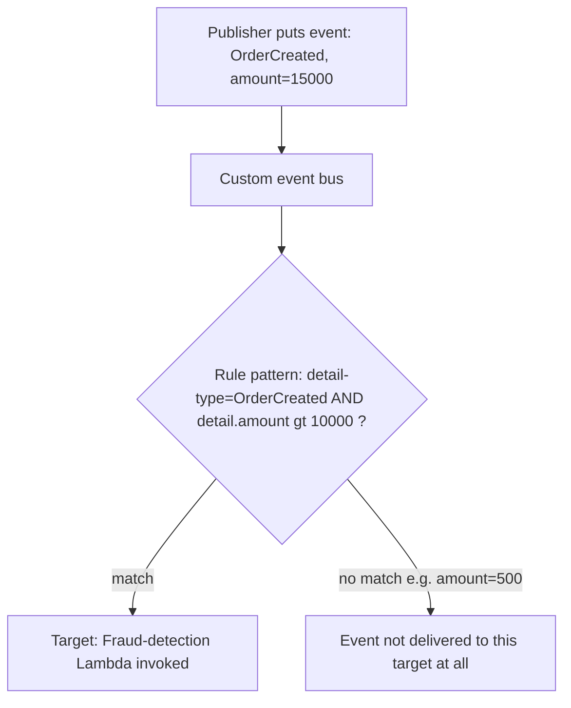

Step by step: (1) every state-change event lands on the shared bus regardless of type or amount;
(2) the rule's event pattern is evaluated against each event's `detail-type` and nested
`detail.amount` field; (3) only events satisfying both the type match and the numeric comparison are
routed to the fraud-detection target; (4) everything else is filtered out before it ever reaches
(and costs an invocation on) the consumer.

**Why the others are wrong:**
- A: EventBridge rules absolutely can filter on nested `detail` payload fields, including with numeric comparisons — this is a core, documented capability, not a limitation requiring a separate bus per threshold.
- C: SQS redrive policies govern how many processing failures move a message to a dead-letter queue; they have no content-based filtering capability on message payload values and are unrelated to this use case.
- D: Having the Lambda function receive every event and filter in code works, but it's exactly what the scenario says to avoid — it costs an invocation for every irrelevant event and duplicates filtering logic that the EventBridge rule's event pattern can do more efficiently at no compute cost.

---

## Q47 — Domain 4: Troubleshooting and Optimization

A team consumes messages from a standard SQS queue with a Lambda function via event source mapping.
Processing occasionally takes longer than the queue's configured visibility timeout, causing the
same message to be redelivered to a second concurrent invocation while the first is still working on
it — resulting in duplicate processing. Besides making the handler logic idempotent (which is always
recommended), what queue-level configuration change most directly reduces this specific race
condition?

A. Reduce the visibility timeout so messages become visible again sooner.

B. Increase the queue's visibility timeout to comfortably exceed the function's maximum expected processing time (commonly recommended as at least 6x the function timeout, to also account for Lambda's internal retry behavior), so a message isn't eligible for redelivery while still legitimately being processed.

C. Switch the queue from Standard to a different AWS Region to reduce network latency.

D. Set the Lambda function's reserved concurrency to 1, forcing fully serial processing of all messages account-wide.

**Correct Answer: B**

**Explanation:** The visibility timeout defines how long a message stays invisible to other
consumers after being received; if it's shorter than actual processing time, the message becomes
visible again — and eligible for redelivery — before the first invocation finishes, causing exactly
this duplicate-processing race. Setting the visibility timeout comfortably longer than the function's
realistic maximum processing time (AWS recommends at least 6x the function's timeout, partly to
cover Lambda's own internal retry windows) is the direct, queue-level fix. See [`services/application-integration/sqs.md`](../../../services/application-integration/sqs.md).

**Why the others are wrong:**
- A: Reducing the visibility timeout makes messages become redeliverable *sooner*, not later — this would make the race condition worse, not better.
- C: SQS queues are regional resources tied to wherever they were created; "switching regions" doesn't address visibility timeout mechanics and would require fully recreating the queue and reconfiguring every producer/consumer, with no relationship to the root cause.
- D: Reserved concurrency of 1 would force every message in the entire account that uses this function to process one at a time, which solves the duplicate-delivery issue only by catastrophically destroying throughput — a wildly disproportionate fix compared to correctly tuning the visibility timeout.

---

## Q48 — Domain 2: Security

A team's RDS database password is currently stored as a Secrets Manager secret, but it's never
rotated — the same password has been in place for over a year. They want automatic rotation every
30 days, performed by AWS-managed logic rather than custom-written rotation code, for a standard RDS
MySQL instance. What is the standard, lowest-effort way to enable this?

A. Write a fully custom Lambda rotation function from scratch, since Secrets Manager has no built-in rotation logic for any database engine.

B. Enable rotation on the secret using Secrets Manager's **built-in rotation function templates** for RDS (deployed automatically via the console/CLI, e.g. `SecretsManagerRDSMySQLRotationSingleUser`), configuring a 30-day `rotationRules` schedule — Secrets Manager handles invoking the Lambda rotation function and updating the secret version automatically going forward.

C. Set the RDS instance's `MasterUserPassword` parameter to `auto-generate-and-rotate-30-days` directly in the DB instance configuration; RDS itself performs rotation with no Secrets Manager involvement.

D. Rotation is only available for IAM database authentication, not password-based authentication, so the password must be abandoned in favor of IAM auth first.

**Correct Answer: B**

**Explanation:** Secrets Manager provides **built-in rotation templates** for common database
engines, including RDS MySQL/PostgreSQL/etc., deployable with a few clicks or one CLI call — these
pre-built Lambda functions handle the full rotation lifecycle (create new password, update the
database, update the secret, test, finish) automatically on whatever schedule (`AutomaticallyAfterDays: 30`)
you configure, without the team writing custom rotation logic. This is Task 2.2 secrets-management
content. See [`services/security-identity-compliance/secrets-manager-vs-parameter-store.md`](../../../services/security-identity-compliance/secrets-manager-vs-parameter-store.md).

**Why the others are wrong:**
- A: Secrets Manager explicitly ships pre-built rotation function templates for major database engines precisely so most teams never need to write rotation logic from scratch; custom functions are only needed for unusual/non-standard secret types.
- C: There is no such RDS master-password parameter; RDS's own "Rotate automatically" toggle in newer console flows is itself backed by Secrets Manager under the hood, not an independent RDS-only mechanism, and there's no literal `auto-generate-and-rotate-30-days` value.
- D: Password rotation via Secrets Manager rotation templates is fully supported for standard password-based database authentication; IAM database authentication is a separate, optional authentication mechanism entirely, not a prerequisite for enabling secret rotation.

---

## Q49 — Domain 3: Testing and Deployment

A CloudFormation custom resource (Lambda-backed) is used to call a third-party API and store its
response as a stack output. During testing, the team notices that deleting the stack leaves the
third-party resource behind, uncleaned, because the Lambda function's code only implements the
`Create` and `Update` event-type branches. What is missing, and what should the function do?

A. Nothing is missing; CloudFormation automatically cleans up anything a custom resource created, regardless of the function's own code.

B. The function's code must also explicitly handle the `Delete` `RequestType`, performing whatever cleanup (e.g. calling the third-party API to deprovision the resource) is appropriate, then still sending a `SUCCESS` response — without this branch, CloudFormation has no way to know cleanup logic needs to run, and the Lambda's default behavior for an unhandled event type does nothing on its own.

C. Add `DeletionPolicy: Retain` to the custom resource so CloudFormation skips calling the function on delete entirely, avoiding the issue.

D. Custom resources cannot ever be deleted automatically; the only option is manual cleanup documented in a runbook.

**Correct Answer: B**

**Explanation:** CloudFormation invokes the same custom resource Lambda function for all three
lifecycle events — `Create`, `Update`, and `Delete` — passing `RequestType` in the event payload; the
function's own code is responsible for branching on that value and performing the appropriate action,
including calling out to whatever external system (here, the third-party API) to actually deprovision
resources on delete. If that branch is missing, nothing happens on delete except (if coded to always
respond `SUCCESS`) a false signal that cleanup succeeded. See [`services/management-governance/cloudformation.md`](../../../services/management-governance/cloudformation.md).

**Why the others are wrong:**
- A: CloudFormation has no visibility into what a custom resource's Lambda function actually did externally (e.g. a third-party API call) — it relies entirely on that function's own code to perform and report on cleanup; nothing happens automatically.
- C: `DeletionPolicy: Retain` does stop CloudFormation from invoking the delete lifecycle on that resource, but that's the opposite of fixing the leak — it formalizes "never clean this up automatically," which doesn't solve the underlying requirement to deprovision the third-party resource.
- D: Custom resources fully support automated deletion; it just requires the function's own code to implement the `Delete` branch correctly, which is a standard and common pattern, not an inherent limitation of the feature.

---

## Q50 — Domain 4: Troubleshooting and Optimization

A team notices their monthly S3 bill includes a surprisingly large "S3 Standard – Requests & data
retrievals" line item, disproportionate to the actual amount of data stored, for a workload that
does millions of small `HeadObject` and `GetObject` calls per day checking for file existence before
conditionally processing them. What is the most effective optimization, and why?

A. Switch the bucket to S3 Glacier Instant Retrieval, which charges nothing for `GetObject`/`HeadObject` requests.

B. Batch/reduce the number of discrete API calls where possible (e.g. using S3 Inventory reports or DynamoDB-tracked existence/state instead of a `HeadObject` check per file, or using `ListObjectsV2` with prefixes to check many keys per call) since S3 request costs are charged per-request regardless of object size, so a high-request-count, small-object workload is dominated by request pricing rather than storage pricing.

C. Enable S3 Transfer Acceleration, which reduces the per-request cost for all API calls.

D. Switch to S3 Select for every `GetObject` call, since S3 Select is billed only on data scanned, not per-request.

**Correct Answer: B**

**Explanation:** S3 request pricing (`GET`/`HEAD`/`LIST`/etc.) is charged **per request**, mostly
independent of object size — so a workload dominated by millions of small per-object existence
checks will rack up request costs far out of proportion to actual storage/data volume. The fix is
architectural: reduce the *number* of discrete API calls, e.g. by maintaining existence/state
metadata in a cheaper-to-query system (like a DynamoDB table updated via S3 event notifications) or
batching lookups (like `ListObjectsV2` across many keys at once, or periodic S3 Inventory reports)
instead of one `HeadObject` per file. This is Task 4.3 S3 cost-optimization content. See
[`services/storage/s3.md`](../../../services/storage/s3.md).

**Why the others are wrong:**
- A: Glacier Instant Retrieval doesn't eliminate request charges — it still bills per-request (at a *higher* rate than Standard for retrievals) in addition to its lower storage cost, making it a poor fit for a request-heavy, frequently-accessed workload like this one.
- C: Transfer Acceleration is priced for and speeds up long-distance data transfer over CloudFront's edge network; it doesn't reduce standard per-request API pricing and would add its own separate cost here with no benefit to this specific problem.
- D: S3 Select does bill by data scanned/returned rather than purely per-request in the same way, but it's designed for querying structured data *within* an object (e.g. CSV/JSON filtering), not for existence checks, and routing every call through S3 Select would add processing overhead without addressing the root cause (too many discrete API calls).

---

## Q51 — Domain 2: Security

A team needs a Lambda function running inside private subnets (no NAT gateway, no internet route) to
be able to call Amazon S3's API for reading configuration objects, without routing traffic over the
public internet at all and without adding a NAT gateway purely for this purpose. Which solution
correctly and most cost-effectively achieves this?

A. Add an Internet Gateway route to the private subnet's route table, redefining it as effectively public.

B. Create a **Gateway VPC Endpoint** for S3, attached to the route tables of the private subnets, which routes S3 API traffic over AWS's private network via a prefix-list route — at no additional hourly cost (unlike interface endpoints), with no NAT gateway required.

C. Create an Interface VPC Endpoint for S3 using PrivateLink, since S3 only supports interface endpoints, not gateway endpoints.

D. Attach an Elastic IP directly to the Lambda function's ENI to route traffic through a static public IP.

**Correct Answer: B**

**Explanation:** S3 (and DynamoDB) support **Gateway VPC Endpoints**, which work by adding a route in
the subnet's route table pointing at the endpoint via a prefix list — traffic to S3 stays on AWS's
private backbone, never touching the public internet or needing a NAT gateway, and gateway endpoints
have no hourly or per-GB processing charge (unlike interface endpoints). This is the standard,
lowest-cost Task 2.2 private-connectivity pattern for S3/DynamoDB specifically. See
[`services/networking-content-delivery/vpc-endpoints-privatelink.md`](../../../services/networking-content-delivery/vpc-endpoints-privatelink.md).

**Why the others are wrong:**
- A: Adding an Internet Gateway route would require the subnet to also have public IP addressing/routing configured properly and defeats the stated goal of staying off the public internet entirely — it's also unnecessary and less secure than a gateway endpoint.
- C: S3 and DynamoDB are the two services that support Gateway Endpoints specifically (most other services only offer Interface Endpoints) — the claim that S3 "only supports interface endpoints" is backwards.
- D: Elastic IPs provide a static public IPv4 address for internet-facing resources; attaching one doesn't create a private path to S3 and isn't even a valid direct attachment target for a Lambda function's managed ENI in this way.

---

## Q52 — Domain 1: Development with AWS Services

A payment-processing system uses an SQS **FIFO** queue so that messages for the same `orderId` are
always processed in the order they were sent, and so that an accidental duplicate send of the exact
same message (same content, sent twice within the 5-minute deduplication window) is automatically
collapsed into one. Which two message attributes must the producer set correctly to get both of
these guarantees?

A. `DelaySeconds` and `VisibilityTimeout` — delay controls ordering and visibility controls deduplication.

B. `MessageGroupId` (same value for all messages that must stay strictly ordered relative to each other, e.g. the `orderId`) and `MessageDeduplicationId` (a value identical only for true duplicates, often derived via content-based deduplication or an explicit idempotency token).

C. `MessageAttributes` and `MessageSystemAttributes` — these two together are what FIFO queues use internally for both ordering and dedup.

D. `ReceiveMessageWaitTimeSeconds` and `MaximumMessageSize`.

**Correct Answer: B**

**Explanation:** FIFO queues guarantee strict ordering only *within* a `MessageGroupId` — messages
sharing a group ID are delivered in send order, while different group IDs can be processed in
parallel/interleaved. Deduplication (within a 5-minute window) is controlled by `MessageDeduplicationId`
— either supplied explicitly by the producer, or automatically computed via content-based
deduplication (a SHA-256 hash of the message body) if that option is enabled on the queue; two
messages with the same dedup ID within the window are treated as one. This is Task 1.1 SQS content.
See [`services/application-integration/sqs.md`](../../../services/application-integration/sqs.md).

**Why the others are wrong:**
- A: `DelaySeconds` delays initial visibility of a message; `VisibilityTimeout` controls re-delivery after a receive — neither has anything to do with FIFO ordering groups or deduplication.
- C: `MessageAttributes`/`MessageSystemAttributes` carry arbitrary custom metadata or system-level metadata (like trace headers) alongside a message; they are not the mechanism FIFO queues use for ordering or deduplication.
- D: `ReceiveMessageWaitTimeSeconds` controls long-polling behavior on the consumer side; `MaximumMessageSize` caps payload size — neither relates to FIFO ordering or dedup semantics at all.

---

## Q53 — Domain 1: Development with AWS Services

A single SNS topic has three subscribers: an SQS queue for order fulfillment (needs every message),
a Lambda function for fraud scoring (only needs messages where `attributes.riskScore >= 80`), and an
email subscription for the operations team (only wants messages where `attributes.priority` equals
`"urgent"`). The publisher currently sends every message to all three regardless of relevance, and
each subscriber filters in its own code. What SNS feature lets each subscriber receive only the
messages relevant to it, configured centrally rather than in each subscriber's own logic?

A. Three separate SNS topics, one per subscriber, each with the publisher manually deciding where to send each message.

B. **SNS subscription filter policies**, attached per-subscription, matching against message attributes (e.g. `{"riskScore": [{"numeric": [">=", 80]}]}` on the fraud Lambda's subscription, `{"priority": ["urgent"]}` on the email subscription) so SNS itself only delivers matching messages to each subscriber.

C. SQS dead-letter queues configured on each subscriber to discard irrelevant messages after delivery.

D. IAM resource policies on the SNS topic restricting which messages each subscriber's principal is allowed to read.

**Correct Answer: B**

**Explanation:** SNS **subscription filter policies** let each individual subscription declare
which messages it wants, matched against the message's attributes — SNS evaluates the filter at
publish time and only delivers a message to subscriptions whose filter policy matches, without the
publisher needing any subscriber-specific logic and without subscribers needing to filter out
irrelevant deliveries themselves. This is Task 1.1 messaging-pattern content. See
[`services/application-integration/sns.md`](../../../services/application-integration/sns.md).

**Why the others are wrong:**
- A: Splitting into separate topics per subscriber pushes the routing decision back onto the publisher's own code for every message, which is exactly the duplicated, scattered logic the scenario wants to avoid centralizing.
- C: Dead-letter queues capture messages that failed delivery/processing after the fact; they have no content-based filtering capability and operate on a completely different concern (failure handling, not relevance-based routing).
- D: IAM resource policies control *authorization* (who is allowed to subscribe/publish/read), not content-based message filtering — they can't selectively suppress delivery of specific messages based on their attribute values.

---

## Q54 — Domain 2: Security

A VPC endpoint for Amazon S3 is created and attached to a private subnet's route table. The security
team wants to further restrict it so that even though the endpoint provides private connectivity to
S3 generally, traffic through *this specific* endpoint can only reach one named company data bucket
— not any other bucket in the account or any other S3 bucket in the AWS Region. Which mechanism
enforces this?

A. A security group attached to the VPC endpoint's ENIs, with an outbound rule naming the specific bucket.

B. An **endpoint policy** attached to the VPC endpoint itself — a resource policy, separate from the bucket's own policy and from IAM identity policies, that can restrict which S3 actions/resources (bucket ARNs) are reachable *through this specific endpoint*, denying access to any other bucket even if the caller's IAM policy would otherwise allow it.

C. A Network ACL on the subnet, with a rule permitting traffic only to the bucket's specific IP address range.

D. The bucket's own bucket policy, which automatically inherits and enforces any restriction placed on VPC endpoints pointing at it.

**Correct Answer: B**

**Explanation:** **VPC endpoint policies** are a distinct resource-policy layer attached to the
endpoint itself, independent of the caller's IAM identity policy and the target bucket's own policy
— they define what's reachable *through that specific endpoint path*. Restricting the endpoint
policy to one bucket ARN means even a caller with full S3 permissions elsewhere in their IAM policy
cannot reach any *other* bucket via this endpoint, adding a defense-in-depth network-path-level
restriction. This is Task 2.2/2.1 content. See [`services/networking-content-delivery/vpc-endpoints-privatelink.md`](../../../services/networking-content-delivery/vpc-endpoints-privatelink.md).

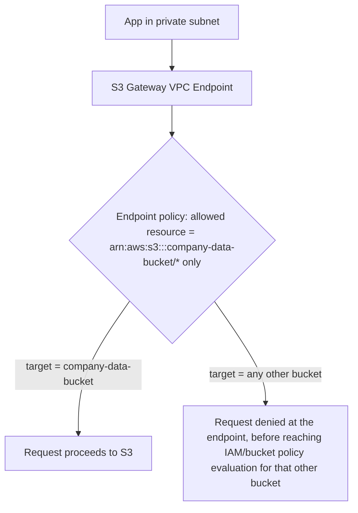

**Why the others are wrong:**
- A: Security groups filter by IP/port/protocol, not by S3 bucket identity — S3 is reached via HTTPS to AWS-managed IP ranges shared across many buckets, so a security group has no way to distinguish "this bucket" from "any other bucket" at the network layer.
- C: NACLs operate on IP/port ranges too, with the same limitation — S3's endpoint IPs aren't segmented per-bucket, so there's no IP-based way to restrict to a single bucket via a NACL rule.
- D: Bucket policies are configured independently on the bucket itself and have no automatic inheritance relationship with any VPC endpoint's policy — each is a separate document that must be configured on its own.

---

## Q55 — Domain 3: Testing and Deployment

A team has a CloudFormation template where `Stack-Network` exports a VPC ID and subnet IDs via
`Outputs`/`Export`, and `Stack-Compute` imports them via `Fn::ImportValue`. The team later tries to
delete `Stack-Network` as part of a cleanup, and the deletion fails. What is the most likely cause,
and the correct remediation order?

A. CloudFormation never allows deleting a stack that has any exports at all, regardless of whether they're imported elsewhere; exports must first be manually removed from the template.

B. A stack **cannot be deleted while another stack still imports one of its exported values** — `Stack-Compute` must first be updated to stop importing those values (or deleted entirely) before `Stack-Network` can be deleted.

C. The deletion failure is unrelated to exports; it must be an IAM permissions issue on the deleting principal.

D. Exports automatically become orphaned placeholder values when the exporting stack is deleted, so the delete would actually succeed but silently break `Stack-Compute`.

**Correct Answer: B**

**Explanation:** CloudFormation explicitly **blocks deletion (and most updates that would remove an
exported output) of a stack whose exports are actively imported by another stack**, specifically to
prevent exactly the dangling-reference breakage the scenario is worried about. The correct order is
to first update or delete whatever stack(s) import the value (here, `Stack-Compute`), removing the
`Fn::ImportValue` dependency, and only then delete `Stack-Network`. This is Task 3.2 cross-stack
IaC content. See [`services/management-governance/cloudformation.md`](../../../services/management-governance/cloudformation.md).

**Why the others are wrong:**
- A: Stacks with exports delete just fine as long as nothing currently imports those specific export values — the restriction is conditional on active imports, not a blanket prohibition on having exports at all.
- C: While IAM permissions issues can certainly cause delete failures in other scenarios, the specific, well-documented behavior for "stack with exports still referenced by `Fn::ImportValue` elsewhere" is this dependency block, and it's the far more likely cause given the described setup.
- D: CloudFormation enforces the dependency *before* allowing deletion — it does not silently let the exporting stack be deleted and leave the importing stack broken; the delete operation itself fails with a clear error instead.

---

## Q56 — Domain 4: Troubleshooting and Optimization

A company runs a fleet of Lambda functions on the default `x86_64` architecture and wants to reduce
compute cost without changing any application logic, for functions written in a runtime that
supports multiple architectures (e.g. Node.js, Python, Java, or a custom-compiled Go/Rust binary
built for both targets). Choose **TWO** correct statements about safely evaluating a switch to
`arm64` (AWS Graviton2).

A. AWS Graviton2 (`arm64`) Lambda functions are priced lower per GB-second than equivalent `x86_64` functions, offering comparable or better price-performance for many workloads with zero application code changes required.

B. Before switching broadly, the team must confirm every native compiled dependency (bundled in layers or container images) has a genuine `arm64`-compatible build available, since a function with an `x86_64`-only native binary will fail at runtime if switched without first verifying/rebuilding that dependency.

C. The switch is guaranteed to behave identically for every function with zero verification needed, since AWS enforces full behavioral equivalence between architectures at the platform level.

D. Architecture has no effect on Lambda pricing at all; the only cost lever available is the function's configured memory size.

E. The Graviton2 pricing benefit only applies to functions using provisioned concurrency; on-demand (unreserved) invocations are billed identically regardless of architecture.

**Correct Answer: A, B**

**Explanation:** AWS Graviton2 (`arm64`)-based Lambda functions are priced lower per GB-second than
equivalent `x86_64` functions, often with comparable or better price-performance for many workloads
— a genuine, code-unchanged cost lever for eligible runtimes. The caveat is dependencies: any native
compiled binaries (in layers, container images, or compiled language runtimes) must actually have
`arm64`-compatible builds, or the function will fail at runtime; so the correct process is to verify
dependency compatibility and benchmark before switching broadly, not assume it blindly. This is Task
4.3 content. See [`services/compute/lambda.md`](../../../services/compute/lambda.md).

**Why the others are wrong:**
- C: "Guaranteed identical behavior with zero verification needed" is false — functions with architecture-specific native dependencies can fail entirely on `arm64` without a compatible build, which is exactly why testing first matters.
- D: Lambda pricing is a function of both configured memory *and* architecture (per-GB-second rate differs between `x86_64` and `arm64`); architecture is a real, distinct pricing lever, not irrelevant.
- E: Both on-demand and provisioned-concurrency Lambda billing are affected by architecture choice — the lower Graviton2 rate applies to GB-second billing generally, not only to provisioned concurrency's specific billing model.

---

## Q57 — Domain 1: Development with AWS Services

An order-notification system needs strict per-customer ordering of notification messages (so a
customer never sees "shipped" before "ordered") while also fanning the same message out to multiple
independent downstream subscribers (SMS service, email service, push-notification service), each
subscribing/unsubscribing independently over time. Which SNS configuration correctly supports both
requirements together?

A. A standard SNS topic, since standard topics already guarantee ordering per customer by default.

B. An **SNS FIFO topic**, using a `MessageGroupId` set to the customer ID to preserve strict per-customer ordering, with each downstream service subscribing (e.g. via an SQS FIFO queue subscription) independently — combining FIFO ordering guarantees with SNS's native fan-out to multiple subscribers.

C. A single SQS FIFO queue polled independently by all three downstream services.

D. Three separate standard SNS topics, one per downstream service, each polled in a strict round-robin by a central dispatcher to simulate ordering.

**Correct Answer: B**

**Explanation:** **SNS FIFO topics** combine ordering guarantees (via `MessageGroupId`, exactly like
SQS FIFO queues) with SNS's core fan-out capability — delivering the same ordered stream of messages
to multiple independent subscribers (which, for FIFO topics, must themselves be SQS FIFO queues).
This directly satisfies "strict per-customer ordering" *and* "fan out to multiple independent
subscribers" simultaneously, which a single queue (no fan-out) or standard topics (no ordering
guarantee) each only satisfy one half of. This is Task 1.1 messaging content. See
[`services/application-integration/sns.md`](../../../services/application-integration/sns.md).

**Why the others are wrong:**
- A: Standard SNS topics provide *best-effort* ordering at most and explicitly do not guarantee strict message order or exactly-once delivery — relying on default behavior for strict ordering requirements is a documented anti-pattern.
- C: A single SQS queue (even FIFO) is a point-to-point delivery mechanism — once one consumer receives and deletes a message, it's gone; it has no native fan-out to multiple independent downstream services the way SNS does.
- D: Manually round-robin polling three separate standard topics to "simulate" ordering is fragile, adds unnecessary custom dispatcher logic, and still doesn't give the underlying guarantee that FIFO topics provide natively.

---

## Q58 — Domain 2: Security

Amazon GuardDuty raises a finding of type `UnauthorizedAccess:EC2/TorIPCaller` for an EC2 instance in
a production VPC. What does this specific finding type indicate, and what should the response
playbook's first step be?

A. The instance is running Tor relay software it was intentionally configured with; no action is needed since this is expected administrative traffic.

B. An API call was made *to* AWS from a source IP address known to be a Tor exit node, suggesting the instance (or credentials associated with it) may be compromised and being used to mask the true origin of malicious activity — the first response step is to investigate which credentials/role made the call and determine whether the instance shows other signs of compromise, isolating it if confirmed.

C. The finding only triggers on outbound network traffic volume anomalies and has nothing to do with Tor specifically; the name is a legacy artifact.

D. This finding type is purely informational and non-actionable, generated automatically for every EC2 instance regardless of behavior, as a baseline health check.

**Correct Answer: B**

**Explanation:** GuardDuty's `UnauthorizedAccess:EC2/TorIPCaller` finding specifically means an AWS
API call associated with that EC2 instance's credentials originated from a known Tor exit node IP —
a strong signal of potential credential compromise or malicious activity being deliberately
obscured, since legitimate application traffic to AWS APIs from production infrastructure
essentially never originates from Tor. The correct first response step is investigating the calling
identity/credentials and instance behavior, escalating to isolation if compromise is confirmed —
this is Task 2.1/2.2 detection-and-response content. See [`services/security-identity-compliance/guardduty.md`](../../../services/security-identity-compliance/guardduty.md).

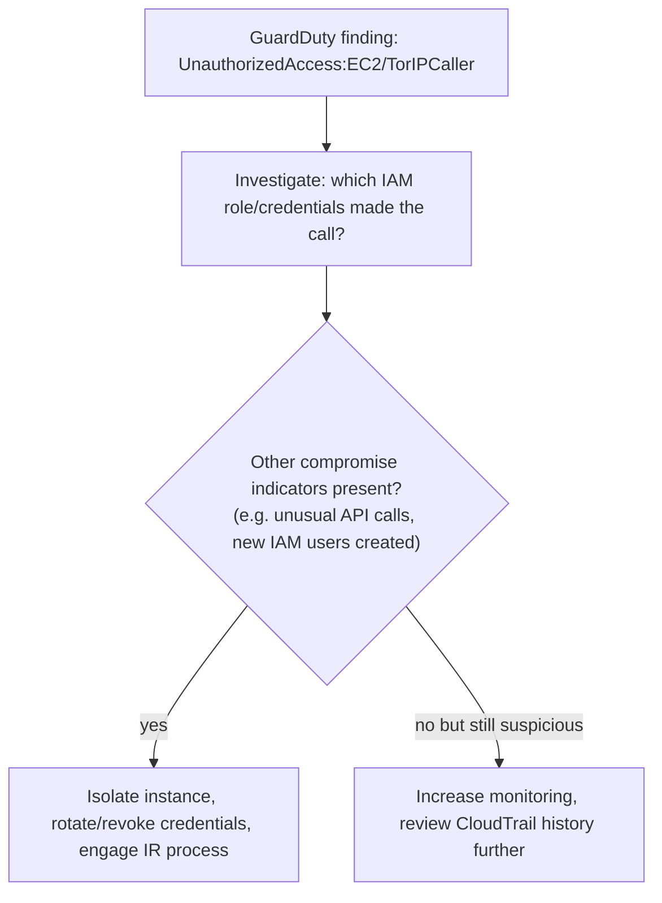

**Why the others are wrong:**
- A: GuardDuty findings of this type are specifically about *AWS API calls* sourced from Tor IPs, not about whether the instance itself runs Tor software — treating a legitimate security finding as automatically benign without investigation is the exact wrong instinct this finding exists to override.
- C: The finding name accurately reflects its actual detection logic (API caller IP matching known Tor exit node ranges); it is not a legacy misnomer or related to generic traffic-volume anomalies, which would be a different finding category entirely.
- D: GuardDuty findings are generated based on specific, triggering behavioral/threat-intel signals — this is not a default, always-on, informational-only finding type; its presence means a specific triggering event actually occurred.

---

## Q59 — Domain 1: Development with AWS Services

A team ingests clickstream events and needs to both (a) deliver a near-real-time, lightly
transformed copy of every event into an S3 data lake with automatic batching/compression and
optional format conversion to Parquet, requiring no custom consumer code, and (b) separately allow
multiple independent real-time applications to read and reprocess the exact same raw event stream
with sub-second latency and replay capability. Which single architecture correctly satisfies both
needs without redundant ingestion pipelines?

A. Use Amazon Kinesis Data Firehose alone; it natively supports both delivery to S3 and replay to multiple independent real-time consumers.

B. Use an Amazon **Kinesis Data Stream** as the single ingestion point, with a **Kinesis Data Firehose delivery stream configured to consume from that Data Stream** (not from the producer directly) for the managed, no-code S3/Parquet delivery path — while independent real-time consumer applications read directly from the Data Stream itself via the Kinesis Client Library or Enhanced Fan-Out, satisfying the replay/multi-consumer requirement.

C. Use two entirely separate, duplicate ingestion pipelines — one Kinesis Data Stream and one independent Kinesis Firehose, each fed directly and redundantly by the producer.

D. Use Amazon SQS Standard as the single ingestion layer, since every consumer can independently poll the same messages without affecting each other.

**Correct Answer: B**

**Explanation:** **Kinesis Data Streams** is the right primitive for "multiple independent consumers,
replay, sub-second latency, ordering by partition key," while **Kinesis Data Firehose** is the right
primitive for "automatic batching, compression, format conversion, and delivery to S3/Redshift/etc.
with no consumer code." Chaining them — Firehose configured with a Data Stream as its *source*
(rather than direct producer PutRecord calls to Firehose) — lets the same single ingested stream
serve both the managed S3 delivery pipeline and any number of independent real-time consumer
applications reading the raw stream directly, with no duplicated ingestion. This is Task 1.1
streaming-data content. See [`services/analytics/kinesis-family.md`](../../../services/analytics/kinesis-family.md).

**Why the others are wrong:**
- A: Firehose is a one-way, managed delivery pipeline to a fixed set of destinations; it has no concept of multiple independent consumer applications replaying or reading the raw stream — that capability is specific to Data Streams.
- C: Two entirely separate, redundantly-fed pipelines doubles ingestion cost and producer complexity (every producer call must hit two separate services) for no benefit over chaining Firehose off the Data Stream, which Kinesis supports natively.
- D: SQS messages are deleted once successfully processed and acknowledged by a consumer (it's point-to-point per consumption, even with multiple queues/consumers each needing their own queue); it has no native replay capability and no automatic format-converting delivery-to-S3 feature like Firehose provides.

---

## Q60 — Domain 3: Testing and Deployment

A SAM template's `Globals` section currently sets `Function: Timeout: 10` and `Function: MemorySize: 256`.
One specific function in the same template, `HeavyProcessingFunction`, needs `Timeout: 120` and
`MemorySize: 1024` because of its unusually long workload, while every other function in the
template should keep using the global defaults unchanged. What is the correct way to express this in
the SAM template?

A. Remove the `Globals` section entirely and specify `Timeout`/`MemorySize` individually on every single function resource in the template.

B. Under `HeavyProcessingFunction`'s own `Properties`, explicitly declare `Timeout: 120` and `MemorySize: 1024` — SAM applies a resource's own explicitly-declared property as an override on top of whatever `Globals` would otherwise apply, leaving every other function unaffected and still inheriting the global defaults.

C. Create a second, separate `Globals` section scoped only to `HeavyProcessingFunction` using a `Condition` key.

D. `Globals` values are immutable once set and cannot be overridden by any individual resource under any circumstances; a second template would be required.

**Correct Answer: B**

**Explanation:** SAM's `Globals` section provides *default* values applied to every resource of the
matching type (e.g. every `AWS::Serverless::Function`), but any property explicitly declared on an
individual resource **overrides** the global default for that resource only — this is precisely the
mechanism for "mostly-shared defaults, with specific exceptions," avoiding having to repeat
`Timeout`/`MemorySize` on every function that's happy with the shared values. This is Task 3.2 SAM
content. See [`services/developer-tools/sam.md`](../../../services/developer-tools/sam.md).

**Why the others are wrong:**
- A: This works but throws away the entire benefit of `Globals` (DRY shared defaults) just to handle one exception — needlessly verbose compared to simply overriding the two properties on the one function that needs different values.
- C: SAM's `Globals` section has no per-resource `Condition`-scoped sub-blocks; `Globals` applies uniformly to all resources of a type, with per-resource overrides being the actual supported exception mechanism.
- D: `Globals` values are explicitly documented as overridable per-resource; they are defaults, not immutable, enforced values — the override mechanism described in answer B is a standard, intended SAM feature.

---

## Q61 — Domain 4: Troubleshooting and Optimization

A team notices their S3 bill includes meaningful "Requests" cost from millions of `GetObject` calls
retrieving entire multi-MB JSON files when the application logic only ever needs one small field
from deep inside each file, then discards the rest after parsing it in application code. Which S3
feature reduces both the data transferred and processing cost for this specific access pattern,
without restructuring how the files are stored?

A. S3 Transfer Acceleration, which compresses objects in transit automatically before delivering them to the client.

B. **S3 Select**, which lets the application push a simple SQL-like filter/projection expression down to S3 itself, retrieving only the specific fields/rows needed from a CSV/JSON/Parquet object — reducing data transferred (and often cost/latency) versus downloading the entire object and discarding most of it client-side.

C. Switching the bucket's storage class to S3 Intelligent-Tiering, which automatically compresses rarely-accessed objects.

D. Enabling S3 Object Lambda, which is required before S3 Select can be used on JSON objects.

**Correct Answer: B**

**Explanation:** **S3 Select** lets you run a restricted SQL expression against an object stored in
S3 (CSV, JSON, or Parquet) and have S3 itself perform the filtering/projection server-side, returning
only the matching data — ideal for this exact "need one small field out of a large file" pattern,
cutting both data transferred over the network and the amount of post-download parsing work the
application must do. This is Task 1.1/4.3 S3-optimization content. See [`services/storage/s3.md`](../../../services/storage/s3.md).

**Why the others are wrong:**
- A: Transfer Acceleration speeds up transfer over long distances using CloudFront's edge network; it doesn't filter or reduce the *amount* of data retrieved per object, and it doesn't perform compression.
- C: Storage classes affect where/how data is stored and its retrieval cost tier; S3 does not automatically compress object content as part of any storage class, and this wouldn't address the "downloading whole files for one field" problem either way.
- D: S3 Object Lambda lets you run custom Lambda transformation code on GET responses and is a separate, more general-purpose feature; S3 Select is independently usable on its own and is not a prerequisite-gated capability behind Object Lambda.

---

## Q62 — Domain 2: Security

A company's AWS Security Hub is enabled across all accounts in an AWS Organization, aggregating
findings from GuardDuty, Macie, Inspector, and Config into a single standardized format (AWS
Security Finding Format, ASFF). Choose **TWO** correct statements about what Security Hub's
**security standards / controls** feature provides for this setup.

A. Enabling a published standard (e.g. CIS AWS Foundations Benchmark, AWS Foundational Security Best Practices) causes Security Hub to continuously evaluate the account(s) against each control in that standard and roll results up into a single, ongoing aggregate compliance score for that standard.

B. Security Hub consumes findings/evaluations from multiple underlying sources (GuardDuty, Macie, Inspector, and AWS Config) as contributing inputs when computing its standards-based scores, rather than relying on any single source exclusively.

C. AWS Config's `ComplianceByConfigRule` API is the sole and exclusive source of any compliance scoring; Security Hub has no scoring capability of its own.

D. GuardDuty's own per-finding severity score is itself the organization's aggregate compliance score against a named standard like CIS, with no further rollup needed.

E. CloudTrail Insights calculates the organization's compliance score by detecting anomalies in API call volume patterns.

**Correct Answer: A, B**

**Explanation:** Security Hub's **security standards** feature (CIS AWS Foundations Benchmark, AWS
Foundational Security Best Practices, PCI DSS, etc.) runs continuous automated checks against each
control defined in the enabled standard(s) and rolls the pass/fail results up into a single,
continuously-updated compliance score per standard. That scoring draws on **multiple underlying
sources** (GuardDuty, Macie, Inspector, Config evaluations, and Security Hub's own checks) as
contributing inputs, rather than any one source being the exclusive basis. This is Task 2.1/2.2
security operations content. See [`services/security-identity-compliance/security-hub-and-inspector.md`](../../../services/security-identity-compliance/security-hub-and-inspector.md).

**Why the others are wrong:**
- C: AWS Config can evaluate compliance against individual Config rules, and Security Hub actually *consumes* Config's evaluations as one input among several when computing standards-based scores — Config is a contributing source, not the sole scoring mechanism, and the claim that Security Hub has none of its own is false.
- D: GuardDuty's per-finding severity score (low/medium/high, numeric 0–10) reflects individual threat findings, not an organization's aggregate compliance posture against a named standard — it requires Security Hub's separate standards/controls rollup to produce that aggregate score.
- E: CloudTrail Insights detects unusual API call volume/pattern anomalies; it has no concept of compliance-standard scoring and is unrelated to this requirement.

---

## Q63 — Domain 1: Development with AWS Services

A high-throughput Kinesis Data Stream (50 shards) has a growing number of independent consumer
applications (currently 6, expected to grow to 15+) each needing to read the full stream
independently at low latency. Using the classic Kinesis Client Library (KCL) polling model (`GetRecords`),
the team starts seeing `ReadProvisionedThroughputExceeded` errors as more consumers are added,
because each shard's read throughput (2 MB/sec and 5 transactions/sec, shared across all polling
consumers of that shard) is being exhausted. What Kinesis feature is designed specifically to let
many consumers each get their own dedicated, non-shared 2 MB/sec read throughput per shard?

A. Increasing the number of shards proportionally to the number of consumers, re-sharding every time a new consumer is added.

B. **Enhanced Fan-Out**, which, when a consumer registers as a dedicated enhanced fan-out consumer, gives that specific consumer its own dedicated 2 MB/sec read throughput *per shard*, pushed to it over HTTP/2 — independent of and not shared with any other consumer's throughput, removing the classic polling model's shared-throughput ceiling.

C. Switching from Kinesis Data Streams to Kinesis Data Firehose, which supports unlimited concurrent readers natively.

D. Increasing each shard's retention period from 24 hours to 7 days, which proportionally increases available read throughput.

**Correct Answer: B**

**Explanation:** Classic (non-enhanced) consumers share each shard's fixed 2 MB/sec read throughput
across every consumer polling that shard via `GetRecords` — adding more consumers eventually exceeds
it. **Enhanced Fan-Out** solves this by giving each *registered* consumer its own dedicated 2 MB/sec
throughput per shard, delivered via a push model over HTTP/2 rather than shared polling, so adding
the 15th consumer doesn't degrade the other 14's throughput at all. This is Task 1.1 Kinesis content.
See [`services/analytics/kinesis-family.md`](../../../services/analytics/kinesis-family.md).

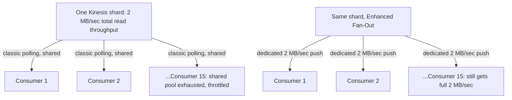

Step by step: in the classic model, every polling consumer of a shard competes for the same fixed
2 MB/sec, so the 15th consumer added starves everyone; with Enhanced Fan-Out, each consumer registers
separately and the shard pushes data to each over its own dedicated HTTP/2 connection at the full
2 MB/sec rate, independent of how many other consumers are also registered.

**Why the others are wrong:**
- A: Re-sharding increases the *total* throughput available across the whole stream, but doesn't change the fundamental shared-per-shard throughput ceiling among polling consumers of a given shard — it's also an operationally heavy, indirect workaround rather than the purpose-built feature for this problem.
- C: Firehose is a one-way delivery pipeline to fixed destinations, not a multi-consumer streaming read API at all; it cannot be substituted for Data Streams' consumer-fan-out use case.
- D: Retention period controls how long data stays available in the stream for (re)reading; it has no effect on per-shard read throughput capacity shared among active polling consumers.

---

## Q64 — Domain 3: Testing and Deployment

A team using AWS CDK (TypeScript) wants to use a brand-new AWS resource type that doesn't yet have a
dedicated, hand-crafted CDK "L2" construct (with convenient high-level methods), but is already
supported by the underlying CloudFormation resource specification. Which CDK construct level lets
them define it anyway, directly from the raw CloudFormation resource type, without waiting for AWS to
publish a higher-level construct?

A. An "L3" pattern construct, which CDK auto-generates for any CloudFormation resource type immediately upon release.

B. An **"L1" (CfnResource / `Cfn<ResourceType>`)** construct — a near-literal, auto-generated mapping of the raw CloudFormation resource and its properties, always available for any resource type CloudFormation itself supports, usable directly even before any L2 wrapper exists.

C. A `CustomResource` backed by a hand-written Lambda function is the only way to use any resource without a pre-built L2 construct.

D. CDK requires upgrading to the latest CDK major version before any new CloudFormation resource type can be referenced at all.

**Correct Answer: B**

**Explanation:** CDK's construct levels are: **L1** (`Cfn*` classes), which are near-1:1,
auto-generated mappings of every CloudFormation resource type and property — always available the
moment CloudFormation itself supports a resource, with no hand-authored wrapper needed; **L2**,
curated higher-level constructs with sensible defaults and convenience methods (hand-built by the CDK
team over time); and **L3**, opinionated multi-resource "pattern" constructs. A brand-new resource
type without an L2 yet can always be used directly via its L1 `Cfn*` class. This is Task 3.2 CDK
content. See [`services/management-governance/cdk.md`](../../../services/management-governance/cdk.md).

**Why the others are wrong:**
- A: L3 pattern constructs are hand-authored, opinionated combinations of multiple resources for common architectures; they are not auto-generated for every new resource type, and in fact require even more design/curation effort than L2 constructs do.
- C: `CustomResource`-backed Lambda functions are a valid way to manage *anything* (including things CloudFormation itself doesn't natively support at all), but they're not "the only way" to use a resource CloudFormation already supports natively — the L1 construct is the simpler, direct option when CloudFormation already has first-class support.
- D: L1 constructs for any CloudFormation-supported resource type are available in the CDK's generated resource library as CloudFormation itself adds support, without requiring a CDK major version bump specifically to "unlock" referencing a new resource type.

---

## Q65 — Domain 4: Troubleshooting and Optimization

A team wants to analyze Amazon RDS for PostgreSQL query performance to find the single slowest,
most resource-consuming query pattern contributing to high CPU utilization during business hours,
without manually parsing raw database logs or writing custom SQL against `pg_stat_statements`
themselves. Which AWS-native tool is purpose-built for this kind of query-level performance
diagnosis with a visual UI?

A. CloudWatch's default `CPUUtilization` metric, which already breaks down CPU usage by individual SQL query automatically.

B. **RDS Performance Insights**, which provides a visual dashboard of database load (measured in Average Active Sessions), broken down by SQL query/wait-event/user, letting you pinpoint exactly which specific query pattern is consuming the most database load at any given time, with historical comparison.

C. VPC Flow Logs, filtered to the RDS instance's elastic network interface, which capture per-query execution plans.

D. AWS X-Ray, by instrumenting the RDS instance itself (not the application) to automatically trace every SQL statement.

**Correct Answer: B**

**Explanation:** **RDS Performance Insights** is purpose-built for exactly this: it visualizes
database load as **Average Active Sessions (AAS)**, sliceable by dimensions like SQL query, wait
event, host, or user — letting you quickly identify that, say, one specific query pattern accounts
for most of the active-session load during the CPU-spike window, without manually trawling logs or
writing `pg_stat_statements` queries by hand. This is Task 4.1/4.2 database-troubleshooting content.
See [`services/database/rds.md`](../../../services/database/rds.md).

**Why the others are wrong:**
- A: The standard `CPUUtilization` CloudWatch metric is a single aggregate instance-level number; it has no per-query breakdown capability whatsoever — that granularity is specifically what Performance Insights adds on top.
- C: VPC Flow Logs capture network-layer metadata (source/destination IP, port, bytes, accept/reject) for ENI traffic; they contain no awareness of SQL query content, execution plans, or database-internal performance data at all.
- D: X-Ray traces application-level request flow when the *application* is instrumented with the X-Ray SDK (including, optionally, SQL call subsegments the app code reports); it is not something you point directly "at" an RDS instance to auto-trace every statement without any application-side instrumentation.

---

*End of Bank 1 — 65 questions. Continue to [`bank-2.md`](bank-2.md) or return to [`README.md`](README.md).*
