# DVA-C03 Study-Mode Exam Bank — Bank 2 (65 Questions)

Second of three study-mode practice exams. Same drilling format as [`bank-1.md`](bank-1.md): answer
and full explanation immediately follow each question. All 65 scenarios here are distinct from
Bank 1, Bank 3, and from [`../practice-questions/`](../practice-questions/). See [`README.md`](README.md)
for suggested usage order across the three banks.

Domain mix: **20 Domain 1** (30.8%), **17 Domain 2** (26.2%), **14 Domain 3** (21.5%),
**14 Domain 4** (21.5%) — matching the real 30/26/22/22 exam weighting, interleaved throughout.

---

## Q1 — Domain 2: Security

An S3 bucket in Account A has a bucket policy granting `s3:GetObject` to a specific IAM role in
Account B. That role in Account B has no identity-based policy statement mentioning S3 at all — its
only permissions come from policies for unrelated services. When the Account B role tries to
`GetObject` from the Account A bucket, what happens?

A. The request succeeds, because a resource-based policy alone is always sufficient to grant cross-account access, with no identity-based policy needed on the caller's side.

B. The request is denied — for a **cross-account** request, both the trusted account's identity-based policy (on the caller) and the trusting account's resource-based policy (on the bucket) must independently allow the action; a resource policy alone is not enough once the request crosses an account boundary.

C. The request succeeds only if the bucket also enables Requester Pays.

D. The request is denied only if Block Public Access is enabled on the bucket; otherwise cross-account resource policies alone are always sufficient.

**Correct Answer: B**

**Explanation:** This is the key difference from same-account evaluation: for a **cross-account**
request, AWS requires **both** sides to grant access independently — the resource-based policy in
the trusting account (Account A's bucket policy) *and* an identity-based policy in the trusted
account (Account B's role) that itself allows the action. Since the Account B role has no S3
permissions in its own identity-based policy, the request is denied even though the bucket policy
explicitly names that role. See [`services/security-identity-compliance/iam.md`](../../../services/security-identity-compliance/iam.md).

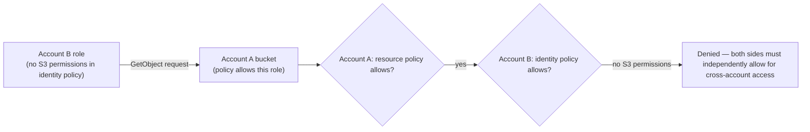

For contrast, the diagram below shows the (different) same-account rule, where either policy alone is enough:

*Source: AWS Documentation — [IAM policy evaluation logic, "Determining whether a request is allowed or denied within an account"](https://docs.aws.amazon.com/IAM/latest/UserGuide/reference_policies_evaluation-logic.html) (curl-verified 200 OK, `image/png`). Same-account access is a union (either policy's allow is enough); cross-account access, as in this question, is an intersection (both must allow).*

**Why the others are wrong:**
- A: This describes the same-account union rule, not the cross-account rule — cross-account access requires an **intersection** (both accounts' policies must allow), the opposite of "either is sufficient."
- C: Requester Pays only shifts who pays data-transfer/request costs; it has no bearing on whether the request is authorized at all.
- D: Block Public Access specifically targets *public* (anonymous or wildcard-principal) access; it doesn't change the fundamental cross-account dual-authorization requirement for a specifically-named principal like this role.

---

## Q2 — Domain 3: Testing and Deployment

A `buildspec.yml` for AWS CodeBuild needs to: (1) install exact dependency versions from a lock file
during a dedicated phase, (2) cache the downloaded dependencies between builds to speed up future
runs, (3) run the test suite, and (4) only if tests pass, produce a build artifact. Which buildspec
structure correctly expresses this?

A. Put everything in a single `build` phase with no `cache` section; CodeBuild automatically caches and orders steps based on static analysis of the commands.

B. Use `phases.install` for dependency installation, a top-level `cache.paths` section pointing at the dependency directory (e.g. `node_modules/**/*`), `phases.pre_build` or `phases.build` for running tests (failing the phase — and the whole build — on a non-zero exit code), and a top-level `artifacts` section defining what to package only after a successful build.

C. Artifacts are defined inside `phases.build` directly as a shell command that zips files manually; the top-level `artifacts` section is deprecated.

D. Caching must be configured entirely outside buildspec.yml, in the CodeBuild project's IAM role.

**Correct Answer: B**

**Explanation:** CodeBuild's `buildspec.yml` has distinct phases (`install`, `pre_build`, `build`,
`post_build`) run in order; a non-zero exit from any command in `phases.build` (like a failing test
suite) fails that phase and the build halts before artifact packaging. A top-level `cache.paths`
section (with the CodeBuild project itself configured to use S3 or local caching) persists specified
directories between builds. The top-level `artifacts` section defines what gets packaged and
uploaded — only reached if earlier phases succeeded. This is Task 3.2 CI content. See
[`services/developer-tools/codebuild.md`](../../../services/developer-tools/codebuild.md).

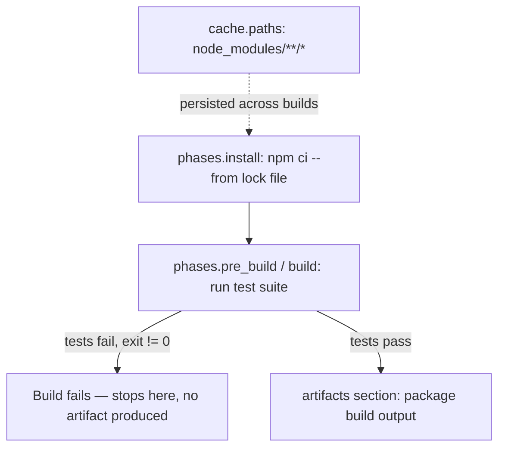

**Why the others are wrong:**
- A: CodeBuild does not auto-detect and cache arbitrary directories through static analysis — caching is explicit, configured via `cache.paths` plus the project's cache-type setting (S3 or local); without it, no caching occurs regardless of phase structure.
- C: The top-level `artifacts` section is the standard, fully supported mechanism for declaring build outputs; it is not deprecated, and defining packaging manually inside `build` bypasses CodeBuild's artifact-handling features (like automatic upload to the pipeline's artifact store) for no benefit.
- D: Caching is configured in `buildspec.yml`'s `cache` section (plus a cache-type setting on the CodeBuild project itself, e.g. S3 bucket location); it has no relationship to the project's IAM role, which governs permissions, not caching behavior.

---

## Q3 — Domain 4: Troubleshooting and Optimization

A Lambda function's X-Ray traces show consistently correct behavior, but the development team wants
to reduce the *cost and volume* of trace data collected in a high-traffic production service, while
still guaranteeing that **every** request resulting in an error (5xx) is always traced, and a
reasonable statistical sample of successful requests is still captured for latency analysis. Which
X-Ray configuration should they adjust?

A. Disable X-Ray entirely for this function and re-enable it only during incidents, since there's no way to bias toward error traces.

B. Configure a custom **X-Ray sampling rule** with a low base sampling rate/reservoir for ordinary traffic, while ensuring the rule (or a second rule) forces a 100% sampling rate for requests matching an error condition — X-Ray sampling rules can be prioritized and scoped (e.g. by service name, HTTP method, or response code) to achieve exactly this kind of biased sampling.

C. Set the Lambda function's `TracingConfig` to `PassThrough` mode, which automatically traces only error responses and nothing else.

D. X-Ray sampling is fixed at a global 5% rate for the entire account and cannot be customized per rule.

**Correct Answer: B**

**Explanation:** X-Ray **sampling rules** let you define a reservoir (minimum guaranteed traces per
second) and a percentage rate for additional traces, with rules evaluated in priority order and
scoped by matching criteria (service name, HTTP method, URL path, etc.) — custom rules targeting
error-prone endpoints or a higher reservoir for failure scenarios let you bias trace collection
toward the most diagnostically valuable requests while reducing overall volume/cost for routine
successful traffic. This is Task 4.1/4.3 content. See [`services/management-governance/cloudwatch.md`](../../../services/management-governance/cloudwatch.md).

**Why the others are wrong:**
- A: Disabling tracing entirely loses the baseline latency visibility into successful requests the team still wants, and re-enabling only reactively during an incident means you have no trace data for the very moment the incident started.
- C: `TracingConfig` has two modes, `Active` and `PassThrough` — `PassThrough` only means the function relies on an upstream service's sampling decision rather than making its own; it has no error-only tracing behavior at all.
- D: X-Ray's default sampling rule (1 request/sec reservoir + 5% of additional requests) is a *default*, fully customizable via custom sampling rules with different reservoirs, rates, and priority — it is not a fixed, uneditable account-wide constant.

---

## Q4 — Domain 1: Development with AWS Services

An application needs to simultaneously (a) add a new item to an `Orders` table, (b) decrement a
`stockCount` attribute on an item in an `Inventory` table, and (c) fail the entire operation —
leaving both tables completely unchanged — if either write would fail (e.g. the inventory item has
insufficient stock). Which DynamoDB API call provides this all-or-nothing, multi-item, potentially
multi-table atomic guarantee?

A. Call `PutItem` on `Orders` followed by `UpdateItem` on `Inventory` sequentially, and if the second call fails, manually call `DeleteItem` to roll back the first.

B. `TransactWriteItems`, which groups up to 100 write operations (across one or more tables) into a single atomic transaction, using `ConditionCheck`/`Put`/`Update`/`Delete` items within it — the entire transaction either fully commits or none of it is applied, with no manual rollback logic required.

C. `BatchWriteItem`, which guarantees all operations in the batch succeed or fail together atomically.

D. Enable DynamoDB Streams on both tables, which automatically rolls back related writes across tables when one fails.

**Correct Answer: B**

**Explanation:** `TransactWriteItems` is DynamoDB's purpose-built API for exactly this requirement:
grouping multiple `Put`/`Update`/`Delete`/`ConditionCheck` operations, potentially spanning multiple
tables, into one all-or-nothing atomic unit — if any item's condition fails, the entire transaction
is rejected and nothing is written anywhere, with no manual compensating-write logic needed. This is
Task 1.3 content. See [`services/database/dynamodb.md`](../../../services/database/dynamodb.md).

**Why the others are wrong:**
- A: Manual sequential writes with hand-rolled rollback logic is exactly the fragile, error-prone pattern transactions exist to eliminate — a crash between the two calls (e.g. the Lambda function being killed) can leave the system in a permanently inconsistent half-written state.
- C: `BatchWriteItem` sends multiple independent `PutItem`/`DeleteItem` requests for efficiency, but each item succeeds or fails **independently** — it explicitly provides no atomicity or all-or-nothing guarantee across the batch.
- D: DynamoDB Streams is a change-data-capture feed for reacting to completed writes after the fact; it has no transactional rollback capability and cannot prevent or undo a write that already happened.

---

## Q5 — Domain 1: Development with AWS Services

A team wants a secondary system to be notified in near-real-time whenever an item in a DynamoDB
`Orders` table changes, receiving both the old and new item images so it can compute what specifically
changed, and wants this processed by a Lambda function with built-in checkpointing/retry handled by
AWS rather than custom polling code. Which combination of features accomplishes this?

A. Enable **DynamoDB Streams** with `StreamViewType: NEW_AND_OLD_IMAGES`, then configure a Lambda **event source mapping** against the stream — Lambda polls the stream internally, delivering batches of change records (each containing both old and new item images) to the function, with automatic checkpointing and configurable retry/batch behavior.

B. Poll the table every second using `Scan` from a cron-triggered Lambda function, diffing against a locally cached copy of the previous scan's results.

C. Subscribe an SNS topic directly to the DynamoDB table; DynamoDB automatically publishes every item change as an SNS notification with no further configuration.

D. Use CloudTrail data events for DynamoDB, which capture full before/after item images for every `PutItem`/`UpdateItem` call.

**Correct Answer: A**

**Explanation:** **DynamoDB Streams** captures an ordered, near-real-time log of item-level
modifications; setting `StreamViewType` to `NEW_AND_OLD_IMAGES` includes both the item's state before
and after the change in each stream record. A Lambda **event source mapping** against the stream
handles polling, batching, checkpointing (via shard iterators), and retry behavior automatically —
no custom polling loop needed. This is Task 1.1/1.3 content. See [`services/database/dynamodb.md`](../../../services/database/dynamodb.md).

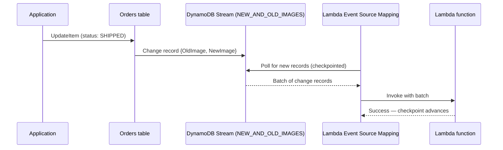

**Why the others are wrong:**
- B: Polling via repeated `Scan` calls is expensive (full table read every interval), introduces latency up to the polling interval, and requires hand-built diffing logic that Streams already provides natively and far more cheaply.
- C: DynamoDB has no built-in direct SNS integration for table changes; getting notifications out requires either DynamoDB Streams (as described) or an application explicitly publishing to SNS itself after a write.
- D: CloudTrail data events for DynamoDB log the *API calls* made (who called `UpdateItem`, when, from where) for audit purposes, but do not include full before/after item image payloads the way Streams' `NEW_AND_OLD_IMAGES` view does.

---

## Q6 — Domain 2: Security

A disaster-recovery plan requires that data encrypted with a KMS key in `us-east-1` must also be
decryptable using the "same" key in `eu-west-1` after a regional failover, without re-encrypting all
existing ciphertext and without the application needing to know which region's key version
encrypted a given object. Which KMS feature is designed for this?

A. Enable automatic key rotation on a standard single-region key; rotation silently replicates the key material to every other AWS Region.

B. A **KMS multi-region key** — a primary key created in one region can have replica keys created in other regions, sharing the same key material and key ID; ciphertext encrypted under the primary can be decrypted by any of its replicas without any cross-region API call or re-encryption, because the underlying cryptographic material is identical.

C. Copy the KMS key's key policy JSON to a new key created independently in the second region; identical policies make two separate keys functionally interchangeable for decrypting the same ciphertext.

D. Use AWS Backup to replicate KMS keys cross-region alongside EBS snapshots.

**Correct Answer: B**

**Explanation:** **Multi-region keys** are a distinct KMS key type specifically for this disaster
recovery pattern: a primary key and its replicas (in other regions) share identical key material and
key ID, so data encrypted under the primary can be decrypted by a replica in another region with no
cross-region network call and no re-encryption — critical for failover scenarios where the original
region may be unavailable. Standard (single-region) keys cannot do this; each is cryptographically
independent even if their policies are identical. This is Task 2.2 content. See
[`services/security-identity-compliance/kms.md`](../../../services/security-identity-compliance/kms.md).

**Why the others are wrong:**
- A: Automatic key rotation generates new cryptographic material *within the same key*, retaining old material for decrypting old ciphertext — it has no cross-region replication behavior at all and doesn't create any key presence in a second region.
- C: Two independently-created KMS keys, even with byte-for-byte identical policy documents, have entirely different underlying cryptographic key material — ciphertext encrypted under one can never be decrypted by the other; only genuine multi-region replica keys share actual key material.
- D: AWS Backup replicates backups of resources like EBS snapshots; it has no mechanism for replicating a KMS key's actual cryptographic material across regions — that is specifically what the multi-region key feature exists to do.

---

## Q7 — Domain 4: Troubleshooting and Optimization

A production incident requires answering: "across every Lambda function in this account, which
specific functions logged an `ERROR` level message mentioning `PaymentGatewayTimeout` in the last 2
hours, and what was each occurrence's exact timestamp and request ID?" The team has dozens of log
groups and doesn't want to open and manually search each one individually. Which tool and query
approach answers this fastest?

A. Open the CloudWatch Logs console for each function's log group individually and use Ctrl+F to search each one's raw log stream manually.

B. **CloudWatch Logs Insights**, running a single query across multiple selected log groups simultaneously (e.g. `fields @timestamp, @requestId, @message | filter @message like /PaymentGatewayTimeout/ and @message like /ERROR/ | sort @timestamp desc`), which returns matching results from every selected log group at once.

C. Enable VPC Flow Logs on each function's associated subnet and filter for the string `PaymentGatewayTimeout`.

D. Query AWS Config's resource configuration history for each Lambda function, filtering by the string `PaymentGatewayTimeout`.

**Correct Answer: B**

**Explanation:** **CloudWatch Logs Insights** supports running one purpose-built query language
expression across multiple log groups at once, with full-text/regex filtering, field extraction, and
sorting — exactly suited to "search across every function's logs for a specific error pattern and
return structured results" without manually opening each log group. This is core Task 4.1
observability-query content. See [`services/management-governance/cloudwatch.md`](../../../services/management-governance/cloudwatch.md).

**Why the others are wrong:**
- A: Manually searching dozens of log groups one at a time via Ctrl+F doesn't scale to "across every Lambda function" and is exactly the slow, manual process Logs Insights' multi-log-group query exists to replace.
- C: VPC Flow Logs capture network-layer metadata (IP, port, bytes, accept/reject) about traffic on an ENI; they contain no application log message content whatsoever and cannot match a string like `PaymentGatewayTimeout`.
- D: AWS Config tracks *resource configuration* changes over time (e.g. a Lambda function's memory setting changing), not application log output — it has no concept of searching log message content.

---

## Q8 — Domain 3: Testing and Deployment

A CodeDeploy deployment to a fleet of EC2 instances uses an `appspec.yml` with lifecycle hooks. The
team wants to run a script that stops the application gracefully *before* the new revision's files
are copied onto the instance, and a separate script that runs health checks *after* the application
has been started with the new code, automatically failing the deployment if the health check script
exits non-zero. Which two lifecycle hooks correctly correspond to these two needs?

A. `BeforeInstall` (runs before the new application revision's files are copied onto the instance — the correct place for a graceful stop of the old version) and `ValidateService` (runs after `ApplicationStart`, used for post-start health checks; a non-zero exit here fails the deployment).

B. `AfterInstall` for the graceful stop, and `BeforeBlockTraffic` for the health check.

C. Both requirements must be handled in a single `ApplicationStart` hook; CodeDeploy only supports one script per deployment.

D. `DownloadBundle` for the graceful stop, and `AfterAllowTraffic` for the health check.

**Correct Answer: A**

**Explanation:** The standard CodeDeploy EC2/on-premises lifecycle event order is roughly:
`ApplicationStop` → `DownloadBundle` → `BeforeInstall` → `Install` → `AfterInstall` → `ApplicationStart`
→ `ValidateService` (with traffic-shifting hooks `BeforeBlockTraffic`/`AfterBlockTraffic`/
`BeforeAllowTraffic`/`AfterAllowTraffic` relevant for load-balanced deployments). `BeforeInstall` is
the correct hook for pre-copy preparation/graceful stop logic, and `ValidateService` is specifically
the post-start health-check hook — any non-zero exit code in a hook script fails the deployment. This
is Task 3.3 content. See [`services/developer-tools/codedeploy.md`](../../../services/developer-tools/codedeploy.md).

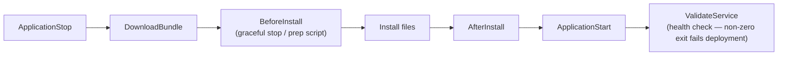

**Why the others are wrong:**
- B: `AfterInstall` runs after files are copied but before the application is (re)started — not a natural place for a "stop the running app" action that should happen first; `BeforeBlockTraffic` is about load-balancer traffic shifting, not application-level health validation.
- C: CodeDeploy explicitly supports distinct scripts for each named lifecycle hook in `appspec.yml`'s `hooks` section — it is not limited to a single script per deployment.
- D: `DownloadBundle` is a CodeDeploy-agent-reserved hook (you generally can't run custom scripts here) for fetching the revision; `AfterAllowTraffic` is specific to load-balanced traffic-shifting deployments, not a general post-start health validation point.

---

## Q9 — Domain 1: Development with AWS Services

A table `Orders` has partition key `orderId`. A new requirement appears: look up all orders for a
given `customerId`, sorted by `orderDate`, with the ability to further filter by `status` — a query
pattern the base table's key schema cannot support directly. The team also needs the existing
`orderId`-based point lookups to continue exactly as before, and wants to avoid a second physical
table. Which DynamoDB feature fits, and what is a key property to decide between two sub-options?

A. A **Global Secondary Index (GSI)** with partition key `customerId` and sort key `orderDate`
   (optionally projecting `status` and other attributes needed), queryable independently of the base
   table's key schema, with its own separate provisioned/on-demand throughput — versus a **Local
   Secondary Index (LSI)**, which must share the base table's partition key and can only be created
   at table-creation time, making a GSI the right fit here since the new access pattern uses a
   different partition key (`customerId` vs. `orderId`) and the table already exists.

B. Add `customerId` and `orderDate` as additional attributes on the base table and use `Scan` with a
   `FilterExpression`; DynamoDB automatically builds an index on any attribute used in a filter.

C. Change the base table's partition key to `customerId`, since a table can only have one key schema and indexes aren't a real DynamoDB concept.

D. Create a second DynamoDB table and manually dual-write every order to both tables from application code.

**Correct Answer: A**

**Explanation:** A **GSI** is precisely for adding a new query pattern with a *different* partition
key than the base table, without altering the base table's own key schema or existing access
patterns — it has its own separate index structure and capacity. An **LSI**, by contrast, must share
the base table's partition key (only the sort key differs) and can only be defined at table creation
time, so it wouldn't apply here anyway, both because the access pattern needs a different partition
key *and* the table already exists. This is Task 1.3 content. See [`services/database/dynamodb.md`](../../../services/database/dynamodb.md).

**Why the others are wrong:**
- B: DynamoDB does not auto-build indexes from `FilterExpression` usage — a `Scan` with a filter still reads the *entire table* and discards non-matching items after the fact, which is both expensive and slow at any meaningful table size, and is not equivalent to having an actual index.
- C: A table does have exactly one primary key schema, but DynamoDB absolutely supports secondary indexes (GSIs and LSIs) specifically to support additional query patterns beyond that one primary key — the premise that indexes "aren't a real concept" is false.
- D: Manual dual-writing to two separate tables from application code introduces consistency risk (a crash between the two writes leaves them diverged) and operational overhead that a native secondary index entirely avoids.

---

## Q10 — Domain 2: Security

A security engineer compares two configuration options for encrypting objects in an S3 bucket used
by a regulated workload: **SSE-S3** (Amazon S3-managed keys) versus **SSE-KMS** (AWS KMS customer-
managed keys). Which statement correctly identifies a capability SSE-KMS provides that SSE-S3
cannot?

A. SSE-S3 and SSE-KMS are functionally identical in every respect; the only difference is a naming convention in the console.

B. SSE-KMS enables **CloudTrail-logged, per-object API-level access auditing of every encrypt/decrypt operation** (since each operation is a KMS API call attributable to a specific IAM principal) and lets you control access to the data via a separate, independently-revocable key policy/grants — capabilities SSE-S3's AWS-owned, non-customer-visible key cannot provide.

C. SSE-S3 supports customer-controlled key rotation schedules, while SSE-KMS keys rotate on a fixed, non-configurable 24-hour cycle.

D. Only SSE-KMS objects can be versioned; SSE-S3 is incompatible with S3 Versioning.

**Correct Answer: B**

**Explanation:** With **SSE-KMS**, every encrypt/decrypt operation is a distinct, CloudTrail-logged
KMS API call (`Decrypt`, `GenerateDataKey`) attributable to the specific calling principal — giving
fine-grained auditability and the ability to independently revoke/restrict access via the key's own
policy (e.g. disabling the key immediately denies access to *all* objects it protects, regardless of
their S3-level permissions). **SSE-S3** uses an AWS-owned key with no customer-visible policy,
audit trail at the key level, or independent revocation lever. See [`services/storage/s3.md`](../../../services/storage/s3.md)
and [`services/security-identity-compliance/kms.md`](../../../services/security-identity-compliance/kms.md).

**Why the others are wrong:**
- A: The two differ substantially — key ownership/visibility, audit granularity, cost (KMS charges per API call; SSE-S3 is free), and policy-based access control are all meaningfully different, not a cosmetic naming difference.
- C: This reverses the actual behavior — SSE-S3 keys are entirely AWS-managed with no customer-configurable rotation at all, while customer-managed KMS keys support **optional automatic annual rotation** that the customer can enable/disable, and it is not a 24-hour cycle for either.
- D: S3 Versioning works identically regardless of which server-side encryption method (SSE-S3, SSE-KMS, or SSE-C) is used for any given object version — there is no such incompatibility.

---

## Q11 — Domain 4: Troubleshooting and Optimization

A dashboard needs a single alarm that reflects overall application health by combining three
existing alarms: `HighALB5xxRate` (ALARM state means elevated 5xx responses), `HighLambdaErrorRate`,
and `RDSConnectionPoolExhausted` — the team wants the combined alarm to enter `ALARM` state if *any*
one of the three individual alarms is in `ALARM` state, without redefining any metric math. Which
CloudWatch feature is designed for this?

A. A new metric math expression that recomputes all three underlying metrics from scratch into one formula.

B. A **composite alarm**, which takes a logical expression over the **alarm states** of existing alarms (e.g. `ALARM("HighALB5xxRate") OR ALARM("HighLambdaErrorRate") OR ALARM("RDSConnectionPoolExhausted")`) and enters `ALARM` itself whenever that expression evaluates true — reusing the existing alarms' own thresholds and logic without touching their underlying metrics.

C. CloudWatch Contributor Insights, which ranks top contributors to a metric but has no alarm-combination capability.

D. An EventBridge rule matching all three alarms' state-change events, configured to simply log the match with no further alarm behavior.

**Correct Answer: B**

**Explanation:** **Composite alarms** combine the *states* of other existing alarms using
`AND`/`OR`/`NOT` logic in an alarm rule expression — ideal for "alarm if any of these already-defined
alarms trips," without needing to recreate or duplicate each underlying alarm's own metric math or
thresholds. This is Task 4.1 observability content. See [`services/management-governance/cloudwatch.md`](../../../services/management-governance/cloudwatch.md).

**Why the others are wrong:**
- A: Metric math operates on raw *metric* values, not alarm states; rebuilding each underlying alarm's condition from scratch in one formula duplicates logic unnecessarily and would need to be kept in sync manually with each individual alarm's own threshold.
- C: Contributor Insights analyzes which dimension values (e.g. which API or IP) contribute most to a metric's volume; it has no capability to combine multiple alarms' states into a new alarm.
- D: An EventBridge rule can react to alarm state-change events and *trigger* a downstream action (like notifying a team), but on its own it doesn't create a new, dashboard-visible alarm resource with its own `ALARM`/`OK` state the way a composite alarm does.

---

## Q12 — Domain 3: Testing and Deployment

A company's workloads span 12 AWS accounts under AWS Organizations. A team wants to deploy the same
baseline CloudFormation template (e.g. a standard VPC configuration, a required CloudTrail trail) to
every account in a specific Organizational Unit automatically, including any new accounts created in
that OU in the future, without manually running `create-stack` in each account one at a time. Which
CloudFormation feature is purpose-built for this?

A. CloudFormation **StackSets** with an OU-based deployment target and automatic deployment enabled, which propagates the stack to every current (and, with automatic deployment, future) account in the specified OU/accounts list, from one central administrator account.

B. A CloudFormation nested stack, where the parent stack's `AWS::CloudFormation::Stack` resource is repeated once per target account ARN.

C. AWS Config conformance packs, which are the only mechanism capable of deploying actual AWS resources (not just compliance rules) across multiple accounts.

D. Copy the template file to an S3 bucket in each of the 12 accounts and configure each account's own EventBridge rule to self-trigger a local stack creation on file upload.

**Correct Answer: A**

**Explanation:** **StackSets** are specifically designed for deploying (and later updating/deleting)
the same CloudFormation template consistently across many accounts and regions from one place; with
an **organizational unit target** and automatic deployment enabled, StackSets will also automatically
deploy the stack into any account that joins that OU later, and remove it if an account leaves —
exactly the "deploy everywhere in this OU, including future accounts" requirement. This is Task 3.2
multi-account IaC content. See [`services/management-governance/cloudformation.md`](../../../services/management-governance/cloudformation.md).

**Why the others are wrong:**
- B: Nested stacks are a single-account, single-deployment composition mechanism for splitting one template into reusable pieces within one stack deployment — they have no cross-account deployment or account-set-targeting capability at all.
- C: AWS Config conformance packs deploy and evaluate **Config rules** (compliance checks) across accounts; they do not provision arbitrary AWS resources like a VPC or CloudTrail trail the way a CloudFormation template does.
- D: This is a convoluted, fully custom-built reinvention of what StackSets already provides natively and more reliably, requiring per-account manual EventBridge setup that itself would need to be deployed to every account somehow (a chicken-and-egg problem StackSets doesn't have).

---

## Q13 — Domain 1: Development with AWS Services

An application frequently needs to run the same multi-attribute "find all orders placed by customer
X in the last 30 days with status 'pending', ordered by date" query, and the team wants to express
this using a familiar SQL-like syntax directly against a DynamoDB table (which already has an
appropriate GSI for `customerId`/`orderDate`), rather than constructing a `KeyConditionExpression`
and `FilterExpression` via the lower-level `Query` API parameters. Which feature allows this?

A. DynamoDB does not support SQL-like syntax under any circumstances; `Query`'s parameter-based API is the only interface.

B. **PartiQL for DynamoDB**, which lets you express reads and writes using a SQL-compatible `SELECT`/`INSERT`/`UPDATE`/`DELETE` syntax (e.g. `SELECT * FROM "Orders"."CustomerDateIndex" WHERE customerId = 'cust-1' AND orderDate > '2024-01-01' AND status = 'pending'`) that DynamoDB translates internally into the equivalent key-condition/filter operations against the specified table or index.

C. Enable Amazon Athena directly on the DynamoDB table with zero configuration; Athena natively queries live DynamoDB tables using standard SQL with no connector needed.

D. Migrate the table to Aurora Serverless, since only relational engines support SQL syntax.

**Correct Answer: B**

**Explanation:** **PartiQL for DynamoDB** is a first-class, SQL-compatible query interface supported
directly by the DynamoDB API (`ExecuteStatement`/`BatchExecuteStatement`) and console, letting
developers write familiar `SELECT ... FROM "TableName"."IndexName" WHERE ...` statements that
DynamoDB executes using the same underlying key-condition/filter/index mechanics as the native API —
useful for teams more comfortable with SQL syntax or doing ad hoc querying, without changing the
underlying table/index design at all. This is Task 1.3 content. See [`services/database/dynamodb.md`](../../../services/database/dynamodb.md).

**Why the others are wrong:**
- A: PartiQL is a genuinely supported, AWS-documented alternative query interface for DynamoDB, coexisting with the traditional parameter-based `Query`/`Scan`/`GetItem` APIs — the premise that no SQL-like syntax exists is simply outdated/incorrect.
- C: Athena can query data *exported* from DynamoDB (e.g. via an S3 export or a connector/federated query setup) but does not natively query a live DynamoDB table with zero configuration as a built-in default behavior.
- D: Migrating the entire data store to a different database engine just to get SQL syntax is a drastic, unnecessary architectural change when PartiQL already provides SQL-like querying directly against DynamoDB.

---

## Q14 — Domain 2: Security

A team needs a Lambda function to decrypt a Parameter Store `SecureString` parameter. They've
granted the function's execution role `ssm:GetParameter` on the specific parameter ARN, but calls
still fail with an access-denied error specifically around decryption (not around reading the
parameter's existence). What permission is most likely still missing?

A. `ssm:DescribeParameters`, which is required before any `GetParameter` call on a `SecureString` can succeed.

B. `kms:Decrypt` on the KMS key used to encrypt the `SecureString` parameter — Parameter Store `SecureString` values are encrypted under a KMS key (the default `alias/aws/ssm` or a customer-managed key), and retrieving the *decrypted* value (`WithDecryption: true`) requires the caller to also be authorized by that key's own policy/IAM permissions, separately from `ssm:GetParameter` itself.

C. `ec2:DescribeParameters`, since Parameter Store runs on the EC2 Systems Manager control plane.

D. `secretsmanager:GetSecretValue`, because `SecureString` parameters are internally backed by Secrets Manager.

**Correct Answer: B**

**Explanation:** A `SecureString` parameter's value is encrypted at rest with a KMS key; calling
`GetParameter`/`GetParameters` with `WithDecryption: true` requires **both** `ssm:GetParameter`
permission on the parameter *and* `kms:Decrypt` permission for the specific KMS key involved (via the
caller's IAM policy and the key's own policy) — missing either piece causes exactly this
decrypt-specific failure while the parameter's existence/metadata may still be visible. This is Task
2.2 content. See [`services/security-identity-compliance/secrets-manager-vs-parameter-store.md`](../../../services/security-identity-compliance/secrets-manager-vs-parameter-store.md)
and [`services/security-identity-compliance/kms.md`](../../../services/security-identity-compliance/kms.md).

**Why the others are wrong:**
- A: `DescribeParameters` lists/describes parameter metadata across the account; it is not a required prerequisite permission for calling `GetParameter` on a specific, already-known parameter name.
- C: Parameter Store is a Systems Manager feature but does not require EC2-specific IAM permissions (`ec2:*`) to read parameter values; that's an unrelated service namespace.
- D: `SecureString` parameters are a native Parameter Store feature, encrypted directly via KMS — they are not internally implemented on top of Secrets Manager, and no Secrets Manager permissions are relevant here.

---

## Q15 — Domain 1: Development with AWS Services

An `Orders` table item has a `status` attribute that must transition only in a specific valid
sequence (`PENDING` → `SHIPPED` → `DELIVERED`), and multiple application instances might try to
update the same order concurrently. The team wants to guarantee that an update only applies if the
item's `status` is still in the exact expected prior state at the moment of the write (preventing a
`DELIVERED` order from being accidentally reverted to `SHIPPED` by a stale, late-arriving request).
Which DynamoDB mechanism enforces this?

A. Strongly consistent reads before every write, which alone guarantee the status value cannot have changed between the read and the subsequent write.

B. `UpdateItem` with a `ConditionExpression` checking the current value of `status` (e.g. `status = :expectedPrior`) as part of the same atomic call — if another writer already changed `status` since the caller last knew about it, the condition fails and the update is rejected, which is DynamoDB's standard **optimistic concurrency control** pattern (often combined with a numeric `version` attribute incremented on every successful write).

C. Enable DynamoDB's `TransactionIsolationLevel: SERIALIZABLE` table setting, which automatically blocks all concurrent writers until each one completes.

D. Use a Global Secondary Index on `status` to automatically enforce valid state transitions.

**Correct Answer: B**

**Explanation:** A `ConditionExpression` on `UpdateItem` is evaluated **atomically with the write
itself** — there's no gap between checking and updating for another writer to exploit, unlike a
separate read-then-write sequence. This is DynamoDB's standard optimistic concurrency pattern: check
that the item is still in the expected state (directly, or via an incrementing `version` attribute)
as part of the same call, and let `ConditionalCheckFailedException` signal a conflicting concurrent
write to retry or reject. This is Task 1.3 content. See [`services/database/dynamodb.md`](../../../services/database/dynamodb.md).

**Why the others are wrong:**
- A: Strong consistency only guarantees a read reflects the latest completed write at the moment of that read — it does nothing to prevent a *different* write from happening in the gap between that read and a subsequent, separate write call, which is exactly the race this scenario is worried about.
- C: DynamoDB has no table-level `TransactionIsolationLevel` setting; `TransactWriteItems` provides transactional semantics for an explicit group of operations, but there's no such blanket, always-on serialization toggle.
- D: A GSI only provides an alternate query pattern on an attribute's current value; it has no capability to validate or enforce business-logic state-transition rules like "only allow PENDING → SHIPPED."

---

## Q16 — Domain 3: Testing and Deployment

A team running a containerized service on Amazon ECS currently uses the **native rolling update**
deployment type (not CodeDeploy blue/green). A recent bad deployment replaced healthy tasks with a
crashing new version, and the service sat partially degraded for several minutes before an engineer
noticed and manually rolled back. The team wants ECS itself to detect a failing rolling deployment
and **automatically roll back** to the last known-good task definition, without adopting a full
CodeDeploy blue/green setup. Which ECS-native feature provides this?

A. ECS has no automatic rollback capability of any kind outside of CodeDeploy; manual intervention is always required for a native rolling update.

B. The ECS service's **deployment circuit breaker**, which monitors a rolling deployment's task
   health during rollout and, if tasks repeatedly fail to stabilize (become healthy) within the
   configured threshold, automatically stops the deployment and rolls the service back to the
   previous task definition — a native ECS capability distinct from, and simpler to adopt than,
   a full CodeDeploy blue/green deployment configuration.

C. ECS Service Auto Scaling, which automatically reverts to the previous task definition whenever CPU utilization drops below a configured threshold.

D. Amazon Inspector, which continuously scans running tasks and forces an automatic rollback whenever a new CVE is published for any installed package.

**Correct Answer: B**

**Explanation:** The **ECS deployment circuit breaker** is a native rolling-update feature (enabled
per service, independent of CodeDeploy) that tracks whether new tasks are successfully stabilizing
during a deployment; if they repeatedly fail to reach a healthy steady state within the configured
failure threshold, ECS automatically halts the rollout and rolls the service back to the prior task
definition — giving automatic rollback protection for teams using plain rolling updates who aren't
ready to adopt the more involved blue/green (second target group, traffic-shifting) CodeDeploy
workflow. This is Task 3.3 content. See [`services/containers/ecs.md`](../../../services/containers/ecs.md).

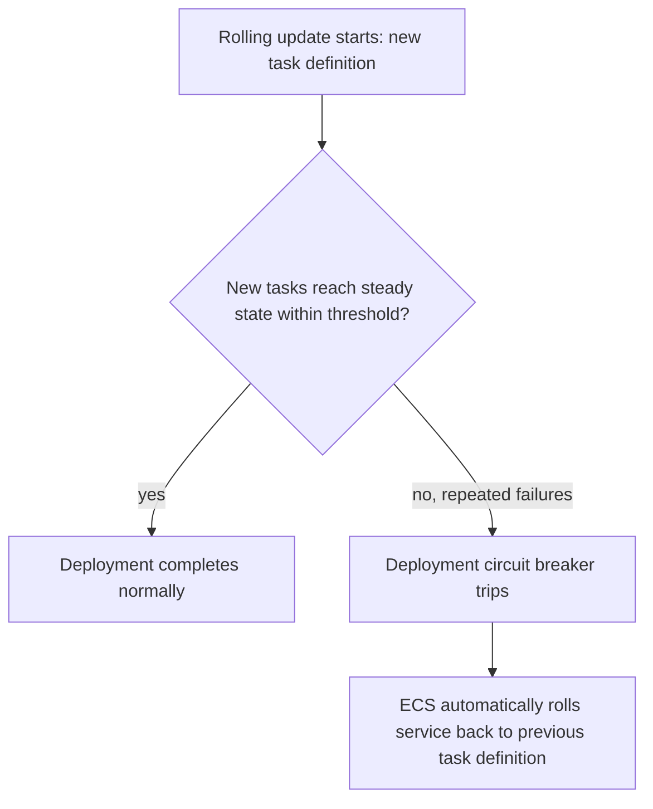

**Why the others are wrong:**
- A: The deployment circuit breaker is exactly a native, non-CodeDeploy automatic-rollback mechanism — the premise that only CodeDeploy can provide this is incorrect.
- C: Service Auto Scaling adjusts task *count* based on scaling metrics like CPU/memory utilization; it has no awareness of deployment health or task-definition rollback at all.
- D: Inspector performs vulnerability scanning on running workloads; it has no deployment-rollback capability and does not react to CVE disclosures by triggering an ECS service rollback.

---

## Q17 — Domain 4: Troubleshooting and Optimization

An application's Amazon ElastiCache for Redis cluster shows a rising `CacheMisses` metric and a
falling hit rate over the past week, even though the application code and cache-key scheme haven't
changed. CloudWatch also shows `Evictions` climbing steadily. What is the most likely root cause, and
the correct first diagnostic/fix?

A. The Redis engine version is outdated and must be upgraded immediately; version alone determines eviction behavior.

B. The working set of frequently-accessed keys has outgrown the node's available memory, causing Redis to evict existing keys (under its configured eviction policy, e.g. `allkeys-lru`) to make room for new writes — the fix is to check `BytesUsedForCache` / `DatabaseMemoryUsagePercentage` against the node's capacity, and either scale up to a larger node type, scale out (cluster mode with more shards), or review the eviction policy and TTLs for the actual working set size.

C. `CacheMisses` and `Evictions` rising together always indicates a misconfigured security group blocking some client connections intermittently.

D. Switch the cluster to Memcached, which never evicts keys under memory pressure.

**Correct Answer: B**

**Explanation:** Rising evictions alongside rising cache misses is the classic signature of memory
pressure: the cache no longer has room for the full working set of actively-needed keys, so the
configured eviction policy removes some (often least-recently-used) keys to make space, and
subsequent requests for those evicted keys become misses. The correct diagnostic is checking memory
utilization metrics against node capacity, then addressing it via vertical (bigger node) or
horizontal (more shards) scaling, or revisiting TTLs/eviction policy if the working set itself has
grown unnecessarily. This is Task 4.2 content. See [`services/database/elasticache.md`](../../../services/database/elasticache.md).

**Why the others are wrong:**
- A: Engine version has no direct, deterministic relationship to eviction behavior under memory pressure — eviction policy and available memory are the relevant levers, not version number alone.
- C: Security group misconfigurations would manifest as connection failures/timeouts, not as the specific metric pattern of rising `CacheMisses` combined with rising `Evictions` on a cache that's otherwise reachable.
- D: Memcached also evicts keys under memory pressure (it simply doesn't support the same persistence/replication features Redis does) — switching engines wouldn't eliminate eviction behavior, and doing so is an unnecessary, heavyweight migration for what's fundamentally a capacity-sizing problem.

---

## Q18 — Domain 2: Security

A Lambda function in a VPC needs to call Amazon Bedrock's `InvokeModel` API, and the security team
requires that this traffic never traverse the public internet, even though it's already TLS-
encrypted end to end. Which networking configuration correctly satisfies this for a Bedrock call made
from inside a VPC?

A. No action is needed; any TLS-encrypted call from a Lambda function in a VPC automatically stays within the AWS private network by default.

B. Create an **interface VPC endpoint (PrivateLink)** for `bedrock-runtime` (and `bedrock-agent-runtime` if using Agents), attach it to the relevant subnets with a security group permitting the Lambda function's security group, and ensure the function's VPC configuration can route to that endpoint — this keeps the API call on AWS's private network path end to end.

C. Attach a NAT Gateway to the Lambda function's subnets; NAT Gateways force all outbound traffic through AWS's private backbone exclusively.

D. Enable VPC Flow Logs on the subnet, which automatically reroutes matched traffic through a private path.

**Correct Answer: B**

**Explanation:** By default, a Lambda function in a VPC reaching an AWS service's public API endpoint
(like `bedrock-runtime`) routes out through a NAT gateway/instance to the public AWS network path —
still encrypted, but not confined to AWS's private backbone. Creating an **interface VPC endpoint**
for the Bedrock runtime service, with appropriate security group rules, gives the function a private
ENI-based path to the service that never touches the public internet. This is Task 2.3's "data
privacy via VPC endpoints" content. See [`certifications/dva-c03/domain-2-security/ai-service-security-risks.md`](../domain-2-security/ai-service-security-risks.md)
and [`services/networking-content-delivery/vpc-endpoints-privatelink.md`](../../../services/networking-content-delivery/vpc-endpoints-privatelink.md).

**Why the others are wrong:**
- A: TLS encrypts the traffic's contents in transit but does not determine its network *path* — without a VPC endpoint, calls to public AWS service endpoints from inside a VPC typically still traverse the public internet path via a NAT gateway/IGW, which is exactly the gap the scenario is concerned about.
- C: A NAT Gateway enables outbound internet access for private-subnet resources; it routes traffic *toward* the public internet (via an Internet Gateway), which is the opposite of keeping traffic off the public internet — it does not provide any private AWS-service path on its own.
- D: VPC Flow Logs are a passive observability/logging feature that records metadata about traffic that already occurred; they have no capability to reroute or influence the actual network path traffic takes.

---

## Q19 — Domain 1: Development with AWS Services

An `Orders` table stores items that should automatically and permanently disappear from the table 90
days after order completion, without any application code needing to run a scheduled cleanup job,
and without this deletion consuming any write-capacity units. Which DynamoDB feature provides this?

A. A DynamoDB Streams trigger that runs a Lambda function once a day to `Scan` and delete expired items.

B. DynamoDB **Time to Live (TTL)**, configured on a Unix-epoch-timestamp attribute (e.g. `expiresAt`); DynamoDB's background TTL process automatically deletes expired items (typically within 48 hours of expiration) at no additional write-capacity cost, with no scheduled job or application code required.

C. S3 Lifecycle policies applied directly to the DynamoDB table.

D. Setting the table's billing mode to on-demand, which automatically expires items older than 90 days by default.

**Correct Answer: B**

**Explanation:** **TTL** is a native DynamoDB feature: once enabled on a table and pointed at a
specific attribute holding a Unix epoch timestamp, DynamoDB's background process automatically
identifies and deletes expired items without consuming write capacity units and without any
application-side scheduled job — the application only needs to set that timestamp attribute (e.g.
`expiresAt = completedAt + 90 days`) when writing or updating the item. This is Task 1.3 content. See
[`services/database/dynamodb.md`](../../../services/database/dynamodb.md).

**Why the others are wrong:**
- A: A manually-scheduled scan-and-delete job works but is exactly the extra application code and `Scan`-based (expensive, slow) approach TTL exists to eliminate, and it would consume write capacity for every delete plus read capacity for the scan.
- C: S3 Lifecycle policies are an S3-specific feature for transitioning/expiring S3 *objects*; they have no applicability to DynamoDB tables or items whatsoever.
- D: Billing mode controls capacity management/pricing model only; DynamoDB has no default, automatic 90-day (or any) item expiration tied to billing mode — expiration requires explicitly configuring TTL on a specific attribute.

---

## Q20 — Domain 3: Testing and Deployment

A team currently deploys application code to a fleet of self-managed EC2 instances (not Lambda, not
ECS) using AWS CodeDeploy. They're deciding between the **in-place** deployment type (CodeDeploy
stops the app on each instance, installs the new revision, restarts it, one batch of instances at a
time) and the **blue/green** deployment type for EC2/On-Premises (CodeDeploy provisions a whole new
set of replacement instances, installs the new revision, and only then reroutes traffic via a load
balancer). Which statement correctly distinguishes the operational trade-off between the two for
this EC2 compute platform?

A. Both deployment types are functionally identical for the EC2/On-Premises compute platform; the names differ only for marketing purposes with no behavioral difference.

B. **In-place** deployment reuses the *existing* instances (no new compute cost, but each instance is
   briefly unavailable while being updated, and rollback means re-deploying the previous revision onto
   those same instances) — **blue/green** for EC2/On-Premises provisions a *separate, new* set of
   instances entirely, installs the revision there, and only cuts traffic over once they're healthy
   (avoiding any in-place downtime window and enabling instant rollback by routing back to the
   original instances), at the cost of temporarily running double the instance capacity during the
   deployment.

C. Blue/green for EC2/On-Premises is only a conceptual name; CodeDeploy has no actual deployment type that provisions new replacement instances for this compute platform, unlike its Lambda and ECS deployment types.

D. In-place deployments always provision a completely new target group and load balancer per deployment, while blue/green deployments reuse the existing instances without any new compute provisioned.

**Correct Answer: B**

**Explanation:** For the **EC2/On-Premises** compute platform specifically, CodeDeploy's **in-place**
deployment type updates the application directly on the existing instances batch by batch (each
batch briefly taken out of service), while its **blue/green** deployment type provisions a
*new* set of replacement instances, deploys the revision to them, and only then reroutes an attached
load balancer's traffic to the new instances — the original instances remain available for an instant
rollback by rerouting traffic back, but the team pays for running both instance sets simultaneously
during the cutover window. This is Task 3.3 content. See [`services/developer-tools/codedeploy.md`](../../../services/developer-tools/codedeploy.md).

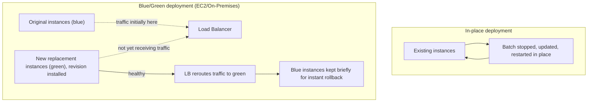

**Why the others are wrong:**
- A: The two deployment types have materially different operational behavior (reuse-in-place with a brief outage window vs. provision-new-then-cutover with double capacity temporarily) — they are not interchangeable naming conventions.
- C: CodeDeploy's EC2/On-Premises blue/green deployment type genuinely provisions a new Auto Scaling group/instance set behind a load balancer — it is a real, distinct, fully implemented deployment type, not merely conceptual.
- D: This reverses the actual behavior — in-place deployments reuse the existing instances with no new compute provisioned, while blue/green is the one that provisions new instances (and can involve a new or existing target group depending on configuration, but always a new instance set).

---

## Q21 — Domain 1: Development with AWS Services

A team stores large (multi-hundred-MB to several-GB) files that users upload directly from a browser
to S3. Network interruptions sometimes occur partway through a large upload, and the team wants
failed uploads to be resumable from roughly where they left off, rather than needing to restart the
entire upload from byte zero, while also enabling parallel upload of different parts of the same
file to improve throughput. Which S3 feature/API is designed for this?

A. S3 **Transfer Acceleration**, which automatically makes any single-PUT upload resumable from the point of failure.

B. **S3 Multipart Upload**, which splits a large object into independently-uploaded parts (each with its own `ETag`), allows parts to be uploaded in parallel or out of order, lets a client resume by only re-uploading failed/missing parts rather than the whole object, and finishes with a `CompleteMultipartUpload` call once all parts are confirmed.

C. Enabling S3 Versioning, which automatically creates a new resumable checkpoint version after every few megabytes of a single-PUT upload.

D. `CopyObject` with a `Range` header, used repeatedly to incrementally build up the final object from a series of smaller uploads.

**Correct Answer: B**

**Explanation:** **Multipart Upload** is S3's purpose-built mechanism for large-object uploads: the
client splits the file into parts (uploaded via `UploadPart`, each independently retryable and
parallelizable), and only calls `CompleteMultipartUpload` once every required part has been
successfully received — if a part fails, only that part needs to be retried, not the whole file,
directly solving both the resumability and the parallel-throughput requirements described. This is
Task 1.1 content. See [`services/storage/s3.md`](../../../services/storage/s3.md).

**Why the others are wrong:**
- A: Transfer Acceleration speeds up transfer over long network distances via CloudFront's edge locations; it doesn't change a standard single-PUT upload's atomicity or provide any part-level resumability on its own.
- C: Versioning creates a new, complete object version each time a *successful* PUT completes; it has no mid-upload checkpointing behavior and would not help with a partially-failed, in-progress single upload at all.
- D: `CopyObject` operates on objects that already exist in S3; it cannot be used to assemble a file from pieces being uploaded by a client that hasn't finished uploading yet, and has no relationship to resumable client uploads.

---

## Q22 — Domain 4: Troubleshooting and Optimization

An API Gateway REST API starts returning `429 Too Many Requests` to clients. CloudWatch shows the
API's traffic is well within the per-method throttle limits configured on the `prod` stage. What
other throttling layer should the team check next, and why?

A. There is no other throttling layer; if the stage-level limits aren't exceeded, 429s must be a client-side caching bug, not real throttling.

B. The **account-level (region-level) throttle limits** — API Gateway enforces a default steady-state request rate and burst limit per AWS account per Region across *all* APIs combined, independent of any individual API/stage/method's own configured limits; if other APIs in the same account/Region are also receiving heavy traffic, the shared account-level ceiling can be exceeded even while this specific API's own stage limits look fine.

C. Lambda's reserved concurrency limit, which is solely responsible for all 429 responses regardless of which service returns them.

D. The CloudFront distribution's price class setting, which directly determines API Gateway's throttle limits.

**Correct Answer: B**

**Explanation:** API Gateway enforces throttling at multiple layers: per-method/stage (explicitly
configured, what the team already checked) and a separate, often-overlooked **account-level default
limit per Region** shared across every API in that account — a burst of traffic to a *different* API
in the same account/Region can exhaust this shared ceiling and cause `429`s on an otherwise
well-provisioned, unrelated API. This is Task 4.2 content. See [`services/networking-content-delivery/api-gateway.md`](../../../services/networking-content-delivery/api-gateway.md).

**Why the others are wrong:**
- A: API Gateway's actual, documented behavior includes this separate account/Region-level ceiling in addition to per-stage/method limits — dismissing 429s as purely a client caching bug ignores a well-known, real throttling layer.
- C: Lambda concurrency throttling does produce its own distinct error behavior (visible in Lambda's own throttle metrics/logs) when *Lambda itself* is the bottleneck, but it is not "solely responsible for all 429 responses" from API Gateway — API Gateway's own throttle limits (per-method/stage and account-level) are a separate, equally valid cause and must be checked independently.
- D: CloudFront price class controls which edge locations serve a distribution's content for cost/latency trade-offs; it has no relationship to API Gateway's own backend throttle limit configuration.

---

## Q23 — Domain 1: Development with AWS Services

A team is choosing between S3 **event notifications** sent directly to a Lambda function/SQS/SNS,
versus routing the same S3 events through **EventBridge** first. Which statement correctly describes
a capability that routing through EventBridge adds, which direct S3 event notifications alone do
not provide?

A. Direct S3 event notifications and EventBridge-routed S3 events are functionally and architecturally identical; there is no reason to ever choose one over the other.

B. Routing through **EventBridge** lets the same S3 event be matched by content-based filtering rules and fanned out to many independent targets/rules (including cross-account, cross-service targets, and features like archive/replay) using one unified event bus — direct S3 event notifications configured on the bucket support a more limited, fixed set of destination types and lack EventBridge's rule-based filtering and multi-target fan-out model.

C. Direct S3 event notifications support far more destination types than EventBridge, including HTTP webhooks and third-party SaaS endpoints natively.

D. EventBridge routing is required before S3 can generate any event notifications at all; S3 cannot emit events without EventBridge enabled.

**Correct Answer: B**

**Explanation:** S3's native event notification configuration supports a fixed set of destinations
(Lambda, SQS, SNS) directly. Enabling **EventBridge notifications** on the bucket instead routes
every S3 event onto the account's default event bus, where EventBridge's full rule-matching
capability (content-based filtering on event fields, multiple independent rules/targets per event,
cross-account event bus targets, archive-and-replay) becomes available — a materially richer routing
model than direct notifications alone. This is Task 1.1 content. See [`services/storage/s3.md`](../../../services/storage/s3.md)
and [`services/application-integration/eventbridge.md`](../../../services/application-integration/eventbridge.md).

**Why the others are wrong:**
- A: The two mechanisms differ substantially in filtering flexibility, fan-out capability, and destination options — treating them as interchangeable ignores exactly the differences that matter when choosing an architecture.
- C: It's EventBridge that supports a much broader range of API Destinations (including third-party webhooks) and many native AWS service targets; direct S3 event notifications are limited to Lambda, SQS, and SNS only.
- D: S3 can generate event notifications independently via its native mechanism without EventBridge involved at all; EventBridge integration is an optional, additional way to route the same underlying events, not a prerequisite for S3 to emit them.

---

## Q24 — Domain 2: Security

A company's WAF (AWS WAF) is attached to a CloudFront distribution in front of a public API. The
security team observes repeated SQL-injection-pattern requests from many different rotating IP
addresses (so simple IP-based rate limiting isn't effective on its own) targeting a login endpoint.
Which WAF configuration most directly and correctly addresses this specific threat pattern?

A. A geographic match rule blocking all traffic from outside the company's home country, since SQL injection attempts always originate from a single predictable region.

B. Associate AWS WAF's **managed rule group for SQL injection** (e.g. the SQL database managed rule group within the AWS Managed Rules) with the web ACL, which inspects request components (query string, body, headers) for known SQL-injection attack patterns and blocks matches — complemented by a **rate-based rule** scoped to the login endpoint's URI path to limit abusive request volume regardless of source IP rotation.

C. Switch CloudFront to use Origin Shield, which is AWS's dedicated mechanism for blocking SQL injection patterns.

D. Enable S3 Block Public Access on the API's backend S3 bucket, which inspects and blocks malicious query strings before they reach the origin.

**Correct Answer: B**

**Explanation:** AWS WAF's **managed rule groups** include pattern-matching rules specifically
designed to detect and block common SQL-injection attack signatures across the request's query
string, body, and headers — directly addressing the attack *type* regardless of which rotating IP
sent it. Pairing this with a **rate-based rule** scoped to the vulnerable endpoint adds volumetric
abuse protection, together forming layered defense that doesn't rely on IP reputation alone. This is
Task 2.2 content. See [`services/security-identity-compliance/waf.md`](../../../services/security-identity-compliance/waf.md).

**Why the others are wrong:**
- A: Attackers using rotating IPs frequently use infrastructure (VPNs, proxies, botnets) that bears no reliable correlation to any single geographic region, and SQL injection as an attack *technique* has no inherent geographic signature at all — this would likely just block legitimate users while doing little against the actual threat.
- C: Origin Shield is a CloudFront caching-optimization feature (an additional caching layer to reduce origin load); it has no web-application-firewall inspection or SQL-injection-blocking capability whatsoever.
- D: Block Public Access is an S3 bucket-level control over public access to objects/buckets; it has no request-inspection or application-layer filtering capability and operates entirely independently of CloudFront/WAF's request path.

---

## Q25 — Domain 3: Testing and Deployment

A company's API Gateway REST API has a `prod` stage serving real traffic. The team wants to release
a new backend Lambda integration version to a small percentage of real production traffic (e.g. 5%)
to validate it under real load, while the other 95% continues hitting the current, proven version —
without creating a whole separate stage or duplicating the API definition. Which API Gateway feature
is designed for this?

A. API Gateway **canary release deployment** on the stage, which lets a specified percentage of traffic be routed to a "canary" deployment (a different backend/stage variable configuration) while the rest continues to the stage's normal deployment, with canary-specific stage variable overrides and the ability to promote the canary to 100% once validated.

B. Creating a second stage named `prod-canary` with its own separate base URL, requiring every client to be manually reconfigured to split traffic themselves.

C. API Gateway usage plans, which control request quotas per API key and have a canary-traffic-splitting mode.

D. Lambda provisioned concurrency set to 5%, which API Gateway interprets as "route 5% of traffic to this configuration."

**Correct Answer: A**

**Explanation:** **Canary release deployments** are a stage-level feature: a percentage of traffic to
the *same* stage/base URL is routed to the canary's deployment (which can reference a different
Lambda version/integration via canary-specific stage variable overrides), while the remainder
continues on the stage's existing deployment — all transparent to clients, who keep using the same
single stage URL. Once validated, the canary can be promoted to become the stage's primary
deployment. This is Task 3.3 content. See [`services/networking-content-delivery/api-gateway.md`](../../../services/networking-content-delivery/api-gateway.md).

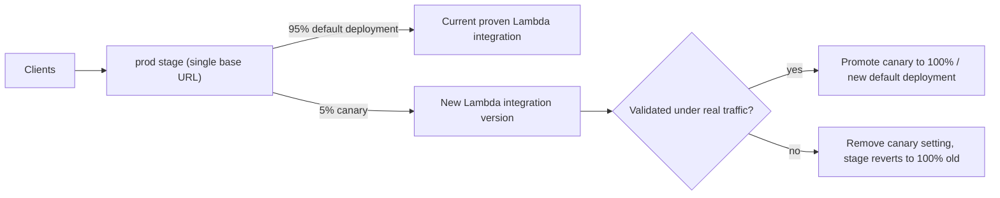

**Why the others are wrong:**
- B: Requiring clients to manually split their own traffic between two separate stage URLs pushes the traffic-splitting problem onto every client application, which defeats the purpose of a server-side, transparent canary mechanism.
- C: Usage plans govern API key-based request quotas and throttling; they have no percentage-based canary traffic-splitting capability.
- D: Provisioned concurrency controls how many execution environments are pre-warmed for a function/version; API Gateway has no mechanism that interprets a Lambda concurrency setting as a traffic-split percentage.

---

## Q26 — Domain 4: Troubleshooting and Optimization

A team running an RDS MySQL instance notices periodic CPU spikes correlated with specific application
batch jobs. They suspect one particular recurring query is responsible but don't want to enable full
general query logging (which would be verbose and costly to store) just to confirm it. Which
RDS-native approach lets them identify slow/expensive queries with a targeted, lower-overhead
mechanism?

A. Enable the **slow query log** via a custom DB parameter group, setting `long_query_time` to a
   threshold (e.g. 1 second) so only queries exceeding that duration are logged — far more targeted
   than full general query logging — and optionally pair this with **RDS Performance Insights** to
   visually correlate the CPU spikes with specific SQL statements and wait events over time.

B. Enable CloudTrail data events for RDS, which capture the full text and execution time of every SQL statement automatically.

C. There is no way to identify specific slow queries on RDS without exporting the entire database to an external query analysis tool.

D. Increase the DB instance's storage IOPS, which automatically surfaces slow-query diagnostics in the console as a side effect.

**Correct Answer: A**

**Explanation:** The **slow query log**, enabled via a custom DB parameter group with a
`long_query_time` threshold, logs only queries exceeding that duration — a much more targeted,
lower-volume mechanism than full general query logging, which logs every statement regardless of
cost. Combined with **Performance Insights**' Average Active Sessions view (sliceable by SQL
statement), this gives a clear, correlated picture of which specific queries are driving CPU load
during the observed spikes. This is Task 4.1/4.2 content. See [`services/database/rds.md`](../../../services/database/rds.md).

**Why the others are wrong:**
- B: CloudTrail logs *management-plane and optionally data-plane API calls* (like `ModifyDBInstance` or, for some engines, certain data API calls); it does not capture arbitrary raw SQL statement text/execution time for a standard RDS MySQL instance's client queries the way a database-native slow query log does.
- C: RDS has multiple native mechanisms (slow query log, Performance Insights, Enhanced Monitoring) purpose-built for exactly this kind of query-level diagnosis — exporting the entire database elsewhere is unnecessary and far more operationally heavy.
- D: Increasing storage IOPS changes the underlying storage performance characteristics; it has no relationship to surfacing query-level diagnostic information in the console.

---

## Q27 — Domain 1: Development with AWS Services

A finance team needs to run long, heavy analytical/reporting SQL queries (scanning months of
transaction history for end-of-quarter reports) against the same data a live, latency-sensitive
transactional application also depends on, backed by a single RDS MySQL instance. The transactional
application's response times degrade noticeably whenever the finance team's reports run, because
both workloads compete for the same instance's CPU and I/O. The team wants to isolate the reporting
workload's resource consumption from the live transactional path, without re-architecting the data
model or building a separate data warehouse pipeline. Which RDS-native feature directly addresses
this?

A. **RDS Read Replicas** — create one or more asynchronously-replicated, independently-addressable
   read-only copies of the primary, and point the finance team's reporting queries at a replica's own
   endpoint instead of the primary — isolating the heavy analytical query load onto separate compute/
   storage resources so it no longer competes with the transactional application for the primary
   instance's CPU and I/O.

B. Enabling Multi-AZ deployment, whose standby instance is specifically designed to be queried directly for heavy analytical reporting workloads in normal operation for every RDS engine.

C. Increasing the primary instance's allocated storage, which proportionally increases available CPU for concurrently-running analytical queries.

D. RDS Proxy, which automatically routes long-running analytical queries to a separate, Proxy-managed compute instance distinct from the primary database instance.

**Correct Answer: A**

**Explanation:** **Read replicas** let you isolate a heavy, latency-tolerant workload (like end-of-
quarter analytical reporting) onto its own asynchronously-replicated copy of the data, completely
separate compute/storage from the primary — so the finance team's expensive queries no longer compete
with the transactional application for the primary's CPU/IOPS, without changing the data model or
building an entirely separate data warehouse/ETL pipeline. This is Task 1.3 content. See
[`services/database/rds.md`](../../../services/database/rds.md).

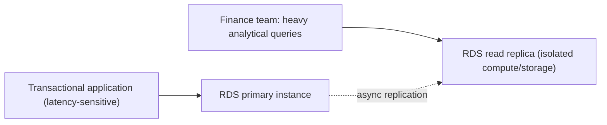

**Why the others are wrong:**
- B: A Multi-AZ standby exists for availability/failover, not for serving live read query traffic in normal operation — for most engines it either cannot be directly queried or isn't intended to absorb a separate, heavy analytical workload the way a dedicated read replica is designed to.
- C: Storage size (GB provisioned) does not proportionally increase available CPU — CPU is tied to instance class, not storage capacity, and this wouldn't isolate the two competing workloads from each other regardless.
- D: RDS Proxy pools and multiplexes database connections to reduce connection overhead; it does not provision separate compute for specific queries or route analytical workloads to different underlying instances — isolating the workload requires an actual separate replica.

---

## Q28 — Domain 2: Security

A company wants developers across the organization to authenticate using the company's existing
corporate identity provider (a SAML 2.0 IdP) and, once authenticated, receive temporary AWS
credentials scoped to a specific IAM role determined by their corporate group membership — without
creating individual long-lived IAM users for each employee. Which AWS mechanism is designed for this
federation pattern?

A. IAM Identity Center (AWS SSO) exclusively, since `sts:AssumeRoleWithSAML` was deprecated and is no longer available to new accounts.

B. **SAML 2.0 federation via IAM**, configuring a SAML identity provider resource in IAM (trusting the corporate IdP's metadata), with one or more IAM roles whose trust policy allows `sts:AssumeRoleWithSAML` for that identity provider, mapping SAML assertion attributes (like group membership) to session attributes/role selection — issuing temporary credentials without any long-lived IAM user per employee.

C. Creating an IAM user per employee with `AdministratorAccess`, then disabling console password login to force federation.

D. Amazon Cognito User Pools, which are the only AWS service capable of accepting SAML assertions from a corporate IdP.

**Correct Answer: B**

**Explanation:** **SAML 2.0 federation** (via an IAM identity provider resource and
`sts:AssumeRoleWithSAML`) is the standard, still-fully-supported mechanism for exactly this: a
corporate IdP authenticates the user and issues a SAML assertion, which the user's client exchanges
for temporary AWS credentials for a role determined by (potentially) assertion attributes like group
membership — with zero long-lived IAM users created per employee. (IAM Identity Center is *also* a
valid, often-preferred modern approach for this, frequently used alongside or instead of raw SAML
federation, but the core underlying mechanism and the specific `AssumeRoleWithSAML` API this question
describes remain available and correctly described here.) This is Task 2.1 content. See
[`services/security-identity-compliance/sts-and-role-switching.md`](../../../services/security-identity-compliance/sts-and-role-switching.md).

**Why the others are wrong:**
- A: `sts:AssumeRoleWithSAML` has not been deprecated — it remains a fully supported, documented API; IAM Identity Center is a separate, complementary offering, not a mandatory replacement that disabled the underlying SAML federation API.
- C: Individual IAM users with broad permissions and disabled console passwords is the opposite of this federation pattern — it still requires provisioning a long-lived identity per employee, which the scenario explicitly wants to avoid.
- D: Cognito User Pools can federate with SAML IdPs too, but they are not "the only" AWS service capable of it — direct IAM SAML federation (and IAM Identity Center) independently support this without Cognito being involved at all.

---

## Q29 — Domain 1: Development with AWS Services

A company runs a primary Aurora MySQL cluster in `us-east-1` serving a global user base, and wants
users in `ap-southeast-1` to get low-latency **read** access to the same data, with a well-defined,
bounded replication lag (typically under 1 second) and the ability to promote the secondary region to
become the new primary (writer) within about a minute if `us-east-1` suffers a full regional outage.
Which Aurora feature fits this?

A. A standard Aurora cross-region **read replica**, which provides the same latency and failover-promotion characteristics as Aurora Global Database, making the two features interchangeable.

B. **Aurora Global Database**, which uses dedicated, purpose-built storage-level replication (not
   binlog-based) to replicate data to secondary regions with typical lag under 1 second, supports up
   to several (engine/version-dependent) secondary read-only regions, and provides managed planned/
   unplanned failover tooling to promote a secondary region to the new primary within about a
   minute during a full regional outage.

C. Aurora Serverless v2, which automatically replicates data to every AWS Region globally by default with no configuration.

D. Cross-region S3 replication of the cluster's automated backups, manually restored into a new cluster in the second region during an outage.

**Correct Answer: B**

**Explanation:** **Aurora Global Database** is purpose-built for this exact cross-region,
low-latency-read-plus-fast-DR profile: dedicated physical replication infrastructure (distinct from
and faster than standard logical/binlog-based cross-region read replicas) keeps secondary-region data
current with sub-second typical lag, and its managed failover process can promote a secondary region
to primary (writer) in roughly a minute — versus a standard cross-region read replica, which
typically has higher replication lag and a slower, more manual promotion path. This is Task 1.3
content. See [`services/database/aurora.md`](../../../services/database/aurora.md).

**Why the others are wrong:**
- A: Standard cross-region read replicas use logical replication with generally higher lag and a slower promotion process than Global Database's dedicated storage-layer replication — they are not interchangeable despite both offering "a replica in another region."
- C: Aurora Serverless v2 is an autoscaling *compute* capacity model for a cluster; it has no automatic, zero-configuration global replication behavior, and enabling multi-region replication still requires explicitly configuring Global Database regardless of serverless vs. provisioned compute.
- D: Manually restoring from S3-replicated backups during an outage involves significant recovery time (far more than "about a minute") and data loss up to the last backup point, which doesn't meet the low-RPO/low-RTO requirement Global Database is designed to satisfy.

---

## Q30 — Domain 3: Testing and Deployment

A team using AWS AppConfig wants to roll out a new feature flag value to production gradually (e.g.
10% of traffic, then ramping to 100% over 30 minutes) and **automatically halt and roll back** the
rollout if a specified CloudWatch alarm enters `ALARM` state during that window — without the
application polling AppConfig constantly or needing custom rollback logic. Which AppConfig features
together provide this?

A. AppConfig **deployment strategies** (defining the percentage growth rate and bake time) combined
   with a configured **CloudWatch alarm monitor** on the deployment — AppConfig automatically halts
   and rolls back an in-progress deployment if the monitored alarm trips, while the AppConfig Lambda
   extension/SDK caches configuration locally in the application, polling AppConfig's backend
   efficiently rather than the application hitting it directly on every request.

B. AppConfig has no built-in rollback capability; the application itself must implement polling logic that checks a separate CloudWatch alarm and manually reverts the flag value in its own code.

C. AWS Config conformance packs, which are what actually power AppConfig's rollout percentage and alarm-based rollback behavior under the hood.

D. A deployment strategy can only be "all at once" or "manual"; percentage-based gradual rollout with alarm-based rollback is not a supported AppConfig capability.

**Correct Answer: A**

**Explanation:** AppConfig **deployment strategies** define how a configuration change rolls out
(percentage growth rate, deployment time, bake time), and a deployment can have one or more
**CloudWatch alarms** associated with it — if any associated alarm enters `ALARM` state during the
bake time, AppConfig automatically halts the deployment and rolls back to the previous configuration
version, with zero custom application-side rollback logic needed. This is Task 3.3 progressive-
delivery content. See [`../domain-3-testing-deployment/README.md`](../domain-3-testing-deployment/README.md).

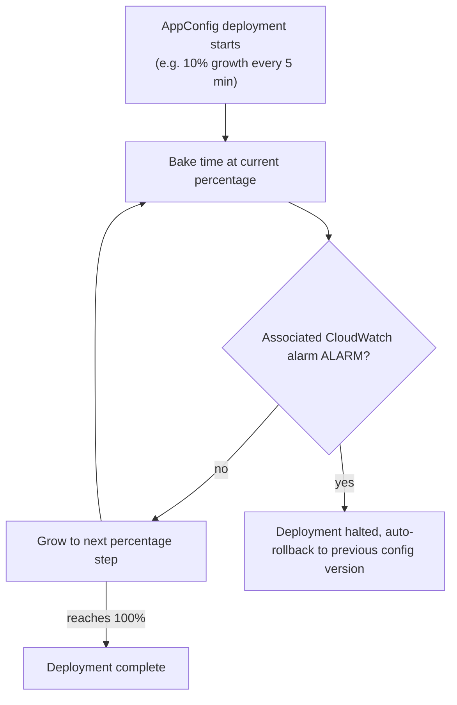

**Why the others are wrong:**
- B: This directly contradicts AppConfig's actual, documented capability — automated alarm-based rollback during a deployment is a first-class, built-in feature, not something the application must reimplement.
- C: AWS Config conformance packs are an entirely separate service concept (compliance rule evaluation across accounts); they have no relationship to AppConfig's deployment/rollback mechanics.
- D: AppConfig explicitly supports percentage-based gradual deployment strategies (in addition to all-at-once and manual options) with configurable growth factor and bake time — this is a core, well-documented feature, not an unsupported capability.

---

## Q31 — Domain 4: Troubleshooting and Optimization

A Lambda function in a VPC is experiencing noticeably higher cold-start latency than an identical
function (same code, same memory) that is *not* attached to a VPC. The team wants to understand the
specific mechanism causing this gap and how to reduce it, beyond simply accepting the slower cold
starts. What is the correct explanation and mitigation?

A. VPC-attached functions are inherently and permanently ~10x slower on every single invocation, warm or cold, with no mitigation possible; this is an unavoidable architectural cost of using a VPC.

B. Cold starts for VPC-attached functions historically required provisioning an elastic network
   interface (ENI) per unique security-group/subnet combination, which took meaningful time; AWS's
   **Hyperplane**-based networking significantly reduced (though did not fully eliminate) this
   overhead by sharing ENIs across functions/invocations with the same VPC configuration — the
   remaining mitigation options are minimizing the number of distinct security-group/subnet
   combinations in use, and/or using **provisioned concurrency** to keep execution environments
   (including their networking setup) pre-initialized and ready.

C. The gap is entirely explained by DNS resolution being disabled by default inside any VPC; enabling `enableDnsSupport` on the VPC eliminates the entire cold-start difference.

D. VPC-attached functions can never use provisioned concurrency; it is only available for functions without a VPC configuration.

**Correct Answer: B**

**Explanation:** Historically, Lambda had to create a new ENI (a comparatively slow operation) for
each unique combination of VPC configuration a function used, adding meaningful cold-start latency.
AWS's Hyperplane-based networking architecture improved this considerably by sharing/pooling
ENIs, but VPC-attached cold starts can still carry some residual overhead versus non-VPC functions.
The practical levers remain: reducing the number of distinct subnet/security-group combinations
across functions (so more functions can share pooled ENIs) and using provisioned concurrency to avoid
cold starts for latency-critical functions altogether. This is Task 4.2 content. See
[`services/compute/lambda.md`](../../../services/compute/lambda.md).

**Why the others are wrong:**
- A: The overhead is real but not an immutable "every invocation, 10x" cost — it specifically affects *cold* starts (ENI setup), and the Hyperplane networking improvements materially reduced it; warm invocations are not meaningfully affected by VPC attachment at all.
- C: DNS resolution settings on a VPC affect whether instances/ENIs in that VPC can resolve DNS names; they are unrelated to the underlying ENI-provisioning cold-start mechanism being described, and toggling them wouldn't address this specific latency gap.
- D: Provisioned concurrency is fully supported for VPC-attached Lambda functions — it's explicitly one of the standard mitigations for VPC-related cold-start latency, not something restricted to non-VPC functions.

---

## Q32 — Domain 1: Development with AWS Services

A chat application needs server-driven, real-time updates pushed to many connected clients whenever
new messages arrive, using a managed GraphQL API with native subscription support, backed directly by
a DynamoDB table, without hand-building a WebSocket connection-management layer. Which AWS service
and feature combination is purpose-built for this?

A. API Gateway REST API with long-polling, since API Gateway REST APIs natively support GraphQL subscriptions as of a recent feature release.

B. **AWS AppSync**, whose GraphQL schema supports `subscription` operations — when a mutation (e.g.
   `sendMessage`) matches a client's active subscription, AppSync automatically pushes the update to
   that subscribed client over a managed WebSocket connection it maintains internally, with a
   DynamoDB resolver handling the underlying data read/write with no custom connection-management
   code required.

C. Amazon Cognito, which provides native GraphQL subscription support as part of its hosted UI feature set.

D. AWS Step Functions Express workflows, which maintain long-lived WebSocket connections to push state-machine execution updates to subscribed GraphQL clients.

**Correct Answer: B**

**Explanation:** **AppSync** natively implements the GraphQL subscription model: clients subscribe to
a named subscription operation, and whenever a corresponding mutation resolves successfully, AppSync
automatically identifies and pushes the relevant payload to every subscribed client over a
connection it manages internally (abstracting away raw WebSocket connection tracking) — with
resolvers (VTL or JavaScript) wiring the mutation/query/subscription operations directly to data
sources like DynamoDB. This is Task 1.1 content. See [`services/application-integration/appsync.md`](../../../services/application-integration/appsync.md).

**Why the others are wrong:**
- A: API Gateway REST APIs have no native GraphQL subscription feature; GraphQL (including subscriptions) is specifically AppSync's domain among AWS's managed API services.
- C: Cognito provides authentication/authorization (including for AppSync APIs) but has no GraphQL API or subscription capability of its own.
- D: Step Functions orchestrates state machine executions; it has no GraphQL subscription model or WebSocket-push-to-GraphQL-clients capability.

---

## Q33 — Domain 2: Security

A Lambda function processes incoming webhook requests through a Lambda **function URL** configured
with `AuthType: NONE` (fully public, no AWS SigV4 required), because the third-party service sending
webhooks cannot sign requests with AWS credentials. The security team wants to still verify that
requests genuinely originated from the legitimate third party, not an arbitrary internet caller who
discovered the URL. What is the correct way to add this verification, given that `AuthType: NONE` is
required here?

A. Switch to `AuthType: AWS_IAM`, since this is strictly superior in every scenario and the third-party limitation described doesn't actually exist.

B. With `AuthType: NONE`, AWS-level authentication is intentionally bypassed, so verification must happen **inside the function's own code** — typically by validating a shared-secret signature the third party includes in a request header (e.g. HMAC-signed using a secret stored in Secrets Manager/Parameter Store), rejecting any request whose signature doesn't match before processing the payload.

C. Function URLs automatically verify the `Origin` header against an allow-list with no code changes required, which is sufficient authentication for any webhook source.

D. Attach an SCP to the account that restricts which source IPs can invoke any Lambda function URL account-wide.

**Correct Answer: B**

**Explanation:** `AuthType: NONE` deliberately means AWS performs **no** request authentication at
the platform level — by design, for cases exactly like this, where the caller cannot produce AWS
SigV4 signatures. The responsibility shifts entirely to **application-level verification**: most
webhook providers support signing their payloads with a shared secret (commonly HMAC-SHA256 over the
raw body, included in a header), which the function must independently validate before trusting the
payload. This is Task 2.1/2.3-adjacent content. See [`services/compute/lambda.md`](../../../services/compute/lambda.md)
and [`services/security-identity-compliance/secrets-manager-vs-parameter-store.md`](../../../services/security-identity-compliance/secrets-manager-vs-parameter-store.md).

**Why the others are wrong:**
- A: `AWS_IAM` requires the caller to sign requests with valid AWS credentials using SigV4 — a third-party service with no AWS account/credentials genuinely cannot do this, which is precisely why `NONE` exists as a supported option for public-facing use cases like webhooks.
- C: Function URLs have no built-in `Origin`-header allow-list authentication mechanism at all; CORS-related `Origin` handling (if configured) governs browser cross-origin request behavior, not caller identity verification, and is not a substitute for actual authentication.
- D: SCPs govern what IAM principals *within* an AWS Organization are permitted to do; they have no mechanism to filter inbound public internet traffic by source IP to a publicly-invokable function URL endpoint.

---

## Q34 — Domain 1: Development with AWS Services

A REST API built on API Gateway offers both a `/v1` and `/v2` resource path, where `/v1` is legacy
and `/v2` is current. The team wants `/v2` to support richer HTTP features (JWT authorizers natively
built into the API type, lower latency, lower cost) while `/v1` continues using an existing,
more-complex request/response VTL mapping-template setup that must be preserved exactly. Should the
team migrate everything to a single **HTTP API**, keep everything on **REST API**, or use a mixed
approach, and why?

A. Migrate both `/v1` and `/v2` to a single HTTP API immediately; HTTP APIs are a strict superset of REST API functionality with no feature gaps whatsoever.

B. Keep the existing `/v1` on a **REST API** (since REST APIs are required for request/response VTL mapping templates, usage plans/API keys, and several other advanced features HTTP APIs don't support) while building the new `/v2` as a separate **HTTP API** (which offers lower latency/cost and built-in JWT authorizers, at the cost of a more limited feature set) — API Gateway explicitly supports both API types coexisting independently in the same account.

C. HTTP APIs and REST APIs cannot coexist in the same AWS account; the team must pick exactly one type account-wide.

D. Use a single REST API for everything, since HTTP APIs were deprecated and are no longer recommended for any new API.

**Correct Answer: B**

**Explanation:** API Gateway's **REST API** and **HTTP API** are genuinely different product types
with different feature sets: REST APIs support richer customization (request/response mapping
templates, usage plans, API keys, more authorizer types, edge-optimized endpoints) while HTTP APIs
are a newer, leaner option optimized for lower latency and cost, with simpler built-in JWT/OIDC
authorizers but a smaller overall feature surface (no native VTL mapping templates, for example).
Both types coexist independently and can be used side-by-side for different APIs in the same account
— exactly matching "preserve complex REST API behavior for `/v1`, use a leaner HTTP API for `/v2`."
This is Task 1.1 content. See [`services/networking-content-delivery/api-gateway.md`](../../../services/networking-content-delivery/api-gateway.md).

**Why the others are wrong:**
- A: HTTP APIs are not a strict superset — they explicitly lack several REST API features (including request/response VTL mapping templates, API keys/usage plans, and some authorizer/integration types), which is exactly why `/v1`'s existing setup can't simply be moved over unchanged.
- C: There is no such account-wide restriction; API Gateway supports creating and operating both REST APIs and HTTP APIs simultaneously within the same account with no conflict.
- D: HTTP APIs are not deprecated — they are an actively recommended, modern option for many new use cases precisely because of their lower latency/cost, coexisting as a parallel offering alongside REST APIs rather than replacing them.

---

## Q35 — Domain 3: Testing and Deployment

A security team wants to verify, **before** granting a developer's proposed new IAM policy, exactly
which specific AWS actions and resources that policy would actually allow or deny for a given
principal — including interactions with any existing permissions boundaries or SCPs already in
place — without creating a test IAM user/role and manually attempting each action live against real
resources. Which AWS tool is designed for this kind of simulated, pre-deployment policy evaluation?

A. The **IAM Policy Simulator** (and/or **IAM Access Analyzer's policy validation/custom policy
   checks**), which evaluates a given policy (or set of policies, including simulating permissions
   boundaries) against specified actions and resources and reports whether each would be allowed or
   denied — without ever actually performing the action against a real resource.

B. AWS Config, which is the only AWS service capable of simulating IAM policy evaluation outcomes before deployment.

C. CloudTrail Insights, by replaying historical API calls through the new policy to see if they would have succeeded.

D. There is no AWS-native way to test a policy's effect before attaching it; the only option is attaching it to a disposable test principal and manually trying every action.

**Correct Answer: A**

**Explanation:** The **IAM Policy Simulator** lets you test what a given set of policies (including,
optionally, permissions boundaries) would allow or deny for specific actions/resources/conditions,
entirely as a simulation with no actual API calls made against real resources. **IAM Access
Analyzer** additionally offers policy validation (catching syntax/logic issues) and custom policy
checks (e.g. verifying a policy doesn't grant a specific sensitive action) as part of a CI/CD
pipeline, extending this pre-deployment verification further. This is Task 3.1/3.2 content. See
[`services/security-identity-compliance/iam.md`](../../../services/security-identity-compliance/iam.md).

**Why the others are wrong:**
- B: AWS Config evaluates the *compliance* of deployed resource configurations against rules over time; it is not a policy-simulation tool and doesn't evaluate hypothetical "would this policy allow X" questions before attachment.
- C: CloudTrail Insights detects anomalies in API call *volume* patterns; it has no policy-simulation or "replay against a new policy" capability.
- D: This ignores the Policy Simulator's and Access Analyzer's actual, well-documented purpose, which exists specifically to avoid the risky "attach and manually test live" workflow this answer falsely claims is the only option.

---

## Q36 — Domain 4: Troubleshooting and Optimization

A microservices application runs on Amazon ECS on Fargate. The team wants a single dashboard showing
CPU/memory utilization per task, per service, and per cluster, plus the ability to drill into
container-level performance metrics and logs — comparable to what CloudWatch Container Insights
provides for EKS — without manually instrumenting every container with a custom metrics agent. Which
AWS feature provides this for ECS/Fargate specifically?

A. CloudWatch **Container Insights**, which can be enabled on ECS clusters (including Fargate) to automatically collect, aggregate, and visualize CPU/memory/network/storage metrics at the cluster, service, and task level, alongside structured log collection, without requiring a custom-built metrics agent in each container.

B. AWS X-Ray, which is the only AWS service capable of reporting container-level CPU/memory utilization for ECS tasks.

C. VPC Flow Logs, enabled per ENI, which natively report container CPU/memory metrics alongside network flow data.

D. Container Insights is exclusively available for EKS and self-managed Kubernetes; ECS/Fargate has no equivalent CloudWatch feature.

**Correct Answer: A**

**Explanation:** **CloudWatch Container Insights** explicitly supports **ECS (EC2 and Fargate launch
types) as well as EKS/Kubernetes**, automatically collecting and aggregating performance metrics at
multiple levels (cluster, service, task, container) and correlating them with logs, without needing
a hand-built custom metrics agent — enabling it is typically a one-setting change (or a CloudFormation/
Terraform property) on the cluster. This is Task 4.1 content. See [`services/management-governance/cloudwatch.md`](../../../services/management-governance/cloudwatch.md)
and [`services/containers/ecs.md`](../../../services/containers/ecs.md).

**Why the others are wrong:**
- B: X-Ray provides distributed tracing of request flow across services (when the application is instrumented with the X-Ray SDK); it has no native container-level CPU/memory utilization reporting capability at all.
- C: VPC Flow Logs capture network-layer metadata (IP/port/bytes/accept-reject) for an ENI; they contain zero CPU/memory utilization data.
- D: This is directly false — Container Insights explicitly documents and supports ECS (both EC2 and Fargate launch types) as a first-class use case, not an EKS-only feature.

---

## Q37 — Domain 2: Security

A Lambda function in Account A needs to synchronously invoke a second Lambda function in Account B
on every request. The Account A function's execution role has `lambda:InvokeFunction` granted on the
Account B function's ARN in its own identity-based policy. The invocation still fails with an
access-denied error. What is most likely still missing?

A. Nothing should be missing; an identity-based policy alone is always sufficient for any cross-account Lambda invocation, so the error must be a transient service issue.

B. A **resource-based policy** on the Account B Lambda function itself, explicitly granting the Account A role/account permission to invoke it (e.g. via `aws lambda add-permission --principal <Account-A-role-or-account> --action lambda:InvokeFunction`) — cross-account access to invoke a Lambda function requires both the caller's identity-based policy *and* the target function's own resource-based policy to allow it, exactly like the cross-account S3 pattern.

C. The Account B function's `Timeout` setting, which must be increased before it can accept cross-account invocations.

D. VPC peering must be configured between the two accounts' default VPCs before any cross-account Lambda invocation can succeed.

**Correct Answer: B**

**Explanation:** Just like S3 bucket policies, Lambda functions support a **resource-based policy**
(managed via `AddPermission`/`RemovePermission`), and cross-account invocation requires authorization
from **both** sides: the caller's identity-based policy (already in place here) **and** the target
function's resource-based policy explicitly permitting that external account/role to invoke it.
Without the resource-based policy statement on the Account B function, the call is denied regardless
of how permissive the caller's own policy is. This is Task 2.1 content. See [`services/compute/lambda.md`](../../../services/compute/lambda.md)
and [`services/security-identity-compliance/iam.md`](../../../services/security-identity-compliance/iam.md).

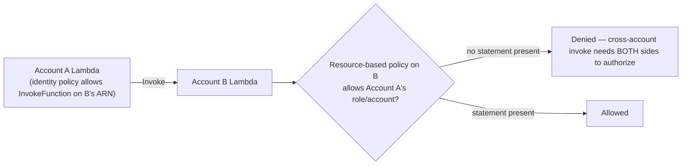

**Why the others are wrong:**
- A: Cross-account AWS API calls generally require authorization from both the caller's account and the resource owner's account — an identity-based policy alone is explicitly insufficient once an account boundary is crossed, which is exactly the gap here.
- C: `Timeout` controls how long an invocation is allowed to run before being terminated; it has no relationship to cross-account authorization.
- D: Lambda-to-Lambda invocation across accounts is a standard IAM-authorized AWS API call (`lambda:InvokeFunction`) over the AWS control/data plane — it has no dependency on VPC peering or any network-level connectivity between the two accounts' VPCs.

---

## Q38 — Domain 3: Testing and Deployment

A team wants every container image pushed to an Amazon ECR repository to be automatically scanned
for known OS and application-package vulnerabilities (CVEs) immediately on push, and wants their
CodePipeline deployment stage to be automatically blocked from deploying any image with a `CRITICAL`
severity finding, without a human having to manually review scan results for every push. Which
combination of features achieves this?

A. Enable ECR **enhanced scanning** (powered by Amazon Inspector) with scan-on-push, and add a
   pipeline stage/action (e.g. a Lambda invoke action) that queries Inspector/ECR's scan findings for
   the specific image digest being deployed, failing the pipeline action (blocking the deploy stage)
   if any `CRITICAL` severity finding is present.

B. ECR automatically blocks `docker pull` of any image with vulnerabilities; no pipeline integration is needed or possible.

C. CodeBuild's `buildspec.yml` has a dedicated, built-in `vulnerabilityThreshold` top-level key that CodeBuild enforces automatically with no ECR or Inspector configuration required.

D. Vulnerability scanning in ECR is only available as a manual, on-demand console action and cannot be triggered automatically on push or integrated into a pipeline.

**Correct Answer: A**

**Explanation:** ECR's **enhanced scanning** (built on Amazon Inspector) can be configured for
automatic scan-on-push, continuously rescanning for newly-disclosed CVEs; findings (with severity) are
queryable via the Inspector/ECR APIs. A pipeline action (commonly a Lambda function invoked as a
CodePipeline custom action) can query those findings for the specific image digest about to be
deployed and fail the pipeline stage if a `CRITICAL` finding exists — gating deployment automatically
without manual review. This is Task 3.1/3.2 content. See [`services/containers/ecr.md`](../../../services/containers/ecr.md).

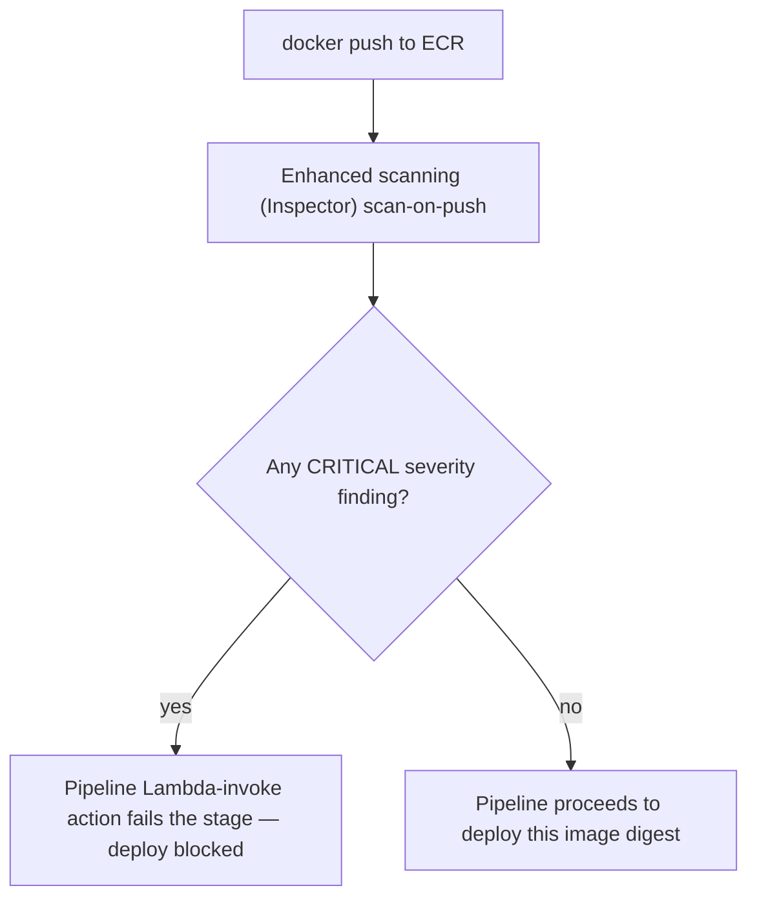

**Why the others are wrong:**
- B: ECR scanning reports findings; it does not, by itself, block `docker pull`/deployment actions — that gating behavior has to be explicitly built into the deployment pipeline (as described in the correct answer), not something ECR enforces automatically.
- C: There's no such built-in `vulnerabilityThreshold` buildspec key; CodeBuild has no native vulnerability-scanning-result-gating feature independent of ECR/Inspector's own scanning and findings APIs.
- D: ECR enhanced scanning explicitly supports automatic scan-on-push (in addition to manual/on-demand scanning for basic scanning mode) and its results are queryable via API, enabling full pipeline integration — this answer understates the feature's actual, documented capability.

---

## Q39 — Domain 4: Troubleshooting and Optimization

An X-Ray service map for a request flow `API Gateway → Lambda → DynamoDB → external Payment API`
shows the `external Payment API` node consistently taking the longest duration of any node, with
occasional red coloring. The team wants to confirm this node is genuinely the bottleneck rather than
an artifact of how X-Ray aggregates subsegment timing. What is the correct way to interpret and drill
further into this?

A. Service map node duration always double-counts downstream nodes' time into the upstream caller's own node, so the Payment API's time is actually already included in the Lambda node's displayed duration and shouldn't be separately investigated.

B. Click into the node to view its individual trace/subsegment list and histogram of response times for that specific downstream call; a consistently high response-time distribution with occasional red (fault) status on the **Payment API node specifically** (not the Lambda node) confirms that call itself — not something else in the Lambda function's own code — is the bottleneck, warranting investigation of the payment provider's own latency/reliability or considering a timeout/circuit-breaker pattern around that specific call.

C. X-Ray service maps cannot show per-downstream-call latency at all; only CloudWatch Logs can reveal which specific call within a function is slow.

D. The red coloring on the Payment API node means the Lambda function itself has a bug; the external API is unrelated to the fault coloring shown there.

**Correct Answer: B**

**Explanation:** X-Ray's service map represents each distinct downstream call (captured as a
subsegment, e.g. an HTTP call made via the instrumented SDK or `captureHTTPsGlobal`) as its own node
with its own duration/status coloring — drilling into the Payment API node specifically shows the
response-time distribution and status (success/fault/error) for *that specific external call*,
independent of the Lambda function's own internal processing time (which is attributed to the Lambda
node itself). This correctly isolates whether the latency/faults originate from the external
dependency rather than something in the Lambda function's own code. See [`services/management-governance/cloudwatch.md`](../../../services/management-governance/cloudwatch.md).

*Source: AWS Documentation — [Use AWS X-Ray service maps and trace views with API Gateway](https://docs.aws.amazon.com/apigateway/latest/developerguide/apigateway-using-xray-maps.html) (curl-verified 200 OK, `image/png`). Each node (API Gateway, each Lambda function, each downstream call) is a separate box with its own latency/status coloring — exactly what lets you isolate the Payment API node's time from the Lambda node's own processing time.*

**Why the others are wrong:**
- A: X-Ray does not double-count time this way for the purpose of node-level display — each node's duration reflects the time attributable to that specific segment/subsegment, letting you distinguish "time spent waiting on the Payment API" from "time spent in the Lambda function's own code," which is the entire point of the service map's node-per-call-boundary design.
- C: The service map specifically does show per-downstream-call latency as separate nodes with their own histograms — this is one of its core, defining capabilities, not a limitation requiring falling back to raw logs.
- D: A fault/error status shown on the Payment API node specifically reflects the outcome of *that* call (e.g. the external API returning an error or timing out); it does not indicate a bug in the Lambda function's own code, which would instead show its own status on the Lambda node.

---

## Q40 — Domain 1: Development with AWS Services

Five independent Lambda functions, owned by different teams, all need the exact same version of a
shared internal utility library. The platform team publishes updates to this library periodically
and wants consuming functions to be able to **pin** to a specific known-good version (for stability)
while also being able to **deliberately upgrade** to a newer version when ready, without any
function accidentally picking up a breaking change automatically. Which Lambda mechanism and
practice correctly supports this?

A. **Lambda layers**, where the platform team publishes a new, immutable **layer version** for every
   update (each with its own unique ARN including a version number); each consuming function's
   configuration explicitly references one specific layer version ARN, and upgrading means the
   consuming team deliberately changes their function's configuration to reference the new version
   ARN — old versions remain available and unaffected by new publishes.

B. A single mutable Lambda layer ARN (without a version number) that the platform team overwrites in place on every update; every consuming function automatically and immediately picks up the latest content on its next cold start.

C. Lambda layers can only be used by the single account/function that originally created them; cross-team sharing of a layer is not supported at all.

D. Storing the shared library directly inside each of the five functions' own deployment packages is the only way to guarantee version pinning, since layers have no versioning concept.

**Correct Answer: A**

**Explanation:** Every time a layer is published, Lambda creates a new, **immutable layer version**
with its own distinct ARN (e.g. `...layer:shared-utils:4` vs. `:5`) — existing layer versions are
never overwritten. A consuming function's configuration pins to one specific version ARN, giving
each team explicit control over when (and whether) to move to a newer version, rather than silently
inheriting changes. This is Task 1.2 content. See [`services/compute/lambda.md`](../../../services/compute/lambda.md).

**Why the others are wrong:**
- B: Lambda layers are not mutable-in-place by version number — publishing always creates a new, distinct version ARN; there's no "overwrite the same ARN's content" behavior that would cause silent, automatic upgrades for existing consumers.
- C: Layers fully support **cross-account sharing** via a resource-based permission statement (`AddLayerVersionPermission`), explicitly enabling the described "platform team publishes, multiple teams/functions consume" pattern.
- D: Layers explicitly do have a versioning concept (as described in the correct answer) — bundling the library into every function's own package would work but defeats the entire point of a shared layer (deduplication, centralized updates) and isn't required to achieve version pinning.

---

## Q41 — Domain 2: Security

An API Gateway REST API is intended to be reachable only from within the company's VPC (e.g. by
internal services), never from the public internet, even though the API itself is created as a
"Private" API Gateway endpoint type attached to an interface VPC endpoint. The security team wants to
further ensure that even *other* VPCs/accounts that might somehow gain network-level reachability to
that interface endpoint still cannot call the API unless they're the specifically intended VPC. Which
mechanism adds this additional restriction?

A. A security group on the API's EC2 integration backend, which is sufficient on its own since API Gateway has no separate resource-policy mechanism for private APIs.

B. An **API Gateway resource policy** on the private API, using a condition like `aws:sourceVpc` (or `aws:SourceVpce`) to restrict which specific VPC(s) or VPC endpoint(s) are allowed to invoke the API at all — denying requests from any other VPC even if they have network-level connectivity to the interface endpoint.

C. Private APIs are automatically restricted to exactly one VPC with no additional configuration possible or needed; the scenario describes an impossible configuration.

D. CloudFront signed URLs, which are the standard mechanism for restricting which VPC can call a private API Gateway endpoint.

**Correct Answer: B**

**Explanation:** API Gateway **resource policies** support condition keys like `aws:SourceVpc` and
`aws:SourceVpce`, letting a private API explicitly restrict invocation to only specified VPC(s) or
VPC endpoint(s) — an authorization-layer control independent of (and in addition to) whatever
network-level reachability might otherwise exist, directly addressing "block other VPCs that might
have network access but shouldn't be authorized to call this API." This is Task 2.1/2.2 content. See
[`services/networking-content-delivery/api-gateway.md`](../../../services/networking-content-delivery/api-gateway.md).

**Why the others are wrong:**
- A: Security groups operate at the network layer on whatever backend integration exists; they have no visibility into or control over which VPC's *API Gateway-level* invocation request is being authorized, and API Gateway explicitly does support its own resource-policy mechanism independent of backend security groups.
- C: Private APIs are not automatically single-VPC-restricted by default — without an explicit resource policy condition, any principal that can reach the interface endpoint over the network may be able to invoke the API, which is exactly why the resource-policy restriction described is a meaningful, necessary addition.
- D: CloudFront signed URLs are a content-delivery access-control mechanism for CloudFront distributions; they have no relationship to restricting which VPC can invoke a private API Gateway API.

---

## Q42 — Domain 3: Testing and Deployment

A team wants every developer to get a fully isolated, temporary preview environment (its own API
Gateway stage, Lambda functions, and DynamoDB table) automatically created when they open a pull
request, and automatically destroyed when the PR is merged or closed — without manually running
deployment commands for each PR. Which approach, built on AWS CDK or SAM plus a CI/CD trigger, best
achieves this?

A. Maintain one shared, permanent "staging" environment that every developer manually coordinates to take turns using for testing their PR, avoiding the need for per-PR environments entirely.

B. Configure the CI/CD pipeline (e.g. GitHub Actions or CodePipeline with a webhook trigger) to, on
   PR open/update, run `cdk deploy`/`sam deploy` with a **PR-number-derived, unique stack name/stage
   name** (ensuring resource names don't collide across concurrent PR environments), and on PR
   close/merge, run `cdk destroy`/`sam delete` targeting that same stack name to tear it down
   automatically.

C. CDK and SAM only support exactly one deployed environment per AWS account; ephemeral, per-PR environments are not technically possible with either tool.

D. Use CloudFormation StackSets to deploy a shared, single preview environment to every target account simultaneously whenever any PR opens anywhere.

**Correct Answer: B**

**Explanation:** The standard ephemeral-preview-environment pattern parameterizes the stack/stage
name by something unique per PR (like the PR number or branch name), so each open PR gets its own
isolated stack deployed via a normal `cdk deploy`/`sam deploy` call triggered by the CI/CD system on
PR events, and a corresponding `cdk destroy`/`sam delete` triggered on PR close/merge tears it down —
giving full isolation between concurrent PRs' test environments with no manual deployment steps. This
is Task 3.1/3.2 content. See [`services/developer-tools/sam.md`](../../../services/developer-tools/sam.md)
and [`services/management-governance/cdk.md`](../../../services/management-governance/cdk.md).

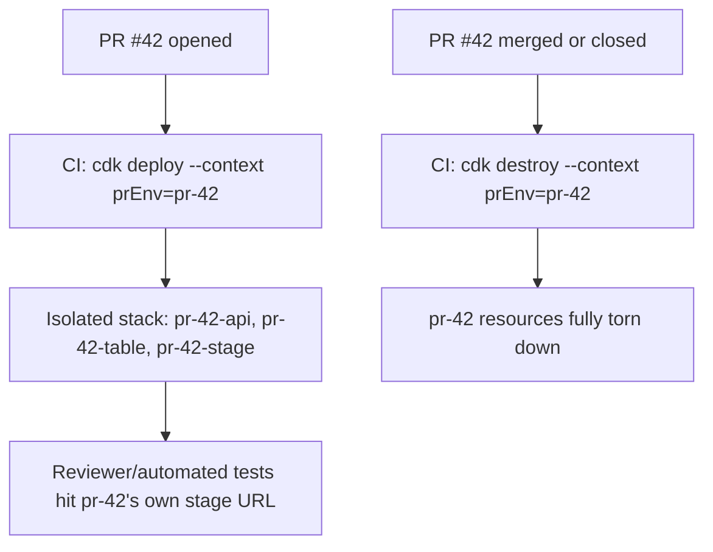

**Why the others are wrong:**
- A: A single shared environment that developers must take turns using reintroduces exactly the coordination bottleneck and cross-PR interference that per-PR ephemeral environments are meant to eliminate.
- C: Both CDK and SAM fully support deploying arbitrarily many independently-named stacks within the same account/region — there's no inherent one-stack-per-account limitation in either tool.
- D: StackSets deploy the *same* template across many target accounts/regions; they have no per-pull-request uniqueness concept and are the wrong mechanism entirely for isolated, ephemeral, per-developer preview environments within likely a single account.

---

## Q43 — Domain 1: Development with AWS Services

A team's AppSync GraphQL API needs to resolve a single query by first fetching data from a DynamoDB
table, then using part of that result to make a second, dependent call to a Lambda function (e.g.
enriching the DynamoDB item with a computed field from business logic) — all within one GraphQL field
resolution, without the client making two separate round-trip API calls. Which AppSync feature
supports chaining multiple data-source operations together for one field?

A. A single **unit resolver** can only ever call exactly one data source; chaining is impossible in AppSync and the client must make two separate queries.

B. An AppSync **pipeline resolver**, composed of an ordered sequence of **functions**, where each function in the pipeline can call a different data source (first a DynamoDB function, then a Lambda function) and pass its result forward via the pipeline's shared `ctx.stash`/`ctx.prev.result`, resolving the field with one client-facing GraphQL call.

C. GraphQL fundamentally does not support resolving a field using more than one data source under any implementation, including AppSync.

D. The client must issue two separate GraphQL queries and manually merge the results in client-side code.

**Correct Answer: B**

**Explanation:** AppSync **pipeline resolvers** let you compose a resolver from multiple ordered
**functions**, each independently able to call any configured data source (DynamoDB, Lambda, HTTP,
RDS, OpenSearch, etc.) — each function's result can be passed to the next via the pipeline context
(`ctx.stash`, `ctx.prev.result`), allowing exactly this "fetch from DynamoDB, then enrich via Lambda"
chain within a single field resolution and a single client-facing API call. This is Task 1.1 content.
See [`services/application-integration/appsync.md`](../../../services/application-integration/appsync.md).

**Why the others are wrong:**
- A: While a basic **unit resolver** is indeed limited to one data source, AppSync's **pipeline resolver** type exists specifically to lift that limitation — the premise that chaining is "impossible in AppSync" overall is false.
- C: This is specific to AppSync's pipeline resolver design (and conceptually similar patterns exist in other GraphQL server implementations via custom resolver composition); it is not a universal, unconditional limitation of GraphQL as a specification.
- D: Requiring two separate client-facing queries with client-side merging is exactly the extra round-trip and complexity a pipeline resolver avoids by composing the logic server-side within one resolver.

---

## Q44 — Domain 2: Security

A Lambda function's function URL is configured with `AuthType: AWS_IAM`. A separate application (in
the same AWS account) needs to invoke this function URL using its own execution role's credentials.
Despite the caller's IAM policy explicitly allowing `lambda:InvokeFunctionUrl` on the target
function's ARN, calls still fail with `403 Forbidden`. What permission is most likely still missing,
specifically for function URLs (as distinct from a direct `Invoke` API call)?

A. `lambda:InvokeFunctionUrl` in the identity-based policy alone is always sufficient; a 403 here must indicate a malformed SigV4 signature instead.

B. A **resource-based policy** on the Lambda function permitting the calling principal to invoke it
   via its function URL — `AuthType: AWS_IAM` requires the caller's request to be SigV4-signed *and*
   requires the function's resource-based policy to explicitly authorize that principal for the
   `lambda:InvokeFunctionUrl` action (added via `aws lambda add-permission --function-url-auth-type AWS_IAM --action lambda:InvokeFunctionUrl --principal ...`), separately from (and in addition to) the caller's own identity-based policy.

C. Function URLs with `AWS_IAM` auth only ever accept requests from the root user of the same account; no other principal, however configured, can ever invoke them.

D. The function's reserved concurrency must be set to at least 1 before `AWS_IAM`-authenticated function URL calls are accepted.

**Correct Answer: B**

**Explanation:** Even within the same account, invoking a function URL with `AWS_IAM` auth requires
**both** the caller's identity-based policy permission **and** a matching resource-based policy
statement on the function itself (added specifically for function-URL invocation, distinct from a
general `lambda:InvokeFunction` permission used for direct `Invoke` API calls) — this dual
requirement commonly trips up teams who only set up the identity-based side. This is Task 2.1
content. See [`services/compute/lambda.md`](../../../services/compute/lambda.md).

**Why the others are wrong:**
- A: An identity-based policy alone is explicitly insufficient here — Lambda resource-based policies gate function URL invocation in addition to the caller's own permissions, which is a commonly-missed, genuinely separate requirement, not an indication of some unrelated SigV4 signing bug.
- C: Resource-based policies on function URLs can authorize any specified principal (IAM user, role, or even another account), not only the root user — root-user-only access is not an actual restriction of this feature.
- D: Reserved concurrency controls how many concurrent executions a function can have; it has no relationship to function URL authentication/authorization at all.

---

## Q45 — Domain 1: Development with AWS Services

A Lambda event source mapping consumes a DynamoDB Stream, invoking a function for every change, but
the function's logic only cares about items where `eventName` is `MODIFY` and the new image's
`status` field equals `"SHIPPED"` — every other change event is currently received and immediately
discarded by the function's own first few lines of code, wasting invocations. Which Lambda feature
reduces this waste by filtering events *before* invocation, at no compute cost for non-matching
events?

A. Lambda **event source mapping filter criteria**, which lets you specify a JSON pattern (evaluated
   against the event, similar in style to EventBridge event patterns) directly on the event source
   mapping — events that don't match the filter are never delivered to the function at all, consuming
   no invocation and incurring no cost.

B. A `ReservedConcurrentExecutions` setting of 0, which filters out all non-matching invocations automatically.

C. DynamoDB Streams have no filtering mechanism; all filtering must always happen inside the function's own code after invocation.

D. An `IteratorAge` threshold configured on the stream, which drops events whose age exceeds the threshold, used as a proxy for filtering unwanted event types.

**Correct Answer: A**

**Explanation:** **Event source mapping filter criteria** (supported for DynamoDB Streams, Kinesis,
SQS, and other poll-based event sources) let you define a JSON-pattern filter evaluated by the Lambda
poller *before* invoking the function — events that don't match are discarded at the polling layer,
never triggering an invocation and incurring zero compute cost, directly solving the "function wakes
up just to immediately discard most events" waste. This is Task 1.2 content. See [`services/compute/lambda.md`](../../../services/compute/lambda.md)
and [`services/database/dynamodb.md`](../../../services/database/dynamodb.md).

**Why the others are wrong:**
- B: `ReservedConcurrentExecutions: 0` would block the function from running *at all*, for any event, including the ones that should match — it has no selective, content-based filtering capability.
- C: DynamoDB Streams event source mappings explicitly support filter criteria (as described) — the premise that all filtering must happen inside function code after invocation ignores this specific, purpose-built feature.
- D: `IteratorAge` is a monitoring metric reflecting how far behind the consumer is relative to the stream's latest record; it is not a filtering mechanism and has no relationship to event content.

---

## Q46 — Domain 1: Development with AWS Services

A team runs a nightly batch job that must process 50,000 independent image files, each requiring the
same containerized processing step (several minutes of CPU-bound work per file), with the ability to
automatically retry individual failed files without re-running the whole batch, and to scale compute
capacity up and back down to zero between nightly runs without managing servers directly. Which AWS
service/feature is purpose-built for this large-scale, independent-item batch compute pattern?

A. A single large EC2 instance running a custom-written loop that processes all 50,000 files sequentially in one long-running process.

B. **AWS Batch array jobs**, which submit one job definition parameterized to run as many independent
   child jobs (indexed via `AWS_BATCH_JOB_ARRAY_INDEX`), each processing one file, scheduled onto a
   managed compute environment (e.g. Fargate or EC2 Spot) that scales out to meet demand and back down
   to zero when idle, with per-child-job retry on failure handled natively.

C. A single Lambda function invoked once, looping through all 50,000 files within one 15-minute-maximum invocation.

D. Step Functions Express workflows exclusively, since Standard workflows cannot process more than 256 KB of state and therefore cannot handle 50,000 items under any configuration.

**Correct Answer: B**

**Explanation:** **AWS Batch array jobs** are purpose-built for "the same containerized unit of work,
run independently many times over a large item count," automatically managing compute capacity
(scaling to zero when idle) and providing per-child-job retry without needing to re-run the entire
batch for one failure — exactly matching this nightly-batch, independent-item, CPU-bound processing
profile. This is Task 1.2/1.1 content. See [`services/compute/aws-batch.md`](../../../services/compute/aws-batch.md).

**Why the others are wrong:**
- A: A single long-running instance processing sequentially has no automatic scale-to-zero behavior, no built-in per-item retry without re-running the whole loop, and wastes compute cost running continuously even outside the nightly batch window unless manually stopped/started.
- C: A single Lambda invocation is capped at a 15-minute maximum duration — looping through 50,000 multi-minute image-processing tasks within one invocation is not feasible regardless of configuration.
- D: Step Functions (Standard or Express, via its own Map state, not "exclusively Express") *can* orchestrate large-scale parallel item processing (especially Distributed Map, designed for very large datasets), but AWS Batch array jobs are the more direct, purpose-built fit for this specific "same containerized compute job, run N times, managed compute scaling" pattern — and the claim that Standard workflows categorically "cannot handle 50,000 items under any configuration" overstates a real but narrower limitation (the 256 KB per-state input/output payload size, not a hard cap on total items processable via Map/Distributed Map).

---

## Q47 — Domain 2: Security

A company runs recurring **Amazon Macie** sensitive-data discovery jobs across a data lake of
several hundred S3 buckets. The security team notices the jobs are expensive and slow, and many
findings turn out to be the same files re-scanned every run even though their content hasn't
changed since the last scan. Choose **TWO** correct Macie configuration changes that reduce this
redundant cost while still catching genuinely new/changed sensitive data.

A. Configure the discovery job's **object criteria** (e.g. "last modified after the previous job's run," or excluding specific prefixes already classified) so each run only scans objects likely to contain new or changed content.

B. Configure the job's **sampling depth** to scan a representative percentage of eligible objects rather than 100% of them on every run, appropriate for very large, slowly-changing buckets where exhaustive re-scanning adds cost without proportional new findings.

C. Disable Macie entirely and switch to a fully custom Lambda+regex scanner, since Macie has no way to avoid re-scanning unchanged objects.

D. Macie jobs always scan 100% of every object in every configured bucket on every run with no filtering or sampling options whatsoever; cost reduction is only possible by removing buckets from scope entirely.

E. Switch all buckets to S3 Glacier storage class, which makes Macie skip them automatically and scan only Standard-tier objects.

**Correct Answer: A, B**

**Explanation:** Macie discovery jobs support **object criteria** (filtering by last-modified date,
tags, size, etc.) and **sampling depth** (scanning a percentage of eligible objects rather than
100%), letting teams avoid redundant full re-scans of unchanged data on every scheduled run while
still catching newly added or modified objects — directly addressing the cost/redundancy concern
without losing detection coverage for what actually changed. This is Task 2.2 content. See
[`services/security-identity-compliance/macie.md`](../../../services/security-identity-compliance/macie.md).

**Why the others are wrong:**
- C: Rebuilding Macie's functionality from scratch with custom regex scanning throws away a managed, continuously-updated sensitive-data-detection service for a bespoke one that would need its own ongoing maintenance, and ignores that Macie already has native cost-control options.
- D: Macie explicitly supports object criteria filtering and sampling precisely to avoid full, unconditional re-scans every run — this answer describes the opposite of Macie's actual documented configurability.
- E: Macie does not automatically skip Glacier-class objects as a cost-control mechanism, and more importantly, objects in Glacier require retrieval before their content can even be inspected, which Macie does not transparently do — storage class and Macie's scan targeting are independent, unrelated settings.

---

## Q48 — Domain 4: Troubleshooting and Optimization

A team wants a single custom CloudWatch metric, `OrderValue`, published from inside a Lambda
function, where each data point also carries high-cardinality dimensions (like `customerId`) for
later analysis, but they want to avoid the added latency and cost of making a separate
`cloudwatch:PutMetricData` API call from inside the function on every invocation. Which approach
achieves this with minimal added latency?

A. Call `cloudwatch:PutMetricData` synchronously once per invocation; there is no lower-latency alternative to a direct API call for custom metrics.

B. Use the **CloudWatch Embedded Metric Format (EMF)**: write a specially-structured JSON log entry
   (including a `_aws` metadata block defining metric names/namespaces/dimensions) directly to
   standard output/CloudWatch Logs instead of calling `PutMetricData` — the CloudWatch Logs service
   automatically extracts and publishes the described metrics asynchronously, adding only local
   logging latency (effectively negligible) to the invocation rather than a network round-trip to the
   CloudWatch API.

C. Metrics can only be published via `PutMetricData`; EMF is strictly a visualization format for the CloudWatch console dashboard and does not generate any actual metrics.

D. Enable X-Ray tracing, which automatically converts every annotation into a custom CloudWatch metric with no additional code.

**Correct Answer: B**

**Explanation:** **Embedded Metric Format (EMF)** lets application code emit metrics as structured
log lines (just a `console.log`/`print` of a JSON object with the right `_aws` metadata shape)
instead of making a synchronous API call — CloudWatch Logs recognizes the EMF structure and
automatically extracts the specified metrics, publishing them without the function waiting on a
network round-trip, and natively supporting high-cardinality dimensions in the underlying log data.
This is Task 4.1/4.3 content. See [`services/management-governance/cloudwatch.md`](../../../services/management-governance/cloudwatch.md).

**Why the others are wrong:**
- A: EMF is specifically the lower-latency alternative to a synchronous `PutMetricData` call — the premise that no alternative exists ignores this well-documented, purpose-built mechanism.
- C: EMF-formatted log entries genuinely generate real, queryable CloudWatch metrics (visible in the Metrics console, usable in alarms/dashboards exactly like any `PutMetricData`-published metric) — it is not merely a visualization-only format.
- D: X-Ray annotations and CloudWatch custom metrics are separate systems; X-Ray has no automatic conversion of annotations into CloudWatch metrics without an explicit, separate metric-publishing mechanism like EMF or `PutMetricData`.

---

## Q49 — Domain 1: Development with AWS Services

A fleet of Lambda functions each opens a new direct connection to an RDS PostgreSQL instance on
every invocation. Under moderate concurrency, the database starts rejecting connections with "too
many connections" errors, even though the actual query workload itself is modest. What is the
correct, Lambda-appropriate fix, and why does it directly address the root cause?

A. Increase the RDS instance's `max_connections` parameter indefinitely; there is no architectural limit to how high this can be safely set regardless of instance size.

B. Introduce **RDS Proxy** in front of the database, with Lambda functions connecting to the proxy's
   endpoint instead of the database directly — RDS Proxy pools and multiplexes a large number of
   short-lived Lambda-originated connections over a much smaller number of actual database
   connections, directly solving the "many concurrent Lambda invocations each opening their own
   connection" root cause rather than just raising a ceiling.

C. Switch every Lambda function to `Timeout: 900` seconds, since longer timeouts automatically reduce the number of concurrent connections needed.

D. Enable Multi-AZ on the RDS instance, which doubles the effective `max_connections` limit by load-balancing connections across both the primary and standby.

**Correct Answer: B**

**Explanation:** The root cause here is architectural: Lambda's concurrency model means many
simultaneous invocations can each try to open their own direct database connection, quickly
exhausting a traditional database's finite connection limit even under modest query load. **RDS
Proxy** sits between the functions and the database, pooling and reusing a much smaller number of
actual backend connections across many logical Lambda-side connections — this is the standard,
purpose-built Task 1.3/4.2 fix for exactly this pattern, rather than just raising a ceiling that
will eventually be hit again as concurrency grows. See [`services/database/rds.md`](../../../services/database/rds.md).

**Why the others are wrong:**
- A: `max_connections` is bounded by the instance's available memory/class, and raising it has real limits and trade-offs (each connection consumes memory); it doesn't address the underlying "too many simultaneous direct connections" architecture problem, just delays hitting the wall again at higher concurrency.
- C: `Timeout` controls how long a single invocation may run before being forcibly terminated; it has no relationship to the number of concurrent connections being opened to the database.
- D: A Multi-AZ standby is for failover, not read/connection load distribution for most engines in normal operation, and it does not double the primary's `max_connections` ceiling for the primary's own active connection handling.

---

## Q50 — Domain 3: Testing and Deployment

A CodePipeline includes a manual approval action before deploying to production. The team wants the
approvers (a specific on-call rotation) to be automatically notified by email/Slack the moment the
pipeline reaches that approval step, rather than relying on someone periodically checking the
CodePipeline console. Which configuration achieves this?

A. CodePipeline automatically emails every IAM user in the account whenever any manual approval action is reached, with no configuration required.

B. Configure the manual approval action with an **SNS topic** (`NotificationArn`) — CodePipeline
   publishes a notification to that topic when the action is reached, and the topic can fan out to
   email subscriptions, a Lambda function that posts to Slack via a webhook, or other subscribers,
   notifying the right people automatically the moment approval is needed.

C. Manual approval actions have no notification capability at all; someone must periodically poll the CodePipeline console or API to detect a pending approval.

D. Enable AWS Chatbot without any further configuration; it automatically discovers and notifies the correct on-call rotation for any pipeline's manual approval step.

**Correct Answer: B**

**Explanation:** A CodePipeline **manual approval action** supports an optional `NotificationArn`
pointing at an SNS topic — when the pipeline execution reaches that action, CodePipeline publishes a
notification to the topic, which can then fan out to however many subscribers are needed (email, a
Lambda function bridging to Slack/Chatbot, SMS, etc.), fully automating "notify the right people the
moment approval is needed" with no manual polling. This is Task 3.2 content. See
[`services/developer-tools/codepipeline.md`](../../../services/developer-tools/codepipeline.md).

**Why the others are wrong:**
- A: CodePipeline does not automatically email every IAM user by default — notification is opt-in and must be explicitly configured via the `NotificationArn`/SNS mechanism (or AWS Chatbot/CodeStar Notifications integration).
- C: This directly contradicts the documented `NotificationArn` capability on approval actions — notification is a real, supported, commonly-used feature, not an absent one.
- D: AWS Chatbot still requires explicit configuration (connecting it to the relevant SNS topic/event source and target Slack channel); it does not auto-discover on-call rotations or pipeline approval steps with zero setup.

---

## Q51 — Domain 2: Security

A team provisions an Application Load Balancer that needs an SSL/TLS certificate for
`api.example.com`, issued via AWS Certificate Manager (ACM), and wants the certificate to **renew
automatically forever** with zero manual steps, including after the initial issuance. Which ACM
validation method should they choose, and why does it enable this?

A. Email validation, since it is ACM's only validation method that supports automatic renewal.

B. **DNS validation** — ACM provides a CNAME record to add to the domain's DNS zone once; as long as
   that CNAME record remains in place (e.g. managed automatically via Route 53 if the zone is hosted
   there, or left in place manually otherwise), ACM can silently, automatically renew the certificate
   indefinitely with no human action required at renewal time, unlike email validation which requires
   a human to click a link in a renewal email periodically.

C. Both validation methods behave identically for renewal purposes; the choice is purely a matter of which email address is available.

D. ACM certificates never expire once issued, regardless of validation method, so renewal is not a real operational concern either way.

**Correct Answer: B**

**Explanation:** **DNS validation** only requires adding a CNAME record once; ACM can then
continuously re-validate domain ownership via that same DNS record at renewal time with zero human
interaction, enabling fully automatic, perpetual renewal — which is why AWS recommends DNS validation
for exactly this reason. **Email validation** requires a domain-contact recipient to click an
approval link in an email sent at renewal time, which can be missed (causing certificate expiry and
an outage) and doesn't scale to an unattended, fully automated process. This is Task 2.2 content. See
[`services/security-identity-compliance/acm-and-private-ca.md`](../../../services/security-identity-compliance/acm-and-private-ca.md).

**Why the others are wrong:**
- A: This reverses the actual capability — DNS validation, not email validation, is the one that supports fully automatic, human-free renewal.
- C: The two methods behave very differently at renewal time specifically because of how re-validation is performed (an automatic DNS record check versus a human needing to click an emailed link) — this is the central, practically important difference between them.
- D: ACM-issued certificates do expire (typically after about 13 months) and must be renewed; whether that renewal is automatic and unattended or requires a human action depends entirely on the validation method chosen.

---

## Q52 — Domain 4: Troubleshooting and Optimization

During a sudden traffic spike, a Lambda function starts returning `TooManyRequestsException` to its
callers. CloudWatch shows the function's own concurrent executions are nowhere near any
`ReservedConcurrentExecutions` limit configured on the function itself. What should the team check
next, and what is the likely root cause?

A. The function's `MemorySize` setting, since insufficient memory is the only cause of `TooManyRequestsException` in Lambda.

B. The **account's regional concurrent execution limit** (a soft limit, default 1,000 per region per
   account unless increased) — if the sum of concurrent executions across *every* function in the
   account/region (not just this one) approaches that shared ceiling, any individual function without
   its own reserved concurrency can be throttled even while comfortably under its own
   function-specific configuration; the fix is requesting a service quota increase and/or allocating
   reserved concurrency to protect critical functions.

C. `TooManyRequestsException` always indicates an API Gateway-level throttle, never a Lambda-level one, so the Lambda function's own concurrency settings are irrelevant to this error.

D. DynamoDB's `ProvisionedThroughputExceededException` is being silently relabeled as Lambda's `TooManyRequestsException` by the SDK, so the actual fix is to scale DynamoDB capacity.

**Correct Answer: B**

**Explanation:** Beyond any function-specific `ReservedConcurrentExecutions` setting, every AWS
account has an overall **regional concurrent execution limit** shared across all functions in that
account/region; a traffic spike affecting the account broadly (even across unrelated functions) can
exhaust this shared pool and throttle functions that look perfectly healthy by their own individual
settings. The fix is requesting a quota increase via Service Quotas/Support, and/or using reserved
concurrency to guarantee critical functions a protected share of the pool. This is Task 4.2 content.
See [`services/compute/lambda.md`](../../../services/compute/lambda.md).

**Why the others are wrong:**
- A: `MemorySize` affects CPU allocation and execution speed/cost, not whether a request is throttled due to concurrency limits — insufficient memory is not a cause of `TooManyRequestsException`.
- C: `TooManyRequestsException` is Lambda's own throttling error, returned directly by the Lambda service itself (distinct from any API Gateway-level `429` that might wrap it when invoked via API Gateway) — it is absolutely a Lambda-level concurrency signal, not exclusively an API Gateway phenomenon.
- D: These are two entirely distinct exception types from two entirely distinct services with no SDK-level relabeling between them; conflating them would misdirect troubleshooting away from the actual Lambda concurrency issue.

---

## Q53 — Domain 1: Development with AWS Services

A web application lets end users download a large file stored privately in S3 (not publicly
readable) for exactly 10 minutes after clicking "Download," without the application's backend
needing to proxy the file's bytes through itself, and without granting the end user any direct,
standing IAM credentials. Which S3 feature fits?

A. Make the object temporarily public via the bucket policy for exactly 10 minutes, then programmatically revoke public access afterward via a scheduled Lambda function.

B. Generate a **presigned URL** for the object (`generate_presigned_url` in the AWS SDK, signed using
   the backend's own IAM credentials) with an expiration of 600 seconds — anyone holding that URL can
   perform the specific signed action (here, `GetObject`) directly against S3 until it expires, with
   no IAM credentials of their own and no need for the application backend to proxy the actual file
   bytes.

C. Attach a resource-based policy to the object itself scoped to the specific end user's session cookie value as the `Principal`.

D. Enable S3 Transfer Acceleration, which automatically generates temporary, time-limited download links for every object.

**Correct Answer: B**

**Explanation:** A **presigned URL** is cryptographically signed using the generating principal's own
AWS credentials, embedding an expiration time and the specific allowed action/resource — anyone with
that URL can perform exactly that action directly against S3 (bypassing the application backend for
the actual data transfer) until it expires, with no AWS credentials or IAM identity needed on the
end-user's side at all. This is Task 1.1/2.1 content. See [`services/storage/s3.md`](../../../services/storage/s3.md).

**Why the others are wrong:**
- A: Toggling public access on and off around a specific user's download window is a race-prone, operationally fragile anti-pattern (a timing window where the object is genuinely public to anyone, and a scheduled revocation that could fail to run) — presigned URLs achieve the same goal far more safely with no public-exposure window at all.
- C: S3 bucket/object policies use IAM principal ARNs (users, roles, accounts) as the `Principal` — they have no mechanism to scope access to an arbitrary application-level session cookie value, which isn't an IAM-recognized identity.
- D: Transfer Acceleration speeds up data transfer over long distances via CloudFront edge locations; it has no relationship to generating temporary, expiring access links — that is specifically what presigned URLs do.

---

## Q54 — Domain 2: Security

A company with 40 AWS accounts under AWS Organizations wants to centrally define which specific
permission sets (e.g. `ReadOnlyAccess`, `DeveloperAccess`, `AdminAccess`) each corporate directory
group can assume, per account, without creating separate IAM users or roles manually in each of the
40 accounts, and wants a single sign-on portal where employees see exactly the accounts/roles they're
authorized for. Choose **TWO** correct statements about using **IAM Identity Center** for this
multi-account access management pattern.

A. Administrators define **permission sets** (reusable, named collections of policies) once and assign them to specific users/groups **per target account**, with Identity Center automatically provisioning and managing the underlying IAM roles in each account rather than requiring manual per-account IAM role creation.

B. Identity Center presents employees with a **single unified access portal** listing exactly which accounts and roles (permission sets) they're authorized to use, rather than requiring each employee to separately know and navigate to 40 different account-specific console URLs.

C. AWS Organizations SCPs alone are capable of directly granting role-based access to specific directory groups, making a separate access-management service like Identity Center unnecessary.

D. Creating 40 separate IAM users per employee (one per account) and distributing 40 sets of credentials to each employee individually is the standard, AWS-recommended approach for this scale of multi-account access.

E. Amazon Cognito User Pools, configured with one app client per AWS account, are the standard AWS service for multi-account workforce access management.

**Correct Answer: A, B**

**Explanation:** **IAM Identity Center** is specifically designed for centralized workforce access
across many AWS accounts in an Organization: administrators define **permission sets** once and
assign them to users/groups per account, with Identity Center handling the underlying IAM role
provisioning in each target account automatically, and presenting employees with a single sign-on
portal listing exactly their authorized account/role combinations — directly matching every part of
this requirement. This is Task 2.1 content. See [`services/security-identity-compliance/iam-identity-center-sso.md`](../../../services/security-identity-compliance/iam-identity-center-sso.md).

**Why the others are wrong:**
- C: SCPs set permission *ceilings* within accounts; they have no capability to grant access, assign roles to users/groups, provision roles across accounts, or provide a sign-on portal — Identity Center is a fundamentally different, additional layer built for exactly this access-provisioning problem.
- D: Creating 40 individual IAM users per employee, with 40 separate credential sets to distribute and rotate, is precisely the unscalable, insecure pattern Identity Center (and federation generally) exists to eliminate.
- E: Cognito User Pools are designed for customer-facing application authentication (sign-up/sign-in for an app's end users), not workforce access management across AWS accounts — it has no native per-account IAM role provisioning or permission-set concept.

---

## Q55 — Domain 3: Testing and Deployment

Before promoting a new Lambda function version to production, a team wants to proactively verify how
the function and its downstream dependencies (a DynamoDB table, an RDS instance) behave under
injected failure conditions — e.g. simulated increased Lambda latency, or a simulated RDS connection
failure — in a controlled, pre-production test, rather than waiting to discover resilience gaps
during a real incident. Which AWS service is purpose-built for this kind of controlled fault-injection
testing?

A. AWS CloudTrail, by replaying historical failure-related log events against the new version to simulate past incidents.

B. **AWS Fault Injection Service (FIS)**, which defines experiment templates that inject specific,
   controlled failure conditions (e.g. Lambda invocation errors/added latency, EC2/RDS disruption
   actions) against targeted resources for a bounded duration, with built-in stop conditions (tied to
   CloudWatch alarms) to automatically halt the experiment if real, unacceptable impact is detected.

C. AWS Config, which can simulate infrastructure failures by evaluating historical compliance rule results against the new version.

D. There is no AWS-native fault-injection/chaos-testing service; this kind of testing requires a fully custom-built third-party framework with no AWS integration.

**Correct Answer: B**

**Explanation:** **AWS Fault Injection Service (FIS)** is purpose-built for controlled chaos/fault-
injection experiments: predefined **actions** targeting specific resources (e.g.
`aws:lambda:invocation-error`, `aws:rds:reboot-db-instance`, network disruption actions) run for a
configured duration within an **experiment template**, with **stop conditions** (backed by CloudWatch
alarms) that automatically abort the experiment if real, unacceptable impact occurs — letting teams
proactively validate resilience before a real failure happens in production. This is Task 3.1
content. See [`../domain-3-testing-deployment/README.md`](../domain-3-testing-deployment/README.md).

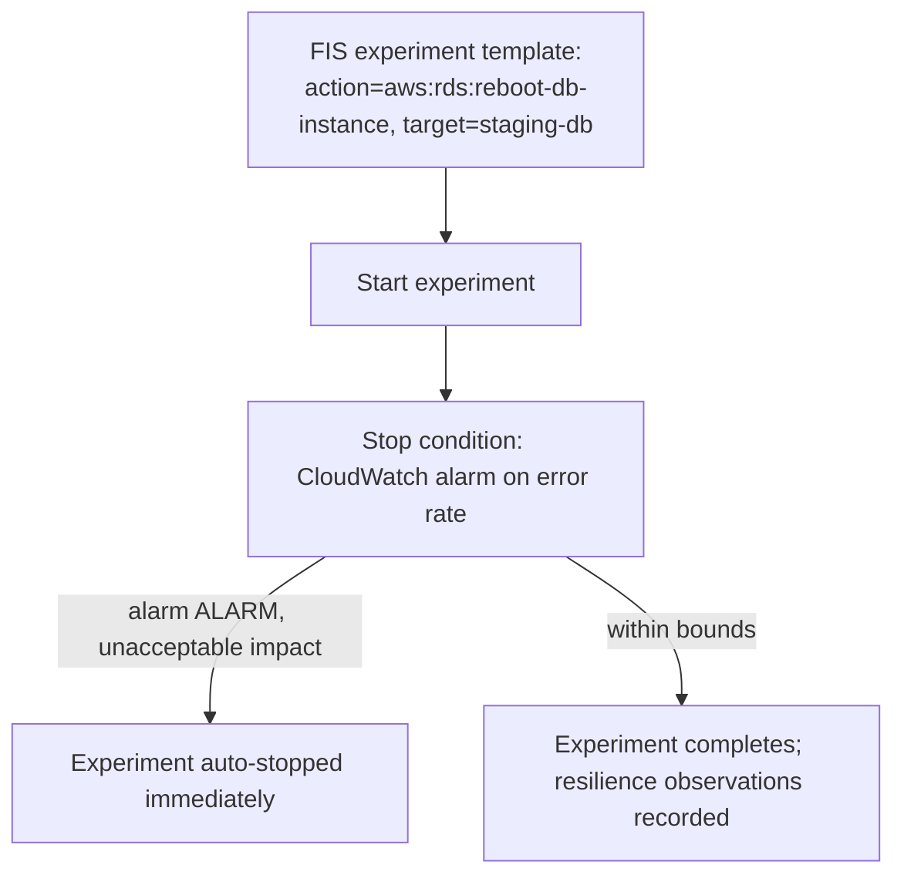

**Why the others are wrong:**
- A: CloudTrail is an audit log of API calls that already happened; it has no capability to inject new, synthetic failure conditions into a system for testing purposes.
- C: AWS Config evaluates resource configuration compliance against rules over time; it has no fault-injection or failure-simulation capability.
- D: AWS FIS is exactly this AWS-native fault-injection/chaos-testing service, with direct, deep integration into AWS resource types and CloudWatch-based safety stop conditions — the premise that no such native service exists is incorrect.

---

## Q56 — Domain 4: Troubleshooting and Optimization

A request flows through `API Gateway → Service A (Lambda) → Service B (Lambda) → Service C (Lambda)`.
X-Ray traces for Service A and Service C show up correctly and are linked together in one trace in
the console, but Service B's segment is **missing entirely** from that trace — it appears as a
completely separate, orphaned trace instead. The X-Ray SDK is correctly installed and initialized in
all three functions. What is the most likely cause?

A. X-Ray has a hard limit of two linked segments per trace; a three-hop chain can never be fully represented in one trace regardless of configuration.

B. Service A is not correctly **propagating the X-Ray trace context** (the `X-Amzn-Trace-Id` header
   or equivalent SDK call) when it invokes Service B — without that explicit propagation, Service B
   has no way to know it's part of an existing trace and starts a brand-new, independent trace ID
   instead, breaking the parent-child linkage even though X-Ray itself is active and correctly
   recording segments for each function individually.

C. Service C's segment being present proves trace propagation is configured correctly everywhere; the missing Service B segment must be a CloudWatch Logs retention/permissions issue instead.

D. X-Ray automatically drops the middle segment of any three-or-more-hop chain to reduce trace storage costs, by design.

**Correct Answer: B**

**Explanation:** X-Ray links segments into one coherent trace via **trace context propagation** — the
calling service must forward the trace ID (typically via the `X-Amzn-Trace-Id` HTTP header for HTTP-
based calls, or explicit SDK context passing for direct SDK invocations) to the service it calls. If
Service A invokes Service B without forwarding that context (e.g. a direct `boto3`/SDK Lambda
`Invoke` call made without the X-Ray SDK's context-propagation wrapper), Service B's X-Ray SDK has no
inherited trace ID to attach to, so it starts a new, disconnected trace — explaining exactly the
"Service B appears as an orphaned, separate trace" symptom even though tracing itself is active. This
is Task 4.1 content. See [`services/management-governance/cloudwatch.md`](../../../services/management-governance/cloudwatch.md).

**Why the others are wrong:**
- A: X-Ray traces can represent arbitrarily long multi-hop service chains as a single linked trace (subject to overall trace size/retention limits, not a hard two-segment cap) — a three-hop chain is fully and routinely supported when context propagation is correctly implemented throughout.
- C: Service C's segment appearing correctly actually suggests that *somewhere* downstream of the break, propagation resumed (or Service C was itself called in a way that correctly inherited context) — it doesn't prove propagation into Service B worked; the orphaned Service B segment is a tracing/instrumentation issue, not a CloudWatch Logs retention or permissions problem (which would affect log visibility, not trace linkage).
- D: X-Ray has no such "automatically drop the middle segment" cost-saving behavior; this scenario's symptom is a specific, fixable instrumentation gap, not an intentional platform limitation.

---

## Q57 — Domain 1: Development with AWS Services

A team designs a single DynamoDB table to serve multiple distinct access patterns for an e-commerce
application (orders, customers, products) using a technique where the partition key and sort key are
generic, overloaded attributes (e.g. `PK`/`SK`) whose actual meaning varies by item type (e.g.
`PK=CUSTOMER#123`, `SK=ORDER#456` for an order item under a customer), avoiding the need for separate
physical tables per entity type. What is this design technique called, and what is its main
trade-off?

A. This is called "table federation," and its only trade-off is a modest increase in per-item storage size with no other practical consequences.

B. This is **single-table design**, which minimizes the number of physical tables (and round trips
   needed to assemble related data via a single `Query` against one partition) at the cost of
   significantly higher upfront modeling complexity — access patterns must be enumerated and designed
   for *before* the table is built, since DynamoDB has no generic cross-entity join capability to fall
   back on if a new, unanticipated access pattern emerges later.

C. This is called "schema-on-read," and it eliminates the need to ever design for specific access patterns in advance, since DynamoDB can infer any query pattern dynamically at read time.

D. This technique is a DynamoDB anti-pattern explicitly discouraged by AWS documentation in all cases; one table per entity type is always correct.

**Correct Answer: B**

**Explanation:** **Single-table design** is a well-documented, intentional DynamoDB modeling pattern:
by overloading generic `PK`/`SK` attributes with entity-specific semantics, related, differently-typed
items can be colocated under the same partition and retrieved together in a single `Query` call —
powerful for performance and cost, but it demands thorough upfront access-pattern analysis, since
DynamoDB (unlike a relational database) has no general-purpose join to fall back on if a genuinely
new query need surfaces after the table is already in production. This is Task 1.3 content. See
[`services/database/dynamodb.md`](../../../services/database/dynamodb.md).

**Why the others are wrong:**
- A: "Table federation" is not the standard term for this technique, and its trade-offs go well beyond storage size — the design-complexity and access-pattern-rigidity trade-off is the central, practically important one.
- C: DynamoDB has no ability to dynamically infer arbitrary query patterns at read time; single-table design in fact requires the *opposite* — rigorous advance planning of every access pattern the application will need.
- D: AWS's own documentation and reference architectures actively recommend single-table design for many DynamoDB use cases precisely because of its performance/cost benefits — it is a deliberate, often-recommended technique, not a universally discouraged anti-pattern.

---

## Q58 — Domain 2: Security

A customer-facing chatbot built on Amazon Bedrock must never generate responses containing
competitor product names, profanity, or detailed instructions for illegal activities — and the team
wants this enforced **consistently at the platform level**, independent of how well any individual
prompt happens to be engineered, so a creative or adversarial user input can't bypass it through
clever prompt phrasing alone. Which Bedrock feature is purpose-built for this kind of enforced,
prompt-independent content control?

A. Writing a longer, more detailed system prompt instructing the model never to mention competitors, profanity, or illegal activity; prompt engineering alone is a fully reliable enforcement mechanism per AWS's own guidance.

B. **Amazon Bedrock Guardrails** — configurable policies defining denied topics (e.g. competitor
   mentions), content filters (profanity, violence, and other categories with adjustable
   sensitivity), and word/phrase filters, applied by the Bedrock service itself to both the user's
   input and the model's output, independent of the specific prompt wording used, and enforced even
   against adversarial or creatively-phrased attempts to work around a system prompt alone.

C. IAM resource policies on the foundation model ARN, which can enumerate forbidden words directly as a `Condition` key evaluated against the model's generated output text.

D. Amazon Macie, which is Bedrock's required pre-processing step for filtering any generated text output before it reaches the end user.

**Correct Answer: B**

**Explanation:** **Bedrock Guardrails** provide a dedicated, platform-enforced content-control layer
—independent of prompt engineering — including denied topics, configurable content filters (hate,
violence, sexual content, profanity, and more, each with adjustable strength), and custom word/phrase
filters, applied to both the incoming prompt and the generated output. This is explicitly more robust
against adversarial phrasing than relying solely on system-prompt instructions, which a sufficiently
creative user can sometimes talk the model out of following. This is Task 2.3 content. See
[`certifications/dva-c03/domain-2-security/ai-service-security-risks.md`](../domain-2-security/ai-service-security-risks.md).

**Why the others are wrong:**
- A: AWS's own guidance (and general industry understanding of LLM behavior) explicitly does **not** treat system-prompt instructions alone as a reliable enforcement mechanism against adversarial or creative user input — this is precisely why a separate, platform-enforced guardrail layer exists.
- C: IAM policies and condition keys govern API-level authorization (who can call which action on which resource); they have no capability to inspect or filter natural-language model output content.
- D: Macie is a sensitive-data *discovery* service for structured/unstructured data in S3 and similar stores; it is not a required or even typical pre-processing step for Bedrock's generated text output, and has no content-moderation relationship to Guardrails.

---

## Q59 — Domain 3: Testing and Deployment

A team's CI/CD pipeline deploys a new application version via CloudFormation that depends on a
specific relational database schema change (a new column with a `NOT NULL` constraint on an existing
table). The team wants the schema migration to run reliably **before** the new application code that
depends on it is deployed, as a distinct, trackable, and ideally automatically-rollback-aware step in
the pipeline, rather than hoping the application's own startup code handles the migration safely
under concurrent deployment. What is the correct pipeline design principle here?

A. Embed the schema migration directly inside the new application code's startup/bootstrap logic, letting every new instance attempt the migration independently and simultaneously on every deploy.

B. Add a **dedicated migration step/stage** in the pipeline (e.g. a CodeBuild action or a one-off
   ECS/Lambda task running a migration tool such as Flyway/Liquibase) that runs **before** the
   application deployment stage, gated so the pipeline halts (and the application deployment never
   proceeds) if the migration step fails — keeping schema changes as an explicit, ordered, and
   independently testable/rollback-aware step distinct from application code deployment.

C. Schema migrations should always run manually, outside of any CI/CD pipeline, by a database administrator connecting directly to production.

D. CloudFormation automatically detects and safely applies arbitrary SQL schema changes inside any RDS instance it manages, with no separate migration tooling needed.

**Correct Answer: B**

**Explanation:** Treating database migrations as their own explicit, ordered pipeline stage — run
once via a dedicated migration tool, gated before the application deployment stage proceeds — avoids
the race condition and inconsistency risk of every concurrently-deploying application instance
attempting the same schema change independently, and gives the pipeline a clear, visible failure point
if the migration itself fails (stopping before incompatible application code is deployed against an
unmigrated schema). This is Task 3.2 content. See [`../domain-3-testing-deployment/README.md`](../domain-3-testing-deployment/README.md).

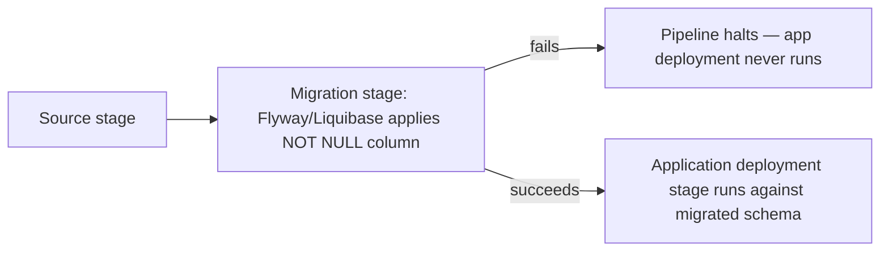

**Why the others are wrong:**
- A: Having every new application instance attempt the same schema migration independently on startup risks race conditions (multiple instances trying to add the same column simultaneously) and makes failures hard to isolate from application startup failures generally.
- C: While some highly regulated environments do require human-gated migrations, "always manual, never in CI/CD" throws away exactly the reliability, repeatability, and ordering guarantees an automated, gated pipeline stage provides — and doesn't scale to frequent deployments.
- D: CloudFormation manages the *existence/configuration* of the RDS instance resource itself (engine, storage, instance class); it has no awareness of or capability to apply arbitrary application-level SQL schema changes inside the database — that requires separate migration tooling.

---

## Q60 — Domain 4: Troubleshooting and Optimization

A Lambda function integrated with API Gateway occasionally needs more than 29 seconds to complete a
long-running synchronous operation. Clients report receiving a `504 Gateway Timeout` from API
Gateway even though CloudWatch Logs show the Lambda function itself eventually completed successfully
a few seconds later. What is the root cause, and what are the realistic fixes?

A. The Lambda function's own `Timeout` setting must be the issue; setting it to a value greater than 29 seconds will resolve the 504 regardless of the API Gateway configuration.

B. **API Gateway has a hard, non-configurable maximum integration timeout of 29 seconds** for both
   REST and HTTP APIs — regardless of how high the Lambda function's own `Timeout` is set, API Gateway
   will return a `504` if the backend hasn't responded within 29 seconds. Realistic fixes include:
   redesigning the operation to be asynchronous (API Gateway triggers the Lambda function, which
   immediately returns an acknowledgment while doing the real work in the background, with the client
   polling or being notified via WebSocket/webhook later), or bypassing API Gateway's synchronous
   integration for this specific operation entirely (e.g. a Lambda function URL, which has no 29-
   second ceiling) if a long synchronous call is unavoidable.

C. Switching from REST API to HTTP API type removes the 29-second integration timeout entirely, allowing integrations of any duration.

D. The 504 is caused by an incorrectly configured CORS policy; fixing the `Access-Control-Allow-Origin` header will resolve timeouts on long-running operations.

**Correct Answer: B**

**Explanation:** API Gateway's integration timeout ceiling (29 seconds) is a **hard platform limit**
for both REST and HTTP APIs, independent of the Lambda function's own configured `Timeout` (which
can go up to 15 minutes) — a function that takes 29+ seconds to complete will always trigger a `504`
from API Gateway's side regardless of Lambda's own settings. The correct architectural fixes are to
make the operation asynchronous (fire-and-acknowledge, with results delivered separately) or route
that specific long-running call through a mechanism without the 29-second ceiling, such as a Lambda
function URL. This is Task 4.2 content. See [`services/networking-content-delivery/api-gateway.md`](../../../services/networking-content-delivery/api-gateway.md)
and [`services/compute/lambda.md`](../../../services/compute/lambda.md).

**Why the others are wrong:**
- A: The Lambda function's own timeout only governs how long *Lambda itself* will let the invocation run; it has no effect on API Gateway's separate, independent 29-second integration-timeout ceiling, which applies regardless of what the backend's own timeout is configured to.
- C: Both REST APIs and HTTP APIs share the same hard 29-second maximum integration timeout; switching API type does not remove or raise this specific limit.
- D: CORS configuration governs which origins are permitted to make cross-origin browser requests and which headers are exposed; it has no relationship to how long an integration is allowed to run before timing out.

---

## Q61 — Domain 2: Security

A company's Bedrock-powered support chatbot needs a **complete, queryable audit record** of every
model invocation — including the exact prompt sent, the model's response, and which model version was
used — retained for compliance review, without the application team having to manually log this data
themselves inside every call site. Which Bedrock feature provides this natively?

A. CloudTrail management events alone, which by default capture the full prompt and response text of every `InvokeModel` call automatically.

B. **Bedrock model invocation logging**, configured at the account/region level to deliver invocation
   data (including the full request and response payloads, plus metadata like model ID and timestamp)
   to a destination such as a CloudWatch Logs group and/or an S3 bucket — enabled once centrally
   rather than requiring every application call site to implement its own logging.

C. Amazon Comprehend, which is required as a mandatory proxy in front of Bedrock and automatically produces the compliance audit trail as a side effect of its sentiment analysis.

D. Bedrock has no native invocation-logging capability; full prompt/response audit logging must be entirely hand-built by wrapping every `InvokeModel` call with custom logging code.

**Correct Answer: B**

**Explanation:** **Model invocation logging** is a native Bedrock configuration (set once per
account/region) that captures full invocation data — including prompt/response content and
metadata — and delivers it to CloudWatch Logs and/or S3, satisfying exactly this "complete, queryable
audit record with no per-call-site custom code" requirement. This is Task 2.3 content. See
[`certifications/dva-c03/domain-2-security/ai-service-security-risks.md`](../domain-2-security/ai-service-security-risks.md).

**Why the others are wrong:**
- A: CloudTrail management events for Bedrock record the *API call metadata* (who called `InvokeModel`, when, from where) for governance purposes, but do **not** by default include the actual prompt/response content payloads — that full-content capture is specifically what model invocation logging (a separate, dedicated feature) provides.
- C: Comprehend is a separate NLP service (sentiment analysis, entity/PII detection) with no mandatory proxy relationship to Bedrock and no built-in compliance audit-logging function for Bedrock invocations.
- D: Model invocation logging is exactly the native, built-in capability this scenario needs — the premise that it must be entirely hand-built ignores this documented, purpose-built feature.

---

## Q62 — Domain 1: Development with AWS Services

A media company serves large video files from S3 to a globally distributed user base, and users far
from the bucket's AWS Region report slow, inconsistent upload speeds when contributing their own
raw footage. The team wants to speed up these long-distance *uploads* specifically (not just
downloads, which are already handled by a separate CloudFront distribution), routing data over
AWS's optimized backbone network from the point closest to each uploading user. Which S3 feature
addresses this?

A. S3 Cross-Region Replication, which automatically speeds up any individual upload in progress by replicating partial data to the nearest region in real time.

B. **S3 Transfer Acceleration**, which routes upload (and download) traffic through the nearest
   CloudFront edge location using a special accelerated endpoint (`<bucket>.s3-accelerate.amazonaws.com`),
   carrying the data over AWS's optimized global backbone network from that edge location to the
   bucket's actual Region — directly improving long-distance upload throughput/consistency with no
   client-side code changes beyond using the accelerated endpoint.

C. Enabling S3 Intelligent-Tiering, which automatically selects the geographically nearest storage location for every uploaded object.

D. Multipart upload alone (without Transfer Acceleration) fully solves long-distance latency, since splitting a file into parts eliminates all effects of network distance.

**Correct Answer: B**

**Explanation:** **S3 Transfer Acceleration** is specifically designed for exactly this problem:
long-distance transfers (uploads particularly benefit, though it helps downloads too) are routed
through the nearest CloudFront edge location and carried over AWS's private backbone network for the
long-haul portion, rather than the public internet path all the way to the bucket's region — directly
addressing inconsistent, slow long-distance upload performance with just an endpoint change. This is
Task 1.1/4.3 content. See [`services/storage/s3.md`](../../../services/storage/s3.md).

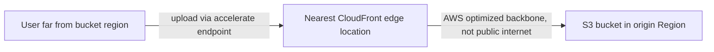

**Why the others are wrong:**
- A: Cross-Region Replication copies already-completed objects to another bucket/region after the fact for durability/locality purposes; it has no mechanism to accelerate an individual upload that is still in progress.
- C: Intelligent-Tiering automatically moves objects between S3 *storage classes* based on access patterns for cost optimization; it has no geographic-routing or upload-acceleration behavior.
- D: Multipart upload enables parallelism and resumability for a large file, which helps throughput and resilience, but it doesn't change the underlying network path/distance the data must travel — pairing multipart upload with Transfer Acceleration (as AWS recommends for large, long-distance uploads) addresses both dimensions together, but multipart alone doesn't eliminate distance-related latency/throughput effects.

---

## Q63 — Domain 3: Testing and Deployment

An application currently has a feature flag (`enableNewCheckout: true/false`) baked directly into
its deployed configuration file, requiring a full redeploy (and rollback-via-redeploy if something
goes wrong) every time the flag needs to be toggled. The team wants to toggle this flag instantly,
for a percentage of users if desired, without any code deployment at all, and wants the running
application to pick up the change within seconds. Which AWS service and feature is purpose-built for
this, distinct from a hardcoded config file?

A. Store the flag value in a Lambda environment variable; environment variable changes take effect instantly across all running execution environments with no function update needed.

B. **AWS AppConfig**, using a **configuration profile** (feature flag type) and a **hosted
   configuration** or similar source, with the application's AppConfig Agent/SDK periodically
   fetching the current value (typically within seconds, via efficient polling against a locally-
   cached version) — toggling the flag in AppConfig (optionally targeting a percentage of traffic via
   a deployment strategy) requires zero application code deployment.

C. Feature flags must always be redeployed as part of application code; there is no AWS-native runtime configuration service that avoids a deployment.

D. Store the flag in a DynamoDB table and have the application re-query it on every single request with no caching, since this is the only way to get sub-second flag propagation.

**Correct Answer: B**

**Explanation:** **AWS AppConfig** is purpose-built for exactly this: dynamic, runtime-configurable
feature flags (and other configuration) that can be changed centrally and picked up by running
application instances within seconds via an efficient local-caching agent/SDK — no code deployment
required to toggle a flag, and deployment strategies can gradually roll out a flag change to a
percentage of traffic with alarm-based automatic rollback if needed. This is Task 3.3 content. See
[`../domain-3-testing-deployment/README.md`](../domain-3-testing-deployment/README.md).

**Why the others are wrong:**
- A: Changing a Lambda function's environment variable **requires an update to the function's configuration** (a deployment-adjacent API call, e.g. `UpdateFunctionConfiguration`), and already-running, warm execution environments for a prior configuration don't instantly pick up the new value without new invocations being routed to freshly-initialized environments — it is not a zero-deployment, instant-everywhere mechanism.
- C: AppConfig exists specifically to provide this capability — the premise that no such AWS-native runtime configuration service exists is false.
- D: Re-querying DynamoDB on every single request with zero caching adds latency and cost to every request just to check a flag that changes rarely; AppConfig's local-caching agent model achieves near-real-time propagation far more efficiently without per-request database calls.

---

## Q64 — Domain 4: Troubleshooting and Optimization

A document-processing Lambda function is triggered by an SQS queue via event source mapping. A bug in
an earlier version of the function occasionally processed the same message twice due to a race in
how it extended visibility timeout, resulting in duplicate downstream records being created (e.g. two
identical invoice records for one uploaded document). The underlying SQS at-least-once delivery
behavior itself is normal and expected. Choose **TWO** correct, durable architectural responses,
rather than trying to eliminate all possible duplicate deliveries entirely.

A. Make the function's downstream write operation **idempotent** — e.g. derive a deterministic key
   from the message content (such as a document ID already present in the message) and use a
   DynamoDB conditional write (`attribute_not_exists`) or an equivalent "insert if not already
   processed" pattern, so that processing the same message a second time is a safe no-op rather than
   creating a duplicate record.

B. If the producer can tolerate it, migrate to an **SQS FIFO queue with content-based deduplication**, which collapses duplicate sends within its 5-minute deduplication window at the queue layer — a complementary, additional layer of protection, used alongside (not instead of) idempotent processing, since FIFO's dedup window doesn't cover every possible duplicate-delivery scenario a standard queue's retry/visibility-timeout behavior can produce.

C. Switch from a standard SQS queue to a Kinesis Data Stream, since Kinesis guarantees each record is delivered and processed exactly once with no possibility of duplicates under any circumstances.

D. Reduce the queue's `VisibilityTimeout` to 0 seconds, which guarantees no message can ever be redelivered to a second consumer.

E. This cannot be fixed at the application level; SQS must be replaced with a strictly exactly-once delivery mechanism, which does not exist anywhere in AWS's messaging services.

**Correct Answer: A, B**

**Explanation:** SQS standard queues provide **at-least-once** delivery by design — duplicate
deliveries are an expected, normal possibility, not a bug to be "fixed" at the queue level. The
primary, durable architectural response is making the processing logic **idempotent**, so that
however many times a given message is delivered and processed, the resulting side effect (e.g. the
created invoice record) only ever happens once. Where the producer can support it, moving to a
**FIFO queue with content-based deduplication** adds a complementary queue-layer defense against
duplicate sends — but it doesn't replace the need for idempotent processing, since FIFO dedup only
covers duplicates within its window, not every path that can cause redelivery. This is the standard
Task 1.1/4.2 pattern for building reliably correct systems on top of at-least-once messaging. See
[`services/application-integration/sqs.md`](../../../services/application-integration/sqs.md)
and [`services/database/dynamodb.md`](../../../services/database/dynamodb.md).

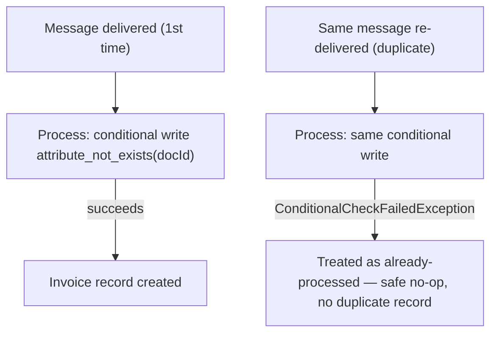

**Why the others are wrong:**
- C: Even Kinesis-based architectures generally provide *at-least-once* processing semantics in practice (consumer-side checkpointing can also redeliver records after a failure); "guarantees exactly-once under all circumstances" significantly overstates what switching messaging services alone would achieve, and idempotent processing remains the standard best practice there too.
- D: A `VisibilityTimeout` of 0 would make a message immediately visible to other consumers the instant it's received, which would make duplicate concurrent processing *more* likely, not eliminate it — this is the opposite of a fix.
- E: FIFO queues' content-based deduplication (choice B) is exactly an application/architecture-level mitigation that works alongside idempotent processing — the premise that "nothing can be fixed at the application level" is false and ignores both valid answers.

---

## Q65 — Domain 2: Security

A team's Bedrock-based document-summarization feature retrieves source documents from an internal
company wiki (via a Knowledge Base configured for Retrieval-Augmented Generation) to ground its
summaries. The security team requires that the Knowledge Base's **ingestion process** only ever pull
documents from the specific, approved wiki S3 export bucket — never any other S3 bucket in the
account, even accidentally via a future misconfiguration — and that the Knowledge Base's own
execution role carry no broader S3 permissions than strictly necessary. Which configuration correctly
enforces this data perimeter?

A. Grant the Knowledge Base's IAM role `s3:*` on `Resource: "*"`, then rely entirely on manual code review of the Knowledge Base configuration to catch any future misconfiguration pointing it at the wrong bucket.

B. Scope the Knowledge Base's execution role's IAM policy to `s3:GetObject`/`s3:ListBucket` on only
   the specific approved bucket's ARN (and its objects), rather than a wildcard resource — combined
   with the bucket's own policy, if desired, further restricting which principals may read from it —
   so that even if the Knowledge Base's data-source configuration were mistakenly pointed at a
   different bucket later, the role's own permissions would make that access impossible regardless.

C. Knowledge Bases automatically and permanently restrict themselves to whichever single bucket was specified at creation time, with no IAM configuration needed or possible to change this.

D. Enable S3 Block Public Access on the approved bucket; this alone fully enforces which specific principals (including the Knowledge Base's own role) can read from it.

**Correct Answer: B**

**Explanation:** This is the same least-privilege, defense-in-depth principle Task 2.3 applies to AI
services generally: scope the Knowledge Base's execution role's IAM permissions to exactly the
approved bucket ARN, rather than a wildcard — so that even a future configuration mistake (pointing
the data source at the wrong bucket) is still blocked by IAM, rather than relying solely on the
Knowledge Base's own configuration (or manual review) staying correct forever. See
[`certifications/dva-c03/domain-2-security/ai-service-security-risks.md`](../domain-2-security/ai-service-security-risks.md)
and [`services/security-identity-compliance/iam.md`](../../../services/security-identity-compliance/iam.md).

**Why the others are wrong:**
- A: A wildcard `s3:*`/`Resource: "*"` grant provides no actual enforcement at all — it relies entirely on nothing ever going wrong in configuration or code review, which is precisely the fragile, non-defense-in-depth approach this scenario's requirement is designed to avoid.
- C: Knowledge Bases do not self-impose any such automatic, IAM-independent bucket restriction — access is governed by whatever IAM permissions the Knowledge Base's execution role actually has, which must be explicitly scoped by the team.
- D: Block Public Access specifically prevents *public* (anonymous/wildcard-principal) access; it has no effect on which *specific, named* IAM principals (like the Knowledge Base's own role) can read the bucket — that's governed by the bucket policy and/or the role's own IAM policy, not Block Public Access settings.

---

*End of Bank 2 — 65 questions. Continue to [`bank-3.md`](bank-3.md) or return to [`README.md`](README.md).*
