# DVA-C03 Study-Mode Exam Bank — Bank 3 (65 Questions)

Third of three study-mode practice exams. Same drilling format as [`bank-1.md`](bank-1.md) and
[`bank-2.md`](bank-2.md): answer and full explanation immediately follow each question. All 65
scenarios here are distinct from Bank 1, Bank 2, and from [`../practice-questions/`](../practice-questions/).
See [`README.md`](README.md) for suggested usage order across the three banks.

Domain mix: **20 Domain 1** (30.8%), **17 Domain 2** (26.2%), **14 Domain 3** (21.5%),
**14 Domain 4** (21.5%) — matching the real 30/26/22/22 exam weighting, interleaved throughout.

---

## Q1 — Domain 3: Testing and Deployment

A CodePipeline's source stage is configured to pull from a GitHub repository. The team notices that
after pushing a commit, the pipeline sometimes takes several minutes to notice the change, and other
times it reacts within seconds. They want the pipeline to react to every push essentially
immediately and consistently. What is the most likely cause of the inconsistent delay, and the fix?

A. CodePipeline has a hardcoded, unconfigurable 5-minute source-check interval with no way to reduce it.

B. The source action is configured to use **polling** (`PollForSourceChanges: true`), which checks the
   repository on a periodic schedule rather than reacting instantly — switching to a **webhook-based
   trigger** (CodeStar Connections for GitHub, which registers a webhook that notifies CodePipeline
   the instant a push happens) makes the pipeline react immediately and consistently instead of
   waiting for the next poll interval.

C. GitHub itself throttles webhook delivery randomly; this is unrelated to any CodePipeline configuration.

D. The inconsistent delay is caused by CodeBuild's cache settings, which have no relationship to the source stage at all.

**Correct Answer: B**

**Explanation:** **Polling-based** source detection checks for changes on a periodic interval, so the
delay before a pipeline reacts depends on where in that interval the push happened to occur — the
inconsistency the team observed is exactly this. A **webhook-based** trigger (via a CodeStar
Connections GitHub source action) instead has GitHub actively notify CodePipeline the moment a push
occurs, giving consistent near-instant reaction with no polling delay. This is Task 3.2 content. See
[`services/developer-tools/codepipeline.md`](../../../services/developer-tools/codepipeline.md).

**Why the others are wrong:**
- A: CodePipeline's polling interval is a configuration choice (and webhooks are the documented, recommended alternative), not an unconfigurable hard constant — the premise that nothing can be changed is false.
- C: While any third-party webhook delivery system can have occasional transient issues, the *consistent* "sometimes seconds, sometimes minutes" pattern described is the textbook signature of polling-interval timing, not random webhook throttling.
- D: CodeBuild's cache configuration affects build speed within the build stage; it has no relationship to how the separate, upstream source stage detects new commits.

---

## Q2 — Domain 4: Troubleshooting and Optimization

A Lambda function is invoked directly (not via API Gateway) by another Lambda function using the
AWS SDK's `Invoke` API, with X-Ray tracing active on both. In the X-Ray console's service map for
this trace, the team sees exactly two nodes representing the invoked function: a node labeled for
the **Lambda service** itself and a separate node for the **function's own code**. What do these two
distinct nodes represent, and why does X-Ray show them separately rather than as one combined node?

A. This is a display bug; X-Ray should show exactly one node per function, and seeing two indicates tracing is misconfigured.

B. The first node represents time spent in the **Lambda service** handling the invocation itself
   (e.g. initialization overhead, the platform-level invoke mechanics), while the second node
   represents the actual **function handler code's own execution segment** — separating these lets
   you distinguish Lambda-platform-level overhead (like a cold start's init phase) from time spent
   inside your own application logic specifically.

C. The two nodes represent the two most recent invocations of the function; X-Ray always shows exactly the last two calls side by side regardless of how many times the function actually ran.

D. One node is for successful invocations and the other exclusively for failed invocations, and a function can never appear as a single node combining both outcomes.

**Correct Answer: B**

**Explanation:** X-Ray automatically records two segments per Lambda invocation: one for the **Lambda
service** itself (capturing platform-level overhead like initialization) and one for the **function's
own code execution** — this separation, visible as two linked nodes in the service map, is
specifically designed to let you distinguish "time the platform spent getting your code ready to run"
from "time your own handler logic actually took," which is valuable when diagnosing whether a latency
issue is cold-start/platform-related or purely in your own code.

*Source: AWS Documentation — [Visualize Lambda Event Function invocations using AWS X-Ray](https://docs.aws.amazon.com/lambda/latest/dg/services-xray.html) (curl-verified 200 OK, `image/png`). The left node is the Lambda service; the right node is the function's own code — exactly the two-node structure this question describes.*

This is Task 4.1 content. See [`services/management-governance/cloudwatch.md`](../../../services/management-governance/cloudwatch.md).

**Why the others are wrong:**
- A: This two-node structure is X-Ray's documented, intentional default behavior for every traced Lambda invocation, not a bug or misconfiguration symptom.
- C: Each node aggregates data across however many invocations fall within the viewed time window (and a given trace reflects one specific invocation's two segments) — this has nothing to do with "always showing the last two calls."
- D: Both nodes can reflect a mix of successful and failed invocations over time (colored accordingly per the usual green/red/yellow/purple convention); the split is Lambda-service-vs-function-code, not success-vs-failure.

---

## Q3 — Domain 1: Development with AWS Services

A team needs to process an extremely large dataset — 50 million individual records stored as
separate small JSON files in S3 — running the same transformation on each file, with built-in
automatic retry for individual failed items, and wants the orchestration itself (not a custom script)
to handle iterating across such a large item count without manually paginating through S3 listings.
A regular Step Functions `Map` state's 40-concurrency practical ceiling and in-memory iteration
model are not well suited to this scale. Which Step Functions feature is designed specifically for
datasets at this scale?

A. A `Parallel` state with 50 million statically-defined branches, one per file.

B. **Distributed Map**, a Map state mode specifically designed for large-scale data processing —
   it can read directly from an S3 bucket/prefix (or a manifest file) as its iteration source, run up
   to 10,000 concurrent child workflow executions, and handles pagination/iteration over massive item
   counts natively, without loading the entire item list into the state's in-memory JSON payload the
   way the standard (inline) Map mode does.

C. AWS Batch is the only AWS service capable of processing more than 40 items in parallel; Step Functions cannot be used at this scale under any configuration.

D. A `Wait` state looped 50 million times via a recursive Step Functions execution calling itself once per file.

**Correct Answer: B**

**Explanation:** **Distributed Map** is purpose-built for exactly this large-scale item-processing
profile: unlike the standard (inline) Map mode — which loads the full iteration array into the
state's JSON input/output (subject to a 256 KB payload limit) — Distributed Map can read its item
list directly from an S3 bucket listing or a manifest file, run far higher concurrency (up to 10,000
parallel child executions), and natively handles massive item counts without hitting the inline
mode's payload-size or practical-item-count limitations. This is Task 1.1 content. See
[`services/application-integration/step-functions.md`](../../../services/application-integration/step-functions.md).

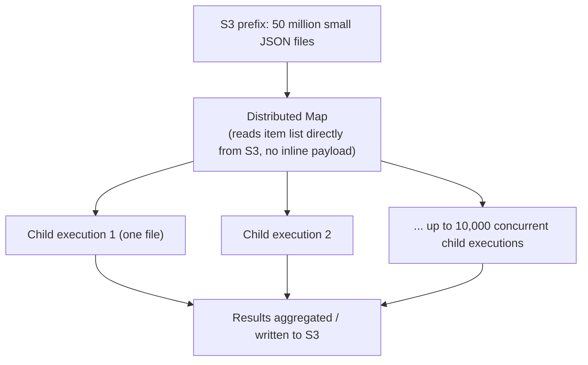

**Why the others are wrong:**
- A: 50 million statically-defined branches is not a representable or feasible template definition at design time under any configuration — `Parallel` states require every branch to be explicitly authored in the state machine definition.
- C: AWS Batch array jobs are also a valid approach for this kind of large-scale item processing (and may be preferable for some workloads), but the claim that Step Functions "cannot be used at this scale under any configuration" is false — Distributed Map exists specifically to address this scale within Step Functions.
- D: Step Functions has no "recursive self-invoking `Wait` state" looping mechanism, and even if it did, looping synchronously 50 million times would be a wildly inefficient, unsupported anti-pattern compared to Distributed Map's native parallel iteration.

---

## Q4 — Domain 2: Security

A security team compares **AWS Shield Advanced** and **AWS WAF** for protecting a public-facing
Application Load Balancer that fronts a critical checkout API. They want to understand what each
layer specifically contributes, since budget constraints mean they need to justify enabling both
rather than just one. Which statement correctly distinguishes their roles?

A. Shield Advanced and WAF are two marketing names for the exact same underlying DDoS-protection service; enabling both provides no additional capability over enabling just one.

B. **WAF** operates at Layer 7, inspecting and filtering individual HTTP requests against rules (SQL
   injection patterns, rate-based rules, geographic restrictions, managed rule groups) to block
   malicious *application-layer* requests; **Shield Advanced** provides enhanced protection against
   larger-scale network/transport-layer (Layer 3/4) and sophisticated Layer 7 DDoS attacks, with
   near-real-time visibility, 24/7 DDoS Response Team (DRT) access, and cost protection for scaling
   charges incurred during an attack — the two are complementary, addressing different parts of the
   threat spectrum, which is exactly why they're commonly layered together.

C. Shield Advanced fully replaces the need for WAF, since it already inspects and blocks SQL injection and other application-layer attack patterns identically to WAF's managed rule groups.

D. WAF only protects CloudFront distributions; it cannot be attached to an Application Load Balancer at all, making Shield Advanced the only option for ALB-fronted workloads.

**Correct Answer: B**

**Explanation:** **WAF** and **Shield Advanced** address different, complementary layers: WAF is a
Layer 7 (application) filter evaluating individual request content against configurable rules, while
Shield Advanced specifically hardens against DDoS attacks (volumetric Layer 3/4 floods and more
sophisticated Layer 7 DDoS patterns), adding incident response support (DRT) and cost protection for
scaling charges triggered by an attack — WAF doesn't provide DDoS-specific cost protection or DRT
access, and Shield Advanced doesn't provide granular, rule-based application-content filtering like
SQL-injection pattern matching. This is Task 2.2 content. See [`services/security-identity-compliance/shield.md`](../../../services/security-identity-compliance/shield.md)
and [`services/security-identity-compliance/waf.md`](../../../services/security-identity-compliance/waf.md).

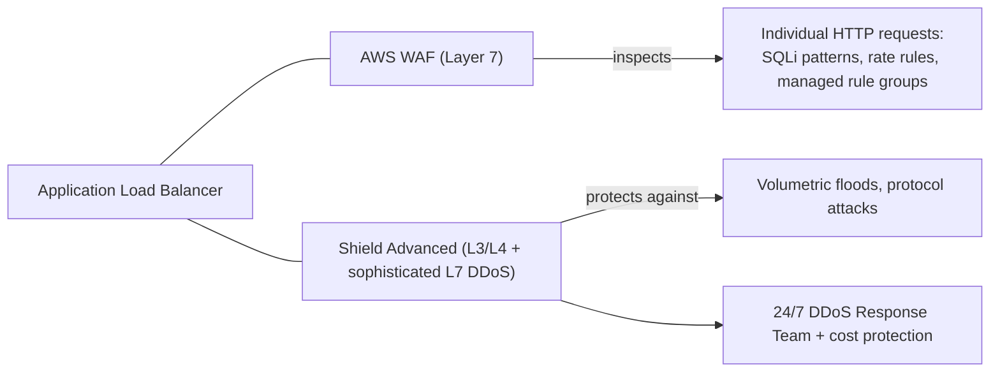

**Why the others are wrong:**
- A: The two are genuinely distinct services with different detection mechanisms, protection scope, and support offerings — they are not a rebranding of the same capability.
- C: Shield Advanced's protections focus on DDoS attack patterns (volumetric and protocol-based primarily, with some Layer 7 DDoS-specific detection); it does not perform WAF's granular, rule-based content inspection for things like SQL injection signatures in arbitrary request bodies.
- D: WAF explicitly supports attachment to Application Load Balancers, API Gateway, AppSync, and Cognito user pools, in addition to CloudFront — it is not CloudFront-exclusive.

---

## Q5 — Domain 1: Development with AWS Services

A team needs to run a Lambda function written in a language AWS doesn't provide a managed runtime
for (e.g. an older or niche language with an existing interpreter/binary). Which Lambda feature
allows this, and what must the function's deployment package/image provide?

A. This is impossible; Lambda only supports the languages for which AWS publishes an official managed runtime, with no extensibility mechanism.

B. A **custom runtime**, built using the **Lambda Runtime API** — the deployment package (or
   container image) includes a `bootstrap` executable that implements the Runtime API's HTTP-based
   invocation loop (polling `/runtime/invocation/next` for events and posting results to
   `/runtime/invocation/{id}/response`), letting Lambda run essentially any language/runtime that can
   be packaged with such a bootstrap process.

C. Lambda automatically transpiles any language's source code into Node.js at deployment time, so no special packaging is required regardless of the original language.

D. Custom runtimes require a separate AWS Support-approved allowlist application before any unsupported language can be used, even for a simple proof of concept.

**Correct Answer: B**

**Explanation:** The **Lambda Runtime API** is an HTTP-based interface that any `bootstrap` process
can implement to receive invocation events and return responses, decoupling Lambda's execution model
from any specific language — this is exactly how AWS's own provided runtimes are built, and
community/custom runtimes for other languages work the same way by shipping their own `bootstrap`
executable in the deployment package or container image. This is Task 1.2 content. See
[`services/compute/lambda.md`](../../../services/compute/lambda.md).

**Why the others are wrong:**
- A: Custom runtimes via the Runtime API are explicitly Lambda's supported extensibility mechanism for exactly this scenario — the premise that no such mechanism exists is false.
- C: Lambda does not transpile arbitrary source code into another language at deployment time; each runtime (managed or custom) executes the code/binary as packaged, with no automatic cross-language conversion step.
- D: Custom runtimes are a standard, openly available, self-service feature — there's no AWS Support allowlist approval process required to use one, for a proof of concept or production use.

---

## Q6 — Domain 2: Security

A company must run certain cryptographic operations in a environment certified to **FIPS 140-2
Level 3** (a hardware security module standard with a higher certification tier than AWS KMS's
standard HSM backing, which is validated to Level 2 for most operations), and additionally needs
full, exclusive single-tenant control over the physical HSM hardware for compliance reasons. Which
AWS service fits this specific, stricter requirement, as distinct from standard AWS KMS?

A. AWS KMS customer-managed keys, which are always FIPS 140-2 Level 3 validated and single-tenant by default with no additional service needed.

B. **AWS CloudHSM**, which provides dedicated, single-tenant hardware security modules validated to
   FIPS 140-2 Level 3, giving the customer exclusive control over the HSM (including administrative
   access AWS itself does not have) — a stricter isolation/compliance posture than KMS's own
   multi-tenant, AWS-managed HSM backing, which is sufficient for most use cases but not this
   specific Level-3/single-tenant requirement.

C. Secrets Manager, which is independently FIPS 140-2 Level 3 validated and can replace any HSM-based requirement.

D. There is no AWS service meeting a FIPS 140-2 Level 3 requirement; this would require an entirely on-premises HSM deployment outside of AWS.

**Correct Answer: B**

**Explanation:** **AWS CloudHSM** provides dedicated, single-tenant HSM instances validated to FIPS
140-2 Level 3, giving the customer exclusive administrative control over the HSM — a materially
different compliance/isolation posture than standard KMS, whose HSM backing (while FIPS-validated)
is AWS-managed and shared infrastructure beneath the key-management service layer. Teams with this
specific stricter requirement (or who need direct PKCS#11/JCE/CNG access to HSM operations) use
CloudHSM, sometimes even as a custom key store backing KMS for a hybrid approach. This is Task 2.2
content. See [`services/security-identity-compliance/kms.md`](../../../services/security-identity-compliance/kms.md).

**Why the others are wrong:**
- A: KMS's standard key store is validated at a different assurance level than CloudHSM's dedicated hardware, and it does not provide customer-exclusive administrative control over the underlying HSM — this is precisely the gap CloudHSM exists to close for stricter requirements.
- C: Secrets Manager is a secrets-storage and rotation service, not an HSM or cryptographic-key-operation service at all; it has no FIPS 140-2 Level 3 HSM capability of its own.
- D: AWS explicitly does offer CloudHSM for this exact requirement — the premise that no AWS-native option exists and only fully on-premises hardware would satisfy it is incorrect.

---

## Q7 — Domain 4: Troubleshooting and Optimization

A developer wants to run and debug a CodeBuild build locally, on their own laptop, using the exact
same build environment (Docker image, environment variables) their CodeBuild project uses in AWS —
before pushing a change and waiting for a full cloud-based build to catch an obvious buildspec typo.
Which AWS tool supports this?

A. There is no way to run a CodeBuild build locally; every build attempt, including testing a buildspec change, requires triggering a real CodeBuild project run in the cloud.

B. The **CodeBuild agent**, run locally via the published `aws/codebuild/local-builds` Docker image
   (using the `codebuild_build.sh` script AWS provides), which pulls the same build environment image
   configured for the CodeBuild project and runs the buildspec locally with full console output,
   letting developers iterate and debug before pushing.

C. AWS CloudShell, which automatically mirrors any CodeBuild project's environment with zero configuration whenever opened.

D. CodeCommit's built-in "preview build" feature, which simulates a CodeBuild run without actually executing any buildspec commands.

**Correct Answer: B**

**Explanation:** AWS publishes a **CodeBuild agent** runnable locally via Docker (the
`aws/codebuild/local-builds` image, driven by the `codebuild_build.sh` helper script), which pulls
down the same build environment image a CodeBuild project is configured to use and executes the
buildspec locally — letting developers debug build/test issues iteratively on their own machine
before pushing and waiting on a cloud build. This is Task 3.1 content. See [`services/developer-tools/codebuild.md`](../../../services/developer-tools/codebuild.md).

**Why the others are wrong:**
- A: The local CodeBuild agent explicitly exists to enable this local-testing workflow — the premise that every test requires a full cloud build run is incorrect.
- C: CloudShell is a browser-based shell environment with the AWS CLI pre-configured; it has no automatic CodeBuild-environment mirroring capability.
- D: CodeCommit has no "preview build" feature; CodeCommit is a source-control service and has no build-simulation capability of its own.

---

## Q8 — Domain 4: Troubleshooting and Optimization

An application's EC2 instances in a private subnet suddenly cannot reach an RDS instance in a
different private subnet within the same VPC, though they could an hour ago and no application code
changed. The team suspects a recent networking change. Which AWS-native tool should they check first
to see exactly which specific traffic is being allowed or rejected at the network layer, and why?

A. AWS X-Ray, since it automatically records every security group and NACL evaluation decision for every packet alongside application traces.

B. **VPC Flow Logs**, enabled on the relevant ENIs/subnet/VPC, which record each traffic flow's
   source/destination IP and port, protocol, and an `ACCEPT` or `REJECT` action — a sudden pattern of
   `REJECT` entries between the EC2 instances' and RDS instance's IPs/ports strongly suggests a
   recently-changed security group or NACL rule is now blocking traffic that used to be allowed.

C. CloudTrail management events, which record the exact packet-level accept/reject decision made by security groups and NACLs for every network flow.

D. AWS Config, which can only report on IAM policy changes and has no visibility into network-layer configuration like security groups or NACLs.

**Correct Answer: B**

**Explanation:** **VPC Flow Logs** capture network-layer flow records (`ACCEPT`/`REJECT`) for traffic
at the ENI, subnet, or VPC level — seeing a sudden shift to `REJECT` entries for the exact
source/destination/port combination the EC2-to-RDS traffic uses points directly at a security group
or NACL change as the cause, letting the team then check CloudTrail for *who* made that specific
change and revert/adjust it. This is Task 4.2 content. See [`services/networking-content-delivery/security-groups-vs-nacls.md`](../../../services/networking-content-delivery/security-groups-vs-nacls.md).

**Why the others are wrong:**
- A: X-Ray traces application-level request flow (when the application is instrumented with its SDK); it has no visibility into network-layer security group/NACL packet evaluation at all.
- C: CloudTrail records *API calls* (like `ModifyDBInstance` or `AuthorizeSecurityGroupIngress`) for audit purposes, not individual network packet accept/reject decisions — Flow Logs are the correct tool for that specific layer, with CloudTrail useful afterward to identify who made the configuration change.
- D: AWS Config can absolutely track configuration changes to security groups and NACLs (as resource types it supports), and this limits the answer's premise, but more importantly Config shows configuration *history*, not live network-layer accept/reject flow data — Flow Logs remain the correct first tool for observing the actual traffic outcome.

---

## Q9 — Domain 1: Development with AWS Services

A team needs its video-encoding pipeline to connect SQS (where encoding jobs are queued) directly to
a Step Functions state machine (which orchestrates the multi-step encoding workflow), with a
lightweight transformation step in between (e.g. enriching each message with metadata looked up from
DynamoDB) — but wants to avoid writing and maintaining a dedicated "glue" Lambda function whose only
job is polling SQS and starting Step Functions executions. Which AWS feature is purpose-built for
this kind of event-source-to-target connection with optional enrichment, with no custom polling code?

A. An EventBridge rule with an SQS target, since EventBridge can poll SQS queues directly as an event source for any rule.

B. **Amazon EventBridge Pipes**, which connects a **source** (here, the SQS queue) directly to a
   **target** (the Step Functions state machine), with an optional **enrichment** step in between
   (a synchronous Lambda function, API destination, or Step Functions Express workflow call) that can
   transform/enrich each batch of messages before they reach the target — all configured
   declaratively, with Pipes handling the underlying polling against the source.

C. SQS cannot be connected to Step Functions by any native integration; a custom Lambda poller is always required as an intermediary.

D. AWS Glue, since "Pipes" and "Glue" refer to the same underlying integration service under different marketing names.

**Correct Answer: B**

**Explanation:** **EventBridge Pipes** is purpose-built for exactly this "connect a source to a
target, with optional enrichment" pattern — it natively polls supported sources (SQS, Kinesis,
DynamoDB Streams, etc.), can route each batch through an enrichment step (Lambda, Step Functions
Express, or an API destination) to transform/augment the data, and then delivers it directly to a
target (Step Functions, among many supported targets) — with no hand-written polling/glue code
required at all. This is Task 1.1 content. See [`services/application-integration/eventbridge.md`](../../../services/application-integration/eventbridge.md).

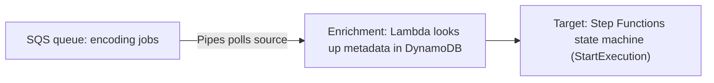

**Why the others are wrong:**
- A: EventBridge rules match against *events already on an event bus*; a standard rule does not itself poll an SQS queue as a direct source the way Pipes does — SQS integration with EventBridge as a direct polled source is specifically a Pipes capability.
- C: Step Functions can be started directly as an EventBridge Pipes target from an SQS source with zero custom Lambda glue code — the premise that a custom poller is always required is outdated and incorrect.
- D: AWS Glue is a separate, unrelated ETL/data-catalog service; "Pipes" and "Glue" are two entirely distinct AWS offerings, not different names for the same thing.

---

## Q10 — Domain 2: Security

A company's KMS customer-managed key currently has automatic key rotation **disabled**. The security
team wants annual rotation enabled going forward, but is concerned about what happens to data
already encrypted under the key's current cryptographic material once rotation begins. What is the
correct expectation?

A. Enabling rotation immediately re-encrypts every object/ciphertext that was ever encrypted under this key, under the new key material, requiring no further action.

B. **Automatic annual key rotation** generates new backing cryptographic material for the key while
   **retaining all previous versions of that material** internally — the key's ARN/ID never changes,
   existing ciphertext remains decryptable (KMS automatically selects the correct historical key
   version needed to decrypt), and newly encrypted data uses the newest material, with no action
   required from the application and no re-encryption of existing data needed or performed.

C. Enabling rotation immediately invalidates and makes permanently undecryptable any data encrypted before rotation was turned on.

D. Key rotation requires the application to track and pass an explicit key-version parameter on every decrypt call going forward, or decryption will fail.

**Correct Answer: B**

**Explanation:** KMS automatic key rotation is designed to be fully transparent to applications:
rotating generates new cryptographic material under the hood while the key's ARN/ID stays the same,
and KMS retains all prior material internally so any previously-encrypted ciphertext remains
decryptable without the application needing to specify a version or re-encrypt anything — new
encryption operations automatically use the latest material. This is Task 2.2 content. See
[`services/security-identity-compliance/kms.md`](../../../services/security-identity-compliance/kms.md).

**Why the others are wrong:**
- A: Rotation does not trigger any automatic re-encryption of existing ciphertext — doing so would require reading and re-writing every encrypted object, which KMS does not do on rotation; existing ciphertext simply remains decryptable using its originally-used key material, retained internally.
- C: Previously-encrypted data remains fully decryptable after rotation; nothing is invalidated — this is the entire point of KMS retaining historical key material rather than discarding it.
- D: Decrypt calls (`kms:Decrypt`) only require the ciphertext blob itself (which embeds metadata identifying which key material version was used); the application never needs to explicitly track or pass version numbers.

---

## Q11 — Domain 3: Testing and Deployment

A team wants to validate that a Step Functions state machine's branching logic (e.g. a `Choice` state
routing differently based on an order's total amount) behaves correctly for several representative
input scenarios, as part of their automated test suite, without needing to actually execute real
Lambda functions, write to a real DynamoDB table, or deploy anything to a real AWS account for every
test run. What is the appropriate testing approach?

A. Step Functions state machines cannot be tested without a live, deployed AWS account; there is no offline or local testing capability of any kind.

B. Use **mocked service integrations for local testing** — running the state machine locally (e.g.
   via the AWS SAM CLI's local Step Functions testing support, or the Step Functions Local Docker
   image) with a mock configuration file that defines canned responses for each `Resource` the state
   machine would normally call, letting the `Choice` state's actual decision logic be exercised
   against each representative input without any real AWS calls.

C. The only valid way to test a `Choice` state's branching logic is to manually read the Amazon States Language JSON and reason about it by eye; there is no executable test harness for this.

D. Deploy the state machine to a dedicated, permanent "test" AWS account and run the full suite of real executions against real resources before every single commit, as the only valid test strategy.

**Correct Answer: B**

**Explanation:** **Step Functions Local** (a downloadable Docker image) supports running and testing
a state machine definition locally, including a **mock configuration** that substitutes canned
responses for whatever `Resource` each state would normally invoke — this lets you exercise the
actual `Choice` state logic (and the rest of the state machine's control flow) against many
representative inputs quickly and deterministically, entirely offline, without real Lambda/DynamoDB
calls or a deployed AWS account. This is Task 3.1 content. See [`../domain-3-testing-deployment/README.md`](../domain-3-testing-deployment/README.md).

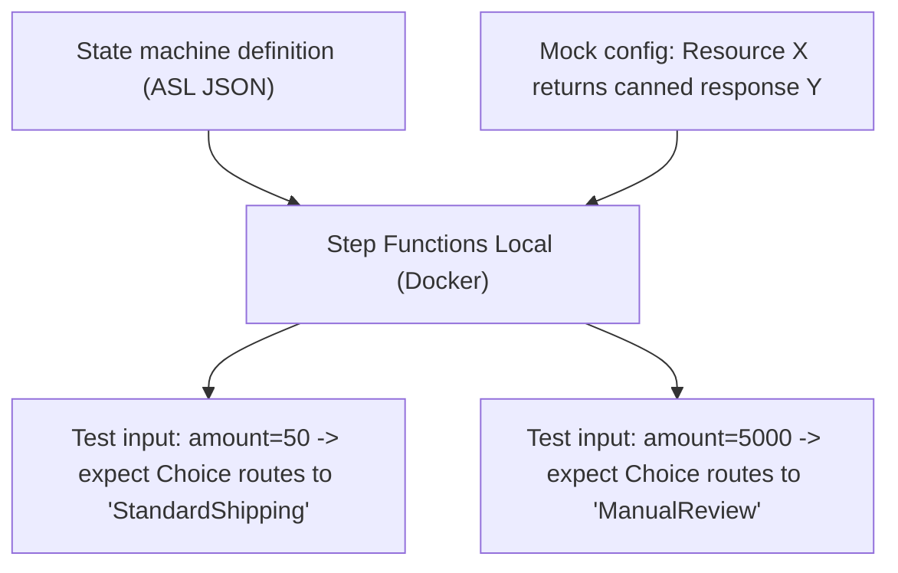

**Why the others are wrong:**
- A: Step Functions Local explicitly provides this offline testing capability — the premise that no such option exists is false.
- C: Manual visual inspection of ASL JSON doesn't actually *execute* the logic against real inputs and can miss subtle bugs an executable test would catch — it's not equivalent to or a substitute for a real test harness.
- D: Running every test against a live, permanently deployed account for every commit is slow, costly, and introduces external dependency flakiness compared to fast, deterministic local/mocked testing — it's not "the only valid strategy," and most teams reserve live-account testing for a smaller set of integration/end-to-end checks.

---

## Q12 — Domain 4: Troubleshooting and Optimization

A team reviews **AWS Trusted Advisor** for their account and sees a flagged check under both the
"Cost Optimization" and "Performance" categories related to EC2 instances. They want to understand
what Trusted Advisor is actually capable of surfacing automatically, without them having to build
custom analysis scripts. Which statement correctly describes Trusted Advisor's role here?

A. Trusted Advisor only evaluates IAM policies for security best practices; it has no cost or performance-related checks at all.

B. **Trusted Advisor** runs a continuously-updated set of checks across cost optimization, performance, security, fault tolerance, and service limits — automatically flagging things like idle/underutilized EC2 instances (cost), instances that would benefit from a newer instance type (performance), and approaching service quota limits, all without custom scripting, though the depth of checks available depends on the account's support plan tier.

C. Trusted Advisor's checks run once at account creation and never again; it provides no ongoing, continuously refreshed analysis.

D. Trusted Advisor is a logging/audit tool identical in function to CloudTrail, with no analysis or recommendation capability at all.

**Correct Answer: B**

**Explanation:** **Trusted Advisor** provides automated checks across five categories (cost
optimization, performance, security, fault tolerance, service limits), refreshed on an ongoing basis
— surfacing things like idle EC2 instances, underutilized EBS volumes, or service quotas approaching
their limit, without the team needing to write custom analysis tooling. The number/depth of checks
available does scale with the account's AWS Support plan (Business/Enterprise unlocks the full
check set). This is Task 4.3 content. See [`services/management-governance/trusted-advisor.md`](../../../services/management-governance/trusted-advisor.md).

**Why the others are wrong:**
- A: Trusted Advisor explicitly covers cost, performance, fault tolerance, and service-limit checks in addition to security — it is not security/IAM-exclusive.
- C: Trusted Advisor checks refresh on an ongoing basis (many run roughly daily, some more frequently), not as a single one-time snapshot at account creation.
- D: CloudTrail is an audit log of API calls; Trusted Advisor is an analysis/recommendation engine producing actionable findings — the two serve fundamentally different purposes and are not equivalent.

---

## Q13 — Domain 1: Development with AWS Services

A streaming clickstream pipeline uses Kinesis Data Firehose to deliver records to S3. Currently, all
records land in one flat S3 prefix regardless of their content, making downstream Athena queries
scan far more data than necessary (since Athena benefits from partition pruning by, say, event date
and event type). The team wants Firehose itself to route each record into a different S3 prefix
based on a field inside the record (e.g. `eventType` and the record's date), without writing a custom
Lambda to split/route records into separate delivery streams. Which Firehose feature does this?

A. Multiple separate Firehose delivery streams, one hardcoded per possible `eventType` value, with the producer choosing which stream to write to based on client-side logic.

B. Firehose **dynamic partitioning**, which can extract specified JSON fields from each record
   (via built-in parsing or a lightweight inline Lambda transform) and use them to construct a
   partitioned S3 key prefix at delivery time (e.g. `eventType=!{partitionKeyFromQuery:eventType}/year=!{timestamp:yyyy}/...`),
   automatically routing each record into the matching partition path within a single delivery stream.

C. S3 Lifecycle policies, which automatically reorganize existing objects into partitioned prefixes based on their content after they've already landed in the flat prefix.

D. Firehose has no partitioning capability; all partition logic must be implemented entirely downstream, after data has already landed in S3, via a separate Glue ETL job.

**Correct Answer: B**

**Explanation:** **Dynamic partitioning** is a native Firehose feature: it extracts specified fields
from incoming records (using JQ-based parsing expressions or an associated Lambda transform) and uses
them to build a partitioned destination prefix per record, all within a single delivery stream — no
need for multiple hardcoded streams or a downstream re-organization step, and it directly improves
Athena/Glue query efficiency via partition pruning on the resulting S3 layout. This is Task 1.1
content. See [`services/analytics/kinesis-family.md`](../../../services/analytics/kinesis-family.md).

**Why the others are wrong:**
- A: Hardcoding one delivery stream per possible `eventType` value is both unscalable (a new event type requires a new stream and a producer code change) and exactly the kind of client-side routing logic dynamic partitioning exists to eliminate.
- C: S3 Lifecycle policies manage storage-class transitions and expiration; they have no capability to reorganize existing objects into new content-derived prefixes.
- D: Dynamic partitioning is a well-documented, native Firehose capability — the premise that all partitioning must happen downstream via a separate Glue job ignores this feature entirely.

---

## Q14 — Domain 3: Testing and Deployment

A team wants every PR opened against their repository's `main` branch to automatically trigger a
quick test suite run and report pass/fail status directly in the PR, before anyone can merge, using
AWS-native CI tooling (not a third-party CI SaaS). Which service/feature combination achieves this?

A. AWS CodeBuild configured as a **webhook-triggered build project** tied to the repository (via
   CodeStar Connections for a GitHub/Bitbucket repo, or CodeCommit's native triggers), filtered to
   pull-request events, reporting build status back to the PR via the provider's native build-status
   API integration (e.g. GitHub check runs).

B. CodePipeline alone, with no CodeBuild involved, since CodePipeline can natively execute test suites without any build-execution service.

C. AWS Config rules, which are the standard AWS-native mechanism for gating pull request merges based on test results.

D. This is only possible using a third-party CI SaaS product; no AWS-native service can react to pull request events or report status back to a PR.

**Correct Answer: A**

**Explanation:** A **CodeBuild project** can be configured to trigger on pull-request webhook events
(via its source provider integration) and report build status back to the originating PR (e.g. as a
GitHub check run) — giving exactly the "AWS-native, PR-triggered test run with inline pass/fail
status" workflow, without requiring a third-party CI product. This is Task 3.1/3.2 content. See
[`services/developer-tools/codebuild.md`](../../../services/developer-tools/codebuild.md).

**Why the others are wrong:**
- B: CodePipeline orchestrates *stages/actions* but relies on an actual build/test execution provider (commonly CodeBuild) to run test commands — it has no built-in test-execution engine of its own.
- C: AWS Config evaluates *resource configuration* compliance against rules; it has no relationship to source-code pull requests or CI test execution.
- D: CodeBuild's native webhook and PR-status-reporting integration is exactly an AWS-native capability for this workflow — the premise that only third-party CI products can do this is incorrect.

---

## Q15 — Domain 1: Development with AWS Services

A team's application occasionally needs to process SQS messages whose payload, after enrichment,
exceeds the SQS maximum message size (256 KB) — for example, attaching a large generated report to a
notification message. They don't want to redesign their entire messaging architecture, just handle
this specific oversized-payload case transparently. Which AWS-provided library and pattern addresses
this without changing the SQS message size limit (which cannot be raised)?

A. Request an AWS Support limit increase to raise the SQS message size limit beyond 256 KB for the specific queue.

B. The **Amazon SQS Extended Client Library**, which automatically detects when a message payload
   exceeds a configurable threshold, transparently uploads the full payload to an S3 bucket, and
   sends a small SQS message containing just a pointer/reference to the S3 object — on the consumer
   side, the same library automatically detects and transparently retrieves the full payload from S3,
   so application code mostly doesn't need to manually implement this split itself.

C. Enable SQS FIFO mode, which automatically raises the per-message size limit to 10 MB for any FIFO queue.

D. Compress every message payload with gzip before sending; SQS automatically decompresses on receipt and this alone permanently solves the size limit for any payload size.

**Correct Answer: B**

**Explanation:** The **SQS Extended Client Library** (available for Java and other SDKs via
community/AWS-provided implementations of the same pattern) implements the "claim check" pattern:
large payloads are stored in S3, with only a lightweight reference traveling through SQS itself —
transparently to most application code using the library, without requiring any SQS size-limit
increase (which, notably, is not something SQS supports raising at all; 256 KB is a hard platform
maximum). This is Task 1.1 content. See [`services/application-integration/sqs.md`](../../../services/application-integration/sqs.md).

**Why the others are wrong:**
- A: SQS's message size limit is a hard platform maximum (256 KB standard, extendable conceptually only via the claim-check pattern described) — there is no AWS Support-provided mechanism to raise it directly for a queue.
- C: FIFO queues have the same 256 KB message size limit as standard queues; FIFO's distinguishing features are ordering and deduplication, not a larger size allowance.
- D: Gzip compression can reduce payload size for *some* content, but it provides no guarantee of staying under the limit for all payloads (a sufficiently large or already-compressed report could still exceed 256 KB even after compression), and SQS does not automatically compress/decompress messages on your behalf at all.

---

## Q16 — Domain 4: Troubleshooting and Optimization

A monthly AWS bill review shows AWS Compute Optimizer flagging several EC2 instances as
"Over-provisioned" with specific smaller instance-type recommendations, based on actual observed
CPU/memory/network utilization over the past 14 days. The team wants to understand what Compute
Optimizer's recommendations are actually based on, and an important caveat before blindly applying
every suggestion. What is correct?

A. Compute Optimizer recommendations are based purely on list price comparisons between instance types, with no actual utilization data considered at all.

B. **Compute Optimizer** analyzes actual historical utilization metrics (CPU, memory if the
   CloudWatch agent is reporting it, network, EBS) to recommend a better-matched instance type/size
   for the *observed* workload pattern — the caveat is that recommendations reflect **historical**
   utilization and may not account for planned future load increases, seasonal spikes outside the
   lookback window, or headroom intentionally reserved for burst capacity, so a review of expected
   future demand should precede applying any downsizing recommendation.

C. Compute Optimizer recommendations are always 100% safe to apply automatically with zero review, since AWS guarantees no workload will ever experience degraded performance after resizing.

D. Compute Optimizer only analyzes RDS instances; it has no EC2-related recommendation capability.

**Correct Answer: B**

**Explanation:** Compute Optimizer uses machine learning over actual CloudWatch utilization metrics
to recommend better-matched instance types/sizes (and generates "Over-provisioned,"
"Under-provisioned," or "Optimized" findings) — but because it's based on *historical* observation
windows, it can't account for future growth, seasonal patterns outside that window, or deliberate
burst-capacity headroom, so teams should sanity-check recommendations against expected future demand
before applying them, rather than blindly auto-applying every suggestion. This is Task 4.3 content.
See [`services/management-governance/cost-management-tools.md`](../../../services/management-governance/cost-management-tools.md).

**Why the others are wrong:**
- A: Compute Optimizer's recommendations are driven by actual utilization telemetry, not simply list-price comparison — price is a factor in showing estimated savings, but the underlying recommendation logic is utilization-based.
- C: Blindly applying every recommendation with no review of future demand can genuinely cause performance problems if growth or seasonal spikes aren't reflected in the historical window used — AWS does not make a zero-risk guarantee here.
- D: Compute Optimizer supports EC2 instances, Auto Scaling groups, EBS volumes, Lambda functions, and ECS on Fargate, among others — it is not RDS-exclusive, and in fact RDS recommendations are a comparatively more recent/limited part of its coverage versus EC2.

---

## Q17 — Domain 2: Security

A company wants to grant read access to a shared S3 bucket to several different internal teams, each
needing access to only their own specific prefix within the bucket (e.g. `team-a/`, `team-b/`), and
wants to manage each team's scoped access as an independent, named object rather than continuously
editing one large, growing bucket policy document every time a new team or prefix is added. Which S3
feature is purpose-built for this kind of decomposed, per-team access management?

A. S3 Object Lock, configured per-prefix with a different retention mode for each team.

B. **S3 Access Points** — named network endpoints, each with its own access policy, that can be
   created per team/use-case, scoped to a specific prefix within the shared bucket; applications
   access the bucket *through* their assigned access point's policy rather than navigating one
   single, ever-growing bucket policy, making it straightforward to add, audit, or revoke one team's
   access independently of the others.

C. S3 Transfer Acceleration, configured with a separate accelerated endpoint per team, which is the standard S3 mechanism for prefix-scoped access control.

D. S3 bucket policies have a hard limit of exactly one `Principal` statement per bucket, making Access Points unnecessary since multi-team access was never actually possible before this limit was introduced.

**Correct Answer: B**

**Explanation:** **S3 Access Points** let you create multiple distinct, named access endpoints for a
single bucket, each with its own access policy (and, since access points support it, scoping to a
specific prefix) — this decomposes what would otherwise be one sprawling bucket policy into
independently manageable units per team/application, directly matching this requirement. This is
Task 2.1/2.2 content. See [`services/storage/s3.md`](../../../services/storage/s3.md).

**Why the others are wrong:**
- A: Object Lock implements WORM (write-once-read-many) retention/legal-hold semantics for compliance; it has no access-control or prefix-scoped-permission capability.
- C: Transfer Acceleration speeds up long-distance data transfer via CloudFront edge locations; it has no access-control or policy-scoping function.
- D: Bucket policies support multiple statements with different principals (there's no "exactly one principal statement" limit) — Access Points exist to make managing many such per-team statements cleaner, not because bucket policies were previously incapable of multi-principal access.

---

## Q18 — Domain 1: Development with AWS Services

An item in a `Payments` table is updated frequently by a background job calling `UpdateItem` with
`BatchWriteItem` calls that occasionally include items DynamoDB couldn't process in the current
request (returned in the response's `UnprocessedItems` field) due to throttling. The team's current
code simply logs a warning when `UnprocessedItems` is non-empty and moves on, silently dropping those
writes. What is the correct handling, and why does the SDK not do this automatically?

A. `BatchWriteItem` automatically retries unprocessed items internally up to 10 times before ever returning a response, so a non-empty `UnprocessedItems` field can never actually occur in practice.

B. The application must explicitly check the `UnprocessedItems` field in the response and **re-submit
   those specific items** in a subsequent `BatchWriteItem` call (typically with exponential backoff
   between retries) until the field comes back empty — `BatchWriteItem` does not transparently retry
   unprocessed items on your behalf because doing so silently, with no visibility or backoff control
   given to the caller, could mask or worsen throttling issues; explicit handling keeps that control
   with the application.

C. `UnprocessedItems` being non-empty always indicates a permanent, non-retryable validation error; those items should be discarded exactly as the current code already does.

D. Switch to `PutItem` calls instead, since `PutItem` has no equivalent unprocessed-items concept and therefore no risk of dropped writes under any load.

**Correct Answer: B**

**Explanation:** `BatchWriteItem` performs multiple independent writes in one request but does not
guarantee all of them succeed — under provisioned-throughput pressure, some items can be returned in
`UnprocessedItems` rather than being silently retried by the SDK. The application is responsible for
checking this field and resubmitting those specific items (ideally with increasing backoff) until
none remain unprocessed; silently ignoring this field, as the current code does, causes exactly the
data-loss bug described. This is Task 1.3 content. See [`services/database/dynamodb.md`](../../../services/database/dynamodb.md).

**Why the others are wrong:**
- A: `BatchWriteItem` can and does return non-empty `UnprocessedItems` under real throttling conditions — there's no internal automatic-retry-to-10-attempts behavior that makes this field impossible to see in practice.
- C: `UnprocessedItems` specifically reflects items not processed due to throttling/capacity constraints (a transient, retryable condition), not a validation failure — treating it as permanent and discarding those writes is exactly the bug causing data loss here.
- D: `PutItem` (a single-item operation) doesn't have a batch-level "unprocessed items" concept because it isn't a batch operation at all, but it still throttles under capacity pressure (returning a `ProvisionedThroughputExceededException` the caller must handle/retry) — switching to it doesn't eliminate the need for retry handling, it just changes its shape.

---

## Q19 — Domain 1: Development with AWS Services

A read-heavy DynamoDB table backing a product catalog serves the same small set of "hot" items (top
sellers) to a very large fraction of all read requests. The team wants microsecond-level read
latency for these items specifically, significantly faster than DynamoDB's own typical single-digit-
millisecond response time, without re-architecting the application's DynamoDB API calls. Which AWS
service is purpose-built for this?

A. DynamoDB Streams, configured with a `NEW_IMAGE` view, which automatically caches every item read in front of the table with no additional service needed.

B. **DynamoDB Accelerator (DAX)**, an in-memory caching layer that sits in front of DynamoDB,
   API-compatible with the existing DynamoDB SDK calls (`GetItem`, `Query`, `Scan`, etc. via the DAX
   client) — cache hits are served in microseconds rather than the single-digit milliseconds typical
   of a direct DynamoDB read, with minimal to no application code restructuring required beyond
   pointing the SDK client at the DAX cluster endpoint.

C. Amazon ElastiCache for Redis, which is a mandatory prerequisite that must sit in front of DAX before DAX itself can be used with DynamoDB.

D. Increasing the table's provisioned read capacity units to an arbitrarily high number, which directly reduces per-request latency into the microsecond range regardless of capacity mode.

**Correct Answer: B**

**Explanation:** **DAX** is purpose-built as a DynamoDB-specific, API-compatible in-memory cache:
swapping the standard DynamoDB client for the DAX client (minimal code change) routes reads through
the DAX cluster first, serving cache hits in microseconds — directly addressing a hot-item,
read-heavy latency requirement without needing to redesign the application's DynamoDB access
patterns. This is Task 1.3 content. See [`services/database/dynamodb.md`](../../../services/database/dynamodb.md).

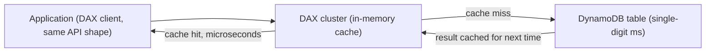

**Why the others are wrong:**
- A: DynamoDB Streams is a change-data-capture feed for reacting to writes; it has no caching behavior and does not sit in the read path at all.
- C: ElastiCache for Redis is a separate, general-purpose caching service entirely independent of DAX — DAX has no dependency on or relationship to ElastiCache, and using Redis as a cache in front of DynamoDB is a different, alternative (manually-integrated) pattern from DAX, not a prerequisite for it.
- D: Provisioned capacity (RCU/WCU) controls *throughput*, not the fundamental per-request latency floor of a direct DynamoDB read, which remains in the single-digit-millisecond range regardless of how much capacity is provisioned — only an actual caching layer like DAX gets into microsecond territory.

---

## Q20 — Domain 3: Testing and Deployment

A team wants to validate, before deploying a change to a production EventBridge rule, that a sample
event they expect to receive will actually match the rule's event pattern as currently written — as
part of their CI pipeline, without having to publish a real test event to the live event bus and
observe whether the target actually fired. Which AWS CLI command/API is designed for this offline
pattern validation?

A. `aws events put-events`, which is the only way to test an event pattern, requiring a live event bus and live target invocation every time.

B. `aws events test-event-pattern`, which takes an event pattern and a sample event JSON as input and
   returns a simple boolean indicating whether that specific event would match the pattern — entirely
   offline, with no event actually published to any bus and no target invoked.

C. `aws events describe-rule`, which automatically runs a battery of pre-generated sample events against the rule and reports a pass/fail summary.

D. EventBridge rule patterns cannot be tested before being deployed; the only validation method is observing production target invocation logs after a real event is received.

**Correct Answer: B**

**Explanation:** `aws events test-event-pattern` is a dedicated, offline validation API: given an
event pattern and a sample event, it returns whether the sample would match — no real event bus
publish, no target invocation, nothing deployed — letting a CI pipeline validate pattern-matching
logic for expected (and explicitly *unexpected*, to catch over-broad matching) sample events before
a rule change ever reaches production. This is Task 3.1 content. See [`services/application-integration/eventbridge.md`](../../../services/application-integration/eventbridge.md).

**Why the others are wrong:**
- A: `put-events` actually publishes a real event to a live bus, which is exactly the "live event bus and target invocation" overhead the scenario wants to avoid for a simple pattern-matching check.
- C: `describe-rule` only returns the rule's own configuration (its pattern, state, targets); it has no built-in battery of sample-event testing.
- D: `test-event-pattern` is specifically AWS's documented, supported offline validation mechanism for exactly this need — the premise that no pre-deployment testing method exists is false.

---

## Q21 — Domain 4: Troubleshooting and Optimization

A company's monthly AWS Cost Explorer report shows a steadily growing EC2-related charge that doesn't
correspond to any actively-running, attached EC2 instance the team can find in the console. After
investigation, they discover several unattached Elastic IP addresses and an idle NAT Gateway left
over from a decommissioned environment. Choose **TWO** correct statements about this class of cost
issue and how to prevent recurrence.

A. This is an **orphaned resource** cost leak — resources (unattached Elastic IPs, idle NAT Gateways, unattached EBS volumes, etc.) that continue to incur charges after the workload they supported was decommissioned, simply because no one explicitly deleted them.

B. **Trusted Advisor**'s cost optimization checks and **AWS Config rules** (e.g. flagging unattached EIPs/volumes) can automatically detect these ongoing leaks on an ongoing basis, and tagging/cleanup automation (e.g. a scheduled Lambda function auditing for untagged or orphaned resources) helps prevent recurrence.

C. This is expected, unavoidable AWS pricing behavior with no tooling available to detect or prevent it; manual quarterly audits are the only option.

D. Elastic IP addresses and NAT Gateways are always free regardless of attachment state, so this cost must actually originate from a different, unrelated service being mislabeled in Cost Explorer.

E. The only way to find orphaned resources like this is to manually inspect every resource type in every region one at a time with no automated assistance available from any AWS service.

**Correct Answer: A, B**

**Explanation:** **Orphaned resources** — infrastructure left behind after its associated workload is
torn down, but not itself cleaned up — are a very common, specific cost-leak pattern. Unattached
Elastic IPs incur an hourly charge specifically *because* they're unattached, and NAT Gateways bill
by the hour regardless of whether anything is actively using them. Trusted Advisor's cost checks and
targeted AWS Config rules (and tagging-based cleanup automation) are the standard tools for
detecting/preventing this pattern going forward. This is Task 4.3 content. See
[`services/management-governance/cost-management-tools.md`](../../../services/management-governance/cost-management-tools.md)
and [`services/management-governance/trusted-advisor.md`](../../../services/management-governance/trusted-advisor.md).

**Why the others are wrong:**
- C: This is a well-known, tooling-detectable cost pattern, not an unavoidable charge with no automated detection option — the premise understates AWS's actual cost-governance tooling.
- D: Unattached Elastic IPs specifically incur an hourly charge *because* they are unattached (to encourage releasing unused addresses), and NAT Gateways always bill hourly regardless of utilization — these are real, correctly-attributed charges, not a mislabeling artifact.
- E: Trusted Advisor and Config rules both provide automated detection across regions for exactly these resource types — manual, one-at-a-time inspection is not the only available approach.

---

## Q22 — Domain 2: Security

A company's Cognito **Identity Pool** supports both authenticated users (who signed in via a User
Pool) and unauthenticated "guest" users (browsing before sign-in). The security team wants to ensure
guest users receive a much more restricted set of AWS permissions (e.g. read-only access to a public
product catalog) than authenticated users (who can write reviews, manage their own cart, etc.).
Which Identity Pool feature correctly enforces this distinction?

A. Identity Pools issue identical IAM role credentials to every identity regardless of authentication state; distinguishing guest from authenticated access requires a separate, custom-built authorization layer entirely outside of Cognito.

B. Identity Pools support configuring **separate IAM roles for authenticated versus unauthenticated
   identities** (and, for authenticated users, optionally more granular **role mapping rules** based
   on token claims) — guest (unauthenticated) identities are automatically vended credentials for the
   unauthenticated role (scoped narrowly, e.g. read-only), while signed-in users get the authenticated
   role (or a more specific mapped role), enforced natively by the Identity Pool's own configuration.

C. Guest access must be entirely disabled at the Identity Pool level before any authenticated-user role can be configured; the two cannot coexist in one Identity Pool.

D. The distinction between guest and authenticated users can only be enforced in application code after credentials are already issued; Cognito itself has no native concept of separate roles for the two cases.

**Correct Answer: B**

**Explanation:** Identity Pools natively support distinct **authenticated role** and
**unauthenticated role** configurations — unauthenticated (guest) identities are vended credentials
for the (typically much more restricted) unauthenticated role automatically, while authenticated
identities get the authenticated role (optionally refined further via role mapping rules keyed on
token claims like Cognito group membership) — this is enforced directly by Cognito/STS at credential-
vending time, not something the application has to separately implement. This is Task 2.1 content.
See [`services/security-identity-compliance/cognito.md`](../../../services/security-identity-compliance/cognito.md).

**Why the others are wrong:**
- A: This is exactly backwards — distinct authenticated/unauthenticated role configuration is a core, native Identity Pool feature specifically designed to avoid needing a separate custom authorization layer for this distinction.
- C: Identity Pools fully support enabling guest (unauthenticated) access *alongside* authenticated access simultaneously — enabling one does not require disabling the other.
- D: The authenticated-vs-unauthenticated role distinction is enforced by Cognito/STS at the moment credentials are issued (before any application code even runs), not something left entirely to application-level enforcement after the fact.

---

## Q23 — Domain 1: Development with AWS Services

A team stores user-uploaded images in S3 and needs to serve a **resized, watermarked** version of
each image on the fly whenever it's requested — without pre-generating every possible resized
variant in advance, and without clients having to call a separate image-processing API before
fetching from S3. Which S3 feature supports this transform-on-GET pattern transparently at the S3
API layer?

A. S3 Select, which can apply arbitrary binary image transformations (resize, watermark) to any object type via SQL-like expressions.

B. **S3 Object Lambda**, which attaches a Lambda function to a specific S3 Object Lambda Access
   Point — standard `GetObject` requests made through that access point are intercepted, and the
   attached Lambda function can transform the retrieved object's content (e.g. resize and watermark
   the image) before returning it to the caller, all transparently from the client's perspective
   (which just calls `GetObject` as normal, against the Object Lambda Access Point).

C. S3 Transfer Acceleration, which automatically applies any configured image-processing Lambda to objects in transit.

D. S3 events + SNS, which synchronously transform every GetObject request's response in real time with no additional access point configuration.

**Correct Answer: B**

**Explanation:** **S3 Object Lambda** is purpose-built for exactly this "transform on GET,
transparently, without pre-generating every variant" use case: a Lambda function is wired to an
Object Lambda Access Point, and any `GetObject` call routed through that access point triggers the
function to process the underlying object (resize, watermark, redact, format-convert, etc.) before
the response is returned to the caller — the caller's code is just a normal `GetObject` call against
the access point. This is Task 1.1 content. See [`services/storage/s3.md`](../../../services/storage/s3.md).

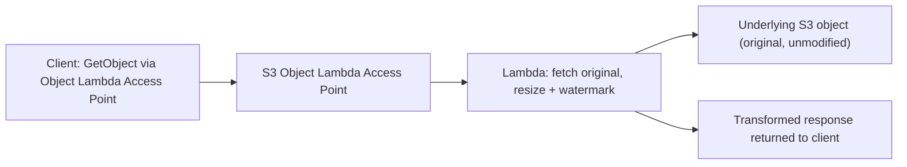

**Why the others are wrong:**
- A: S3 Select applies SQL-like filtering/projection to structured text data (CSV/JSON/Parquet); it has no binary image-manipulation capability like resizing or watermarking.
- C: Transfer Acceleration speeds up data transfer via CloudFront edge locations; it has no content-transformation capability at all.
- D: S3 event notifications are asynchronous, fire-and-forget notifications about object lifecycle events (like `PutObject`) — they do not intercept and synchronously transform the response body of a `GetObject` call in real time; that is specifically what Object Lambda does.

---

## Q24 — Domain 3: Testing and Deployment

A team wants an automated way to verify that a new application version works correctly against the
full, real production-like traffic pattern across two AWS Regions simultaneously (active-active),
before fully promoting it — and wants the ability to promote region by region rather than all at
once, in case an issue surfaces in the first region before the second is touched. Which deployment
approach fits a multi-region active-active rollout with staged, per-region promotion?

A. A single CloudFormation StackSet update targeting both regions simultaneously with no sequencing option; StackSets can only ever update every target region atomically, all at once.

B. A **pipeline with sequential, per-region deployment stages** (e.g. a CodePipeline with a Region-A
   deploy stage followed by a manual approval or automated validation gate, then a Region-B deploy
   stage) — each region's CloudFormation/CDK deployment runs independently, so validation/rollback for
   Region A can happen before Region B is ever touched, directly matching the staged promotion
   requirement.

C. Deploy to both regions using a single `aws cloudformation deploy` command with a `--regions us-east-1,eu-west-1` flag, which deploys and validates both regions together as one atomic, rollback-linked unit.

D. Multi-region active-active deployments are not supported by any AWS deployment tooling; this requires an entirely custom, non-AWS orchestration system.

**Correct Answer: B**

**Explanation:** Building the pipeline with **separate, sequential per-region stages** — each running
its own regional CloudFormation/CDK deployment, separated by a validation gate or manual approval —
gives exactly the staged, independently-rollback-able promotion the scenario needs: Region A's issues
can be caught and addressed before Region B is ever deployed to, rather than both regions being
changed as one inseparable atomic unit. This is Task 3.2/3.3 content. See [`../domain-3-testing-deployment/README.md`](../domain-3-testing-deployment/README.md).

**Why the others are wrong:**
- A: StackSets actually *do* support sequential, batched multi-region/account rollout (with configurable concurrency and failure tolerance settings) rather than being limited to one single atomic all-regions-at-once update — but more importantly, this answer's premise of "no sequencing option at all" misdescribes StackSets' real, more flexible deployment-ordering capability.
- C: The AWS CLI's `cloudformation deploy` command does not have a multi-region, atomically-linked `--regions` flag that deploys to several regions as one rollback-linked transaction — each region's stack deployment is independent, and there's no such single-command, cross-region atomic operation.
- D: AWS pipeline tooling (CodePipeline, StackSets, or simply parameterized sequential stages in any CI/CD system) fully supports building staged multi-region rollouts — the premise that this requires an entirely non-AWS system is false.

---

## Q25 — Domain 1: Development with AWS Services

A mobile app uploads JPEG photos directly to a Lambda function through API Gateway's Lambda proxy
integration. The team notices uploaded images arrive corrupted — the bytes the Lambda function
receives don't match the original file. API Gateway is base64-encoding text payloads by default,
but image data is binary. Which API Gateway configuration correctly handles binary payloads through
a Lambda proxy integration?

A. Nothing needs to change; Lambda proxy integration always passes binary payloads through byte-for-byte with no encoding step, so the corruption must be a client-side bug.

B. Configure the API's **binary media types** list (e.g. `image/jpeg`, or `*/*` for all types) at the
   API level — for a request whose `Content-Type` matches a configured binary media type, API Gateway
   base64-encodes the raw bytes into the proxy event's `body` and sets `isBase64Encoded: true`, and the
   Lambda function must decode the body from base64 before treating it as binary image data.

C. Binary payloads are only supported by HTTP APIs, never REST APIs; the team must migrate the entire API to an HTTP API before any image upload can work correctly.

D. Switch the integration from Lambda proxy to a VTL mapping template, since VTL automatically and transparently converts any binary payload to base64 with no API-level binary media type configuration needed.

**Correct Answer: B**

**Explanation:** API Gateway REST APIs require the API's **binary media types** to be explicitly
configured; for a request whose `Content-Type` header matches one of those configured types, API
Gateway base64-encodes the payload before including it in the Lambda proxy integration's event,
setting `isBase64Encoded: true` so the function knows to `base64.b64decode()` the body before treating
it as binary image data — without this configuration, API Gateway doesn't know to apply base64
encoding to binary content and the payload can be mangled. This is Task 1.1 content. See
[`services/networking-content-delivery/api-gateway.md`](../../../services/networking-content-delivery/api-gateway.md).

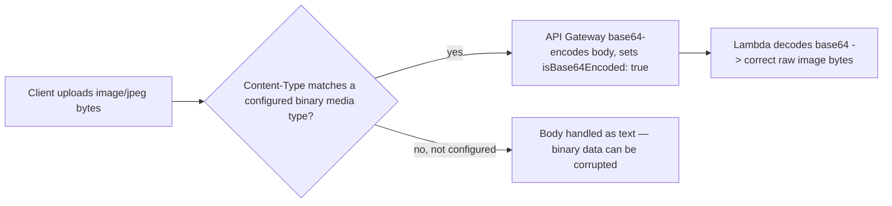

**Why the others are wrong:**
- A: Lambda proxy integration does not automatically detect and preserve arbitrary binary content without the API's binary media types being explicitly configured — this is precisely the missing step causing the corruption described.
- C: Binary payload support (via binary media types and `isBase64Encoded`) is available for REST APIs too — it is not an HTTP-API-exclusive capability requiring a full migration.
- D: VTL mapping templates operate on text-based transformations of a payload; they do not provide the API-level binary media type configuration needed to correctly base64-encode binary content in the first place, and in fact VTL templates are generally a poor fit for binary payload handling compared to proxy integration with binary media types configured.

---

## Q26 — Domain 2: Security

A security team runs an integration between **GuardDuty** and **Security Hub**, and wants any new
`CRITICAL` severity GuardDuty finding to automatically trigger an immediate, specific remediation
action (e.g. isolating the affected EC2 instance by changing its security group to a fully-locked-
down one) without a human having to notice and manually act on the finding first. Which AWS
architecture achieves this automated response?

A. GuardDuty findings automatically remediate themselves with no further configuration; this is a built-in, default GuardDuty behavior requiring no additional resources.

B. Route GuardDuty findings (directly, or via Security Hub's aggregated findings) to an **EventBridge
   rule** matching on finding severity/type, with a **Lambda function target** that performs the
   specific remediation action (e.g. calling `ec2:ModifyInstanceAttribute` to swap the security group)
   — this "detect via GuardDuty/Security Hub, route via EventBridge, act via Lambda" pattern is the
   standard automated security-response architecture.

C. AWS Config rules are the only mechanism capable of triggering automated remediation; GuardDuty findings cannot be connected to any remediation action under any architecture.

D. CloudTrail Insights automatically executes any Lambda function tagged with `auto-remediate: true` whenever a GuardDuty finding of any severity is created, with no EventBridge rule needed.

**Correct Answer: B**

**Explanation:** The standard automated-response pattern is: GuardDuty (or Security Hub, which
aggregates GuardDuty findings alongside others) emits findings as events; an **EventBridge rule**
filters for the specific severity/type of interest; and the rule's **target** (typically a Lambda
function, or Step Functions for a multi-step response) performs the actual remediation action —
fully automating detection-to-response with no human needing to notice the finding first. This is
Task 2.1/2.2 content. See [`services/security-identity-compliance/guardduty.md`](../../../services/security-identity-compliance/guardduty.md)
and [`services/security-identity-compliance/security-hub-and-inspector.md`](../../../services/security-identity-compliance/security-hub-and-inspector.md).

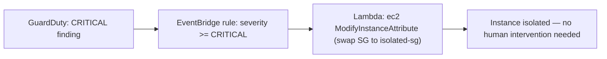

**Why the others are wrong:**
- A: GuardDuty detects and reports findings; it has no built-in automatic remediation action of its own — any actual response action must be explicitly wired up via the EventBridge+Lambda (or similar) pattern.
- C: AWS Config rules can trigger Systems Manager Automation remediations for Config-rule *compliance* findings, but that's a separate mechanism from GuardDuty findings — GuardDuty findings integrate with automated response via EventBridge, not exclusively through Config.
- D: CloudTrail Insights detects API call volume anomalies; it has no finding-routing or remediation-execution capability, and there is no such generic `auto-remediate: true` tag convention that any AWS service automatically acts on.

---

## Q27 — Domain 2: Security

An API Gateway REST API uses a custom Lambda authorizer (`TOKEN` type) to validate a proprietary
bearer token format the company uses (not a standard JWT/OIDC token Cognito or a JWT authorizer could
handle natively). The team notices every single request re-invokes the authorizer Lambda function,
even when the exact same token is presented repeatedly within a short time window, adding
unnecessary latency and cost. What configuration reduces this?

A. API Gateway always re-invokes a Lambda authorizer on every single request with no way to change this behavior, regardless of configuration.

B. Configure the authorizer's **`authorizerResultTtlInSeconds`** (the authorizer cache TTL, up to
   3600 seconds) — API Gateway will cache the authorizer's policy response keyed by the identity
   source (e.g. the token value) for that duration, and skip re-invoking the Lambda function for
   repeated requests with the same identity source within the TTL window.

C. Switch to a REQUEST-type authorizer, which is inherently always cached indefinitely regardless of any TTL setting, unlike TOKEN-type authorizers.

D. Enable API Gateway stage-level response caching, which automatically also caches all authorizer decisions as a side effect with no separate authorizer-specific setting.

**Correct Answer: B**

**Explanation:** API Gateway Lambda authorizers support an **authorizer cache**, controlled by
`authorizerResultTtlInSeconds` — when set (default is non-zero, but it's fully configurable, including
down to 0 to disable caching), API Gateway caches the authorizer's returned policy by its identity
source value, so repeated requests presenting the same token within the TTL window skip invoking the
Lambda function entirely, directly reducing both latency and cost. This is Task 1.1 content. See
[`services/networking-content-delivery/api-gateway.md`](../../../services/networking-content-delivery/api-gateway.md).

**Why the others are wrong:**
- A: The authorizer cache TTL is explicitly configurable (0 to 3600 seconds) — API Gateway does not unconditionally re-invoke the authorizer on every request when a non-zero TTL is set.
- C: Both `TOKEN` and `REQUEST` type authorizers support the same `authorizerResultTtlInSeconds` caching mechanism (keyed differently — by the token for `TOKEN` type, by a composite of specified identity sources for `REQUEST` type); neither is "inherently always cached indefinitely" by default.
- D: Stage-level response caching caches full method *responses*; it is a separate feature from the authorizer's own cache and does not automatically extend to caching authorization decisions.

---

## Q28 — Domain 3: Testing and Deployment

A team has adopted **trunk-based development** (everyone commits small, frequent changes directly
to `main`, feature flags gate incomplete work) after previously using long-lived feature branches
with a GitFlow-style model. They need to redesign their CodePipeline trigger configuration
accordingly. What is the key pipeline-trigger implication of this shift?

A. No change is needed; pipeline trigger configuration is entirely independent of whichever branching strategy a team uses.

B. With trunk-based development, the pipeline should trigger on **every merge/commit to `main`**
   directly (since that's now the single, continuously-deployable branch), typically combined with
   feature flags (e.g. via AWS AppConfig) to hide incomplete functionality in production rather than
   relying on long-lived branches to isolate unfinished work — whereas a GitFlow-style pipeline
   historically triggered separately per long-lived branch (`develop`, `release/*`, etc.), each
   representing a different environment stage.

C. Trunk-based development requires disabling all automated pipeline triggers entirely, relying exclusively on manual, scheduled nightly builds instead.

D. GitFlow and trunk-based development produce functionally identical CI/CD pipelines in every respect, since both eventually merge code into some branch.

**Correct Answer: B**

**Explanation:** Trunk-based development collapses the branching model down to essentially one
continuously-integrated branch (`main`), so the pipeline's trigger naturally becomes "every commit/
merge to `main`" rather than separate triggers per long-lived branch representing different
environments — unfinished functionality is hidden via feature flags (rather than via a separate,
unmerged branch), which is why this shift often also drives adoption of a dynamic feature-flagging
tool. This is Task 3.2 content. See [`../domain-3-testing-deployment/README.md`](../domain-3-testing-deployment/README.md).

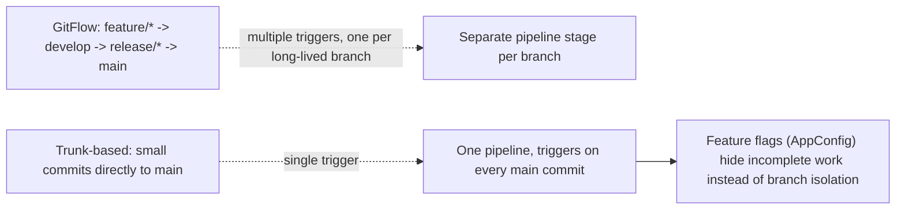

**Why the others are wrong:**
- A: Branching strategy directly shapes what a pipeline should trigger on and how many long-lived environment-mapped branches/triggers are needed — the two are closely linked design decisions, not independent.
- C: Trunk-based development is explicitly associated with *more* frequent automated integration/deployment (not less), typically meaning pipelines trigger more often, not that automated triggers are disabled.
- D: The two branching models produce meaningfully different pipeline trigger structures (one trigger per long-lived branch vs. one trigger on a single trunk) and different mechanisms for isolating incomplete work (branch isolation vs. feature flags) — they are not functionally identical.

---

## Q29 — Domain 4: Troubleshooting and Optimization

A media company serves video segments from S3 via CloudFront, and notices their CloudFront cache
hit ratio is unexpectedly low (most requests are "misses," going all the way back to the S3 origin)
even though the same video files are being requested repeatedly by many different users. Investigation
shows the application appends a unique per-session query string parameter (e.g.
`?sessionToken=abc123`) to every video segment URL, even though the video content itself never varies
by session. What is the root cause, and the fix?

A. CloudFront never caches any response containing a query string under any configuration, so query strings must be removed entirely from all URLs for any caching to occur.

B. By default, CloudFront's cache key can include the full query string, meaning each unique
   `sessionToken` value produces a **distinct cache key** even though the underlying object is
   identical — causing a cache miss (and separate origin fetch) for what should be the exact same
   cached response. The fix is configuring the distribution's **cache policy** to exclude the
   irrelevant query string parameter(s) from the cache key (while still forwarding the parameter to
   the origin if needed for logging/other purposes), so requests differing only by session token share
   one cache entry.

C. CloudFront caching is entirely origin-controlled and unrelated to query strings; the low hit ratio must be caused by an S3 bucket policy issue instead.

D. The only fix is switching from S3 as the origin to an Application Load Balancer, since ALB origins are cached differently with respect to query strings.

**Correct Answer: B**

**Explanation:** CloudFront's **cache key** configuration (via a cache policy) determines which parts
of the request (including which specific query string parameters, if any) distinguish one cached
object from another — if the cache key includes the full query string by default/configuration, a
session-unique parameter that doesn't actually affect the response content still fragments the cache
into effectively one entry per request, tanking the hit ratio. Explicitly excluding irrelevant
parameters from the cache key (while optionally still forwarding them to the origin) restores proper
caching. This is Task 4.3 content. See [`services/networking-content-delivery/cloudfront.md`](../../../services/networking-content-delivery/cloudfront.md).

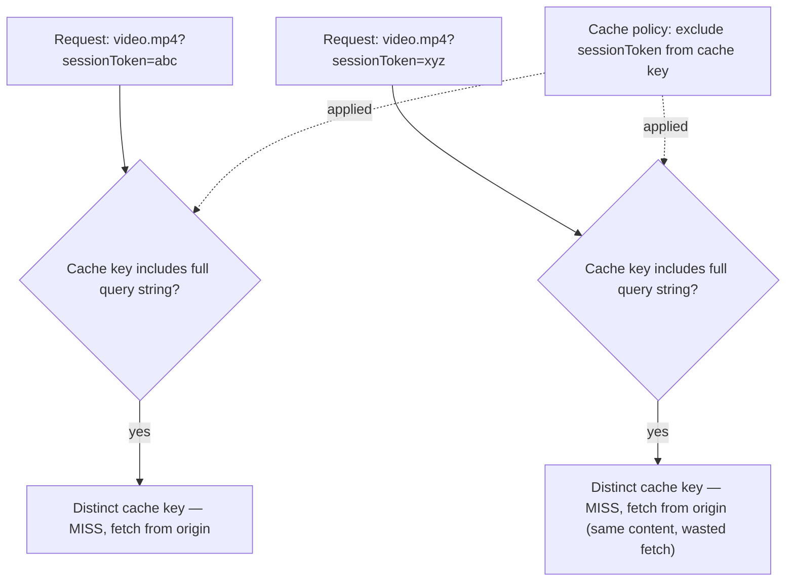

**Why the others are wrong:**
- A: CloudFront can and does cache responses for requests that include query strings; the behavior is configurable (which parameters, if any, participate in the cache key), not an unconditional "never cache with any query string" rule.
- C: S3 bucket policy governs access authorization; it has no relationship to CloudFront's caching/cache-key behavior, which is the actual, clearly identifiable root cause here.
- D: Switching origin types doesn't change CloudFront's own cache-key configuration logic — the fix is adjusting the distribution's cache policy regardless of what origin type is in use.

---

## Q30 — Domain 2: Security

A Lambda function processes documents uploaded by customers, and occasionally those documents
contain accidental leaks of sensitive personal data (SSNs, credit card numbers) that get written
unredacted into the function's own CloudWatch Logs during debugging/error logging, creating a
compliance exposure. The team wants to catch and remove this kind of sensitive data from log output
automatically, with minimal custom regex-writing. Which AWS service is purpose-built for detecting
this category of sensitive data in text content?

A. AWS X-Ray, by enabling a "PII detection" annotation mode that automatically redacts sensitive data from all trace segments and subsegments.

B. **Amazon Comprehend**, specifically its PII (personally identifiable information) detection
   capability (`DetectPiiEntities`), which can be run against text content (e.g. the document text or
   log lines before they're written) to identify categories like SSNs, credit card numbers, and names
   — enabling the function to redact/mask detected entities before logging, without hand-writing and
   maintaining custom regex patterns for every PII category.

C. AWS Config, which is the standard AWS service for detecting PII inside arbitrary unstructured text content.

D. There is no AWS service capable of detecting PII in unstructured text; this must be entirely hand-built using custom regular expressions with no managed-service assistance.

**Correct Answer: B**

**Explanation:** **Amazon Comprehend**'s PII detection APIs (`DetectPiiEntities`,
`ContainsPiiEntities`) use pre-trained NLP models to identify categories of sensitive data (names,
SSNs, credit card numbers, addresses, and more) within arbitrary text — a managed alternative to
hand-rolling and maintaining a comprehensive set of regex patterns, directly applicable to
redacting sensitive content before it's written to logs. This is Task 2.2/2.3-adjacent content
(the same "don't leak sensitive data in logs" principle Task 2.3 applies to AI-specific log content).
See [`certifications/dva-c03/domain-2-security/ai-service-security-risks.md`](../domain-2-security/ai-service-security-risks.md).

**Why the others are wrong:**
- A: X-Ray has no PII-detection or automatic redaction capability for trace data; it records whatever annotations/metadata the application code explicitly provides.
- C: AWS Config evaluates resource configuration compliance; it has no text-content-analysis or PII-detection capability of any kind.
- D: Comprehend's managed PII detection explicitly exists to avoid the custom-regex-maintenance burden described — the premise that no managed-service option exists is incorrect.

---

## Q31 — Domain 1: Development with AWS Services

A document-processing pipeline uses an AppSync GraphQL API where a mutation needs to trigger a
fairly complex piece of business logic (calling an external payment API, then writing to two
different DynamoDB tables conditionally) that doesn't map cleanly to AppSync's built-in VTL
mapping-template capabilities for a single resolver step. The team wants to write this logic in
regular application code (e.g. Node.js) rather than VTL, while still using AppSync as the GraphQL
layer. Which resolver option fits?

A. VTL mapping templates are the only resolver mechanism AppSync supports; any resolver logic beyond simple data-source calls must be VTL regardless of complexity.

B. A **direct Lambda resolver** (or a Lambda function as one step of a **pipeline resolver**),
   where the mutation is wired directly to a Lambda function that receives the GraphQL resolver
   context as its event and can implement arbitrarily complex logic in a standard programming
   language (calling external APIs, writing to multiple tables conditionally, etc.), returning a
   result AppSync maps back into the GraphQL response.

C. AppSync requires migrating the entire API off of AppSync and onto a plain Lambda-backed REST API via API Gateway if any single resolver's logic is too complex for VTL.

D. AppSync JavaScript resolvers (APPSYNC_JS runtime) are a deprecated legacy feature that AWS recommends against using for any new resolver logic.

**Correct Answer: B**

**Explanation:** AppSync supports resolvers backed directly by a **Lambda function** (either as a
simple unit resolver, or as one function within a **pipeline resolver**), letting arbitrarily complex
business logic be implemented in a normal programming language/runtime rather than being forced into
VTL — the Lambda function receives the resolver's event context and returns data AppSync maps into
the GraphQL response, fitting exactly this "complex logic beyond simple data-source mapping" need.
This is Task 1.1 content. See [`services/application-integration/appsync.md`](../../../services/application-integration/appsync.md).

**Why the others are wrong:**
- A: VTL is one resolver option among several (including direct Lambda resolvers and the newer JavaScript resolver runtime); it is not the sole supported mechanism for any resolver logic regardless of complexity.
- C: Migrating off AppSync entirely for one complex resolver is a drastic, unnecessary architectural change when Lambda resolvers already solve this exact problem natively within AppSync.
- D: AppSync's JavaScript (APPSYNC_JS) resolver runtime is an actively supported, AWS-recommended *modern alternative* to VTL for many resolver use cases (not a deprecated legacy feature) — though for the most complex, free-form logic described here, a full Lambda function resolver remains the most flexible option.

---

## Q32 — Domain 3: Testing and Deployment

A team's CloudFormation stack manages a critical, stateful RDS instance alongside several stateless
resources (Lambda functions, an API Gateway API). They want to prevent a future, accidental
`UpdateReplacePolicy`-less change (e.g. someone unintentionally modifying a property that would force
RDS instance *replacement*, destroying the database) from ever actually executing, even if someone
runs an update without first carefully reviewing a change set. Which CloudFormation feature adds this
extra, standing safety net?

A. `DeletionPolicy: Retain` on the RDS resource, which is sufficient on its own to block any update that would otherwise replace the resource.

B. A **stack policy** applied to the stack, explicitly denying `Update:Replace` (and optionally
   `Update:Delete`) actions on the RDS resource's logical ID — once applied, CloudFormation will
   reject any stack update attempting to replace or delete that specific resource, regardless of
   whether the person running the update noticed the change set's replacement warning or not.

C. IAM permissions boundaries on the deploying role, which are CloudFormation's only mechanism for preventing resource replacement during a stack update.

D. Stack policies apply automatically to every resource in every stack by default with no explicit configuration needed, fully preventing all replacement scenarios out of the box.

**Correct Answer: B**

**Explanation:** A **stack policy** is a JSON document (separate from the template) that can
explicitly restrict what update actions are allowed on specific logical resource IDs within the stack
— denying `Update:Replace`/`Update:Delete` on the RDS resource means CloudFormation will refuse to
perform that action during *any* future stack update, acting as a standing guardrail independent of
whether a human carefully reviewed a change set beforehand. This is Task 3.2 content. See
[`services/management-governance/cloudformation.md`](../../../services/management-governance/cloudformation.md).

**Why the others are wrong:**
- A: `DeletionPolicy: Retain` controls what happens to the *old* physical resource during a replace/delete (keeping it instead of deleting it) — it does not, by itself, prevent the replacement operation from being triggered in the first place; a stack policy is the mechanism that blocks the action itself.
- C: Permissions boundaries constrain what IAM *actions* a role can perform generally; they have no CloudFormation-resource-logical-ID-specific update-action restriction capability — that's specifically what stack policies provide.
- D: Stack policies must be explicitly applied and configured per stack; there is no default, automatic, zero-configuration stack policy protecting every resource from replacement out of the box.

---

## Q33 — Domain 2: Security

A Lambda function processes incoming S3 event notifications. The function's execution role trusts
only `lambda.amazonaws.com` in its trust policy (standard), but the team is worried about a
**confused deputy** scenario: could a different AWS account somehow trick S3 into invoking *their*
Lambda function (in the victim account) using an S3 bucket the attacker controls in their own
account, by configuring that bucket's notification to target the victim's function ARN? Which
specific IAM condition key, used on the Lambda function's resource-based policy, directly closes this
gap?

A. `aws:RequestedRegion`, which restricts the invocation to a specific AWS Region and inherently prevents any confused-deputy scenario regardless of which account owns the triggering bucket.

B. **`aws:SourceAccount`** (and often `aws:SourceArn` for extra specificity, naming the exact expected
   bucket ARN) on the Lambda function's resource-based policy statement that grants `s3.amazonaws.com`
   permission to invoke it — restricting the permission so it only takes effect when the triggering S3
   service request is acting on behalf of the *specific, expected* account (and/or bucket), preventing
   an unrelated account's bucket from successfully invoking the function even if they configure a
   notification pointing at its ARN.

C. `aws:MultiFactorAuthPresent`, which blocks any S3 event notification from triggering a Lambda function unless the uploading user authenticated with MFA.

D. There is no IAM condition key capable of restricting which account's S3 bucket can trigger a Lambda function; this can only be prevented by making the function's code check the event's bucket owner manually.

**Correct Answer: B**

**Explanation:** This is the textbook **confused deputy** problem, and `aws:SourceAccount`
(frequently paired with `aws:SourceArn` for the specific expected resource) is the standard IAM
condition key AWS recommends for exactly this scenario across many services (S3-to-Lambda, SNS-to-
Lambda, etc.) — it ensures the permission granted to the service principal (`s3.amazonaws.com`) is
scoped to only take effect "when acting on behalf of this specific account/resource," closing the gap
where an unrelated account's resource could otherwise successfully invoke a victim's function. This
is Task 2.1 content.

*Source: AWS Documentation — [IAM policy evaluation logic, "Permissions boundaries"](https://docs.aws.amazon.com/IAM/latest/UserGuide/reference_policies_evaluation-logic.html) (curl-verified 200 OK, `image/png`). Permissions boundaries (shown here) are a different, complementary mechanism from `aws:SourceAccount`/`aws:SourceArn` confused-deputy conditions — boundaries cap what an identity can do account-wide, while source-account/ARN conditions scope a resource-based policy's trust to one specific caller.*

See [`services/security-identity-compliance/iam.md`](../../../services/security-identity-compliance/iam.md).

**Why the others are wrong:**
- A: `aws:RequestedRegion` restricts by AWS Region, which has no relationship to *which account* owns the triggering resource — an attacker's bucket could exist in the same region as the expected one and this condition would do nothing.
- C: `aws:MultiFactorAuthPresent` checks whether the calling principal's session used MFA; S3's own internal service-to-service invocation of Lambda on your behalf has no concept of an end-user's MFA session at all, making this condition inapplicable here.
- D: `aws:SourceAccount`/`aws:SourceArn` are exactly the IAM-native, resource-policy-level mechanism for this — the premise that only manual, in-code checking can prevent it ignores this standard, simpler, more robust platform-level control.

---

## Q34 — Domain 1: Development with AWS Services

A Lambda function needs long-running, asynchronous external approval before continuing a workflow
(e.g. "pause the Step Functions execution until a human approves this expense report via a separate
web portal, which could take minutes or days"), without the state machine polling repeatedly or
timing out on a fixed, short wait. Which Step Functions integration pattern fits this exactly?

A. A `Wait` state with a fixed `Seconds` value long enough to cover the worst-case approval time, after which execution simply continues regardless of whether approval was actually granted.

B. The **callback pattern** (`.waitForTaskToken`) — a Task state integration that pauses the
   execution and generates a **task token**, which is handed off (e.g. included in an email or
   portal link to the approver) to an external system; that external system later calls
   `SendTaskSuccess`/`SendTaskFailure` with the token once a decision is made, resuming the exact
   paused execution — supporting arbitrarily long waits (up to the state's configurable, generous
   heartbeat/timeout settings) without any polling.

C. A `Parallel` state with one branch looping a `Wait`-then-check cycle indefinitely until a human manually edits the running execution's state directly via the console.

D. Step Functions cannot pause and resume execution for external, asynchronous approval under any configuration; this must be implemented by polling an external database from inside a Lambda function in a tight loop.

**Correct Answer: B**

**Explanation:** The **`.waitForTaskToken`** integration pattern is specifically designed for
"pause until an external system later tells me to continue" scenarios: Step Functions generates a
task token, hands it to whatever external process will eventually report back (a human approval
portal, an external batch job, etc.), and the execution remains paused — consuming no compute, not
polling — until `SendTaskSuccess`/`SendTaskFailure` is called with that token, at which point
execution resumes exactly where it left off. This is Task 1.1 content. See [`services/application-integration/step-functions.md`](../../../services/application-integration/step-functions.md).

**Why the others are wrong:**
- A: A fixed-duration `Wait` state has no awareness of whether the actual external approval happened — it just resumes blindly after the timer, regardless of outcome, which doesn't correctly model "wait for an actual decision."
- C: There's no supported Step Functions pattern involving manually editing a running execution's internal state via the console as a normal integration mechanism — this isn't how the callback pattern or any standard integration works.
- D: The callback pattern explicitly provides this pause-and-resume-on-external-signal capability natively — the premise that it requires custom polling is incorrect and ignores this core, documented feature.

---

## Q35 — Domain 3: Testing and Deployment

A team wants to verify, as an automated pre-production check, that a new microservice correctly
implements the request/response contract its consumers expect (field names, types, required fields)
— catching a breaking API change before it reaches production and breaks a consuming team's service
— without needing every consumer team to run a full integration test against a live deployment of
the new service for every change. Which testing approach fits this specific "verify contract
compliance without full live integration" need?

A. Unit tests covering only the new service's internal business logic, with no verification of its actual external request/response shape against what consumers expect.

B. **Consumer-driven contract testing** — consuming teams define and publish explicit expectations
   (contracts) about the request/response shape they depend on; the providing service's pipeline runs
   these contract tests against its own code (often via a broker service storing the shared contracts)
   on every change, failing the build if the new version would violate any published consumer
   expectation — catching breaking changes without needing a full live, deployed integration test
   across every consumer for every change.

C. End-to-end testing against the full production environment is the only way to verify API contract compliance; there is no lighter-weight alternative.

D. API Gateway automatically validates that every new deployment is contract-compatible with every previous version, with no additional testing tooling required.

**Correct Answer: B**

**Explanation:** **Consumer-driven contract testing** directly addresses this gap between
"isolated unit tests" (too narrow, miss cross-service contract issues) and "full live integration
tests" (too heavy, requires every consumer deployed and reachable for every check) — each consumer's
expectations are captured as an explicit, versioned contract, and the provider's pipeline verifies its
own changes against those contracts automatically, catching breaking changes early without needing a
live multi-service integration environment for every test run. This is Task 3.1 content. See
[`../domain-3-testing-deployment/README.md`](../domain-3-testing-deployment/README.md).

**Why the others are wrong:**
- A: Unit tests scoped only to internal logic have no visibility into whether the service's actual external request/response shape still matches what any consumer expects — this is precisely the gap contract testing closes.
- C: Full end-to-end/live integration testing against production (or a full staging replica) is valid but heavyweight and slow; contract testing is specifically the lighter-weight, faster-feedback alternative for this particular concern, not something with no alternative.
- D: API Gateway has no automatic, built-in cross-version API contract-compatibility verification capability — this is a testing-process concern the team must implement, not a platform feature API Gateway provides for free.

---

## Q36 — Domain 4: Troubleshooting and Optimization

A Step Functions Standard workflow execution failed partway through. The team opens the execution's
details in the console and wants to find exactly which state failed, what error type/cause was
reported, and what the input/output was at each step leading up to the failure — without re-running
the workflow or adding any new logging. Which part of the Step Functions console/API provides this
directly?

A. CloudTrail management events, which record the full input/output payload of every state transition within a Step Functions execution by default.

B. The execution's **event history** (visible in the console's "Execution event history" and
   retrievable via `GetExecutionHistory`), which records every state transition in order, including
   the specific failed state's `Error`/`Cause` fields (for a `TaskFailed`/`ExecutionFailed` event) and
   the input/output at each preceding step — giving a full, replayable timeline of exactly what
   happened without needing to re-run anything or add logging.

C. Step Functions does not retain any detail about a failed execution beyond its final overall status (`FAILED`); root-causing a failure always requires re-running the workflow with debug logging freshly enabled.

D. AWS X-Ray is the only place failed-state details are recorded; Step Functions itself discards all execution detail immediately after an execution completes or fails.

**Correct Answer: B**

**Explanation:** Step Functions' **execution event history** is retained per-execution and includes
every state entered/exited, task scheduled/succeeded/failed events (with `Error` and `Cause` fields
populated for failures), and the input/output at each step — this is the primary, built-in
troubleshooting source for "what exactly happened in this specific failed execution," with no need to
re-run anything or instrument additional logging beforehand. This is Task 4.1/4.2 content. See
[`services/application-integration/step-functions.md`](../../../services/application-integration/step-functions.md).

**Why the others are wrong:**
- A: CloudTrail records the Step Functions *API calls* made (like `StartExecution`), not the full internal per-state input/output detail of an execution's actual workflow progression — that granular detail lives in the execution's own event history, a Step Functions-specific feature.
- C: Step Functions retains the full execution event history (subject to the service's retention period) well beyond just a final status flag — the premise that no detail beyond "FAILED" is available is false.
- D: X-Ray can provide complementary tracing/timing visibility when integrated, but Step Functions' own execution event history is independently available and is the primary, built-in source for this kind of detail, with or without X-Ray enabled.

---

## Q37 — Domain 2: Security

A company's security team wants to enforce, organization-wide, that **every** S3 bucket across every
account must have default encryption enabled and versioning enabled, continuously (not just at
creation time — if someone disables either setting later, it should be automatically flagged, and
ideally auto-remediated). Which AWS service/feature combination is purpose-built for this kind of
continuous, org-wide compliance enforcement (as distinct from a one-time preventative control)?

A. A single IAM policy attached to every user in the organization denying `s3:PutBucketVersioning` with a `False` value, which alone fully covers both the versioning and encryption requirements continuously.

B. An **AWS Config conformance pack**, deployed across the Organization (via Config's
   organization-wide deployment capability), bundling the relevant managed Config rules (e.g.
   `s3-bucket-server-side-encryption-enabled`, `s3-bucket-versioning-enabled`) with optional
   auto-remediation actions (via Systems Manager Automation documents) — continuously evaluating
   every bucket in every member account and flagging (or automatically fixing) drift from the required
   configuration, not just at creation time.

C. CloudFormation StackSets alone, since they re-apply the original template's settings automatically and continuously to every resource in every account with zero additional configuration.

D. This requirement cannot be enforced continuously across an organization by any AWS-native service; it would require a fully custom-built, externally-hosted monitoring system.

**Correct Answer: B**

**Explanation:** **AWS Config conformance packs**, deployed organization-wide, are specifically built
for exactly this: bundling a set of Config rules (continuously evaluating live resource configuration
against the desired state) with optional auto-remediation, deployable consistently across every
account in an Organization — directly matching "continuously enforced, not just at creation,
org-wide, with auto-remediation." This is Task 2.1/2.2 content. See [`services/management-governance/aws-config.md`](../../../services/management-governance/aws-config.md).

**Why the others are wrong:**
- A: An IAM policy denying a specific API call parameter only prevents that one specific *action* (disabling versioning via that exact API call pattern); it provides no detection of encryption misconfiguration, no visibility into current compliance state, and no remediation of drift that happened through some other path (e.g. before the policy existed) — it's a narrow preventative control, not a continuous compliance system.
- C: StackSets apply a template at deployment/update time; they do not continuously monitor already-deployed resources for later, out-of-band configuration drift the way Config conformance packs do — that's drift detection/Config's job, not StackSets'.
- D: AWS Config conformance packs are exactly this AWS-native, org-wide, continuous compliance mechanism — the premise that no such native option exists is incorrect.

---

## Q38 — Domain 1: Development with AWS Services

A high-traffic Lambda function calls a downstream HTTP API using the AWS SDK's underlying HTTP
client, and profiling shows a meaningful fraction of each invocation's time is spent on the TLS
handshake and connection setup for that HTTP client — because the function's code currently creates
a brand-new HTTP client (and thus a new connection) inside the handler on every single invocation.
What is the standard Lambda performance-optimization fix for this specific pattern?

A. Increase the function's memory allocation to the maximum 10,240 MB, which automatically eliminates TLS handshake overhead regardless of where the client is instantiated in the code.

B. Move the HTTP client's (and any other SDK client's) **initialization to outside the handler
   function**, at the top level of the function's module/file — code outside the handler runs once
   per new execution environment (cold start) rather than on every invocation, so a *warm* invocation
   reuses the already-initialized client and its already-established connection(s), avoiding repeated
   TLS handshake overhead on every call.

C. Switch the downstream API call from HTTPS to plain HTTP, which eliminates the TLS handshake step entirely and is an acceptable trade-off for any Lambda function regardless of the data being transmitted.

D. Enable Lambda SnapStart, which is supported for and effective on any Lambda runtime/language to eliminate connection-setup overhead on every single invocation, warm or cold.

**Correct Answer: B**

**Explanation:** Code placed **outside** the handler function (at module/file scope) executes only
once per new execution environment — during a cold start — and persists across subsequent *warm*
invocations of that same environment; initializing SDK/HTTP clients at this scope means a warm
invocation reuses the already-established client/connection rather than paying TLS handshake and
connection-setup cost on every single call, which is exactly the documented, standard Lambda
performance best practice for this kind of pattern. This is Task 1.2/4.3 content. See
[`services/compute/lambda.md`](../../../services/compute/lambda.md).

**Why the others are wrong:**
- A: More memory increases proportional CPU allocation, which can modestly speed up computation generally, but it does not eliminate the fundamental architectural problem of re-creating a connection/client inside the handler on every single invocation.
- C: Downgrading to unencrypted HTTP to avoid TLS overhead trades away transport security for a marginal, misdirected performance gain, and is not an appropriate general recommendation regardless of the data's sensitivity — the correct fix targets *where the client is initialized*, not the protocol.
- D: SnapStart is currently supported for specific runtimes (not universally "any runtime/language"), and its mechanism (resuming from a pre-initialized snapshot) addresses cold-start initialization cost specifically — it does not change the fact that creating a brand-new client *inside the handler on every invocation* (the actual bug here) would still re-run on every single call, warm or not, unless the client initialization itself is moved outside the handler.

---

## Q39 — Domain 3: Testing and Deployment

A team wants to automatically trigger a specific, custom validation step in their CodePipeline — one
that doesn't correspond to any of CodePipeline's built-in action provider types (Source, Build,
Deploy, Test, Approval, Invoke) — such as posting a message to an internal ticketing system and
waiting for a ticket status change before the pipeline proceeds. Which CodePipeline action type
supports arbitrary, fully custom logic like this?

A. CodePipeline only supports its small set of predefined action provider types; no mechanism exists for running arbitrary custom logic as a pipeline step.

B. A **Lambda invoke action** — CodePipeline's `Invoke` action type with the `Lambda` provider lets a
   pipeline stage run arbitrary custom code (anything a Lambda function can do, including calling an
   external ticketing API) as a first-class pipeline action, with the function explicitly reporting
   success/failure back to CodePipeline (via `put-job-success-result`/`put-job-failure-result`) to
   control whether the pipeline proceeds.

C. A manual approval action is the only way to pause a pipeline for an external condition; no automated action type can wait for external system state.

D. CodeBuild projects cannot be used as pipeline actions for any custom logic; only CodePipeline's own native action types (never CodeBuild) can run application code.

**Correct Answer: B**

**Explanation:** CodePipeline's **Lambda invoke action** is specifically the mechanism for
arbitrary, custom pipeline-step logic — the invoked function can do essentially anything (call an
external API, run custom validation, wait on an async condition via a callback-and-retry pattern),
and reports its outcome back to CodePipeline explicitly via the Job API
(`put-job-success-result`/`put-job-failure-result`), which the pipeline uses to decide whether to
proceed, retry, or fail the stage. This is Task 3.2 content. See [`services/developer-tools/codepipeline.md`](../../../services/developer-tools/codepipeline.md).

**Why the others are wrong:**
- A: The Lambda invoke action type exists specifically to support logic beyond the built-in provider types — the premise that no custom-logic mechanism exists is false.
- C: Manual approval actions require explicit *human* approval; they aren't designed for waiting on an *automated* external system's state change, which the Lambda invoke action (potentially combined with a polling/callback pattern) can actually support.
- D: CodeBuild projects are commonly used as pipeline actions to run arbitrary custom build/test/validation commands too (CodeBuild supports a far broader range of use cases than just "Build"), so the claim that only native action types can run application code is also incorrect — but the Lambda invoke action remains the most direct fit for the lightweight, arbitrary-logic scenario described.

---

## Q40 — Domain 4: Troubleshooting and Optimization

A Lambda function processes messages from an SQS queue, occasionally failing and exhausting its
`maxReceiveCount`, which moves the failed message to a configured dead-letter queue (DLQ). The team
wants to inspect those failed messages, fix the underlying bug, and then **safely move the
previously-failed messages back to the original source queue** for reprocessing — without manually
writing a custom script to copy message bodies and attributes one by one. Which AWS feature supports
this "redrive from DLQ back to source" workflow natively?

A. SQS has no native mechanism for moving messages from a DLQ back to a source queue; this must always be done via a fully custom script reading and rewriting each message manually.

B. SQS **dead-letter queue redrive** (`StartMessageMoveTask` API, or the "Redrive to source queue"
   action in the console) — a native SQS capability that moves some or all messages from a DLQ back to
   its originally-configured source queue (or another specified destination), preserving message
   attributes, without hand-written per-message copying code.

C. Only AWS Support can perform a DLQ redrive, via a manually-filed support case; this is never a self-service, API-accessible operation.

D. Enabling SQS FIFO mode on the DLQ automatically redrives every message back to its source queue on a fixed hourly schedule with no action needed.

**Correct Answer: B**

**Explanation:** SQS's native **DLQ redrive** capability (via the `StartMessageMoveTask` API or the
equivalent console action) lets you move messages from a dead-letter queue back to their original
source queue (or to a different destination) as a self-service, API-driven operation — preserving
message content/attributes without writing custom per-message migration code. This is Task 4.2
content. See [`services/application-integration/sqs.md`](../../../services/application-integration/sqs.md).

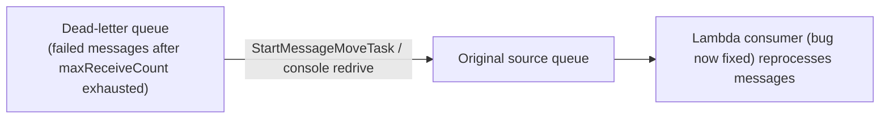

**Why the others are wrong:**
- A: The native redrive capability exists specifically to avoid needing a custom per-message copying script — the premise that no native mechanism exists is false.
- C: Redrive is a fully self-service API/console operation available to any account with appropriate IAM permissions; it does not require filing an AWS Support case.
- D: FIFO mode governs ordering/deduplication semantics; it has no automatic, scheduled redrive-to-source behavior of any kind, and redrive is always an explicitly-triggered action, not an automatic hourly process.

---

## Q41 — Domain 2: Security

A company uses **attribute-based access control (ABAC)** in IAM: IAM principals and resources are
tagged (e.g. `Project: Phoenix`), and a single shared IAM policy grants access only when the
principal's `aws:PrincipalTag/Project` matches the resource's `aws:ResourceTag/Project` — rather than
writing a separate, resource-ARN-specific policy per project. Choose **TWO** correct statements
about the operational advantages and scope of ABAC compared to traditional resource-ARN-based
(RBAC-style) policies.

A. A **single ABAC policy** can scale to cover any number of projects/teams without being rewritten — onboarding a new project means just tagging the new principals and resources consistently, with the existing shared policy automatically applying correctly, instead of writing (and maintaining) a new resource-ARN-specific policy statement for every new project.

B. ABAC is supported broadly across many AWS services that support tag-based condition keys (including EC2, RDS, Lambda, Secrets Manager, and more), not limited to any single service.

C. ABAC policies are always evaluated meaningfully faster at the IAM enforcement layer than ARN-based policies, which is its primary real advantage.

D. ABAC completely eliminates the need for any IAM policy at all; tags alone enforce access control without any policy document being evaluated.

E. ABAC can only be used for S3 resources; it has no applicability to any other AWS service's IAM-based access control.

**Correct Answer: A, B**

**Explanation:** The core operational benefit of **ABAC** is that access logic is expressed once, in
terms of tag relationships, rather than enumerated per specific resource ARN — a traditional
ARN-based policy needs a new statement (or a template-generated one) for every new project/resource,
while an ABAC policy automatically "just works" for any newly-tagged principal/resource pair without
any policy edit, which scales far better as the number of projects/teams grows. This capability is
also broadly available: many AWS services that support tag-based condition keys can participate in
ABAC, not just one specific service. This is Task 2.1 content. See [`services/security-identity-compliance/iam.md`](../../../services/security-identity-compliance/iam.md).

**Why the others are wrong:**
- C: IAM policy evaluation performance is not meaningfully different between ABAC-style condition-based policies and ARN-based policies from an application's perspective — the advantage is operational/maintainability, not raw evaluation speed.
- D: ABAC conditions are still evaluated *within* an IAM policy document (using `Condition` blocks comparing principal and resource tags) — tags alone, with no policy referencing them, grant nothing.
- E: ABAC is supported broadly across many AWS services (as choice B correctly states), not limited to S3 specifically.

---

## Q42 — Domain 1: Development with AWS Services

A team's AppSync GraphQL API resolver logic for a `getOrder` query is currently implemented in VTL,
but as the resolver's logic grows (several conditional branches, calling a secondary data source
conditionally based on the first result), the team finds VTL's templating syntax increasingly hard to
read and test. They want to rewrite just this one resolver using a more standard, testable
programming language construct, without abandoning VTL in the rest of the API's resolvers (which
remain simple enough to keep as-is). Which AppSync capability allows this per-resolver choice?

A. AppSync requires every resolver across an entire API to use the exact same resolver runtime (all VTL or all JavaScript); mixing runtimes within one API is not supported.

B. AppSync supports configuring the **resolver runtime independently per resolver** — this specific
   `getOrder` resolver can be rewritten using the **APPSYNC_JS** runtime (writing request/response
   mapping logic in standard JavaScript, which is generally easier to read/test than VTL for complex
   conditional logic), while every other resolver in the same API continues using VTL unaffected.

C. Switching any single resolver to JavaScript silently converts the entire API's GraphQL schema to a different format, breaking every other resolver.

D. There is no way to improve resolver readability within AppSync; the only option for complex logic is abandoning AppSync for a hand-built GraphQL server.

**Correct Answer: B**

**Explanation:** AppSync's resolver **runtime** setting (VTL or **APPSYNC_JS**) is configured
**per resolver**, not globally for the whole API — teams can incrementally migrate specific,
complex resolvers to the JavaScript runtime (often more readable/testable for conditional logic than
VTL templating) while leaving simpler resolvers on VTL, with no requirement to convert the entire API
at once. This is Task 1.1 content. See [`services/application-integration/appsync.md`](../../../services/application-integration/appsync.md).

**Why the others are wrong:**
- A: Resolver runtime is explicitly a per-resolver configuration — AppSync does not enforce a single, API-wide runtime choice across every resolver.
- C: Changing one resolver's runtime has no effect on the GraphQL schema format or on any other resolver's configuration; each resolver's runtime choice is independent.
- D: The APPSYNC_JS runtime exists specifically to provide a more standard-language alternative to VTL within AppSync itself — abandoning AppSync entirely is not required to improve resolver readability.

---

## Q43 — Domain 2: Security

A Lambda function's execution role currently has a policy granting `bedrock:InvokeModel` on
`Resource: "*"`, intended for a chatbot feature. The security team wants to scope this down following
least privilege, and separately wants to ensure that if this role is ever compromised, an attacker
couldn't also use it to modify the account's Bedrock Guardrails configuration or provision new custom
models. What change(s) correctly address both concerns?

A. No change is needed; `bedrock:InvokeModel` on `Resource: "*"` inherently cannot be used for any management-plane action like modifying Guardrails, so the second concern is already addressed by default.

B. Scope the `Resource` to the specific approved foundation model ARN(s) (e.g.
   `arn:aws:bedrock:us-east-1::foundation-model/anthropic.claude-*`) rather than a wildcard, and
   explicitly ensure the role's policy grants **only** `bedrock:InvokeModel`/`InvokeModelWithResponseStream`/
   `ApplyGuardrail` (the runtime-invocation actions this chatbot actually needs) with **no**
   `bedrock:CreateGuardrail`, `bedrock:UpdateGuardrail`, `bedrock:CreateCustomModel`, or other
   management-plane actions — separating runtime invocation permissions from Bedrock's management/
   administrative permissions, exactly as Task 2.3 recommends.

C. Add an explicit `Deny` statement for `bedrock:*` to the same policy, which is required before any `Allow` statement for `bedrock:InvokeModel` can take effect at all.

D. Move the `bedrock:InvokeModel` permission to a separate, dedicated AWS account solely for the purpose of bypassing the need for resource-level scoping entirely.

**Correct Answer: B**

**Explanation:** This is the Task 2.3 "access control for AI services" principle applied directly:
scope `Resource` to the specific, approved model ARN(s) rather than a wildcard, and keep the
*runtime-invocation* actions (`InvokeModel`, `InvokeModelWithResponseStream`, `ApplyGuardrail`)
separate from *management-plane* actions (creating/modifying Guardrails, provisioning custom models)
— a compromised runtime role should never also be able to reconfigure the safety controls or create
new model resources, which requires deliberately *not* granting those broader actions in the first
place. See [`certifications/dva-c03/domain-2-security/ai-service-security-risks.md`](../domain-2-security/ai-service-security-risks.md).

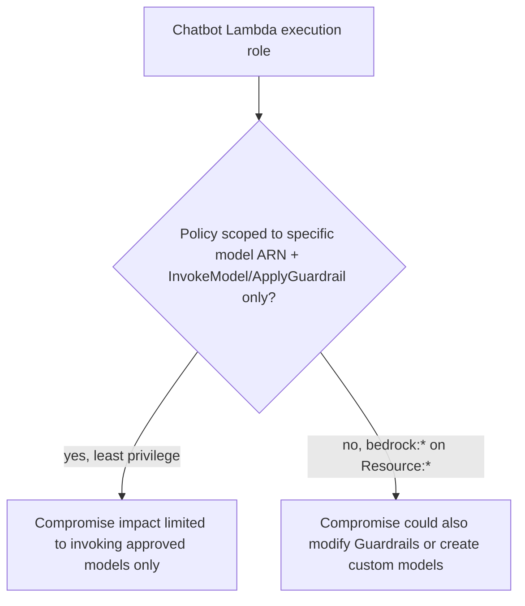

**Why the others are wrong:**
- A: A wildcard `Resource: "*"` on `bedrock:InvokeModel` specifically only grants that one action — this particular policy as described wouldn't separately grant management actions either, but the key risk in the *scenario* is that a role granted broad `bedrock:*`-style access elsewhere (or expanded later without discipline) could pick up management actions; the described fix explicitly locks down to only the needed runtime actions and resources as a deliberate, durable practice, not an automatic default property of any `InvokeModel` grant alone.
- C: There's no requirement to add a `Deny` statement before an `Allow` statement can take effect — `Allow` statements function independently; this describes a nonexistent IAM prerequisite.
- D: Moving a permission to a different account doesn't eliminate the need for proper resource-level scoping and action separation within whatever account/role actually holds and uses the permission — the underlying least-privilege work still has to happen wherever the role lives.

---

## Q44 — Domain 3: Testing and Deployment

A company runs its primary production database on RDS for PostgreSQL and needs to perform a major
version upgrade that historically has caused meaningful downtime during an in-place upgrade. They
want a safer approach: stand up a fully separate, synchronized copy of the production database on
the new engine version, validate it thoroughly with real (replicated) production data, and only then
switch application traffic over — with the ability to quickly fall back to the original if a problem
is discovered shortly after cutover. Which RDS-native feature is purpose-built for this pattern?

A. A standard RDS snapshot restore, performed once, with no ongoing synchronization between the original and the new instance after the snapshot is taken.

B. **Amazon RDS Blue/Green Deployments**, which create a fully managed staging ("green") environment
   that stays synchronized with production ("blue") via native replication, let the team validate the
   green environment (including testing the new engine version) against live-replicated data, and then
   perform a managed, low-downtime switchover — with the original blue environment kept available
   briefly afterward as a fallback if an issue surfaces.

C. Multi-AZ deployment alone, which is specifically designed for major version upgrade validation and switchover testing rather than for its stated availability/failover purpose.

D. There is no RDS-native feature for this; the only option is a fully custom-built, externally-orchestrated dual-write application-level migration.

**Correct Answer: B**

**Explanation:** **RDS Blue/Green Deployments** are purpose-built for exactly this: creating a
synchronized "green" copy of production (on the target engine version, in this case), using native
replication to keep it current with "blue" production in real time, validating the green environment
independently, and performing a managed, minimal-downtime switchover — with blue retained briefly
afterward specifically so a problem discovered post-cutover can be addressed via fallback. This is
Task 3.3 content. See [`services/database/rds.md`](../../../services/database/rds.md).

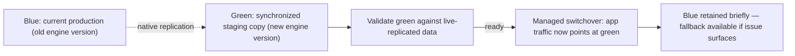

**Why the others are wrong:**
- A: A one-time snapshot restore has no ongoing synchronization after the snapshot is taken — any production writes occurring after that point wouldn't be reflected, making it unsuitable for validating against current, live-replicated production data right up to cutover.
- C: Multi-AZ is designed for high availability/failover to a standby in the same engine version, not for cross-version upgrade validation and controlled switchover — it's a different feature solving a different problem.
- D: RDS Blue/Green Deployments are exactly the AWS-native, fully-managed feature for this pattern — the premise that only a fully custom, externally-orchestrated solution exists is incorrect.

---

## Q45 — Domain 1: Development with AWS Services

A Lambda function initializes a database connection pool (or an SDK client with internal connection
reuse) once at module scope, expecting it to be reused across many warm invocations of the same
execution environment. The team notices that occasionally a request intermittently fails with a
"connection closed"/"broken pipe" style error that isn't reproducible on retry. What is the most
likely cause specific to the Lambda execution model, and the recommended handling?

A. This always indicates a bug in the downstream database itself; Lambda's execution model has no relationship to connection lifecycle at all.

B. Lambda execution environments can be **frozen** between invocations (when the environment isn't
   actively processing a request) and later **thawed** to handle a new invocation — a connection that
   was alive when the environment froze can have been silently closed by the remote end (e.g. an idle
   timeout on the database/load balancer side) while frozen, so the *first* request after a long idle
   period can fail against a now-stale connection; the recommended handling is implementing connection
   validation/retry logic (checking the connection's health or catching the specific error and
   reconnecting) rather than assuming a connection initialized once at module scope remains valid
   forever.

C. Lambda execution environments are always fully torn down and recreated between every single invocation, so no connection could ever persist long enough to go stale in the first place.

D. This only ever happens when the function's `Timeout` setting is below 3 seconds; increasing it to any higher value eliminates all stale-connection errors permanently.

**Correct Answer: B**

**Explanation:** Lambda's execution model **freezes** an execution environment's process between
invocations rather than destroying it (enabling warm starts) and later **thaws** it for a subsequent
invocation — but while frozen, the environment isn't actively running, so a remote peer (database,
load balancer, API) might independently decide to close an idle connection due to its own timeout
policy. The environment has no way to detect or react to that closure while frozen; the first
invocation after thawing can therefore hit a now-dead connection. Defensive connection-health
checking/reconnect-on-error logic is the standard mitigation, rather than assuming module-scope
initialization guarantees a permanently valid connection. This is Task 1.2/4.2 content. See
[`services/compute/lambda.md`](../../../services/compute/lambda.md).

**Why the others are wrong:**
- A: This is a well-documented characteristic of Lambda's freeze/thaw execution model interacting with connection idle timeouts elsewhere in the stack — it is not inherently a database-side bug, and Lambda's execution model is directly relevant to why this occurs.
- C: If environments were destroyed and recreated on every invocation, there would be no warm starts at all, and module-scope-initialized clients would never persist between invocations (defeating their entire performance purpose) — this directly contradicts Lambda's actual, documented warm-start behavior.
- D: `Timeout` governs how long a single invocation may run before forced termination; it has no relationship to whether a remote peer closes an idle connection during a frozen period between invocations, and no specific threshold value "eliminates" this class of issue.

---

## Q46 — Domain 3: Testing and Deployment

A team currently manages its internal shared library dependencies (used across multiple services'
CodeBuild projects) by having each project's `buildspec.yml` pull directly from the public npm/PyPI
registries, occasionally hitting registry rate limits or outages that fail unrelated builds, and with
no centralized way to vet/approve which package versions internal teams are allowed to pull. Which
AWS service addresses both the reliability and governance concerns for internal dependency
management?

A. Amazon S3 alone, with each team manually uploading approved package tarballs to a shared bucket and hand-editing every project's dependency-resolution configuration to point at S3 URLs.

B. **AWS CodeArtifact** — a managed artifact repository that can proxy/cache upstream public
   repositories (npm, PyPI, Maven, NuGet, etc.) so builds pull from CodeArtifact's cached copies
   (insulating internal builds from upstream outages/rate limits), while also supporting internal,
   private packages and policy-based approval/governance over which versions are available to
   consuming projects.

C. AWS CodeCommit, which is a source-control service with no artifact-repository or package-proxying capability of any kind.

D. There is no AWS-native artifact repository service; teams must always rely on a self-hosted, third-party artifact repository tool for this use case.

**Correct Answer: B**

**Explanation:** **CodeArtifact** is purpose-built for exactly this: acting as a managed, cached proxy
in front of public package registries (reducing exposure to their outages/rate limits for internal
builds) while also hosting private internal packages and supporting governance controls over which
package versions are available — directly addressing both the reliability and the approval/governance
concerns described. This is Task 3.1/3.2 content. See [`../domain-3-testing-deployment/README.md`](../domain-3-testing-deployment/README.md).

**Why the others are wrong:**
- A: Manually managing package tarballs in a plain S3 bucket, with each project hand-configured to point at specific S3 URLs, is exactly the kind of unscalable, ungoverned, manually-maintained workaround CodeArtifact exists to replace with proper versioning, proxying, and policy support.
- C: CodeCommit is strictly a Git-based source-control service; it has no package/artifact-repository or upstream-proxying functionality whatsoever.
- D: AWS does provide a native artifact-repository service (CodeArtifact) for exactly this purpose — the premise that only third-party, self-hosted tooling exists is incorrect.

---

## Q47 — Domain 4: Troubleshooting and Optimization

A team's monthly Cost Explorer breakdown shows a significant, steadily-growing charge under "EC2 -
Other" that doesn't correspond to running instance-hours at all, and turns out to be entirely NAT
Gateway **data processing** charges. Investigation reveals several Lambda functions in private
subnets making frequent calls to AWS services (S3, DynamoDB) by routing egress through a NAT Gateway
rather than any VPC endpoint. Choose **TWO** correct, direct cost optimizations here.

A. Add **Gateway VPC Endpoints** for S3 and DynamoDB, which have no hourly or data-processing charge at all, routing that traffic off the NAT Gateway entirely and eliminating the associated per-GB NAT data-processing cost for it.

B. For other AWS services reached from these functions, consider **Interface VPC Endpoints** where the endpoint's own hourly-plus-data-processing cost is lower than the NAT Gateway data-processing charges currently being incurred for that traffic.

C. Reduce the Lambda functions' memory allocation, since NAT Gateway data processing charges are billed proportionally to configured Lambda memory rather than to actual data volume transferred.

D. NAT Gateway data processing charges are fixed, flat-rate monthly fees unrelated to actual data volume, so no architectural change can reduce this specific charge.

E. Switch the Lambda functions out of the VPC entirely, which is the only way to avoid any NAT Gateway-related charge, with no functional trade-off of any kind.

**Correct Answer: A, B**

**Explanation:** NAT Gateway bills a **per-GB data processing charge** in addition to its hourly
charge; AWS-service-bound traffic (S3, DynamoDB, and many others) routed through a NAT Gateway instead
of a **VPC endpoint** incurs this charge unnecessarily, since VPC endpoints route that same traffic
over AWS's private network instead — Gateway endpoints (S3, DynamoDB) have no additional charge at
all, and Interface endpoints, while not free, are often cheaper than the NAT data-processing charges
they replace for meaningful traffic volumes. This is Task 4.3 content. See
[`services/networking-content-delivery/vpc-endpoints-privatelink.md`](../../../services/networking-content-delivery/vpc-endpoints-privatelink.md)
and [`services/networking-content-delivery/data-transfer-pricing.md`](../../../services/networking-content-delivery/data-transfer-pricing.md).

**Why the others are wrong:**
- C: NAT Gateway data processing charges are billed based on the actual **volume of data processed** through the gateway, not based on the Lambda function's configured memory setting — reducing memory has no direct relationship to this specific charge.
- D: NAT Gateway data processing is explicitly a **per-GB** charge (in addition to an hourly base charge), not a flat fee independent of traffic volume — reducing the volume of traffic routed through it directly reduces this cost component.
- E: Removing Lambda functions from a VPC entirely does avoid NAT Gateway charges, but it's not "the only way," and it comes with a real functional trade-off if those functions need private connectivity to VPC-resident resources (like an RDS instance) that *require* VPC attachment — VPC endpoints solve the cost problem without removing VPC connectivity.

---

## Q48 — Domain 2: Security

A Lambda function calls Amazon Bedrock to generate customer-support responses, and separately needs
to detect and mask any customer PII (phone numbers, email addresses, account numbers) that might
appear in either the customer's incoming message or the model's generated response, before either is
written to a persistent conversation-history store. The team wants to implement this with a managed
AWS service rather than hand-maintained regex, applied as an explicit step both before and after the
model call. Which architecture is correct?

A. Rely entirely on Bedrock Guardrails' built-in content filters to handle PII masking automatically with no additional service, since Guardrails' denied-topics and content-filter categories already cover arbitrary customer account numbers out of the box with zero configuration.

B. Call **Amazon Comprehend's `DetectPiiEntities`** (or use Bedrock Guardrails' dedicated **sensitive
   information filter**, which specifically supports PII-type entity detection/masking, as a
   complementary or alternative layer) on the incoming message **before** sending it to the model, and
   again on the model's generated response **before** persisting it — masking/redacting detected PII
   entities at both points, rather than relying on hand-written regex patterns for each PII category.

C. PII detection and masking can only be performed manually by a human reviewer reading every conversation before it's stored; no automated AWS service offers this capability.

D. Store the raw, unmasked conversation data as-is, since Bedrock's own internal infrastructure automatically strips all PII from any data written to a customer's own persistent storage outside of Bedrock.

**Correct Answer: B**

**Explanation:** This is Task 2.3's "sensitive data in logs/storage" principle applied end-to-end:
detect and mask PII both on the way *into* the model (so sensitive data isn't unnecessarily processed/
exposed further than needed) and on the way *out* (since a model can echo back or generate text
containing PII), using a managed detection capability — either Comprehend's dedicated PII detection
API, or Bedrock Guardrails' own sensitive-information filter (which many teams now use specifically
for this purpose, including entity types tailored for PII) — rather than hand-rolled, incomplete regex
patterns. See [`certifications/dva-c03/domain-2-security/ai-service-security-risks.md`](../domain-2-security/ai-service-security-risks.md).

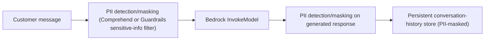

**Why the others are wrong:**
- A: Guardrails' denied-topics and standard content filters target categories like hate speech/violence/prompt injection; while Guardrails does offer a dedicated sensitive-information filter for PII-type entities, the premise that the *general* content-filter categories already cover arbitrary account numbers "out of the box with zero configuration" overstates what's automatic versus what still requires deliberately configuring the sensitive-information filter for the relevant entity types.
- C: Both Comprehend and Bedrock Guardrails provide automated, managed PII-detection capability — manual human review of every conversation is neither required nor practical/scalable, and isn't the only available option.
- D: Bedrock does not automatically strip PII from data an application chooses to persist in its own separate storage after receiving a model's response — that's entirely the application's own responsibility to implement.

---

## Q49 — Domain 1: Development with AWS Services

A team ingests events from multiple microservices onto a shared EventBridge custom event bus, then
needs to occasionally **replay** a specific historical window of events (e.g. "replay everything from
last Tuesday between 2pm and 4pm") against a newly-added consumer to backfill its state, without
re-triggering every other existing consumer/rule for those same historical events. Which EventBridge
feature supports this targeted replay capability?

A. EventBridge has no replay capability at all; once an event is processed, it is permanently gone and can never be reprocessed by any consumer, old or new.

B. **EventBridge archive and replay** — an **archive** configured on the event bus (optionally
   filtered to specific event patterns) retains a durable copy of matching events; a **replay**
   operation can then re-send a specified time range of archived events, and critically, a replay can
   be scoped to target only specific rules (letting the new consumer's rule receive the replayed
   events while other, already-caught-up rules/consumers are excluded from the replay).

C. DynamoDB Streams is the only AWS mechanism capable of replaying historical events, and it must be manually wired in front of every EventBridge bus to gain any replay capability.

D. S3 Lifecycle policies automatically archive and replay EventBridge events with zero additional configuration, replaying every historical event to every single rule on the bus by default.

**Correct Answer: B**

**Explanation:** EventBridge's **archive** feature retains a durable, filtered copy of events flowing
through a bus; a subsequent **replay** can specify a time range and which event bus/rules to target,
letting a newly-added consumer receive a historical backfill without those same events being
re-delivered to already-caught-up existing consumers (since replay targeting can be scoped). This is
Task 1.1 content. See [`services/application-integration/eventbridge.md`](../../../services/application-integration/eventbridge.md).

**Why the others are wrong:**
- A: Archive and replay is a real, documented, purpose-built EventBridge capability for exactly this need — the premise that no replay mechanism exists at all is false.
- C: DynamoDB Streams is an entirely separate, unrelated change-data-capture mechanism for DynamoDB table changes; it has no role in EventBridge's own event bus replay functionality.
- D: S3 Lifecycle policies manage S3 storage-class transitions/expiration and have no relationship to EventBridge archiving or replay at all; replay is also always an explicitly-triggered, scoped operation, never an automatic default re-delivery to every rule.

---

## Q50 — Domain 4: Troubleshooting and Optimization

A team wants every microservice's test suite results, across a dozen different CodeBuild/CodePipeline
projects, to be visible to engineering leadership in one unified place — total pass/fail counts,
trends over time, and flaky-test identification — without each team manually exporting and emailing
spreadsheets after every build. Which combination of AWS features supports this centralized test
reporting?

A. CodeBuild **test reports** (configured via a `reports` section in `buildspec.yml` pointing at test
   result files, e.g. JUnit XML) publish structured results to a **CodeBuild report group**; report
   groups can be viewed centrally in the CodeBuild console across projects, and the underlying data can
   be further aggregated/visualized (e.g. via a CloudWatch dashboard built on report-group metrics, or
   exported) for leadership-level visibility.

B. CodePipeline automatically emails a formatted spreadsheet to a designated leadership distribution list after every single pipeline execution, with zero configuration required.

C. AWS Config is the standard AWS service for aggregating and visualizing software test suite pass/fail results across multiple CodeBuild projects.

D. There is no AWS-native way to aggregate test results across multiple projects; each team must always manually compile and share results through non-AWS tooling.

**Correct Answer: A**

**Explanation:** CodeBuild's **test reporting** feature (configured via the `reports` section of
`buildspec.yml`, pointing at test result files in supported formats like JUnit XML, Cucumber JSON, or
TestNG XML) publishes structured pass/fail/duration data to a named **report group** — report groups
aggregate results across many build runs (and can span multiple projects feeding into the same group
naming convention), viewable centrally in the console, with trend data useful for spotting flaky
tests, and can feed further visualization (dashboards) downstream. This is Task 3.1 content. See
[`services/developer-tools/codebuild.md`](../../../services/developer-tools/codebuild.md).

**Why the others are wrong:**
- B: CodePipeline has no built-in automatic spreadsheet-emailing feature for test results; any such distribution would need to be custom-built (e.g. via a Lambda invoke action), not a zero-configuration default behavior.
- C: AWS Config evaluates resource configuration compliance; it has no test-result-aggregation or reporting capability for software test suites at all.
- D: CodeBuild's native test reporting and report groups are exactly the AWS-native mechanism for this centralized aggregation — the premise that no such capability exists ignores this documented feature.

---

## Q51 — Domain 1: Development with AWS Services

A DynamoDB table `Flights` has partition key `flightId`. A new feature needs to efficiently find all
flights departing from a specific airport on a specific date, sorted by departure time — a query the
base table's key schema cannot support. The team adds a Global Secondary Index with partition key
`departureAirport` and sort key `departureDateTime`, and begins issuing `Query` calls against it with
a `FilterExpression` further restricting results to flights with `status = "ON_TIME"`. They notice the
GSI's consumed read capacity is much higher than expected given how few `ON_TIME` results are actually
returned. What is the cause, and the fix?

A. GSIs always consume exactly 10x the read capacity of an equivalent base-table query, regardless of filtering; this overhead is an unavoidable, fixed GSI tax with no mitigation.

B. A `FilterExpression` is applied **after** DynamoDB has already read (and billed for) every item
   matching the `KeyConditionExpression` from the index — items filtered out by `status != "ON_TIME"`
   still consumed read capacity before being discarded from the response. If this filtering pattern is
   common, the fix is to make `status` (or a composite value combining it) part of the GSI's key
   schema itself (e.g. as part of the sort key, or a separate, more selective index) so DynamoDB can
   use a `KeyConditionExpression` to avoid reading non-matching items in the first place.

C. FilterExpressions are evaluated entirely client-side by the SDK after a full, unrelated table scan, regardless of whether a GSI or KeyConditionExpression is used at all.

D. The fix is to switch the table to on-demand billing mode, which automatically converts all FilterExpressions into KeyConditionExpressions with no schema change needed.

**Correct Answer: B**

**Explanation:** This is a common DynamoDB misconception: `FilterExpression` is applied to items
**after** they're read based on the `KeyConditionExpression`/index key match — so every item matching
the key condition is read (and billed) regardless of whether the filter ultimately excludes it, which
is exactly why read capacity can look disproportionately high relative to the final, filtered result
count. The durable fix is designing the key schema (base table or index) so the discriminating
attribute is part of the key condition itself, letting DynamoDB skip non-matching items at the index
level rather than reading-then-discarding them. This is Task 1.3 content. See
[`services/database/dynamodb.md`](../../../services/database/dynamodb.md).

**Why the others are wrong:**
- A: There is no fixed "GSI always costs 10x" rule — GSI read capacity reflects the actual items read matching the key condition, exactly like the base table; the inflated cost here is specifically attributable to filtering after the read, not an inherent GSI tax.
- C: `FilterExpression` combined with a `Query`'s `KeyConditionExpression` is still evaluated server-side by DynamoDB against only the items matching that key condition (not a full table scan) — conflating this with `Scan`'s behavior misdescribes how `Query` with filtering actually works.
- D: Billing mode (provisioned vs. on-demand) has no effect on filter-vs-key-condition semantics; it does not convert filter expressions into key conditions under any configuration.

---

## Q52 — Domain 2: Security

A Bedrock Agent is configured with two action groups: one that looks up order status (read-only,
calling an internal read API) and a second that issues refunds (calling a payment-system API that
moves real money). The security team wants to ensure that even if a cleverly-crafted user prompt
tricks the agent's reasoning into attempting an unauthorized refund, the underlying AWS-level
permissions make that attempt impossible to actually execute — not just unlikely due to the agent's
own prompt-based guardrails. What is the correct way to achieve this defense-in-depth guarantee?

A. Rely solely on a detailed agent instruction prompt telling the model "never issue a refund without explicit human confirmation," since a sufficiently well-written prompt is a complete, sufficient security control on its own.

B. Scope the Bedrock Agent's **execution role** (and, where applicable, the specific Lambda function(s)
   backing each action group) with least privilege per action group — the refund action group's
   underlying Lambda function/role should only have the specific narrow permissions needed to call the
   refund API, and ideally require a separate, explicit authorization step (e.g. a human-approval
   callback, or a hard business-logic cap on refund amount enforced in code, not just in the model's
   reasoning) — so that even if the agent's *reasoning* is manipulated into attempting an unauthorized
   refund, the actual underlying system enforces real guardrails independent of the model's own
   judgment.

C. Bedrock Agents automatically sandbox every action group's underlying API calls in a way that makes real-world financial impact impossible by design, with no additional IAM or application-level control needed.

D. Combine both action groups into a single Lambda function and IAM role, since consolidating permissions always improves security by reducing the number of IAM policies to manage.

**Correct Answer: B**

**Explanation:** This is Task 2.3's "AI agent security" principle: an agent's *reasoning* can be
manipulated (via prompt injection or otherwise) into attempting actions it shouldn't, so the real
safety boundary must live in the **actual permissions and business logic** the agent's action groups
invoke — least-privilege IAM scoping per action group, and hard application-level controls (approval
steps, amount caps) that don't depend on the model behaving correctly — rather than trusting the
model's own prompt-based judgment as the sole line of defense. See
[`certifications/dva-c03/domain-2-security/ai-service-security-risks.md`](../domain-2-security/ai-service-security-risks.md)
and [`services/security-identity-compliance/iam.md`](../../../services/security-identity-compliance/iam.md).

**Why the others are wrong:**
- A: Prompt-based instructions are not a reliable, enforceable security boundary against adversarial or manipulated reasoning — this is precisely why Task 2.3 emphasizes real IAM/application-level controls as the actual enforcement layer, not the model's own instructions.
- C: Bedrock Agents do not automatically impose real-world financial safety limits on arbitrary action-group API calls — whatever the backing Lambda function and its IAM role/business logic actually permit is exactly what can happen; there's no built-in financial-impact sandboxing.
- D: Combining the read-only order-lookup and the money-moving refund action groups into one shared function/role actively *widens* the blast radius of a compromise or a manipulated reasoning chain — this is the opposite of least privilege and defense-in-depth.

---

## Q53 — Domain 3: Testing and Deployment

A team wants every merge to their `main` branch to automatically trigger a CodeBuild action group
that runs **both** unit tests and a static code-security scan (e.g. for hardcoded secrets or known
vulnerable dependencies) **in parallel** within the same CodePipeline stage, rather than sequentially
one after another, to reduce total pipeline duration — but wants the stage to fail overall if either
check fails. Which CodePipeline stage/action configuration achieves this?

A. CodePipeline actions within a single stage always run strictly sequentially in the order listed; parallel execution of actions within one stage is not a supported capability.

B. Configure both the unit-test action and the security-scan action within the **same stage**, each
   with the **same `RunOrder` value** — actions sharing a `RunOrder` within a stage execute in
   **parallel**, and the stage only transitions forward once *all* actions at that `RunOrder` (and any
   subsequent ones) have succeeded; a failure in either parallel action fails the stage.

C. Parallel action execution requires creating a separate CodePipeline entirely for each action, with a third, orchestrating pipeline manually triggering both and polling for completion.

D. Only CodeBuild batch builds (not CodePipeline action configuration) can run multiple checks in parallel; CodePipeline itself has no parallel-action capability under any configuration.

**Correct Answer: B**

**Explanation:** CodePipeline's **`RunOrder`** property, set per action within a stage, determines
execution sequencing: actions sharing the **same** `RunOrder` value run in **parallel**, while
actions with different `RunOrder` values run sequentially in ascending order — configuring the
unit-test and security-scan actions with the same `RunOrder` runs them concurrently within the stage,
with the stage requiring all of them to succeed before proceeding. This is Task 3.2 content. See
[`services/developer-tools/codepipeline.md`](../../../services/developer-tools/codepipeline.md).

**Why the others are wrong:**
- A: `RunOrder` explicitly enables parallel execution of multiple actions sharing the same value within one stage — strictly sequential execution is the behavior only when `RunOrder` values differ, not an unconditional rule for every action in a stage.
- C: A separate orchestrating pipeline is unnecessary complexity; `RunOrder` within a single stage of one pipeline natively provides the parallel-execution-with-combined-gating behavior described.
- D: While CodeBuild batch builds do offer their own internal parallelism *within a single CodeBuild project/build*, CodePipeline's own `RunOrder` mechanism independently and natively supports running multiple distinct pipeline *actions* in parallel within a stage — the premise that CodePipeline itself has no such capability is incorrect.

---

## Q54 — Domain 4: Troubleshooting and Optimization

A company centralizes CloudWatch Logs from Lambda functions running in 15 different "workload"
AWS accounts into one "logging" account, for unified search/alerting without engineers needing
cross-account console access to each workload account individually. Which architecture correctly
achieves this centralized, cross-account log aggregation?

A. Manually copy and paste log lines from each workload account's CloudWatch console into a shared spreadsheet in the logging account once a day.

B. Configure a **cross-account CloudWatch Logs subscription** (or destination) in each workload
   account's relevant log groups, pointing at a **log destination** (backed by a Kinesis Data Stream
   or Firehose delivery stream) created in the central logging account, with the destination's
   resource policy explicitly authorizing each workload account to send to it — centralizing log data
   into the logging account in near-real-time without manual console access to each workload account.

C. CloudTrail is the only AWS mechanism for aggregating Lambda application logs across accounts; CloudWatch Logs itself has no cross-account capability.

D. Each workload account must be merged into the logging account as a single AWS account before any log aggregation across them becomes technically possible.

**Correct Answer: B**

**Explanation:** **Cross-account CloudWatch Logs subscriptions** (log group subscription filters
pointing at a **destination** in another account, backed by Kinesis Data Streams or Firehose) are the
standard pattern for centralized, near-real-time log aggregation across many accounts into one
logging account — each workload account's log groups subscribe to the central destination (whose
resource policy explicitly authorizes them), with no manual copying and no requirement to merge
accounts. This is Task 4.1 content. See [`services/management-governance/cloudwatch.md`](../../../services/management-governance/cloudwatch.md).

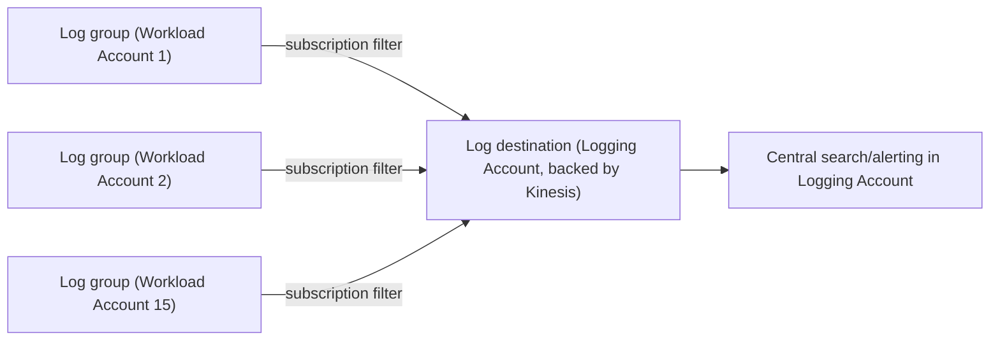

**Why the others are wrong:**
- A: Manual copy-paste is exactly the unscalable, error-prone, non-real-time process this architecture exists to eliminate for 15 accounts' worth of logs.
- C: CloudWatch Logs explicitly supports cross-account subscriptions/destinations as a native capability — the premise that it has none, and that only CloudTrail (which records API calls, not application log content) can aggregate across accounts, is incorrect.
- D: AWS accounts remain fully separate under this architecture (which is specifically designed for multi-account setups, often under AWS Organizations); merging accounts is neither required nor a sensible approach to log aggregation.

---

## Q55 — Domain 2: Security

A company deploys an internal AI-assisted code-review tool that uses Amazon Comprehend to scan code
diffs for accidentally-committed secrets (API keys, passwords) **before** a pull request can be
merged, blocking the merge if any are found. The security team wants to confirm this approach has an
important limitation compared to purpose-built secret-scanning tools, and wants a complementary
control. What is the correct assessment?

A. Comprehend's PII/entity detection models are specifically trained and optimized to recognize the structural patterns of API keys, passwords, and credentials with full, guaranteed accuracy; no complementary tooling is needed.

B. Comprehend is built for detecting PII entities (names, SSNs, addresses) and general sentiment/
   language analysis — it is **not** purpose-built for recognizing the specific structural patterns of
   API keys, tokens, and credentials (which follow service-specific formats). A dedicated
   secret-scanning tool (e.g. git-secrets, TruffleHog, or Amazon CodeGuru/CodeWhisperer's relevant
   security-scanning features, or a managed service like GitHub secret scanning for repos hosted
   there) pattern-matches against known credential formats specifically, and should run as a
   complementary, purpose-built control rather than relying on Comprehend alone for this particular
   detection category.

C. There is no meaningful difference between PII detection and credential/secret detection; any service capable of one is automatically equally effective at the other.

D. Secret scanning should only ever happen after merge, in production, since pre-merge scanning of code diffs is not technically possible with any AWS or third-party tool.

**Correct Answer: B**

**Explanation:** **Amazon Comprehend** is purpose-built for natural-language PII and entity detection
(names, locations, SSNs) and sentiment/language analysis — a fundamentally different detection problem
from recognizing the specific, structured formats of API keys/tokens/credentials (which dedicated
secret-scanning tools pattern-match against known provider-specific formats, entropy analysis, and
regex signatures). Relying on Comprehend alone for secret detection would likely miss many real
credential leaks; a dedicated secret-scanning tool integrated into the PR/CI pipeline is the correct
complementary control. This connects to Task 2.2's "avoid hardcoded secrets" content alongside Task
2.3's AI-service-limitation awareness. See [`services/security-identity-compliance/secrets-manager-vs-parameter-store.md`](../../../services/security-identity-compliance/secrets-manager-vs-parameter-store.md).

**Why the others are wrong:**
- A: Comprehend's models are not specifically trained/optimized for credential-format recognition — this overstates its actual designed capability and creates false confidence in a control that may have significant blind spots for this specific threat.
- C: PII detection (recognizing names/addresses/SSNs via NLP) and credential/secret detection (recognizing structured token/key formats, often via pattern-matching or entropy analysis) are different problems with different detection techniques — proficiency at one doesn't imply proficiency at the other.
- D: Pre-merge scanning of code diffs is a standard, widely-used, technically straightforward practice (exactly what the scenario already describes happening) — the claim that it's impossible contradicts the scenario's own premise.

---

## Q56 — Domain 1: Development with AWS Services

A Lambda function's alias is configured with **provisioned concurrency** set to a static value of
20, sized for typical daytime traffic. During a predictable nightly batch job, traffic spikes to
require roughly 80 concurrent executions for about 30 minutes, then drops back down — currently
causing cold starts for the extra ~60 concurrent invocations beyond the static provisioned amount
during that window every night. The team wants provisioned concurrency to automatically scale up
before the nightly spike and back down afterward, without manually editing the setting twice a day.
Which AWS feature supports this?

A. Lambda provisioned concurrency is always a fixed, manually-set value with absolutely no automatic scaling capability under any configuration.

B. **Application Auto Scaling**, configured with the Lambda alias's provisioned concurrency as a
   scalable target — either via a **scheduled scaling** action (raising the value shortly before the
   known nightly batch window and lowering it afterward) or a **target-tracking** policy (scaling based
   on a utilization metric), automating exactly this kind of predictable, time-based capacity
   adjustment without manual, twice-daily configuration edits.

C. Lambda reserved concurrency automatically converts to provisioned concurrency during any traffic spike, requiring no separate Auto Scaling configuration.

D. CloudWatch anomaly detection alarms directly and automatically adjust provisioned concurrency settings with no Application Auto Scaling configuration involved.

**Correct Answer: B**

**Explanation:** Lambda's provisioned concurrency integrates with **Application Auto Scaling**, which
supports both **scheduled scaling** (ideal for a known, predictable nightly batch window — raise
before, lower after) and **target-tracking** scaling policies — automating exactly the kind of
"temporarily higher provisioned concurrency for a predictable traffic window" requirement without
manual, twice-daily edits. This is Task 1.2/4.3 content. See [`services/compute/lambda.md`](../../../services/compute/lambda.md).

**Why the others are wrong:**
- A: Provisioned concurrency explicitly supports automated scaling via Application Auto Scaling — the premise that it's always a fixed, manual-only value is incorrect.
- C: Reserved concurrency and provisioned concurrency are distinct, independently-configured settings serving different purposes (capping/guaranteeing concurrency vs. pre-initializing execution environments) — one does not automatically convert into or trigger the other during a traffic spike.
- D: CloudWatch anomaly detection alarms can *trigger* an action (e.g. via an EventBridge rule invoking an Auto Scaling policy change), but they don't directly and automatically reconfigure provisioned concurrency themselves without an Application Auto Scaling policy being the actual mechanism performing the scaling.

---

## Q57 — Domain 3: Testing and Deployment

A team's CodeArtifact repository hosts internal private npm packages. A separate, partner
organization needs read-only access to pull one specific package from this repository as part of
their own build process, without the team creating a full IAM user/role in their own account that the
partner organization would need credentials for. Which approach correctly supports this external,
cross-organization sharing?

A. CodeArtifact fundamentally cannot be accessed by any principal outside the repository-owning AWS account under any configuration, making cross-organization sharing technically impossible.

B. Use a **cross-account CodeArtifact domain/repository policy**, granting the specific external
   account (or a role in it, established via normal AWS cross-account trust) the specific
   `codeartifact:GetPackageVersionAsset`/related read permissions needed — the partner organization's
   own AWS account/role authenticates using their own credentials (via `sts:AssumeRole` into a
   narrowly-scoped role, or direct resource-policy-granted access) rather than the hosting team issuing
   them brand-new IAM users in the hosting account.

C. Export every package version as a plain downloadable ZIP file hosted on a public, unauthenticated website, since this is the only way to share CodeArtifact content outside the owning account.

D. CodeArtifact requires merging the partner organization's AWS account into the hosting team's AWS Organization before any package can be shared, with no narrower cross-account access option available.

**Correct Answer: B**

**Explanation:** CodeArtifact supports **cross-account access** via domain/repository resource
policies (similar in spirit to S3 bucket policies), letting a specific external account's principal
(via its own IAM role, trusted through standard cross-account AssumeRole or resource-policy grants)
read specific packages without the hosting account needing to create and distribute brand-new IAM
users/credentials for the partner — this is Task 3.1/2.1-adjacent content. See
[`../domain-3-testing-deployment/README.md`](../domain-3-testing-deployment/README.md) and
[`services/security-identity-compliance/sts-and-role-switching.md`](../../../services/security-identity-compliance/sts-and-role-switching.md).

**Why the others are wrong:**
- A: CodeArtifact explicitly supports cross-account access via resource policies — the premise that external access is fundamentally impossible is false.
- C: Publishing private packages to a public, unauthenticated website defeats the entire purpose of a private artifact repository and introduces an unnecessary, severe security exposure — this is not the correct or standard sharing mechanism.
- D: Merging AWS Organizations is a drastic, unrelated administrative action with no bearing on CodeArtifact's actual cross-account resource-policy-based sharing capability, which works fine between fully independent accounts/organizations.

---

## Q58 — Domain 4: Troubleshooting and Optimization

A Lambda function processing video files intermittently times out, and profiling data shows CPU
utilization pegged near 100% for the function's full configured memory/CPU allocation during these
slow invocations, while network wait time is minimal. A separate, different function experiencing
slow invocations shows the opposite profile: CPU utilization staying low throughout, with most of the
invocation's wall-clock time spent waiting on a downstream HTTP call's response. What does each
profile indicate, and how should each be optimized differently?

A. Both profiles indicate the exact same root cause (insufficient memory) and should be fixed identically by raising memory to the function's maximum regardless of which profile is observed.

B. The video function's profile (CPU pegged near 100%) indicates a **CPU-bound** workload — the
   correct lever is increasing memory (which proportionally increases allocated CPU) or optimizing the
   underlying compute-heavy code itself. The second function's profile (low CPU, high wait time)
   indicates an **I/O-bound** workload — increasing memory would do little, since the bottleneck is
   external network latency; the correct levers are addressing the downstream dependency's latency,
   adding caching, or, if legitimate concurrency is the goal, ensuring sufficient concurrent
   invocations (not more memory per invocation) can run in parallel.

C. Both profiles indicate a networking misconfiguration in the function's VPC settings, correctable only by removing both functions from any VPC entirely.

D. CPU utilization and wait-time profiling are not meaningfully different signals in Lambda; any performance issue should always be diagnosed exclusively through the function's configured `Timeout` value alone.

**Correct Answer: B**

**Explanation:** Correctly distinguishing **CPU-bound** (compute pegged, limited by available CPU
power — which scales with configured memory) from **I/O-bound** (CPU idle, limited by waiting on an
external call) workloads is essential because the fix differs: a CPU-bound function benefits directly
from more memory/CPU allocation (or code-level optimization), while an I/O-bound function's bottleneck
is external latency that more memory does nothing to address — the correct lever there is improving
the downstream dependency's performance, adding caching, or ensuring adequate *concurrent* invocation
capacity rather than more *per-invocation* compute. This is Task 4.2/4.3 content. See
[`services/compute/lambda.md`](../../../services/compute/lambda.md).

**Why the others are wrong:**
- A: Raising memory helps the CPU-bound case but does little to nothing for the I/O-bound case, where the bottleneck is external wait time rather than available compute — treating both profiles identically ignores the entire diagnostic point of profiling CPU vs. wait time separately.
- C: Neither profile described is characteristic of a VPC networking misconfiguration specifically (which would typically show connection failures/timeouts rather than this clean CPU-bound-vs-I/O-bound distinction), and removing functions from a VPC is an unrelated, disproportionate non-fix for either scenario.
- D: CPU utilization and wait-time profiling are exactly the meaningful, distinct signals that let you correctly diagnose *why* an invocation is slow — `Timeout` alone only tells you *that* an invocation eventually failed to complete in time, with no insight into the underlying cause.

---

## Q59 — Domain 2: Security

A company's KMS key policy grants `kms:Decrypt` broadly to an application role, but the security team
wants to further restrict that the role can only decrypt data when the request originates from calls
made *through a specific AWS service* (e.g. only when S3 is using the key on the role's behalf for
SSE-KMS decryption, not when the role tries to call `kms:Decrypt` directly itself from arbitrary
application code). Which KMS condition key enables this specific restriction?

A. `aws:RequestedRegion`, which restricts decryption to a specific AWS Region and inherently also restricts which AWS service can be the calling intermediary.

B. **`kms:ViaService`**, a condition key that restricts a KMS permission so it only applies when the
   request is made by a specified AWS service acting on the principal's behalf (e.g.
   `"kms:ViaService": "s3.us-east-1.amazonaws.com"`) — a direct `kms:Decrypt` call made by the role's
   own application code (not through that specific service) would not satisfy this condition and would
   be denied.

C. `kms:GrantIsForAWSResource`, which is the standard condition key for restricting decryption to only occur via a specific intermediary AWS service.

D. There is no KMS condition key capable of distinguishing a direct application call to `kms:Decrypt` from a call made by KMS on behalf of another AWS service using the key.

**Correct Answer: B**

**Explanation:** **`kms:ViaService`** is specifically designed for this distinction: it restricts a
policy statement so it only applies when the KMS request arrives via a specified AWS service calling
on the principal's behalf (such as S3 performing SSE-KMS operations), rather than the principal's own
code calling the KMS API directly — exactly the restriction described, separating "service-mediated"
use of the key from "direct" use. This is Task 2.1/2.2 content. See [`services/security-identity-compliance/kms.md`](../../../services/security-identity-compliance/kms.md).

**Why the others are wrong:**
- A: `aws:RequestedRegion` restricts by AWS Region only; it has no capability to distinguish which specific intermediary service (if any) made the call on the principal's behalf.
- C: `kms:GrantIsForAWSResource` is related to grant constraints for AWS-resource-associated grants, not to restricting policy applicability based on which service mediated a request — it is not the correct condition key for this specific "via service" restriction.
- D: `kms:ViaService` is exactly this documented, purpose-built condition key — the premise that no such distinction is possible is incorrect.

---

## Q60 — Domain 1: Development with AWS Services

A team needs an EventBridge rule on their custom event bus to deliver matching events to a Lambda
function in a **different AWS account**, as part of a larger, multi-account event-driven
architecture (e.g. a central "orders" account publishing events that a separate "fulfillment" account
needs to react to). Which combination of configuration correctly enables this cross-account event
delivery?

A. EventBridge rules can only ever target resources within the same account as the rule itself; cross-account targets are not supported under any configuration, requiring a Lambda function to manually poll a queue instead.

B. Configure the rule in the publishing ("orders") account to target the **destination event bus**
   in the fulfillment account directly (EventBridge natively supports a cross-account event bus as a
   rule target), with the fulfillment account's event bus **resource policy** explicitly granting the
   orders account permission to `PutEvents` on it — the fulfillment account then has its own local
   rule(s) on its own bus to route the received events to its own Lambda function.

C. Cross-account EventBridge delivery requires manually exporting and re-importing a CloudFormation stack between the two accounts for every single event published.

D. The only way to achieve this is deploying the Lambda function itself into the orders account instead, abandoning the multi-account separation entirely.

**Correct Answer: B**

**Explanation:** EventBridge natively supports a rule whose **target is another account's event
bus**, provided that target bus's **resource policy** grants the source account permission to
`PutEvents` — events then land on the fulfillment account's own bus, where its own local rules can
route them to whatever target (like a Lambda function) makes sense within that account, preserving
clean multi-account separation of concerns. This is Task 1.1 content. See [`services/application-integration/eventbridge.md`](../../../services/application-integration/eventbridge.md).

**Why the others are wrong:**
- A: Cross-account event bus targeting is an explicitly documented, core EventBridge capability — the premise that rules can never target another account is false.
- C: There is no such manual CloudFormation export/import step required for every event; the cross-account bus policy is configured once, and event delivery itself happens automatically and continuously thereafter via the normal `PutEvents`/rule-matching flow.
- D: Deploying the Lambda function into the publishing account would defeat the multi-account separation the architecture is intentionally built around — cross-account bus targeting exists specifically to avoid needing this kind of consolidation.

---

## Q61 — Domain 3: Testing and Deployment

A team deploys infrastructure for `dev`, `staging`, and `prod` environments using a single AWS CDK
app, and currently each environment's resource configuration (instance sizes, feature flags) is
hardcoded with `if/else` branches scattered throughout the CDK code checking an environment-name
string. This has become hard to maintain as more environment-specific differences accumulate. What is
the recommended CDK pattern for cleanly managing environment-specific configuration?

A. CDK has no mechanism for environment-specific configuration; scattered `if/else` branches checking a string are the only supported approach for any environment-variation need.

B. Centralize environment-specific values into a structured configuration object (e.g. a TypeScript
   interface/object, or values read via CDK **context**, `cdk.json`, or a dedicated config file) keyed
   by environment name, passed explicitly into each stack's constructor as typed props — rather than
   scattering conditional checks throughout construct code, each construct simply receives the already-
   resolved values for its target environment.

C. Each environment must be defined in an entirely separate, independently-maintained CDK application with no code shared between them at all, as the only valid way to avoid environment-conditional logic.

D. CDK automatically infers all environment-specific configuration values without any explicit input, based solely on the AWS account ID being deployed to.

**Correct Answer: B**

**Explanation:** The recommended CDK pattern is centralizing environment-specific values into a
single, typed configuration structure (whether a plain object/interface, CDK context values, or a
config file) keyed by environment, and passing the *already-resolved* values into stacks/constructs
as explicit props — constructs themselves stay environment-agnostic, simply using whatever values
they're given, rather than each construct independently re-implementing environment-detection
branching logic. This is Task 3.2 content. See [`services/management-governance/cdk.md`](../../../services/management-governance/cdk.md).

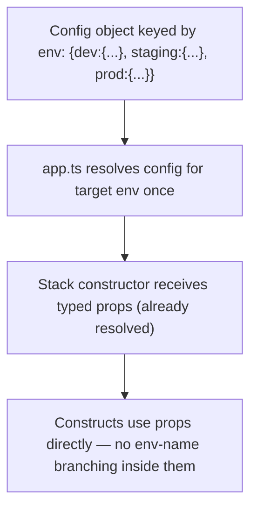

**Why the others are wrong:**
- A: CDK explicitly supports structured configuration patterns (context, typed config objects, environment-keyed props) specifically to avoid scattered conditional logic — the premise that no better mechanism exists is false.
- C: Fully separate, independently-maintained CDK apps per environment with zero shared code throws away the benefit of a single, consistent, DRY infrastructure codebase — centralized configuration within one app is the standard, less duplicative alternative.
- D: CDK has no automatic inference of arbitrary application-specific configuration values (like desired instance sizes or feature flags) from an AWS account ID alone — this always requires explicit configuration from the team.

---

## Q62 — Domain 4: Troubleshooting and Optimization

A team's EFS file system, mounted by several EC2 instances, shows intermittent slow read/write
performance that correlates with periods of sustained high throughput usage, with performance
returning to normal after usage drops. CloudWatch's `BurstCreditBalance` metric for the file system
shows a steady decline during the slow periods, reaching zero right as performance degrades. What is
the cause, and the fix?

A. This is caused by an EC2 instance-level CPU credit exhaustion (T-family burstable instance credits), entirely unrelated to EFS or its own metrics.

B. The file system is using **EFS Bursting Throughput mode**, which accrues burst credits during
   low-usage periods and spends them during high-throughput periods — sustained high throughput
   exhausts the burst credit balance, after which throughput is capped at the baseline rate tied to
   the file system's size, causing exactly this performance degradation; the fix is switching to
   **Provisioned Throughput mode** (paying for a guaranteed throughput level independent of file
   system size or burst credits) or **Elastic Throughput mode** (which scales automatically with
   demand, also independent of burst credits).

C. `BurstCreditBalance` is a purely cosmetic, informational-only metric with no actual relationship to real throughput capacity or performance.

D. The fix is to enable S3 Transfer Acceleration on the EFS file system, which is the standard mechanism for resolving EFS burst credit exhaustion.

**Correct Answer: B**

**Explanation:** **EFS Bursting Throughput mode** ties baseline throughput to file system size and
allows bursting above that baseline using accumulated credits — sustained high-throughput usage
depletes the credit balance, and once exhausted, throughput is capped at the (often much lower)
baseline rate, exactly matching the described symptom. The fix is moving to **Provisioned Throughput**
(a fixed, guaranteed rate you pay for directly) or **Elastic Throughput** (automatically scaling to
demand without a credit-based ceiling), neither of which depend on burst credits. This is Task 4.2/4.3
content. See [`services/storage/efs.md`](../../../services/storage/efs.md).

**Why the others are wrong:**
- A: EC2 CPU credits are a wholly separate mechanism from EFS burst credits; the scenario's described metric (`BurstCreditBalance` for the *file system*) and its correlation with throughput degradation is specifically an EFS-level phenomenon, not an EC2 instance-level one.
- C: `BurstCreditBalance` directly reflects real, consumable throughput-bursting capacity — it is not cosmetic, and its depletion correlating exactly with performance degradation demonstrates its real operational significance.
- D: S3 Transfer Acceleration is an entirely separate S3-specific feature for speeding up long-distance object transfers; it has no relationship to or applicability for EFS throughput mode or burst credits whatsoever.

---

## Q63 — Domain 1: Development with AWS Services

A video file is uploaded to S3, triggering a Lambda function via S3 event notification. The function
needs to download the (potentially several-hundred-MB) file to local disk for processing. The team
notices that for a sequence of related video files processed by repeated invocations of the *same*
warm execution environment, some reference data (a small lookup table downloaded once from S3) could
be reused across invocations instead of being re-downloaded every single time, but the large video
file itself obviously must be freshly downloaded each time since it's different content per
invocation. Where should the lookup table be cached to benefit from warm-start reuse, and where should
the large per-invocation video file go?

A. Both should be stored in Lambda environment variables, since environment variables are the only storage location that persists across invocations within the same execution environment.

B. The small, reusable **lookup table** should be downloaded once and cached in a module-scope
   variable or on `/tmp` during a cold start's initialization code (outside the handler), so warm
   invocations of the same environment can reuse it without re-downloading; the large, per-invocation
   **video file** should be downloaded fresh into `/tmp` *inside* the handler on every invocation
   (since its content genuinely differs each time), sized according to `/tmp`'s configured ephemeral
   storage capacity.

C. Both the lookup table and every video file should be downloaded fresh inside the handler on every single invocation, since nothing persists between invocations under any circumstances, warm or cold.

D. The video file should be cached outside the handler at module scope for reuse across invocations, while the lookup table must be re-downloaded inside the handler every time.

**Correct Answer: B**

**Explanation:** `/tmp` (ephemeral storage) and module-scope variables both persist across **warm**
invocations of the *same* execution environment (though not guaranteed across cold starts to a new
environment) — this makes them appropriate for caching genuinely reusable data like a small lookup
table fetched once, while content that's different on every invocation (the video file itself) still
needs fresh download logic inside the handler each time, since no caching strategy can "reuse" content
that's actually new each call. This is Task 1.2/4.3 content. See [`services/compute/lambda.md`](../../../services/compute/lambda.md).

**Why the others are wrong:**
- A: Lambda environment variables are read-only, fixed configuration values (set via `UpdateFunctionConfiguration`, not writable at runtime) — they cannot be used as a runtime cache for downloaded data at all, unlike `/tmp` or module-scope variables.
- C: Module-scope initialization code and `/tmp` *do* persist across warm invocations of the same environment — the premise that nothing ever persists, warm or cold, contradicts Lambda's actual, well-documented execution model and would make the lookup-table-caching optimization impossible even though it's a standard, valid pattern.
- D: This reverses the correct caching assignment — the video file's content differs every invocation and must always be freshly fetched, while the lookup table is the genuinely reusable asset that benefits from warm-start caching.

---

## Q64 — Domain 2: Security

A company's WAF web ACL in front of a login page has been effective against simple scripted
credential-stuffing attempts using a small, static list of rotating IPs, but a more sophisticated
attacker is now using a large residential proxy network (many distinct, legitimate-looking IPs,
each making only a handful of login attempts) combined with realistic browser fingerprints, making
simple rate-based rules per source IP ineffective. Which WAF feature is specifically designed to
address this more sophisticated class of credential-stuffing/bot traffic?

A. A geographic match rule blocking all countries except the company's home market, which is fully effective against any residential-proxy-based attack regardless of proxy IP geolocation.

B. **AWS WAF Bot Control** (and/or **AWS WAF CAPTCHA/Challenge actions**), which goes beyond simple
   per-IP rate limiting by using bot-classification signals (behavioral patterns, known bot
   signatures, fingerprinting heuristics) to identify and challenge/block likely automated traffic even
   when it's spread across many low-volume-per-IP sources that a simple rate-based rule wouldn't catch.

C. Switching the login page from HTTPS to HTTP, which eliminates the attacker's ability to use proxies.

D. AWS WAF has no capability beyond simple per-source-IP rate-based rules; defeating this kind of distributed, low-volume-per-IP attack requires an entirely custom-built, non-AWS bot-detection system.

**Correct Answer: B**

**Explanation:** **WAF Bot Control** specifically targets this harder class of problem: distributed,
low-volume-per-source bot traffic that evades simple IP-based rate limiting, using broader
bot-classification signals; pairing it with **CAPTCHA/Challenge** actions adds an interactive
verification step for suspicious traffic rather than relying solely on volumetric IP-based rules. This
is Task 2.2 content. See [`services/security-identity-compliance/waf.md`](../../../services/security-identity-compliance/waf.md).

**Why the others are wrong:**
- A: Residential proxy networks can route through IPs geographically located anywhere, including the company's own home market — geographic blocking provides no reliable defense against this and would also likely block many legitimate users.
- C: Downgrading to unencrypted HTTP has no bearing on an attacker's ability to use proxy IPs, and it removes transport-layer security for every legitimate user's credentials — this is actively harmful, not a mitigation.
- D: Bot Control and CAPTCHA/Challenge actions are exactly AWS WAF's native, purpose-built answer to this more sophisticated bot-traffic problem — the premise that only a fully custom external system can address it is incorrect.

---

## Q65 — Domain 1: Development with AWS Services

A team's Lambda function is invoked by multiple different event sources across different functions in
the account — some triggered by S3, some by SNS, some directly by another account's EventBridge bus
(as described in a cross-account architecture) — and the team wants a single, consistent way for each
function's code to log which specific event source/account triggered it, for audit and debugging
purposes, without each function needing bespoke parsing logic per trigger type. What general Lambda
development practice addresses this cleanly?

A. Lambda automatically injects a single, universally-structured `triggerSource` field into every possible event payload shape, regardless of originating service, requiring no code-level handling at all.

B. Implement a small, shared **event-source detection/normalization helper** (e.g. a shared Lambda
   layer or common module) that inspects the incoming event's shape/fields (which differ meaningfully
   between S3, SNS, EventBridge, and other sources) and extracts a consistent, normalized
   "source/account/identifier" structure for logging — centralizing this per-source-type parsing logic
   once, in a shared, testable, reusable component, rather than duplicating bespoke parsing in every
   function that happens to use a particular trigger type.

C. Every Lambda function must be entirely rewritten to use API Gateway as its sole trigger type, since API Gateway is the only event source with a single, universally-standard event shape.

D. CloudTrail automatically and transparently rewrites every Lambda function's own application log output to include a standardized trigger-source field, with no application code changes needed.

**Correct Answer: B**

**Explanation:** Different Lambda event sources (S3, SNS, EventBridge, API Gateway, etc.) deliver
meaningfully different event JSON shapes — there's no single universal field Lambda injects
automatically across all of them. The clean development practice is building a small, shared,
reusable helper (packaged as a layer or common module, as Task 1.2's "shared code across functions"
content recommends) that inspects and normalizes whichever event shape it receives into a consistent
structure for logging/debugging, avoiding duplicated, bespoke per-function parsing logic. This is Task
1.1/1.2 content. See [`services/compute/lambda.md`](../../../services/compute/lambda.md).

**Why the others are wrong:**
- A: Lambda does not inject any universal, source-agnostic metadata field into every event payload automatically — each event source's payload shape is genuinely different, and the application must handle that variability itself.
- C: Forcing every function (regardless of its natural trigger, like an S3 upload or an EventBridge rule match) to be re-architected behind API Gateway is a drastic, unnecessary, and often architecturally inappropriate change just to get a single event shape — the correct fix is normalization logic, not forcing a single trigger type everywhere.
- D: CloudTrail records AWS API call activity; it has no capability to rewrite or inject content into a Lambda function's own application-level log output.

---

*End of Bank 3 — 65 questions. Study-mode complete. Return to [`README.md`](README.md).*
