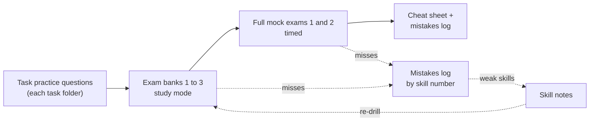

# Exam prep

Material for the final weeks before the AWS Certified Developer - Associate (DVA-C03) exam on Wednesday, December 30, 2026. The skill notes in the four domain folders teach the content. This folder tests it under exam conditions and condenses it for last-minute review.

## Files

| File | What it is | When to use it |
|---|---|---|
| [`exam-strategy.md`](exam-strategy.md) | Exam format, time management, question-reading tactics, the mistakes-log method, and a day-by-day final-week plan | Read once at the start of the final weeks; reread the time-management section before each mock exam |
| [`cheat-sheet.md`](cheat-sheet.md) | One "clue to answer" reference organized by domain and task, with current limits and a link from every row to its skill note | Night before and exam morning, read top to bottom in about 30 minutes; also after each practice set to check a surprising answer |
| [`exam-banks/`](exam-banks/README.md) | Three 65-question banks in study mode: answer and explanation under each question | Three to two weeks out, after you finish all four domains; one bank every few days |
| [`full-exams/`](full-exams/index.md) | Two 65-question timed mock exams with separate answer keys | Final week, under a 130-minute timer, a few days apart |

## How the pieces fit

1. **While studying each task,** answer that task's `practice-questions.md`, for example [Task 1.2 practice questions](../domain-1-development-with-aws-services/task-1.2-develop-lambda-functions/practice-questions.md).
2. **After all four domains,** drill the [exam banks](exam-banks/README.md). Every explanation links to the skill note it tests.
3. **In the final week,** take the [full mock exams](full-exams/index.md) under real timing.
4. **Throughout,** log every miss and guess by skill number, using the [mistakes-log method](exam-strategy.md#mistakes-log), and reread the skill notes that keep showing up.
5. **On exam morning,** read the [cheat sheet](cheat-sheet.md) once.

## Notes on accuracy and scope

- Explanations and limits follow current AWS documentation where older material disagreed. Examples: SQS messages up to 1 MiB, API Gateway REST integration timeouts that Regional and private APIs can raise past 29 seconds, and Step Functions execution semantics (Standard exactly-once; Express asynchronous at-least-once, synchronous at-most-once). The cheat sheet's Sources section lists the AWS pages used.
- Questions about services that are not on the DVA-C03 service list (AWS AppSync, AWS Cloud9, AWS Shield, Amazon CodeWhisperer, now part of Amazon Q Developer, and security, compliance, and cost services such as AWS Config, Amazon Macie, Amazon GuardDuty, AWS Security Hub, AWS Trusted Advisor, AWS Compute Optimizer, and AWS Batch) are kept for background and labeled "Not on the DVA-C03 service list."
- Quotas change. Before relying on a number, check the current AWS documentation.

## Sources

- Organized from the practice material and exam-prep chapters in `archive/` (plain text, not links): `archive/dva-c03/practice-questions/full-exams/`, `archive/dva-c03/exam-bank/`, `archive/dva-c03-study-notes/05-cheat-sheet.md`, and `archive/aws-dva-notes/Markdown Files/29. Exam Review & Tips.md` and `31. Exam Day Cheat Sheet.md`.
